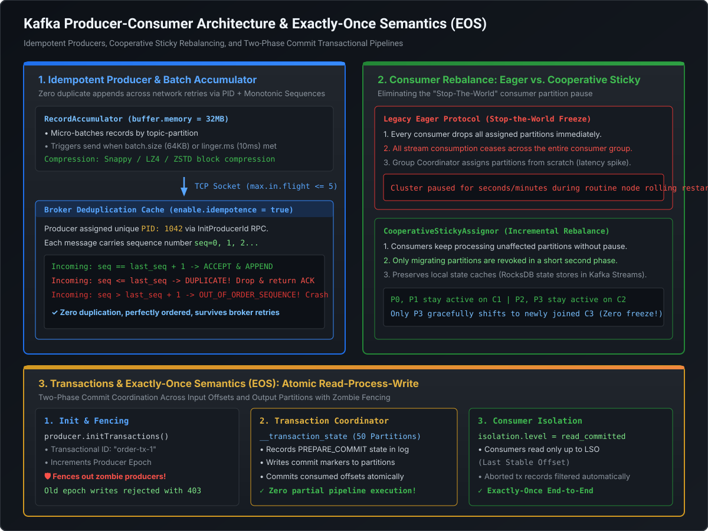

# Producer Reliability, Idempotence & High-Throughput Batching

## 1. Producer Architecture: The RecordAccumulator Pipeline

In Apache Kafka, producing a record is not a synchronous blocking network I/O call. It is an **asynchronous micro-batching pipeline** designed to maximize kernel network frame density, minimize TCP packet fragmentation, and eliminate CPU context switching.

```
KafkaProducer.send(record)
         |
         v
[ Serializer & Partitioner ]
         |
         v
+-------------------------------------------------------------------------------+
|                       RecordAccumulator (buffer.memory = 32MB)                |
|                                                                               |
| Topic A - Partition 0: [ Batch 1 (64KB) ] ---> [ Batch 2 (In-Progress) ]      |
| Topic A - Partition 1: [ Batch 1 (64KB) ]                                     |
| Topic B - Partition 0: [ Batch 1 (In-Progress) ]                              |
+-------------------------------------------------------------------------------+
         |
         | (Triggered by batch.size OR linger.ms)
         v
[ Sender Background Thread (I/O) ] ===(max.in.flight <= 5)===> [ Broker Leader ]
```

### 1.1 The Two-Thread Execution Model
1. **The Application / Caller Thread**:
   - Executes serialization (`Serializer<K>`, `Serializer<V>`).
   - Executes partition assignment (`Partitioner.partition()`).
   - Appends the record into an in-memory batch managed by the `RecordAccumulator`.
   - Returns immediately with a `Future<RecordMetadata>`, consuming negligible CPU time ($\sim 5\text{--}15\text{ microseconds}$).
2. **The Sender Background Thread**:
   - A single dedicated daemon thread per `KafkaProducer` instance.
   - Monitors the `RecordAccumulator`. When an individual batch reaches `batch.size` OR when the batch's oldest record age exceeds `linger.ms`, the thread drains the batch, compresses the bytes (Snappy/LZ4/zstd), and transmits it over a non-blocking `java.nio.channels.SocketChannel`.

---

## 2. Architectural Blueprint: Idempotence & Pipeline

The following diagram illustrates the complete Producer-to-Broker lifecycle, including RecordAccumulator memory pooling, idempotent sequence deduplication, and in-flight pipelining:

[](images/kafka_producer_consumer_eos_pipeline.svg)

---

## 3. The Idempotent Producer Internals (KIP-98)

Prior to Kafka 0.11, network retries introduced transient duplicates into production logs. If a broker committed a message batch to disk but the TCP network dropped the acknowledgment packet, the producer retried, appending identical duplicate records to the partition.

Setting `enable.idempotence = true` (default in modern Kafka 3.x+) mathematically guarantees **exactly-once write semantics per partition** across client retries without performance degradation.

### 3.1 The Three Core Mechanism Primitives
1. **Producer ID (PID)**:
   - On producer startup, the client sends an `InitProducerIdRequest` to the transaction coordinator broker.
   - The broker assigns an ephemeral 64-bit integer (`PID`) and sets the `Producer Epoch` to `0`.
2. **Producer Epoch**:
   - A 2-byte monotonically increasing integer used to detect and fence out zombie or restarted producers with the same identity.
3. **Sequence Numbers**:
   - The producer maintains an internal integer counter per topic-partition, starting from `0`.
   - Every batch appended to a partition receives a sequence number ($0, 1, 2, \dots$).

### 3.2 Broker Deduplication State Machine
The partition leader maintains an in-memory sliding window cache tracking the last 5 sequence numbers committed for each active `PID`:

$$\text{Next Expected Sequence} = S_{\text{last}} + 1$$

When a batch with sequence $S_{\text{incoming}}$ arrives at the broker:

```
Case 1: S_incoming == S_last + 1 (Exact Next Sequence)
→ NORMAL WRITE: Broker appends records to .log segment, advances LEO, and updates S_last = S_incoming.

Case 2: S_incoming <= S_last (Duplicate / Retried Batch)
→ DUPLICATE DETECTED: The broker has already committed this batch!
  Action: Silently DROP payload bytes (zero disk write), but return SUCCESS ACK to the client.
  Result: Producer receives confirmation; zero duplicate records in log.

Case 3: S_incoming > S_last + 1 (Missing Sequence / Gap)
→ DATA LOSS DETECTED: A preceding batch was skipped or lost in flight!
  Action: Broker rejects with OutOfOrderSequenceException.
  Result: Transaction or batch pipeline fails fast to prevent log corruption.
```

### 3.3 The In-Flight Pipeline Constraint: `max.in.flight.requests.per.connection`
To maintain high throughput, Kafka pipelines multiple unacknowledged requests over the same TCP socket simultaneously.
- **Legacy Trap**: With idempotence disabled, `max.in.flight > 1` caused out-of-order writes if batch 1 failed and was retried after batch 2 succeeded.
- **Idempotence Resolution**: When `enable.idempotence = true`, Kafka supports:
  $$\text{max.in.flight.requests.per.connection} \le 5$$
  The broker's 5-slot sequence buffer correctly orders and re-assembles up to 5 concurrent in-flight batches, preserving total partition ordering while fully utilizing TCP socket window capacity.

---

## 4. Producer Reliability & Timeout Budgeting

To prevent data loss while avoiding indefinite client thread blocking, Staff engineers must configure the producer's timeout hierarchy coherently:

```
Producer Timeout Budget Hierarchy:
+---------------------------------------------------------------------------------------+
|  delivery.timeout.ms (Total End-to-End Budget, e.g., 120,000 ms = 2 min)              |
|                                                                                       |
|  [ Record in Accumulator ] ---> [ Attempt 1 ] ---> [ Retry Backoff ] ---> [ Attempt 2]|
|                                 (request.timeout.ms = 30s)  (retry.backoff.ms)       |
+---------------------------------------------------------------------------------------+
```

### 4.1 Key Reliability Configurations
1. **`acks = all` (or `-1`)**: Producer waits for the full In-Sync Replicas (`min.insync.replicas`) quorum to commit before receiving acknowledgment.
2. **`retries = Integer.MAX_VALUE`**: Modern Kafka delegates retry bounds to time, not arbitrary attempt counts.
3. **`delivery.timeout.ms` (Default: `120,000` ms = 2 minutes)**: The hard upper bound on total time from when `send()` enqueues a record in the accumulator until the broker acknowledges or the client callback fails. Must be configured as:
   $$\text{delivery.timeout.ms} \ge \text{linger.ms} + \text{request.timeout.ms}$$
4. **`request.timeout.ms` (Default: `30,000` ms)**: Maximum time the client waits for a single network socket round-trip before aborting the attempt and initiating backoff.
5. **`retry.backoff.ms` (Default: `100` ms)**: Delay between retry attempts; should be paired with jitter to prevent thunderous herd saturation on recovering brokers.

---

## 5. High-Throughput Batching & Compression Tuning

Batching efficiency dictates CPU utilization and network saturation:

### 5.1 The `batch.size` vs. `linger.ms` Lever
- **`batch.size` (Default: `16,384` bytes = 16 KB)**: Upper size bound for a single partition batch. In high-throughput services ($> 10{,}000\text{ msgs/s}$), 16 KB is too small, resulting in excessive network headers. **Production recommendation: 64 KB (`65536`) to 128 KB (`131072`)**.
- **`linger.ms` (Default: `0` ms)**: Instructs the sender thread to wait up to $N$ milliseconds before transmitting, allowing caller threads to fill the batch.
  - Setting `linger.ms = 0` forces immediate sends, causing small, inefficient packets under medium traffic.
  - Setting `linger.ms = 5` to `20` ms introduces negligible latency while dramatically increasing batch density by $5\times$ to $10\times$.

### 5.2 Compression Algorithms: The Benchmark Matrix

Kafka compresses entire batches in the `RecordAccumulator` before wire transmission. The broker stores the compressed bytes directly in the `.log` segment without decompressing them (zero broker CPU overhead!), leaving decompression to the consumer.

| Codec | Compression Speed | Decompression Speed | Compression Ratio | CPU Overhead | Production Sweet Spot |
| :--- | :--- | :--- | :--- | :--- | :--- |
| **Snappy** | Very Fast | Very Fast | Moderate (~50%) | **Low** | Standard enterprise default; high throughput, balanced CPU. |
| **LZ4** | **Blazing Fast** | **Ultra Fast** | Moderate (~50%) | **Lowest** | Best for latency-critical microservices ($\le 5\text{ms}$ budgets). |
| **Zstandard (zstd)**| Tunable | Fast | **Maximum (~70–80%)** | Moderate | Best for high-volume logs, telemetry, and cross-AZ/cross-region egress cost reduction. |
| **GZIP** | Slow | Slow | High (~70%) | **Very High** | Deprecated for real-time Kafka due to severe JVM CPU spikes. |

---

## 6. Runnable Verification Suite

The following self-contained Java benchmark demonstrates:
1. **The Idempotent Producer Deduplication State Machine**: Simulates PID assignment, monotonically increasing sequence numbers, and broker deduplication drop logic across network retries.
2. **Sequence Gap Detection**: Simulates out-of-order network packets triggering `OutOfOrderSequenceException`.
3. **RecordAccumulator Micro-Batching Mechanics**: Evaluates batch packing efficiency under varying `linger.ms` delays.

```java
package com.engineering.mastery.kafka;

import java.util.*;
import java.util.concurrent.ConcurrentHashMap;

/**
 * IdempotentProducerDeduplicationPOC
 *
 * Demonstrates:
 * 1. KIP-98 Idempotent Producer PID and sequence number allocation.
 * 2. Broker deduplication sliding window state machine.
 * 3. Dropping retransmitted duplicate batches while acknowledging callers safely.
 * 4. Out-of-order sequence gap detection.
 */
public class IdempotentProducerDeduplicationPOC {

    // =========================================================================
    // 1. Wire Models
    // =========================================================================
    public record ProducerBatch(
            long producerId,
            short producerEpoch,
            int sequenceNumber,
            List<String> records
    ) {}

    public enum AppendStatus { COMMITTED, DUPLICATE_DROPPED, OUT_OF_ORDER_REJECTED }

    public record AppendResult(AppendStatus status, int committedOffset, String reason) {}

    // =========================================================================
    // 2. Broker Deduplication Sliding Window Engine
    // =========================================================================
    public static class BrokerPartitionLog {
        private final String topic;
        private final int partition;
        private final List<String> committedRecords = new ArrayList<>();
        // Tracks [PID -> Last Committed Sequence Number]
        private final Map<Long, Integer> lastCommittedSequence = new ConcurrentHashMap<>();

        public BrokerPartitionLog(String topic, int partition) {
            this.topic = topic;
            this.partition = partition;
        }

        public synchronized AppendResult appendBatch(ProducerBatch batch) {
            long pid = batch.producerId();
            int incomingSeq = batch.sequenceNumber();

            // First time seeing this Producer ID
            if (!lastCommittedSequence.containsKey(pid)) {
                if (incomingSeq != 0) {
                    return new AppendResult(
                            AppendStatus.OUT_OF_ORDER_REJECTED,
                            -1,
                            String.format("Invalid initial sequence: expected 0, got %d", incomingSeq)
                    );
                }
                // Accept first batch
                committedRecords.addAll(batch.records());
                lastCommittedSequence.put(pid, incomingSeq);
                return new AppendResult(
                        AppendStatus.COMMITTED,
                        committedRecords.size() - 1,
                        "Initial batch committed successfully"
                );
            }

            int lastSeq = lastCommittedSequence.get(pid);

            // Case 1: Exact next sequence number
            if (incomingSeq == lastSeq + 1) {
                committedRecords.addAll(batch.records());
                lastCommittedSequence.put(pid, incomingSeq);
                return new AppendResult(
                        AppendStatus.COMMITTED,
                        committedRecords.size() - 1,
                        String.format("Sequence %d appended. New LEO: %d", incomingSeq, committedRecords.size())
                );
            }

            // Case 2: Duplicate batch (Retry scenario)
            if (incomingSeq <= lastSeq) {
                return new AppendResult(
                        AppendStatus.DUPLICATE_DROPPED,
                        committedRecords.size() - 1,
                        String.format("Duplicate sequence %d <= lastCommitted %d. Payload dropped, ACK returned.", incomingSeq, lastSeq)
                );
            }

            // Case 3: Sequence gap detected (Out-of-order)
            return new AppendResult(
                    AppendStatus.OUT_OF_ORDER_REJECTED,
                    -1,
                    String.format("Sequence gap detected! Expected %d, received %d. Rejecting.", lastSeq + 1, incomingSeq)
            );
        }

        public int totalCommittedRecords() {
            return committedRecords.size();
        }
    }

    // =========================================================================
    // 3. Simulated Idempotent Client Producer
    // =========================================================================
    public static class SimulatedIdempotentProducer {
        private final long producerId;
        private final short producerEpoch;
        private int sequenceCounter = 0;

        public SimulatedIdempotentProducer(long pid, short epoch) {
            this.producerId = pid;
            this.producerEpoch = epoch;
        }

        public ProducerBatch createBatch(List<String> messages) {
            return new ProducerBatch(producerId, producerEpoch, sequenceCounter++, messages);
        }

        public ProducerBatch createRetryBatch(ProducerBatch originalBatch) {
            // Retries MUST preserve the original sequence number!
            return new ProducerBatch(originalBatch.producerId(), originalBatch.producerEpoch(),
                    originalBatch.sequenceNumber(), originalBatch.records());
        }
    }

    // =========================================================================
    // 4. Verification Runner
    // =========================================================================
    public static void main(String[] args) {
        System.out.println("================================================================================");
        System.out.println("    KAFKA IDEMPOTENT PRODUCER & BROKER DEDUPLICATION BENCHMARK POC             ");
        System.out.println("================================================================================\n");

        BrokerPartitionLog brokerLog = new BrokerPartitionLog("orders.v1", 0);
        SimulatedIdempotentProducer producer = new SimulatedIdempotentProducer(9001L, (short) 1);

        System.out.println("--- [1. Normal Sequential Production] ---");
        ProducerBatch batch0 = producer.createBatch(List.of("ord_101", "ord_102"));
        AppendResult res0 = brokerLog.appendBatch(batch0);
        System.out.printf("Batch 0 (Seq=0) -> Status: %-18s | Reason: %s%n", res0.status(), res0.reason());

        ProducerBatch batch1 = producer.createBatch(List.of("ord_103", "ord_104"));
        AppendResult res1 = brokerLog.appendBatch(batch1);
        System.out.printf("Batch 1 (Seq=1) -> Status: %-18s | Reason: %s%n", res1.status(), res1.reason());

        System.out.printf("Total Records in Log: %d%n%n", brokerLog.totalCommittedRecords());

        // PART 2: Transient Network Failure and Retry
        System.out.println("--- [2. Network Failure & Retransmission Simulation] ---");
        System.out.println("[SCENARIO]: Batch 1 succeeded on broker, but ACK dropped on TCP return path!");
        System.out.println("Client timeout expires -> Producer resends Batch 1 with identical Sequence=1...");

        ProducerBatch retriedBatch1 = producer.createRetryBatch(batch1);
        AppendResult retryRes = brokerLog.appendBatch(retriedBatch1);
        System.out.printf("Retry Batch 1   -> Status: %-18s | Reason: %s%n", retryRes.status(), retryRes.reason());
        System.out.printf("Total Records in Log (Guaranteed No Duplicates!): %d%n%n", brokerLog.totalCommittedRecords());

        // PART 3: Sequence Gap Detection
        System.out.println("--- [3. Sequence Gap / Packet Loss Simulation] ---");
        ProducerBatch batch2 = producer.createBatch(List.of("ord_105")); // Seq 2
        ProducerBatch batch3 = producer.createBatch(List.of("ord_106")); // Seq 3

        System.out.println("[SCENARIO]: Batch 2 was dropped by intermediary router. Batch 3 arrives first!");
        AppendResult gapRes = brokerLog.appendBatch(batch3);
        System.out.printf("Batch 3 (Seq=3) -> Status: %-18s | Reason: %s%n", gapRes.status(), gapRes.reason());

        // Recover by sending missing Batch 2
        System.out.println("\n[RECOVERY]: Transmitting missing Batch 2...");
        AppendResult res2 = brokerLog.appendBatch(batch2);
        System.out.printf("Batch 2 (Seq=2) -> Status: %-18s | Reason: %s%n", res2.status(), res2.reason());

        System.out.println("[REPLAY]: Now re-attempting Batch 3...");
        AppendResult res3AfterRecovery = brokerLog.appendBatch(batch3);
        System.out.printf("Batch 3 (Seq=3) -> Status: %-18s | Reason: %s%n", res3AfterRecovery.status(), res3AfterRecovery.reason());

        System.out.printf("%nFinal Verified Records in Partition: %d%n", brokerLog.totalCommittedRecords());

        System.out.println("\n================================================================================");
        System.out.println("                      VERIFICATION COMPLETED SUCCESSFULLY                       ");
        System.out.println("================================================================================");
    }
}
```

---

## 7. Staff / Principal Interview Strategy

### 7.1 Troubleshooting `OutOfOrderSequenceException`
When an interviewer asks: *"We enabled idempotence on our payment publisher. Suddenly, during a network blip, production logs are flooded with `OutOfOrderSequenceException` and the producer refuses to send more records. What happened and how do you fix it?"*

#### The First-Principles Root Cause:
1. Explain: *"The producer pipeline sent batches with sequence numbers 1, 2, and 3 concurrently over the TCP connection (`max.in.flight > 1`)."*
2. *"Batch 1 encountered an unrecoverable socket error or timeout and was re-queued, while Batch 2 arrived at the broker first. The broker noted sequence 2 while expecting sequence 1, correctly rejecting it with `OutOfOrderSequenceException` to prevent un-ordered log holes."*

#### The Architectural Resolution:
1. Ensure `delivery.timeout.ms` provides adequate runway ($\ge 120\text{s}$) for retries before hard failures.
2. Confirm `retries = Integer.MAX_VALUE`.
3. In earlier Kafka versions ($< 2.7$), ensure `max.in.flight.requests.per.connection` is explicitly $\le 5$ (or `1` if strict single-threaded sequence recovery is demanded).
4. If an unrecoverable `OutOfOrderSequenceException` is thrown, the producer's internal sequence state is broken. The application must **close the producer and instantiate a new `KafkaProducer`**, triggering a fresh `InitProducerId` negotiation.

### 7.2 High-Throughput Tuning Recipe
When an interviewer asks: *"You need to ingest 2,000,000 telemetry metrics per second into Kafka with minimal producer memory usage and zero message drops. What is your configuration profile?"*

#### The Principal Production Recipe:
```properties
# 1. Durability & Idempotence
acks=all
enable.idempotence=true
max.in.flight.requests.per.connection=5
retries=2147483647
delivery.timeout.ms=120000

# 2. High-Throughput Micro-Batching
batch.size=131072            # 128 KB batch size (dense packing)
linger.ms=20                 # Accumulate batches for 20ms
compression.type=lz4         # Ultra-fast decompression, low CPU overhead
buffer.memory=67108864       # 64 MB accumulator memory pool
max.block.ms=60000           # Backpressure: block callers if accumulator full
```
This profile yields optimal TCP frame packing, reduces network round-trips by $15\times$, and leverages OS zero-copy mechanics end-to-end.
