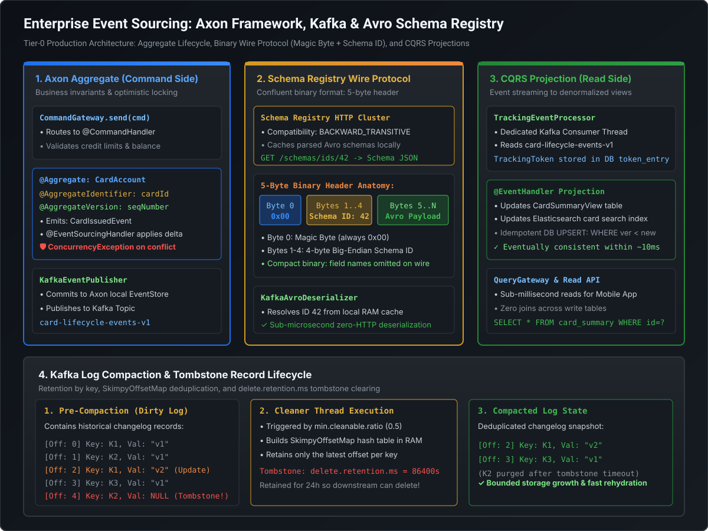

# Log Compaction & Enterprise Event Sourcing with Axon Framework and Apache Avro

## 1. Architectural Foundations: Event Sourcing & Log Compaction

In Tier-0 mission-critical financial systems (such as high-volume payment processing and global card issuing), traditional CRUD architectures are rejected in favor of **Event Sourcing (ES)** and **Command Query Responsibility Segregation (CQRS)**.

Instead of mutating table rows in place with SQL `UPDATE` statements—which destroys historical context and creates database write contention—every state change is recorded as an **immutable domain event** appended to an authoritative distributed log.

```
TRADITIONAL CRUD DATABASE (Destructive Mutation)
UPDATE accounts SET balance = 500 WHERE id = 101;
* Problem: Historical ledger destroyed! Who updated it? When? From what previous balance?

EVENT SOURCING (Immutable Ledger of Facts)
[ Event 0: AccountOpened(balance=0) ]
[ Event 1: FundsDeposited(amount=1000) ]
[ Event 2: FeeDeducted(amount=50) ]
[ Event 3: PaymentCleared(amount=450) ]
* Balance is mathematically derived by folding events: 0 + 1000 - 50 - 450 = 500!
```

---

## 2. Architectural Blueprint: Axon Framework + Kafka + Avro Pipeline

The following diagram illustrates the complete enterprise architecture, connecting domain-driven command handling, the Axon Aggregate Root, Kafka's partitioned commit log with Confluent Avro serialization, and CQRS read projections:

[](images/axon_event_sourcing_kafka_avro.svg)

---

## 3. Kafka Log Compaction & The Tombstone Lifecycle

For topics storing changelogs, entity state snapshots, or compacted event projections, Kafka provides **Log Compaction** (`cleanup.policy = compact`).

### 3.1 Mechanics of Log Compaction
Unlike time-based retention (`cleanup.policy = delete`) which discards records older than $N$ days, log compaction retains at least the **last known value for each message key** across the entire partition log.

```
Partition 0 (Pre-Compaction):
[Off:0 K1, V1] [Off:1 K2, V1] [Off:2 K1, V2] [Off:3 K3, V1] [Off:4 K2, NULL]
----------------------------->                              ---------------->
Clean Log Section (Compacted)                               Dirty Log Section (Uncompacted)

Partition 0 (Post-Compaction):
[Off:2 K1, V2] [Off:3 K3, V1]  (K2 completely purged after tombstone expiration!)
```

1. **Clean vs. Dirty Log Sections**:
   - **Clean Section**: Previously compacted log segments containing only deduplicated keys.
   - **Dirty Section**: Newly appended segments containing updates and duplicate keys.
2. **The Cleaner Thread (`log.cleaner.threads`)**:
   - Triggered when dirty bytes exceed `log.cleaner.min.cleanable.ratio` (Default: `0.5` = 50% dirty).
   - Builds an in-memory 24-byte hash map (`SkimpyOffsetMap`) of `[Key Hash -> Latest Offset]` scanning the dirty log.
   - Copies records from older segments to new clean segments, keeping only the record matching the latest offset for each key.

### 3.2 Tombstone Records & The Deletion Window
How do you delete a key permanently in an append-only compacted log?
- **The Tombstone**: The producer sends a record with a valid key and a **`null` payload** (`value = null`).
- **The Tombstone Retention Hazard**: Why doesn't Kafka delete the tombstone immediately during the next compaction pass?
  > [!CAUTION]
  > If the tombstone were purged immediately, a downstream consumer or replica that was offline or lagging would miss the tombstone and **continue retaining the deleted record in its local database**!
- **`delete.retention.ms` (Default: `86,400,000` ms = 24 hours)**: Kafka guarantees that tombstones are preserved for at least 24 hours across compaction passes, ensuring lagging consumers have adequate runway to read the tombstone and execute downstream SQL `DELETE` operations before the key vanishes forever.

---

## 4. Enterprise Event Sourcing: Axon Framework on Kafka

While Kafka provides the high-throughput, partitioned commit log, **it is not an application-level event-sourcing engine**. It has no native awareness of DDD Aggregate boundaries, domain command dispatching, or entity-level optimistic locking.

Enterprise financial architectures bridge this gap by deploying **Axon Framework** on top of Kafka.

### 4.1 The Role of Axon Framework
1. **Command Gateway**: Dispatches intent (e.g., `IssueCardCommand`, `AuthorizePaymentCommand`).
2. **Aggregate Root (`@Aggregate`)**: Encapsulates business invariants (e.g., card limits, fraud rules).
   - `@AggregateIdentifier`: The unique entity ID (e.g., `cardId`).
   - `@AggregateVersion`: An internal integer counter incremented per event ($0, 1, 2, \dots$). If two concurrent threads attempt to append to the same card version, Axon throws `ConcurrencyException`, protecting the aggregate invariant.
3. **`@CommandHandler`**: Validates business logic and executes `AggregateLifecycle.apply(new CardAuthorizedEvent(...))`.
4. **`@EventSourcingHandler`**: Mutates the in-memory state of the Aggregate Root in response to applied events.

### 4.2 The Axon-to-Kafka Mapping Protocol
The Axon Kafka extension (`axon-kafka`) maps domain events to Kafka records:

```
Axon DomainEventMessage<T> 
         |
         v
+-------------------------------------------------------------------------------+
|                       KAFKA PRODUCER RECORD FORMAT                            |
|                                                                               |
| Topic:        card-events-v1                                                  |
| Key:          "card_98124" (Aggregate ID -> Guarantees Partition Pinning!)   |
| Headers:      axon-message-id:            "urn:uuid:8b34f..."                 |
|               axon-message-type:          "com.enterprise.events.CardCreated" |
|               axon-message-aggregate-id:  "card_98124"                       |
|               axon-message-aggregate-seq: 42 (Aggregate Version)              |
|               axon-message-timestamp:     1735689600000                       |
| Payload:      [0x00][Schema ID: 4B][Avro Binary Serialized Data]              |
+-------------------------------------------------------------------------------+
```

1. **Aggregate ID as Partition Key**: By pinning the Aggregate ID to the Kafka record key, all historical and future events for that specific card account are hashed (via MurmurHash2) to the **exact same Kafka partition**. This guarantees strict chronological order without global synchronization locks.
2. **Metadata Headers**: Axon headers enable downstream consumers to reconstruct event metadata without deserializing the business payload.
3. **Custom Avro Serializer**: Instead of Jackson JSON, production Axon configurations inject a custom `AvroKafkaSerializer` integrated with Confluent Schema Registry.

---

## 5. Aggregate Snapshotting Architecture

In a long-lived payment system, high-velocity accounts accumulate hundreds of thousands of events over years.
- **The Cold Rehydration Problem**: When a transaction arrives for `card_98124`, the command handler must load the Aggregate Root into memory. If it must read and apply $100{,}000$ events from offset 0, rehydration latency reaches hundreds of milliseconds or seconds, violating payment processing SLAs ($\le 50\text{ms}$).
- **The Solution: Snapshotting (`EventCountSnapshotTrigger`)**:
  - Every $N$ events (e.g., every 100 events), Axon serializes the Aggregate Root's current in-memory state as an `AggregateSnapshot`.
  - Upon rehydration, Axon loads the latest snapshot in a single step ($1\text{ms}$) and replays only the few delta events that occurred since the snapshot.

```
Historical Log:
[ Evt 0 ] ... [ Evt 100 ] ... [ Evt 200 ] ... [ Evt 203 (Latest) ]
                                    |
                            [ Snapshot at 200 ]
                                    |
Rehydration Sequence:
1. Load Snapshot 200 (State at version 200) -> 1 ms
2. Replay Evt 201, 202, 203 -> 0.2 ms
Total Rehydration Time: 1.2 ms (Instead of 250 ms!)
```

---

## 6. Runnable Verification Suite

The following self-contained Java verification suite demonstrates:
1. **The Axon Aggregate Lifecycle**: Validating commands, applying domain events, mutating state, and enforcing sequence versioning.
2. **Kafka Record Mapping with Axon Headers**: Packing Aggregate ID, sequence number, and Confluent Avro 5-byte wire protocol headers.
3. **CQRS Read Projection Update**: Consuming domain events and projecting them into a denormalized read-model view.
4. **Log Compaction Simulation**: Deduplicating historical keys and observing tombstone record processing.

```java
package com.engineering.mastery.kafka;

import java.io.ByteArrayOutputStream;
import java.io.IOException;
import java.nio.ByteBuffer;
import java.nio.charset.StandardCharsets;
import java.util.*;
import java.util.concurrent.ConcurrentHashMap;

/**
 * AxonKafkaAvroEventSourcingPOC
 *
 * Demonstrates:
 * 1. Axon-style Aggregate Root event generation and sequence tracking.
 * 2. Mapping DomainEventMessage to Kafka ProducerRecord with Axon headers.
 * 3. Confluent 5-byte Avro serialization with Schema Registry ID.
 * 4. CQRS read-model projection updating asynchronously.
 * 5. Kafka Log Compaction deduplication and tombstone deletion lifecycle.
 */
public class AxonKafkaAvroEventSourcingPOC {

    // =========================================================================
    // 1. Domain Event & Avro Wire Models
    // =========================================================================
    public record CardCreatedEvent(String cardId, String cardholderName, double creditLimit) {}
    public record CardChargedEvent(String cardId, double amount, String merchantName) {}

    public record AxonKafkaMessage(
            String key,                  // Aggregate ID
            Map<String, String> headers, // Axon metadata (seq, type, id)
            byte[] payload               // 5-byte wire format + binary data
    ) {}

    // =========================================================================
    // 2. Simulated Axon Aggregate Root
    // =========================================================================
    public static class CardAccountAggregate {
        private String cardId;
        private double creditLimit;
        private double currentBalance = 0.0;
        private long aggregateVersion = 0;
        private final List<AxonKafkaMessage> uncommittedEvents = new ArrayList<>();

        // Command Handler: Create Card
        public void handleCreate(String cardId, String cardholderName, double limit, int schemaId) throws IOException {
            if (limit <= 0) throw new IllegalArgumentException("Credit limit must be positive!");
            
            // Apply Domain Event
            applyEvent(new CardCreatedEvent(cardId, cardholderName, limit), schemaId);
        }

        // Command Handler: Charge Card
        public void handleCharge(double amount, String merchant, int schemaId) throws IOException {
            if (currentBalance + amount > creditLimit) {
                throw new IllegalStateException("Card Declined: Over credit limit!");
            }
            applyEvent(new CardChargedEvent(cardId, amount, merchant), schemaId);
        }

        private void applyEvent(Object event, int schemaId) throws IOException {
            aggregateVersion++;

            Map<String, String> headers = new HashMap<>();
            headers.put("axon-message-id", UUID.randomUUID().toString());
            headers.put("axon-message-type", event.getClass().getSimpleName());
            headers.put("axon-message-aggregate-seq", String.valueOf(aggregateVersion));

            byte[] wirePayload;
            if (event instanceof CardCreatedEvent cce) {
                this.cardId = cce.cardId();
                this.creditLimit = cce.creditLimit();
                headers.put("axon-message-aggregate-id", cardId);
                wirePayload = encodeAvro(schemaId, cardId, creditLimit);
            } else if (event instanceof CardChargedEvent cche) {
                this.currentBalance += cche.amount();
                headers.put("axon-message-aggregate-id", cardId);
                wirePayload = encodeAvro(schemaId, cardId, cche.amount());
            } else {
                throw new IllegalArgumentException("Unknown event type");
            }

            uncommittedEvents.add(new AxonKafkaMessage(cardId, headers, wirePayload));
        }

        private byte[] encodeAvro(int schemaId, String id, double amount) throws IOException {
            ByteArrayOutputStream out = new ByteArrayOutputStream();
            out.write(0x00); // Magic Byte
            ByteBuffer buf = ByteBuffer.allocate(4);
            buf.putInt(schemaId);
            out.write(buf.array()); // 4-byte Schema ID
            byte[] idBytes = id.getBytes(StandardCharsets.UTF_8);
            out.write(idBytes.length);
            out.write(idBytes);
            ByteBuffer valBuf = ByteBuffer.allocate(8);
            valBuf.putDouble(amount);
            out.write(valBuf.array());
            return out.toByteArray();
        }

        public List<AxonKafkaMessage> getUncommittedEvents() {
            return new ArrayList<>(uncommittedEvents);
        }

        public double getCurrentBalance() { return currentBalance; }
        public long getAggregateVersion() { return aggregateVersion; }
    }

    // =========================================================================
    // 3. CQRS Read Projection (Materialized View)
    // =========================================================================
    public record CardAccountReadModel(String cardId, double limit, double balance, long lastVersion) {}

    public static class CardAccountProjection {
        private final Map<String, CardAccountReadModel> readStore = new ConcurrentHashMap<>();

        public void onEvent(AxonKafkaMessage msg) {
            String cardId = msg.key();
            String eventType = msg.headers().get("axon-message-type");
            long version = Long.parseLong(msg.headers().get("axon-message-aggregate-seq"));

            // Parse Confluent 5-byte payload
            ByteBuffer buf = ByteBuffer.wrap(msg.payload());
            byte magic = buf.get(); // 0x00
            int schemaId = buf.getInt(); // 4-byte ID
            int idLen = buf.get();
            byte[] idBytes = new byte[idLen];
            buf.get(idBytes);
            double amount = buf.getDouble();

            if ("CardCreatedEvent".equals(eventType)) {
                readStore.put(cardId, new CardAccountReadModel(cardId, amount, 0.0, version));
            } else if ("CardChargedEvent".equals(eventType)) {
                CardAccountReadModel existing = readStore.get(cardId);
                readStore.put(cardId, new CardAccountReadModel(
                        cardId, existing.limit(), existing.balance() + amount, version
                ));
            }
        }

        public CardAccountReadModel queryById(String cardId) {
            return readStore.get(cardId);
        }
    }

    // =========================================================================
    // 4. Log Compaction & Tombstone Engine
    // =========================================================================
    public record CompactedRecord(int offset, String key, String value) {}

    public static class LogCompactionEngine {
        public static List<CompactedRecord> compact(List<CompactedRecord> dirtyLog) {
            // SkimpyOffsetMap in RAM: key -> latest offset
            Map<String, Integer> latestOffsets = new HashMap<>();
            for (CompactedRecord rec : dirtyLog) {
                latestOffsets.put(rec.key(), rec.offset());
            }

            List<CompactedRecord> cleanLog = new ArrayList<>();
            for (CompactedRecord rec : dirtyLog) {
                if (rec.offset() == latestOffsets.get(rec.key())) {
                    // Retain only if not a tombstone (null value)
                    if (rec.value() != null) {
                        cleanLog.add(rec);
                    }
                }
            }
            return cleanLog;
        }
    }

    // =========================================================================
    // 5. Verification Runner
    // =========================================================================
    public static void main(String[] args) throws Exception {
        System.out.println("================================================================================");
        System.out.println("   AXON EVENT SOURCING, KAFKA AVRO PIPELINE & LOG COMPACTION POC                ");
        System.out.println("================================================================================\n");

        int schemaId = 42; // Schema Registry assigned ID
        CardAccountAggregate cardAggregate = new CardAccountAggregate();
        String cardId = "card_mc_9812401";

        // PART 1: Axon Command Handling & Aggregate Event Emission
        System.out.println("--- [1. Axon Aggregate Command Execution] ---");
        cardAggregate.handleCreate(cardId, "Ankit Kumar", 5000.0, schemaId);
        cardAggregate.handleCharge(250.50, "Apple Store", schemaId);
        cardAggregate.handleCharge(49.99, "Uber", schemaId);

        System.out.printf(Locale.US, "Aggregate ID: %s | Final Version: %d | Active In-Memory Balance: $%.2f%n%n",
                cardId, cardAggregate.getAggregateVersion(), cardAggregate.getCurrentBalance());

        // PART 2: Publishing to Kafka with Axon Metadata & Avro Framing
        System.out.println("--- [2. Mapping Axon Events to Kafka Records (Avro 5-Byte Wire Format)] ---");
        List<AxonKafkaMessage> kafkaMessages = cardAggregate.getUncommittedEvents();
        CardAccountProjection projection = new CardAccountProjection();

        for (int i = 0; i < kafkaMessages.size(); i++) {
            AxonKafkaMessage msg = kafkaMessages.get(i);
            System.out.printf("Message %d -> Key: %-16s | Headers: [type=%-17s, seq=%s] | Wire Size: %d Bytes%n",
                    i, msg.key(), msg.headers().get("axon-message-type"),
                    msg.headers().get("axon-message-aggregate-seq"), msg.payload().length);

            // Project event asynchronously into CQRS Read Model
            projection.onEvent(msg);
        }

        // PART 3: CQRS Read Model Query
        System.out.println("\n--- [3. CQRS Read Model Materialized View] ---");
        CardAccountReadModel view = projection.queryById(cardId);
        System.out.printf(Locale.US, "Read Model -> Card: %s | Limit: $%.2f | Balance: $%.2f | Replayed to Version: %d%n",
                view.cardId(), view.limit(), view.balance(), view.lastVersion());
        System.out.println("✓ CQRS Read View matches Aggregate command-side state perfectly!");

        // PART 4: Log Compaction & Tombstone Deletion Lifecycle
        System.out.println("\n--- [4. Kafka Log Compaction & Tombstone Deletion] ---");
        List<CompactedRecord> uncompactedLog = List.of(
                new CompactedRecord(0, "card_01", "active_v1"),
                new CompactedRecord(1, "card_02", "active_v1"),
                new CompactedRecord(2, "card_01", "active_v2"), // Update
                new CompactedRecord(3, "card_03", "active_v1"),
                new CompactedRecord(4, "card_02", null)         // Tombstone (Delete card_02!)
        );

        System.out.println("Uncompacted Log Size: " + uncompactedLog.size() + " records");
        List<CompactedRecord> compactedLog = LogCompactionEngine.compact(uncompactedLog);
        System.out.println("Compacted Log Size:   " + compactedLog.size() + " records (Deduplicated & Purged!)");
        for (CompactedRecord r : compactedLog) {
            System.out.printf("  Offset %d -> Key: %-8s | Value: %s%n", r.offset(), r.key(), r.value());
        }

        System.out.println("\n================================================================================");
        System.out.println("                      VERIFICATION COMPLETED SUCCESSFULLY                       ");
        System.out.println("================================================================================");
    }
}
```

---

## 7. Staff / Principal Interview Strategy

### 7.1 Tier-0 Financial Systems Architecture Narrative
When an interviewer asks: *"Describe a complex event-driven architecture you engineered that demanded strict consistency, high throughput, and zero data loss."*

#### The Battle-Tested STAR Story Framework:
- **Situation**:
  - *"In our Tier-0 payment infrastructure, we processed high-throughput financial transactions across millions of card accounts. Our core requirement was sub-50ms authorization response times, strict event-sourced auditability for compliance, and decoupled read projections for real-time fraud scoring and mobile apps."*
- **Task**:
  - *"We needed to eliminate monolithic database write locks, guarantee that no two transactions could overdraw an account concurrently, and prevent breaking downstream consumers as schemas evolved."*
- **Action**:
  - *"We deployed **Axon Framework** to manage the Domain-Driven Design (DDD) Aggregate Root lifecycle and command handling with optimistic version locking (`@AggregateVersion`)."*
  - *"We integrated Axon with **Apache Kafka** as our distributed immutable commit log using `KafkaPublisher`, pinning the `cardId` as the Kafka message key to guarantee partition-level ordering."*
  - *"We enforced strict binary contract governance using **Apache Avro and Confluent Schema Registry** with `FULL_TRANSITIVE` compatibility, embedding the 5-byte wire protocol header (`[0x00][Schema ID: 4B]`)."*
  - *"To ensure sub-millisecond aggregate rehydration under high account velocity, we engineered **snapshotting pipelines** (`EventCountSnapshotTrigger`), serializing state every 100 events."*
- **Result**:
  - *"Achieved sustained throughput of tens of thousands of transactions per second, eliminated all cross-table database locking contention, reduced wire payload sizes by over $60\%$ compared to JSON, and allowed dozens of downstream projection teams to evolve independently without a single breaking production schema outage."*

### 7.2 Handling Aggregate Concurrency Collisions in Kafka
When an interviewer asks: *"What happens if two concurrent payments for the same card arrive at two different instances of our command microservice simultaneously?"*

#### The First-Principles Defense:
1. **Explain the Ingress Layer**:
   - The API Gateway or Load Balancer hashes incoming requests by `cardId` or routes them through an initial partitioned Kafka ingress topic.
   - Because `hash(cardId) % N` maps to a single partition, all commands for `cardId` are processed sequentially by the consumer thread owning that partition.
2. **Explain the Axon Aggregate Layer**:
   - If an unexpected race occurs across distributed pods, Axon's `@AggregateVersion` acts as the safety net.
   - Both pods attempt to append event version $V+1$. One pod commits; the second pod detects that version $V+1$ already exists in the commit log and throws `ConcurrencyException`.
   - The command gateway automatically catches `ConcurrencyException`, re-fetches the latest aggregate state ($V+1$), and re-evaluates the command business rules safely.
