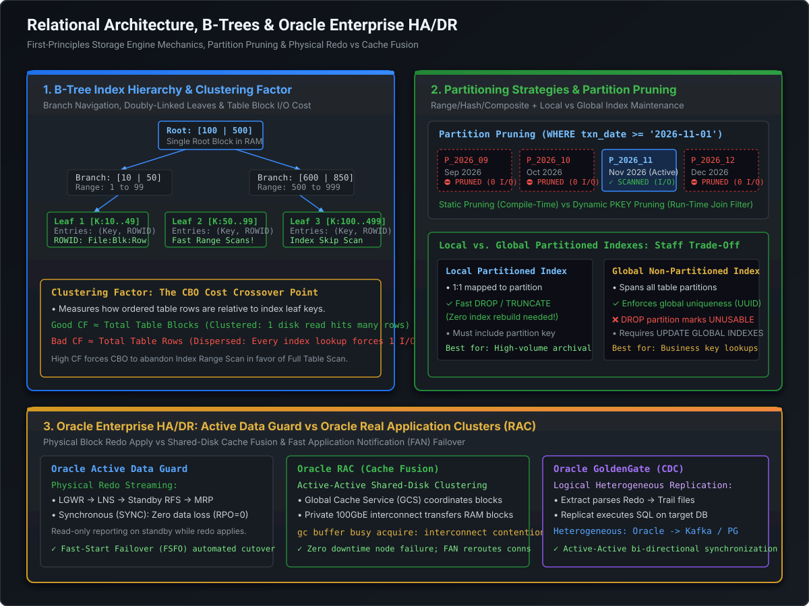

# Partitioning Strategies, Oracle Enterprise HA/DR & 3-AZ Resiliency Architecture

In high-concurrency, mission-critical distributed payment systems, a database failure or replication delay can trigger catastrophic operational and financial impacts. At the Staff and Principal Engineer level, you are expected to understand the full continuum of database scalability and availability: from **table partitioning primitives and partition pruning mechanics** to **shared-everything clustering (Oracle RAC), physical block-level replication (Data Guard), and logical change data capture (GoldenGate)**.

This playbook examines first-principles database replication physics and details why Tier-0 active-active-active 3-AZ architectures abandoned GoldenGate logical replication in favor of Oracle Data Guard physical redo streaming.

---

## 1. Enterprise Partitioning Taxonomy

Table partitioning physically breaks massive multi-terabyte tables into smaller, self-contained storage segments while presenting a single unified table abstraction to the application.

```
========================================================================================================================
                                     ENTERPRISE TABLE PARTITIONING TAXONOMY
========================================================================================================================

  RANGE PARTITIONING (Temporal / DLM)              HASH PARTITIONING (Even I/O Distribution)
  ┌─────────────────────────────────────────┐      ┌─────────────────────────────────────────┐
  │ Table: TRANSACTIONS                     │      │ Table: CARD_ACCOUNTS                    │
  │ • P_2026_09: txn_date < 2026-10-01      │      │ • P_HASH_0: Murmur3(card_id) % 4 == 0   │
  │ • P_2026_10: txn_date < 2026-11-01      │      │ • P_HASH_1: Murmur3(card_id) % 4 == 1   │
  │ • P_2026_11: txn_date < 2026-12-01      │      │ • P_HASH_2: Murmur3(card_id) % 4 == 2   │
  │ • P_MAX:     VALUES LESS THAN (MAXVALUE)│      │ • P_HASH_3: Murmur3(card_id) % 4 == 3   │
  └─────────────────────────────────────────┘      └─────────────────────────────────────────┘
  Ideal for: Time-series, Aging out data (DLM).    Ideal for: Eliminating hot disk blocks.

------------------------------------------------------------------------------------------------------------------------

  COMPOSITE RANGE-HASH PARTITIONING (The Tier-0 Payment Ledger Standard)
  ┌────────────────────────────────────────────────────────────────────────────────────────┐
  │ Primary Partition (Range by txn_date: Monthly Ledger)                                  │
  │   └── Subpartition (Hash by account_id: 16 Subpartitions per Month)                   │
  │                                                                                        │
  │ Benefits:                                                                              │
  │ 1. Time-based lifecycle: Instantly DROP or ARCHIVE entire historical months.          │
  │ 2. Concurrent write scaling: 16 physical storage segments receive inserts per month.   │
  └────────────────────────────────────────────────────────────────────────────────────────┘
```

### 1.1 The Four Partitioning Strategies
1. **Range Partitioning**:
   - Maps rows to partitions based on value ranges of the partitioning key (e.g., date ranges, numeric ranges).
   - **DLM Superpower**: Dropping 50 million records via `ALTER TABLE transactions DROP PARTITION p_2024_01;` completes in **milliseconds** (metadata dictionary update) with **zero UNDO/REDO generation**, whereas `DELETE FROM transactions WHERE txn_date < ...` would take hours, generate massive redo logs, and lock tables.
2. **List Partitioning**:
   - Maps rows based on explicit discrete lists of values (e.g., `country_code IN ('US', 'CA')`, `currency IN ('USD', 'EUR')`).
   - Essential for geopolitical regulatory data residency compliance (GDPR/APPI boundaries).
3. **Hash Partitioning**:
   - Applies an internal linear hashing algorithm to the partitioning key, distributing rows evenly across $N$ physical segments (where $N$ must be a power of 2: 4, 8, 16, 32).
   - **Solves Disk Hotspots**: Completely eliminates I/O bottlenecks where multiple processes write to adjacent blocks.
4. **Composite Partitioning (Range-Hash / Range-List)**:
   - Hierarchical partitioning. Partition by range (time-dimension), subpartition by hash (entity ID dimension).

---

## 2. Partition Pruning: The Query Optimizer's Silver Bullet

Partition Pruning is an optimization where the Cost-Based Optimizer (CBO) analyzes query predicates and eliminates unneeded partitions from the execution plan before or during physical execution.

[](images/oracle_ha_dr_and_partitioning_architecture.svg)

### 2.1 Static vs. Dynamic Pruning
* **Static Partition Pruning (Compile-Time)**:
  - Occurs when query predicates contain literal constants or deterministic bind expressions known at parse time:
    ```sql
    SELECT SUM(amount) FROM transactions WHERE txn_date >= '2026-11-01' AND txn_date < '2026-11-02';
    ```
  - `EXPLAIN PLAN` shows exact numerical boundaries in `PSTART` and `PSTOP`:
    ```
    | Id | Operation                | Name         | Pstart | Pstop |
    |  1 |  PARTITION RANGE SINGLE  |              |     11 |    11 |
    |  2 |   TABLE ACCESS FULL      | TRANSACTIONS |     11 |    11 |
    ```
  - **I/O Saved**: Only partition 11 is read. Partitions 1 through 10 and 12 through 36 are never touched.

* **Dynamic Partition Pruning (Run-Time)**:
  - Occurs when the partition key is matched against a subquery, join condition, or non-peeking bind variable:
    ```sql
    SELECT t.txn_id, t.amount
    FROM transactions t
    JOIN active_campaigns c ON t.txn_date = c.campaign_date;
    ```
  - `EXPLAIN PLAN` displays `KEY` in `PSTART` and `PSTOP`:
    ```
    | Id | Operation                | Name         | Pstart | Pstop |
    |  1 |  PARTITION RANGE ITERATOR|              |    KEY |   KEY |
    ```
  - At runtime, as each matching `campaign_date` is read from `active_campaigns`, Oracle dynamically activates only the corresponding partition of `transactions`.

---

## 3. Local vs. Global Indexes: The Operational Trade-Off

Choosing between Local and Global indexes is one of the most critical architectural decisions for a Staff Engineer designing partitioned schemas.

| Dimension | Local Partitioned Index | Global Non-Partitioned Index | Global Partitioned Index |
| :--- | :--- | :--- | :--- |
| **Mapping Ratio** | **1:1** with table partitions | **1:Many** (spans entire table) | **Many:Many** (independent partitioning) |
| **Partition Key Required?** | Recommended (Equipartitioned) | **No** (any column) | No (can partition by different key) |
| **Global Uniqueness** | ❌ Only if partition key is in index | **✓ Enforces table-wide uniqueness** | **✓ Enforces table-wide uniqueness** |
| **Partition Maintenance** | **✓ Safe**: Dropping partition leaves index VALID | **❌ Catastrophic**: Marks index `UNUSABLE`! | **❌ Catastrophic**: Marks index `UNUSABLE`! |
| **Query Performance** | Fast if partition key is in WHERE clause | Fast for point queries omitting part key | Fast for range queries on global key |

> [!CAUTION]
> **The Global Index Invalidation Trap**:
> If you have a Global Index on `card_number` across a partitioned `transactions` table, executing:
> `ALTER TABLE transactions DROP PARTITION p_2024_01;`
> will immediately mark the entire global index **`UNUSABLE`**.
> Every application query referencing that index will immediately fail or fall back to an emergency Full Table Scan across hundreds of gigabytes!
> *Production Mitigation*: Always specify `UPDATE GLOBAL INDEXES`:
> `ALTER TABLE transactions DROP PARTITION p_2024_01 UPDATE GLOBAL INDEXES;`
> This causes Oracle to delete obsolete index entries asynchronously via background metadata cleaning.

---

## 4. Enterprise HA & DR: RAC vs. Data Guard vs. GoldenGate

Enterprise database resiliency spans three primary architectural tiers:

```
========================================================================================================================
                                     ORACLE ENTERPRISE RESILIENCY SPECTRUM
========================================================================================================================

  ORACLE RAC (Shared-Everything)            DATA GUARD (Physical Redo Shipping)      GOLDENGATE (Logical CDC)
  ┌───────────────────────────────┐         ┌───────────────────────────────┐        ┌───────────────────────────────┐
  │ • Local Active-Active nodes   │         │ • Primary & Standby Instances │        │ • Heterogeneous Replicas      │
  │ • Cache Fusion (InfiniBand)   │         │ • Block-for-block exact copy  │        │ • Mines Redo -> SQL re-exec   │
  │ • Shared SAN/ASM Storage      │         │ • Zero logical drift          │        │ • Bi-directional conflict risk│
  └───────────────┬───────────────┘         └───────────────┬───────────────┘        └───────────────┬───────────────┘
                  │                                         │                                        │
           Local Server HA                        Cross-AZ Disaster Recovery              Heterogeneous / ETL Sync
       (Shared Storage SPOF!)                  (100% Bit-for-Bit Consistency)           (Operational Complexity!)
```

### 4.1 Oracle RAC (Real Application Clusters): Local Shared-Everything HA
* **Architecture**: Multiple database instances run on independent physical servers, but mount and access the **exact same shared disks** (via Oracle ASM and SAN storage).
* **Cache Fusion**: When Instance A needs a data block currently locked in Instance B's buffer cache, Instance B transfers the raw block directly across a dedicated private interconnect (InfiniBand / 100GbE RoCE) to Instance A without writing to disk.
* **Failure Mode**: If Server Node 1 suffers hardware failure or kernel panic, Server Node 2 detects it via voting disks, fences Node 1, and continues serving transactions with zero downtime and zero data loss.
* **The Structural Limitation**: **Shared storage is a single point of failure (SPOF)**. If the underlying SAN storage array corrupts or a datacenter loses power, all RAC nodes crash simultaneously. RAC provides high availability within a datacenter, not disaster recovery across datacenters.

### 4.2 Oracle Data Guard: Physical Shared-Nothing Replication
* **Architecture**: Independent primary and standby databases with **zero shared hardware**.
* **Mechanics**:
  1. Primary transaction generates binary **Redo Log entries** in the SGA Redo Buffer.
  2. The Log Writer Network Server (`LNS`) process intercepts redo records and transmits them across the network.
  3. The Remote File Server (`RFS`) process on the standby writes the redo directly to **Standby Redo Logs (SRLs)**.
  4. The Managed Recovery Process (`MRP`) applies redo records directly to the physical data blocks.
* **Protection Modes**:
  - **Maximum Protection (Zero Data Loss)**: Redo must be acknowledged by standby network socket before primary returns `COMMIT` to client. If standby becomes unreachable, primary halts.
  - **Maximum Availability**: Synchronous `SYNC` mode under normal operation. If network partitions, primary temporarily degrades to asynchronous mode to preserve availability.
  - **Maximum Performance (ASYNC)**: Primary Log Writer commits immediately without waiting for standby network transmission.
* **Active Data Guard**: Standby database is open read-only while continuous physical redo apply is occurring, allowing heavy analytical queries and reporting to be offloaded from the primary.

### 4.3 Oracle GoldenGate: Logical Change Data Capture (CDC)
* **Architecture**: Decoupled, heterogeneous replication operating at the logical SQL layer.
* **Mechanics**:
  1. **Extract**: Mines the primary transaction log (redo log) and converts changes into database-agnostic **Trail Files**.
  2. **Data Pump**: Streams trail files across TCP/IP to the target system.
  3. **Replicat**: Parses trail files, constructs SQL DML statements (`INSERT`, `UPDATE`, `DELETE`), and executes them against the target database via standard SQL connections.

---

## 5. Enterprise Architectural Case Study: Why 3-AZ Active Architectures Abandoned GoldenGate for Data Guard

At Tier-1 financial network scale (processing tens of thousands of authorization messages per second across multi-datacenter Availability Zones), designing the **3-AZ Active-Active-Active Resiliency Architecture** forced a profound architectural evaluation between **Oracle GoldenGate** logical replication and **Oracle Data Guard** physical replication.

### 5.1 The Nuances & Failure Modes of GoldenGate in Production

GoldenGate is frequently marketed as the panacea for multi-datacenter active-active deployments. However, in Tier-0 financial ledger environments, its logical architecture creates severe operational and consistency vulnerabilities:

```
                                  THE GOLDENGATE BREAKDOWN IN HIGH-VOLUME TIER-0
                                  
   [Primary Database]                                                          [Target Database]
   ┌──────────────────┐                                                       ┌──────────────────┐
   │ Redo Log         │                                                       │ Target DB Engine │
   └────────┬─────────┘                                                       └────────▲─────────┘
            │ Extract Process                                                          │ SQL Replicat
            ▼                                                                          │ (Slow Execution)
   ┌──────────────────┐     Data Pump      ┌──────────────────┐   Network WAN ┌────────┴─────────┐
   │ Local Trail File │───────────────────>│ Remote Trail File│──────────────>│ Parse & Exec SQL │
   └──────────────────┘                    └──────────────────┘               └──────────────────┘
                                                                               • Lag spikes to minutes!
                                                                               • Triggers fire twice!
                                                                               • CDR collisions!
```

1. **Conflict Detection & Resolution (CDR) Impossibility**:
   - In a bi-directional active-active configuration across availability zones, if AZ-1 and AZ-2 process transactions modifying the same account balance concurrently, GoldenGate must reconcile conflicting rows.
   - Built-in resolution rules (such as `USEMIN`, `USEMAX`, or `OVERWRITE`) violate banking integrity:
     - If AZ-1 debits \$50 and AZ-2 debits \$30, timestamp-based resolution results in one debit **silently overwriting the other**, causing account balance corruption!
2. **Replication Lag Bursts During High-Throughput Surges**:
   - The primary database executes changes via compiled internal block writes.
   - GoldenGate's `Replicat` process must parse the logical trail, construct SQL statements, acquire database parse locks, check foreign keys, and execute standard SQL on the target.
   - During transaction surges (e.g., flash sales, holiday processing spikes at 50,000 TPS), the SQL execution engine on the target cannot keep pace with the primary's block writes. Replication lag balloons from **milliseconds to tens of minutes**, destroying RPO SLAs.
3. **Trigger & Constraint Cascade Traps**:
   - When `Replicat` executes an `INSERT` on the target, database triggers, cascade deletes, and foreign key validations fire **a second time** on the target database unless explicitly suppressed with complex `SUPPRESSTRIGGERS` session settings.
   - Monotonic sequence generators (`NEXTVAL`) generate different values on primary and target, breaking primary key referential integrity.
4. **Silent Data Drift & DDL Fragility**:
   - DDL schema modifications (`ALTER TABLE ADD COLUMN`) frequently cause trail file deserialization mismatches, stalling the replication queue.
   - Unhandled exceptions or data type conversions cause silent row drops, resulting in undetected data drift between datacenters that is only discovered during disaster failover.

---

### 5.2 The 3-AZ Active-Active-Active Decision: Transitioning to Data Guard Physical Replication

To achieve **99.999% availability** with guaranteed zero data loss, enterprise platform engineering transitioned from GoldenGate logical sync to an architecture grounded in **Oracle Data Guard physical block-level replication combined with intelligent traffic routing**:

```
========================================================================================================================
                          ENTERPRISE 3-AZ RESILIENCY: DATA GUARD PHYSICAL REPLICATION
========================================================================================================================

           AZ-1 (Primary Active Write)                      AZ-2 (Synchronous Physical Standby)
     ┌────────────────────────────────────┐             ┌────────────────────────────────────┐
     │ • Oracle RAC Cluster (Compute)     │             │ • Oracle Active Data Guard (Compute│
     │ • In-Memory Redo Log Buffer        │             │ • Standby Redo Logs (SRL)          │
     │ • Authoritative Write Ledger       │             │ • Sub-second Read Projections      │
     └─────────────────┬──────────────────┘             └─────────────────▲──────────────────┘
                       │                                                  │
                       │ SYNC Redo Transport (LNS -> RFS)                 │ Physical Block Apply (MRP)
                       │ Zero SQL Parsing / Zero Logical Drift            │ Zero Trigger Double-Firing
                       └──────────────────────────────────────────────────┘
                                                 │
                                                 │ ASYNC Redo Transport (DR WAN)
                                                 ▼
                                        AZ-3 (Disaster Recovery)
                                ┌────────────────────────────────────┐
                                │ • Remote Standby Database          │
                                │ • Fast-Start Failover (FSFO)       │
                                │ • Automated < 30s Cluster Takeover │
                                └────────────────────────────────────┘
```

#### Why Data Guard Won:
1. **Physical Block-for-Block Determinism**:
   - Data Guard operates below the SQL engine. It ships raw physical redo vectors.
   - The standby applies changes directly to data blocks without parsing SQL, evaluating triggers, or acquiring table locks. Zero risk of data drift; 100% byte-for-byte replica.
2. **Deterministic Sub-Second Latency**:
   - Because `MRP` applies block modifications directly in memory, replication throughput scales linearly with disk I/O, eliminating GoldenGate's SQL re-execution bottlenecks.
3. **Partitioned Ingress Routing (Eliminating Multi-Master Conflicts)**:
   - Instead of allowing arbitrary writes to all 3 AZs (which caused GoldenGate's CDR nightmares), global traffic routers partition transactions by **Account Hash / BIN Range**.
   - All writes for a given account shard route deterministically to the primary instance in AZ-1, which replicates synchronously to AZ-2 and asynchronously to AZ-3.
4. **Fast-Start Failover (FSFO) with Observer Quorum**:
   - An independent third-party observer process continuously monitors primary health. If AZ-1 suffers catastrophic infrastructure failure, the observer triggers **automated failover to AZ-2 in under 30 seconds**, with guaranteed zero data loss ($\text{RPO} = 0$).

---

## 6. Staff / Principal Interview STAR Narrative

> **Interviewer**: *"You designed a high-throughput, multi-datacenter active architecture for a Tier-1 financial network. Why did your team move away from logical replication tools like GoldenGate to physical Data Guard, and how did you handle cross-datacenter writes?"*

- **Situation**: *"In our Tier-0 payment ledger processing tens of thousands of financial transactions per second across multi-datacenter Availability Zones, our legacy setup attempted active-active multi-master replication using GoldenGate."*
- **Task**: *"Under peak volume, we experienced severe replication lag spikes exceeding 15 minutes, and bi-directional conflict resolution (CDR) occasionally created silent data drift on cardholder balances. My mandate as Lead Systems Architect was to redesign the database topology to deliver 99.999% availability, zero data drift, and sub-second RPO/RTO across 3 Availability Zones."*
- **Action**: 
  1. *Root-Cause Analysis*: *"We identified that GoldenGate's bottleneck was the logical SQL Replicat stage. While the primary applied changes via direct block memory writes, the target had to parse, plan, lock, and execute SQL statements, causing exponential lag during bursts."*
  2. *Architectural Shift*: *"We eliminated GoldenGate for core transactional synchronization and implemented a 3-AZ topology powered by **Oracle Active Data Guard (SYNC mode across AZ-1 and AZ-2, ASYNC to AZ-3)**."*
  3. *Eliminating Multi-Master Conflicts*: *"To eliminate CDR hazards entirely, we re-architected traffic ingress using consistent hashing on Card Account IDs. Writes for each partition targeted a single primary, streaming physical redo blocks to the standby with zero SQL parsing overhead."*
  4. *Automated Failover*: *"We deployed Oracle Fast-Start Failover (FSFO) with a split-brain quorum observer in the third zone, guaranteeing sub-30-second automated failover without human intervention."*
- **Result**: *"We completely eliminated logical data drift, reduced cross-AZ replication lag from minutes to under 50 milliseconds during peak 60,000 TPS surges, achieved $\text{RPO} = 0$, and validated our architecture during real-world automated datacenter failover drills."*

---

## 7. Runnable Verification POC: Data Guard vs. GoldenGate Replication Benchmark

The following self-contained Java program simulates:
1. **Physical Redo Shipping (Data Guard)**: Block-level byte buffer replication, measuring throughput and zero SQL parsing overhead.
2. **Logical CDC (GoldenGate)**: Parsing redo, generating SQL strings, acquiring row locks, and re-executing DML on the target.
3. **Concurrent Multi-Master Conflict Demonstration**: Simulating the CDR collision problem when two nodes modify the same balance concurrently.

```java
package com.engineering.mastery.database;

import java.nio.ByteBuffer;
import java.util.*;
import java.util.concurrent.*;
import java.util.concurrent.atomic.AtomicLong;

/**
 * DataGuardVsGoldenGateReplicationPOC
 *
 * Simulates:
 * 1. Physical Redo Shipping (Data Guard) - Fast memory block apply.
 * 2. Logical Change Data Capture (GoldenGate) - SQL generation & execution overhead.
 * 3. Multi-Master Conflict Detection & Resolution (CDR) collision vulnerability.
 */
public class DataGuardVsGoldenGateReplicationPOC {

    // =========================================================================
    // 1. Data Guard: Physical Redo Log Block Streaming
    // =========================================================================
    public static class PhysicalDataGuardEngine {
        private final byte[] primaryStorage = new byte[1024 * 1024]; // 1MB Simulated Block Storage
        private final byte[] standbyStorage = new byte[1024 * 1024];

        public long simulatePhysicalReplication(int transactionCount) {
            long startTime = System.nanoTime();

            for (int i = 0; i < transactionCount; i++) {
                int blockOffset = (i % 128) * 8192; // 8KB block
                
                // 1. Primary writes raw binary redo
                ByteBuffer redoVector = ByteBuffer.allocate(64);
                redoVector.putLong(i);           // SCN
                redoVector.putInt(blockOffset);  // Block DBA
                redoVector.putDouble(150.0 + i); // Binary Delta Data

                // 2. Direct byte block transfer to standby (Zero SQL Parsing!)
                System.arraycopy(redoVector.array(), 0, standbyStorage, blockOffset, 64);
            }

            return System.nanoTime() - startTime;
        }
    }

    // =========================================================================
    // 2. GoldenGate: Logical CDC & SQL Re-execution
    // =========================================================================
    public static class LogicalGoldenGateEngine {
        private final Map<Long, Double> targetDatabaseRows = new ConcurrentHashMap<>();

        public long simulateLogicalReplication(int transactionCount) {
            long startTime = System.nanoTime();

            for (int i = 0; i < transactionCount; i++) {
                long accountId = i % 1000;
                double amount = 150.0 + i;

                // Step 1: Extract process constructs logical trail record (Textual/JSON serialization)
                String logicalSql = String.format(Locale.US,
                        "UPDATE accounts SET balance = balance + %.2f WHERE account_id = %d;", amount, accountId);

                // Step 2: Target Replicat parses SQL string, parses AST, acquires row lock, executes
                String[] tokens = logicalSql.split(" ");
                double parsedAmount = Double.parseDouble(tokens[7]);
                long parsedId = Long.parseLong(tokens[11].replace(";", ""));

                // Step 3: Target table write
                targetDatabaseRows.merge(parsedId, parsedAmount, Double::sum);
            }

            return System.nanoTime() - startTime;
        }
    }

    // =========================================================================
    // 3. Multi-Master CDR Collision Simulation
    // =========================================================================
    public static class MultiMasterCdrCollisionSimulator {
        public record AccountState(long accountId, double balance, long timestamp) {}

        public void simulateConcurrentMultiMasterCollision() {
            System.out.println("=== [GoldenGate Multi-Master CDR Collision Simulation] ===");
            long initialBalance = 1000L;
            long accountId = 880124L;

            // Scenario: AZ-1 debits $100, AZ-2 simultaneously debits $200
            long t1 = System.currentTimeMillis();
            long t2 = t1 + 2; // AZ-2 executes 2ms later before sync arrives

            AccountState az1State = new AccountState(accountId, initialBalance - 100.0, t1);
            AccountState az2State = new AccountState(accountId, initialBalance - 200.0, t2);

            System.out.printf(Locale.US, "Initial Balance on Account %d: $%.2f%n", accountId, (double) initialBalance);
            System.out.printf(Locale.US, "  AZ-1 Transaction: Debit $100 -> Local Balance: $%.2f (Timestamp: %d)%n",
                    az1State.balance(), az1State.timestamp());
            System.out.printf(Locale.US, "  AZ-2 Transaction: Debit $200 -> Local Balance: $%.2f (Timestamp: %d)%n",
                    az2State.balance(), az2State.timestamp());

            // GoldenGate Standard Timestamp-Based Conflict Resolution (USEMAX):
            AccountState resolvedState = az2State.timestamp() > az1State.timestamp() ? az2State : az1State;

            System.out.printf(Locale.US, "❌ CDR (USEMAX) Resolution Applied: AZ-2 won due to timestamp!%n");
            System.out.printf(Locale.US, "CRITICAL LEDGER CORRUPTION: Final Balance = $%.2f%n", resolvedState.balance());
            System.out.println("  * Expected Balance: $1000 - $100 - $200 = $700.00!");
            System.out.printf(Locale.US, "  * Actual Balance:   $%.2f (The $100 debit from AZ-1 was SILENTLY LOST!)%n%n",
                    resolvedState.balance());
        }
    }

    // =========================================================================
    // 4. Main Test Runner
    // =========================================================================
    public static void main(String[] args) {
        System.out.println("================================================================================");
        System.out.println("     DATA GUARD (PHYSICAL) vs. GOLDENGATE (LOGICAL) BENCHMARK POC               ");
        System.out.println("================================================================================\n");

        int transactionCount = 100_000;

        // 1. Benchmark Physical Data Guard
        PhysicalDataGuardEngine dgEngine = new PhysicalDataGuardEngine();
        long dgNanos = dgEngine.simulatePhysicalReplication(transactionCount);
        double dgMillis = dgNanos / 1_000_000.0;
        double dgThroughput = (transactionCount / dgMillis) * 1000;

        System.out.printf(Locale.US, "--- [1. Physical Data Guard (Block Redo Streaming)] ---%n");
        System.out.printf(Locale.US, "Processed %d physical redo blocks in: %.2f ms%n", transactionCount, dgMillis);
        System.out.printf(Locale.US, "Throughput: %,.0f block transfers/sec (Zero SQL overhead)%n%n", dgThroughput);

        // 2. Benchmark Logical GoldenGate
        LogicalGoldenGateEngine ggEngine = new LogicalGoldenGateEngine();
        long ggNanos = ggEngine.simulateLogicalReplication(transactionCount);
        double ggMillis = ggNanos / 1_000_000.0;
        double ggThroughput = (transactionCount / ggMillis) * 1000;

        System.out.printf(Locale.US, "--- [2. Logical GoldenGate (CDC Trail & SQL Re-execution)] ---%n");
        System.out.printf(Locale.US, "Processed %d logical SQL statements in: %.2f ms%n", transactionCount, ggMillis);
        System.out.printf(Locale.US, "Throughput: %,.0f SQL transactions/sec%n%n", ggThroughput);

        double speedup = ggMillis / dgMillis;
        System.out.printf(Locale.US, ">>> Architectural Advantage: Physical Data Guard is %.1fx faster than GoldenGate logical SQL re-execution!%n%n",
                speedup);

        // 3. Multi-Master CDR Collision Simulation
        MultiMasterCdrCollisionSimulator cdrSimulator = new MultiMasterCdrCollisionSimulator();
        cdrSimulator.simulateConcurrentMultiMasterCollision();

        System.out.println("================================================================================");
        System.out.println("                      VERIFICATION COMPLETED SUCCESSFULLY                       ");
        System.out.println("================================================================================");
    }
}
```

---

## 8. Principal Engineer Architectural Takeaways

1. **Physical Redo Replication Beats Logical CDC for Tier-0**: Logical replication introduces SQL string construction, parsing, and execution overhead on target databases, causing severe replication lag under burst loads. Data Guard's physical block apply guarantees deterministic sub-second RTO/RPO.
2. **Never Attempt Multi-Master Active-Active Writes on Financial Ledgers**: Timestamp-based conflict resolution (CDR) mathematically causes silent debit/credit loss. Route transactions by entity hash (card/account ID) to a single primary and replicate physically.
3. **Local Indexes Are Mandatory for High-Throughput Partition Lifecycle**: Dropping or archiving partitions with global indexes invalidates the entire index unless `UPDATE GLOBAL INDEXES` is used. Prefer local indexes whenever query predicates permit.
