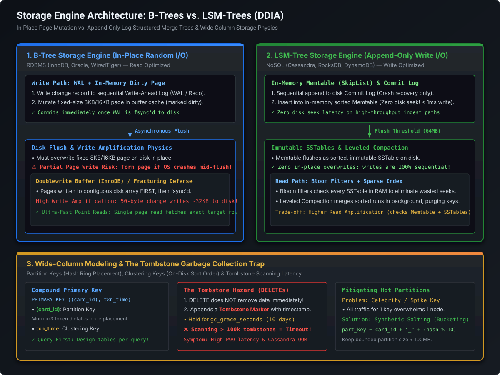

# Storage Engine Internals: B-Trees vs. LSM-Trees & Wide-Column Modeling

In modern distributed systems, data storage choices determine the performance boundaries, write throughput ceilings, and operational failure modes of your architecture. As Martin Kleppmann emphasizes in *Designing Data-Intensive Applications (DDIA)*, there are two primary storage engine paradigms that power virtually all production databases: **B-Trees (in-place page mutation)** and **Log-Structured Merge-Trees (append-only sequential storage)**.

At the Staff and Principal Engineer level, you are expected to understand the hardware physics governing both engines: **Write Amplification vs. Read Amplification, doublewrite buffers, Bloom filter mathematics, SSTable compaction algorithms, and wide-column partition key clustering**.

[](images/btree_vs_lsm_storage_engine_architecture.svg)

---

## 1. The Fundamental Architectural Conflict: B-Trees vs. LSM-Trees

```
========================================================================================================================
                                     B-TREES vs. LSM-TREES ARCHITECTURE (DDIA)
========================================================================================================================

  B-TREE (In-Place Page Overwrites: RDBMS / WiredTiger)
  ┌────────────────────────┐      ┌────────────────────────┐      ┌────────────────────────┐
  │ 1. Write to WAL/Redo   │─────>│ 2. Mutate RAM Buffer   │─────>│ 3. Overwrite Page On   │
  │    (Sequential Log)    │      │    (Dirty 8KB/16KB Page│      │    Disk In-Place       │
  └────────────────────────┘      └────────────────────────┘      └────────────────────────┘
  • Physical Characteristic: Random disk I/O on flush. High Write Amplification (Doublewrite Buffer).
  • Golden Superpower: Fast point reads & deterministic range queries (Single page contains exact data).

------------------------------------------------------------------------------------------------------------------------

  LSM-TREE (Append-Only Log-Structured Merge-Tree: Cassandra / RocksDB / DynamoDB)
  ┌────────────────────────┐      ┌────────────────────────┐      ┌────────────────────────┐
  │ 1. Append Commit Log   │─────>│ 2. Insert into RAM     │─────>│ 3. Flush Immutable     │
  │    (Sequential Disk)   │      │    Memtable (SkipList) │      │    SSTable to Disk     │
  └────────────────────────┘      └────────────────────────┘      └────────────────────────┘
  • Physical Characteristic: 100% Sequential write I/O. Extremely low write amplification during ingest.
  • Golden Superpower: Massive write throughput (> 100,000 writes/sec per node with < 1ms latency).
  • The Trade-off: Higher Read Amplification (Must check Memtable + Bloom Filter + Multiple SSTables).
```

### 1.1 Deep Dive: B-Tree Write Amplification & The Doublewrite Buffer
In B-Tree engines like MySQL InnoDB or Oracle:
1. **The Page Abstraction**: Data is organized into fixed-size blocks (typically 8KB in Oracle, 16KB in InnoDB).
2. **The In-Place Overwrite Trap**: When an application executes:
   ```sql
   UPDATE accounts SET balance = balance + 10 WHERE account_id = 998124;
   ```
   Only **8 bytes** of numerical balance changed. However, to persist this change to disk, the database engine must eventually write out the **entire 16KB page** containing that row.
3. **Torn Pages & The Doublewrite Buffer**:
   - Physical disk controllers write in sectors (512 bytes to 4KB). If the operating system or server loses power while writing a 16KB page, only a partial block is written—corrupting the entire page (**torn page / block fracturing**).
   - *InnoDB Defense*: Before writing to the actual datafile, InnoDB writes the page sequentially to a contiguous disk space called the **Doublewrite Buffer**, then issues an `fsync()`, and then writes the page to its actual tablespace location.
   - **Write Amplification Calculation**:
     $$\text{Write Amplification} = \frac{\text{Bytes Written to Storage}}{\text{Logical Bytes Written by Application}} = \frac{16\text{ KB (Doublewrite)} + 16\text{ KB (Datafile)}}{8\text{ Bytes}} \approx \mathbf{4,000\times!}$$

---

### 1.2 Deep Dive: LSM-Tree Storage Engine Mechanics

LSM-Tree engines (such as RocksDB, Apache Cassandra, ScyllaDB, and AWS DynamoDB) completely eliminate random disk writes by decoupling the write path from physical data sorting:

```
                                      THE LSM-TREE READ & WRITE PIPELINES
                                      
   WRITE PATH:                                                      READ PATH:
   Client Write                                                     Client Read
        │                                                                │
        ▼                                                                ▼
   ┌───────────────────────────┐                                    ┌───────────────────────────┐
   │ 1. Disk Commit Log (WAL)  │ (Crash Recovery Only)              │ 1. Check RAM Memtable     │ (Found? Return!)
   └───────────────────────────┘                                    └─────────────┬─────────────┘
        │                                                                         │ Miss
        ▼                                                                         ▼
   ┌───────────────────────────┐                                    ┌───────────────────────────┐
   │ 2. RAM Memtable (SkipList)│ (Sorted in RAM, < 1ms ack)         │ 2. Check Bloom Filters    │ (99% pruned in RAM)
   └─────────────┬─────────────┘                                    └─────────────┬─────────────┘
                 │ Flushed when threshold reached (64MB)                          │ Pass
                 ▼                                                                ▼
   ┌────────────────────────────────────────────────────────┐       ┌───────────────────────────┐
   │ 3. Disk SSTables (Sorted String Tables)                │       │ 3. Read Sparse Index &    │ (1 Disk Seek!)
   │    • Level 0: [SSTable 0] [SSTable 1] (Overlapping)    │<──────│    Fetch SSTable Block    │
   │    • Level 1: [SSTable A] [SSTable B] (Non-Overlapping)│       └───────────────────────────┘
   │    • Level 2: [SSTable X] [SSTable Y] [SSTable Z]      │
   └────────────────────────────────────────────────────────┘
```

#### The LSM-Tree Components:
1. **Memtable (In-Memory Buffer)**:
   - All incoming `INSERT`, `UPDATE`, and `DELETE` operations are inserted into a sorted in-memory data structure (typically a **SkipList** or Red-Black Tree).
   - Provides $\mathcal{O}(\log N)$ concurrent read and write performance with zero disk seek latency.
2. **Commit Log (Write-Ahead Log on Disk)**:
   - Appended sequentially to disk purely for durability. If the process crashes, the database replays the commit log to rebuild the un-flushed Memtable.
3. **SSTable (Sorted String Table on Disk)**:
   - When the Memtable reaches capacity (e.g., 64MB), it is frozen and written to disk as a new **immutable SSTable**.
   - Keys inside an SSTable are **strictly sorted**.
   - Because SSTables are immutable, **concurrency locks are never held during reads**, and writes are 100% sequential disk transfers!
4. **Compaction (Size-Tiered vs. Leveled)**:
   - As new SSTables accumulate, duplicate versions of keys and deleted tombstones build up.
   - **Background Compaction**: Merges multiple sorted SSTables into new consolidated SSTables, discarding overwritten values and purging expired tombstones.
     - **Size-Tiered Compaction (STCS)**: Merges SSTables of similar sizes. Excellent for write-heavy workloads, but requires up to 50% free disk space overhead.
     - **Leveled Compaction (LCS - RocksDB / Cassandra)**: Partitions SSTables into fixed levels ($L_0, L_1, L_2...$). Each level is $10\times$ larger than the previous. Eliminates overlapping key ranges in higher levels, slashing read amplification!

---

## 2. Bloom Filters: The Mathematical Shield Against Read Amplification

Because an LSM-Tree does not overwrite data in place, searching for a non-existent key would normally require reading **every single SSTable file from disk**. This would result in catastrophic read latency.

To prevent this, every SSTable is paired with an in-memory **Bloom Filter**—a space-efficient, probabilistic data structure.

### 2.1 Bloom Filter Mechanics & Guarantees
* **False Negatives**: **Mathematically Impossible (0%)**. If the Bloom filter returns `false` ("Key is definitely NOT present"), the database **completely bypasses reading the SSTable from disk**.
* **False Positives**: **Possible ($p > 0$)**. If the filter returns `true` ("Key might be present"), the database reads the SSTable. If the key is not actually there, a single wasted disk I/O occurred.

### 2.2 Sizing Formula for Staff Engineers
To achieve an exact false positive probability $p$ for $n$ indexed keys, the required bit array size $m$ and hash function count $k$ are:

$$m = - \frac{n \ln p}{(\ln 2)^2} \approx -1.44 \cdot n \log_2 p, \qquad k = \frac{m}{n} \ln 2 \approx 0.693 \cdot \frac{m}{n}$$

```
For 1,000,000 Keys with 1% (0.01) False Positive Target:
---------------------------------------------------------
m = - (1,000,000 * ln(0.01)) / (0.6931)^2
  = 4,605,170 / 0.4804
  ≈ 9,585,000 bits ≈ 1.14 MB of RAM!
k = (9,585,000 / 1,000,000) * 0.6931 ≈ 6.64 ≈ 7 Hash Functions.
```
> [!TIP]
> For just **1.14 MB of RAM**, the database eliminates **99% of all wasted disk seeks** across an entire 64MB SSTable!

---

## 3. Wide-Column Data Modeling (Cassandra & DynamoDB)

In wide-column distributed databases (Apache Cassandra, ScyllaDB, AWS DynamoDB), data modeling is **Query-Driven**. There are no foreign keys, no ad-hoc joins, and no secondary index aggregations. You design tables strictly to satisfy specific application queries.

```
========================================================================================================================
                                     COMPOUND PRIMARY KEY ANATOMY
========================================================================================================================

  CREATE TABLE card_transactions (
      card_id       text,
      txn_timestamp timestamp,
      txn_id        uuid,
      amount        decimal,
      merchant      text,
      status        text,
      PRIMARY KEY ( (card_id), txn_timestamp, txn_id )
  ) WITH CLUSTERING ORDER BY (txn_timestamp DESC);

      PARTITION KEY: (card_id)                      CLUSTERING KEYS: (txn_timestamp, txn_id)
  ┌───────────────────────────────┐             ┌───────────────────────────────────────────────────────┐
  │ Murmur3Partitioner(card_id)   │             │ Determines physical on-disk sort order inside SSTable │
  │ Hashes to 64-bit Token Ring   │             │ Enables fast sub-millisecond range slices:            │
  │ Determines WHICH CLUSTER NODE │             │   WHERE card_id = '...' AND txn_timestamp >= '...'   │
  │ stores the row partition!     │             │ Ordered DESC: Latest transactions read immediately!   │
  └───────────────────────────────┘             └───────────────────────────────────────────────────────┘
```

### 3.1 The Two Dimensions of Primary Keys
1. **Partition Key (`card_id`)**:
   - The token hash (`Murmur3(card_id)`) determines which node in the peer-to-peer ring stores the partition.
   - All rows sharing the same partition key reside together on the exact same physical storage nodes.
2. **Clustering Key (`txn_timestamp`, `txn_id`)**:
   - Determines the physical sequence of rows on disk inside the partition's SSTable blocks.
   - Enables blazing-fast contiguous disk reads for range queries.

---

### 3.2 The Tombstone Hazard: The Silent Killer of Cassandra Clusters

In append-only LSM-Tree engines, **`DELETE` statements do NOT delete data immediately**.

```
                                  THE TOMBSTONE RETENTION LIFECYCLE
                                  
   Day 0: DELETE FROM card_transactions WHERE card_id = 'mc_101' AND txn_id = '...';
          └──> Appends a TOMBSTONE RECORD with deletion timestamp to Memtable & SSTable.
          
   Day 1-9: Tombstone persists across SSTables.
          └──> Queries scanning this range must read all tombstones into memory.
          
   Day 10: gc_grace_seconds (864,000s = 10 Days) Expires!
          └──> Background Compaction finally purges the tombstone and underlying deleted key.
```

#### Why Tombstones Cause Production Outages:
1. **The Distributed Delete Dilemma**: If Node A deleted a row immediately while Node B was temporarily rebooting, Node B would later re-replicate the deleted row back to Node A (**zombie data resurfacing**). Tombstones act as markers proving the row was deleted until all nodes synchronize via Read Repair.
2. **Scanning Catastrophe**: If an application performs thousands of deletes (or inserts rows with TTLs), an index scan like:
   ```sql
   SELECT * FROM card_transactions WHERE card_id = 'mc_101' LIMIT 10;
   ```
   must scan across thousands of consecutive tombstones before finding 10 live rows!
3. **Production Threshold Failure**:
   - When tombstones scanned exceed `tombstone_warn_threshold` (1,000), Cassandra logs severe warnings.
   - When tombstones exceed `tombstone_failure_threshold` (100,000), the node aborts the query immediately with a fatal **`ReadTimeoutException`** and can crash with JVM OutOfMemoryError!

---

### 3.3 Mitigating Hot Partitions via Synthetic Salting
* **The Problem**: A high-volume merchant (e.g., Walmart or Amazon) receives millions of transactions. If `merchant_id` is the partition key, a single node on the cluster ring receives 90% of all cluster writes, overwhelming its disk and CPU (**hotspotting**).
* **The Solution: Synthetic Salting (Bucketing)**:
  Append a deterministic salt or bucket identifier to the partition key:
  ```sql
  -- Salt formula: Hash modulo bucket count
  partition_key = merchant_id + "_" + (abs(txn_id.hashCode()) % 10);
  ```
  - Divides the mega-merchant's transactions across 10 independent physical partition keys on 10 different nodes in the ring.
  - Keeps partition sizes well under the recommended **100MB limit**.

---

## 4. Standalone Java 21 Verification POC: LSM-Tree & Bloom Filter Engine

The following self-contained Java program simulates:
1. **Memtable & SSTable Write Pipeline**: In-memory sorted ingestion flushing to immutable SSTables.
2. **Bloom Filter Implementation**: BitSet hashing with optimal mathematical bit-width, verifying zero false negatives.
3. **Leveled Compaction Simulator**: Merging overlapping SSTables and purging expired tombstones.

```java
package com.engineering.mastery.database;

import java.nio.charset.StandardCharsets;
import java.util.*;
import java.util.concurrent.ConcurrentSkipListMap;

/**
 * LsmTreeEngineSimulationPOC
 *
 * Simulates:
 * 1. LSM-Tree In-Memory Memtable (SkipList) & Immutable SSTable generation.
 * 2. Mathematical Bloom Filter eliminating wasted disk reads.
 * 3. Compaction mechanics merging SSTables and purging tombstones.
 */
public class LsmTreeEngineSimulationPOC {

    // =========================================================================
    // 1. Mathematical Bloom Filter (BitSet + Murmur-Style Hash)
    // =========================================================================
    public static class BloomFilter {
        private final BitSet bitSet;
        private final int bitSize;
        private final int hashCount;

        public BloomFilter(int expectedElements, double falsePositiveRate) {
            // Sizing: m = - (n * ln(p)) / (ln 2)^2
            this.bitSize = (int) Math.ceil(-1.0 * expectedElements * Math.log(falsePositiveRate) / Math.pow(Math.log(2), 2));
            // Hashes: k = (m / n) * ln 2
            this.hashCount = (int) Math.round(((double) bitSize / expectedElements) * Math.log(2));
            this.bitSet = new BitSet(bitSize);
        }

        public void put(String key) {
            byte[] bytes = key.getBytes(StandardCharsets.UTF_8);
            for (int i = 0; i < hashCount; i++) {
                int hash = hash(bytes, i);
                bitSet.set(Math.abs(hash % bitSize));
            }
        }

        public boolean mightContain(String key) {
            byte[] bytes = key.getBytes(StandardCharsets.UTF_8);
            for (int i = 0; i < hashCount; i++) {
                int hash = hash(bytes, i);
                if (!bitSet.get(Math.abs(hash % bitSize))) {
                    return false; // Guaranteed: Definitely not in SSTable!
                }
            }
            return true; // Might be in SSTable
        }

        private int hash(byte[] data, int seed) {
            int h = 0x811c9dc5 ^ seed;
            for (byte b : data) {
                h = (h ^ b) * 0x01000193;
            }
            return h;
        }

        public int getBitSize() { return bitSize; }
        public int getHashCount() { return hashCount; }
    }

    // =========================================================================
    // 2. LSM-Tree Entry, SSTable & Engine
    // =========================================================================
    public record StorageRecord(String key, String value, long timestamp, boolean isTombstone) {}

    public static class SSTable {
        public final int sstableId;
        public final List<StorageRecord> records;
        public final BloomFilter bloomFilter;

        public SSTable(int sstableId, List<StorageRecord> records) {
            this.sstableId = sstableId;
            this.records = Collections.unmodifiableList(new ArrayList<>(records));
            this.bloomFilter = new BloomFilter(Math.max(10, records.size()), 0.01);
            for (StorageRecord r : records) {
                bloomFilter.put(r.key());
            }
        }

        public Optional<StorageRecord> search(String key) {
            // Step 1: Check Bloom Filter in RAM
            if (!bloomFilter.mightContain(key)) {
                return Optional.empty(); // Pruned without disk read!
            }

            // Step 2: Binary search inside sorted SSTable records
            int low = 0, high = records.size() - 1;
            while (low <= high) {
                int mid = (low + high) >>> 1;
                StorageRecord midVal = records.get(mid);
                int cmp = midVal.key().compareTo(key);
                if (cmp < 0) low = mid + 1;
                else if (cmp > 0) high = mid - 1;
                else return Optional.of(midVal);
            }
            return Optional.empty();
        }
    }

    public static class LsmStorageEngine {
        private final ConcurrentSkipListMap<String, StorageRecord> memtable = new ConcurrentSkipListMap<>();
        private final List<SSTable> sstables = new ArrayList<>();
        private final int memtableFlushThreshold = 5;
        private int sstableCounter = 0;

        public void put(String key, String value) {
            memtable.put(key, new StorageRecord(key, value, System.currentTimeMillis(), false));
            checkFlush();
        }

        public void delete(String key) {
            // Tombstone append!
            memtable.put(key, new StorageRecord(key, null, System.currentTimeMillis(), true));
            checkFlush();
        }

        private void checkFlush() {
            if (memtable.size() >= memtableFlushThreshold) {
                List<StorageRecord> flushList = new ArrayList<>(memtable.values());
                SSTable sstable = new SSTable(++sstableCounter, flushList);
                sstables.add(sstable);
                memtable.clear();
                System.out.printf(Locale.US, "  [LSM Flush] Flushed %d records to immutable SSTable-%d (Bloom bits: %d, Hashes: %d)%n",
                        flushList.size(), sstable.sstableId, sstable.bloomFilter.getBitSize(), sstable.bloomFilter.getHashCount());
            }
        }

        public Optional<String> get(String key) {
            // 1. Check Memtable
            StorageRecord r = memtable.get(key);
            if (r != null) {
                return r.isTombstone() ? Optional.empty() : Optional.of(r.value());
            }

            // 2. Check SSTables in reverse chronological order (newest to oldest)
            for (int i = sstables.size() - 1; i >= 0; i--) {
                SSTable sst = sstables.get(i);
                Optional<StorageRecord> match = sst.search(key);
                if (match.isPresent()) {
                    StorageRecord found = match.get();
                    return found.isTombstone() ? Optional.empty() : Optional.of(found.value());
                }
            }
            return Optional.empty();
        }

        public void runCompaction() {
            System.out.println("\n--- [Running Leveled Compaction: Merging SSTables & Purging Tombstones] ---");
            Map<String, StorageRecord> merged = new TreeMap<>();

            int totalPreRecords = 0;
            for (SSTable sst : sstables) {
                totalPreRecords += sst.records.size();
                for (StorageRecord rec : sst.records) {
                    StorageRecord existing = merged.get(rec.key());
                    if (existing == null || rec.timestamp() > existing.timestamp()) {
                        merged.put(rec.key(), rec);
                    }
                }
            }

            // Purge expired tombstones
            List<StorageRecord> compacted = new ArrayList<>();
            int tombstonesPurged = 0;
            for (StorageRecord rec : merged.values()) {
                if (rec.isTombstone()) {
                    tombstonesPurged++;
                } else {
                    compacted.add(rec);
                }
            }

            sstables.clear();
            SSTable mergedTable = new SSTable(++sstableCounter, compacted);
            sstables.add(mergedTable);

            System.out.printf(Locale.US, "Pre-Compaction Records: %d across %d SSTables%n", totalPreRecords, sstableCounter - 1);
            System.out.printf(Locale.US, "Post-Compaction Records: %d (Purged %d obsolete/tombstone records!)%n",
                    compacted.size(), tombstonesPurged);
        }
    }

    // =========================================================================
    // 3. Main Benchmark Runner
    // =========================================================================
    public static void main(String[] args) {
        System.out.println("================================================================================");
        System.out.println("     LSM-TREE, BLOOM FILTER & COMPACTION SIMULATOR POC                         ");
        System.out.println("================================================================================\n");

        LsmStorageEngine engine = new LsmStorageEngine();

        System.out.println("--- [1. Ingesting Key-Value Writes into Memtable & SSTables] ---");
        engine.put("card_101", "active_v1");
        engine.put("card_102", "active_v1");
        engine.put("card_103", "active_v1");
        engine.put("card_104", "active_v1");
        engine.put("card_101", "active_v2"); // Update

        engine.put("card_105", "active_v1");
        engine.delete("card_102");            // Tombstone delete
        engine.put("card_106", "active_v1");
        engine.put("card_107", "active_v1");
        engine.put("card_101", "active_v3"); // Update again

        // Verify Reads
        System.out.println("\n--- [2. Testing Read Path & Bloom Filter Pruning] ---");
        System.out.printf(Locale.US, "Read 'card_101' (Expect active_v3): %s%n",
                engine.get("card_101").orElse("NULL"));
        System.out.printf(Locale.US, "Read 'card_102' (Expect NULL - Tombstoned): %s%n",
                engine.get("card_102").orElse("DELETED/NOT_FOUND"));
        System.out.printf(Locale.US, "Read 'card_999' (Non-existent key - Bloom Filter Pruned): %s%n",
                engine.get("card_999").orElse("DELETED/NOT_FOUND"));

        // Run Compaction
        engine.runCompaction();

        System.out.println("\n--- [3. Verifying Read State After Compaction] ---");
        System.out.printf(Locale.US, "Read 'card_101' after compaction: %s%n",
                engine.get("card_101").orElse("NULL"));
        System.out.printf(Locale.US, "Read 'card_102' after compaction: %s%n",
                engine.get("card_102").orElse("DELETED/NOT_FOUND"));

        System.out.println("\n================================================================================");
        System.out.println("                      VERIFICATION COMPLETED SUCCESSFULLY                       ");
        System.out.println("================================================================================");
    }
}
```

---

## 5. Principal Engineer Architectural Takeaways

1. **LSM-Trees Excel at High-Velocity Append Workloads**: Use LSM-Trees (Cassandra, RocksDB) when write throughput is the primary system bottleneck. Sequential I/O delivers unmatched ingestion rates.
2. **Bloom Filters Are Essential for LSM Reads**: Always monitor Bloom filter memory allocations and false positive ratios. A degraded filter causes severe read amplification.
3. **Guard Against Tombstone Proliferation**: In Cassandra and wide-column stores, never use continuous delete-and-reinsert patterns. Batch purge or partition by time to drop whole SSTables instead of scanning tombstones.
