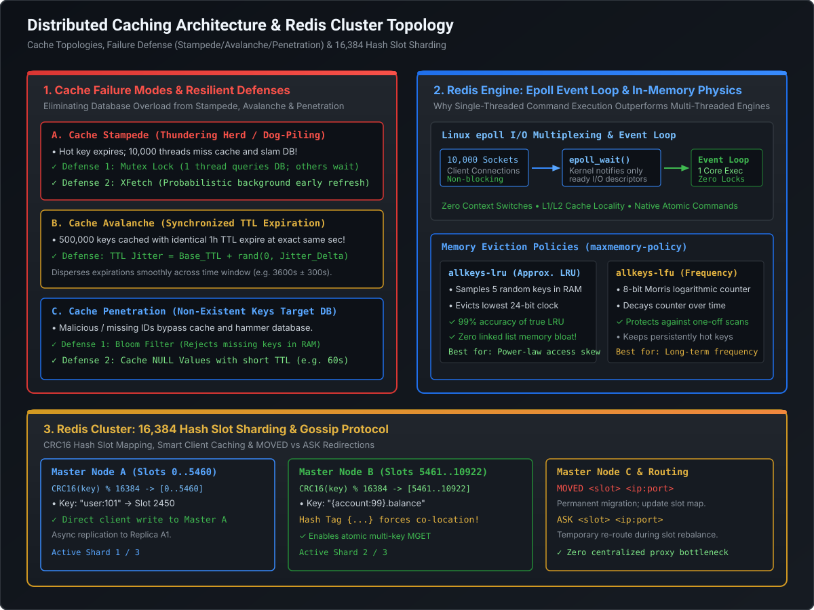

# Distributed Caching Topologies, Invalidation Physics & Failure Mode Defenses

In modern hyperscale architectures, caching is not merely a performance optimization—it is the primary defense line protecting persistent database tiers from catastrophic collapse. When caching works, systems achieve sub-millisecond response times and handle millions of requests per second. When caching fails, failures are rarely graceful: **Cache Stampedes, Avalanches, and Penetration** can instantly cascade into database connection pool exhaustion and complete cluster outages.

At the Staff and Principal Engineer level, you are expected to understand the physics of cache invalidation, race conditions between cache and database writes, and algorithmic defenses like **Probabilistic Early Expiration (XFetch)** and **TTL Jitter**.

---

## 1. Caching Topologies & Invalidation Mechanics

```
========================================================================================================================
                                     ENTERPRISE CACHING TOPOLOGY SPECTRUM
========================================================================================================================

  CACHE-ASIDE (Lazy Loading)                        WRITE-THROUGH                                     WRITE-BEHIND (Write-Back)
  ┌───────────┐      ┌───────────┐                  ┌───────────┐      ┌───────────┐                  ┌───────────┐      ┌───────────┐
  │App Thread │─────>│Cache Store│                  │App Thread │─────>│Cache Store│                  │App Thread │─────>│Cache Store│ (Ack Immediate)
  └─────┬─────┘      └───────────┘                  └───────────┘      └─────┬─────┘                  └───────────┘      └─────┬─────┘
        │ Miss                                                               │ Synchronous                          │ Async Queue
        ▼                                                                    ▼                                      ▼
  ┌───────────┐                                                        ┌───────────┐                          ┌───────────┐
  │ Database  │                                                        │ Database  │                          │ Database  │ (Batched Flush)
  └───────────┘                                                        └───────────┘                          └───────────┘
  • Best: Read-heavy, resilient to cache outage.    • Best: Strict consistency; no stale reads.        • Best: High-velocity writes (telemetry).
  • Traps: Invalidation race conditions.            • Traps: High write latency (2 network hops).      • Traps: Data loss risk if cache crashes.
```

### 1.1 Cache-Aside: The Write Invalidation Dilemma
In Cache-Aside, the application code coordinates both the database and the cache.

#### Why We MUST Delete the Cache Key Instead of Updating It
When data changes in the database, should the application update the cache value (`SET key new_val`) or delete the cache key (`DEL key`)?
**Staff Engineers always choose DELETE (Invalidation)** for two critical reasons:
1. **Wasted Compute & Memory**: Updating the cache on every write forces the application to serialize and store data that may never be read before it is updated again. Deleting ensures only actively requested data consumes RAM.
2. **The Out-of-Order Write Race Condition**:
   ```
   Time    Thread 1 (Update to A)             Thread 2 (Update to B)
   t1      Writes A to Database
   t2                                         Writes B to Database
   t3                                         Updates Cache to B
   t4      Updates Cache to A (Delayed!)
   
   Result: Database contains B, but Cache contains A! Cache is permanently corrupt!
   ```
   If both threads instead execute `DELETE key`, the cache key is purged and the next read query deterministically fetches the latest database state $B$.

---

### 1.2 The Classic Cache-Aside Read/Write Race Condition
Even with `DELETE`, a subtle concurrency race condition can theoretically occur:
```
Time    Thread 1 (Read Miss)               Thread 2 (Write)
t1      Reads DB (sees Old Value V1)
t2                                         Writes New Value V2 to DB
t3                                         Deletes Cache Key
t4      Writes Old Value V1 to Cache!
```
* **Why this is rare in production**: Step $t1$ (DB read) is almost always orders of magnitude faster than Step $t2$ (DB write with locks and disk flush), making it virtually impossible for Thread 2's write to slip between Thread 1's read and write.
* **Production Defenses**:
  - **Short TTLs**: Always attach a safety TTL (e.g., 300 seconds) to cache keys.
  - **Delayed Double Deletion**: In high-concurrency environments, Thread 2 deletes the cache key, updates the DB, sleeps for 500ms, and deletes the cache key a second time to eradicate any stale writes from Step $t4$.

---

## 2. Production Cache Failure Modes & Defense Engineering

[](images/redis_cluster_and_cache_patterns.svg)

### 2.1 Failure Mode 1: Cache Stampede (Thundering Herd / Dog-Piling)
* **The Physics of the Incident**:
  A single, ultra-hot key (e.g., homepage banner, live product pricing, or election results queried at 20,000 req/sec) expires or is evicted. In the subsequent 50 milliseconds, 10,000 incoming application threads simultaneously observe a **cache miss**.
* **The Cascading Outage**: All 10,000 threads execute the identical heavy SQL query against the primary database. The database connection pool is instantly saturated, CPU hits 100%, query timeouts cascade across microservices, and the database crashes.

#### Defense Strategy A: Distributed Mutex Locking
Only the first thread that observes the cache miss acquires a short-lived distributed mutex lock (e.g., Redis `SET lock:key token NX EX 5`) and queries the database. All other threads either sleep/retry or return a stale cached value:
```java
// Mutex Lock Pattern
String val = cache.get(key);
if (val == null) {
    if (redis.setNx("lock:" + key, 5)) { // 5-second lease
        try {
            val = database.query(key);
            cache.set(key, val, 300);
        } finally {
            redis.del("lock:" + key);
        }
    } else {
        Thread.sleep(50);
        return cache.get(key); // Retry or serve stale
    }
}
```

#### Defense Strategy B: The XFetch Probabilistic Early Expiration Algorithm
Developed by Vattani et al., **XFetch** completely eliminates stampedes by computing whether a read request should refresh the key in the background **before** it actually expires:

$$\text{Trigger Background Refresh If:} \quad \Delta \cdot \beta \cdot (-\ln(\text{UniformRandom}(0, 1))) > \text{Expiry} - \text{CurrentTime}$$

* $\Delta$ = Time taken to compute the value from the database (in seconds).
* $\beta$ = Aggressiveness multiplier ($\beta > 0$, typically $1.0$).
* **Mathematical Beauty**:
  - When far from expiration, the probability of refresh is near zero.
  - As time approaches expiration, the probability increases exponentially.
  - **Zero threads ever experience a cache miss**, and exactly one thread performs the background refresh!

---

### 2.2 Failure Mode 2: Cache Avalanche
* **The Physics of the Incident**:
  An application initializes, or a daily batch job populates 500,000 product records into Redis with an identical TTL of 1 hour (`expire(key, 3600)`).
* **The Cascading Outage**: Exactly 3,600 seconds later, all 500,000 keys expire at the **exact same millisecond**. The entire cache layer vanishes instantly, transferring 100% of read traffic directly onto the database tier.

#### The Defense: TTL Jitter Algorithm
Never set fixed, uniform TTLs. Always add a pseudo-random jitter window:

$$\text{TTL} = \text{Base\_TTL} + \text{UniformRandom}(0, \text{Jitter\_Delta})$$

```java
// Example: 1-hour cache with 10% random jitter (3600s ± 360s)
long baseTtl = 3600;
long jitter = ThreadLocalRandom.current().nextLong(0, 360);
long effectiveTtl = baseTtl + jitter; // Distributed smoothly between 3600s and 3960s!
```
* **Result**: Key expirations are distributed smoothly over a 6-minute window. Database load remains completely flat.

---

### 2.3 Failure Mode 3: Cache Penetration
* **The Physics of the Incident**:
  A malicious scraper or buggy client continuously requests non-existent records (e.g., querying for user IDs `-99999` or random UUIDs). Because the requested keys do not exist in the database, they are never written to the cache. Every single request bypasses the cache and hits the database.

#### The Dual Defense Architecture:
1. **In-Memory Bloom Filter Upfront**:
   - Maintain an in-memory Bloom filter containing all valid primary keys.
   - Incoming requests check the Bloom filter first. If the filter returns `false`, the request is rejected immediately at the API gateway in sub-microseconds without querying Redis or the database.
2. **Null-Value Caching (Negative Caching)**:
   - When a database query returns empty, cache a sentinel `NULL` object with a short TTL:
     ```sql
     SET user:-99999 "EMPTY_SENTINEL" EX 60
     ```
   - Subsequent requests for the non-existent key hit the cache and return `404 Not Found` without touching the database.

---

## 3. Standalone Java 21 Verification POC: Stampede, XFetch & Defense Engine

The following self-contained Java program simulates:
1. **Unmitigated Cache Stampede**: 1,000 concurrent threads hitting an expired hot key, demonstrating 1,000 simultaneous database queries.
2. **Mutex Lock Defense**: 1,000 threads coordinated by a mutex lock, proving that exactly **1** thread queries the database while 999 are served from cache.
3. **XFetch Probabilistic Early Expiration**: Demonstrating background refresh before TTL expiration with zero cache misses.
4. **Bloom Filter Penetration Defense**: Rejecting non-existent keys with zero database lookups.

```java
package com.engineering.mastery.database;

import java.util.*;
import java.util.concurrent.*;
import java.util.concurrent.atomic.AtomicInteger;
import java.util.concurrent.locks.ReentrantLock;

/**
 * CacheStampedeAndPenetrationDefensePOC
 *
 * Demonstrates:
 * 1. Unmitigated Cache Stampede (1,000 threads slam DB).
 * 2. Mutex Lock Defense (Single DB fetch, 999 cache hits).
 * 3. XFetch Probabilistic Early Expiration Algorithm.
 * 4. Bloom Filter Cache Penetration Defense.
 */
public class CacheStampedeAndPenetrationDefensePOC {

    // =========================================================================
    // 1. Simulated Database & Cache Infrastructure
    // =========================================================================
    public static class DatabaseService {
        private final AtomicInteger queryCounter = new AtomicInteger(0);

        public String fetchProduct(String productId) {
            queryCounter.incrementAndGet();
            try {
                // Simulate 50ms slow database disk query
                Thread.sleep(50);
            } catch (InterruptedException e) {
                Thread.currentThread().interrupt();
            }
            return "PRODUCT_DATA_FOR_" + productId;
        }

        public int getQueryCount() { return queryCounter.get(); }
        public void resetQueryCount() { queryCounter.set(0); }
    }

    public record CacheItem(String value, long expireAtMillis, double computeTimeSeconds) {}

    public static class CacheService {
        private final Map<String, CacheItem> storage = new ConcurrentHashMap<>();
        private final Map<String, ReentrantLock> mutexPool = new ConcurrentHashMap<>();

        public void put(String key, String value, long ttlMillis, double computeTimeSeconds) {
            storage.put(key, new CacheItem(value, System.currentTimeMillis() + ttlMillis, computeTimeSeconds));
        }

        public CacheItem get(String key) {
            CacheItem item = storage.get(key);
            if (item == null) return null;
            if (System.currentTimeMillis() > item.expireAtMillis()) {
                storage.remove(key);
                return null; // Expired
            }
            return item;
        }

        // --- Mutex Lock Defense ---
        public String getWithMutex(String key, DatabaseService db) {
            CacheItem item = get(key);
            if (item != null) return item.value();

            ReentrantLock lock = mutexPool.computeIfAbsent(key, k -> new ReentrantLock());
            if (lock.tryLock()) {
                try {
                    // Double-checked locking
                    item = get(key);
                    if (item != null) return item.value();

                    String dbValue = db.fetchProduct(key);
                    put(key, dbValue, 10_000, 0.05);
                    return dbValue;
                } finally {
                    lock.unlock();
                }
            } else {
                // Another thread is fetching. Wait briefly and read cache
                try {
                    Thread.sleep(60);
                } catch (InterruptedException e) {
                    Thread.currentThread().interrupt();
                }
                item = get(key);
                return item != null ? item.value() : "FALLBACK_STALE";
            }
        }

        // --- XFetch Probabilistic Early Expiration ---
        public boolean shouldRefreshXFetch(String key, double beta) {
            CacheItem item = storage.get(key);
            if (item == null) return true;

            long now = System.currentTimeMillis();
            long timeToExpiryMillis = item.expireAtMillis() - now;
            if (timeToExpiryMillis <= 0) return true;

            // XFetch condition: delta * beta * (-ln(rand)) > (expiry - now)
            double deltaSeconds = item.computeTimeSeconds();
            double rand = ThreadLocalRandom.current().nextDouble();
            if (rand == 0.0) rand = 0.0001; // Avoid ln(0)

            double xfetchThresholdSeconds = -1.0 * deltaSeconds * beta * Math.log(rand);
            double timeToExpirySeconds = timeToExpiryMillis / 1000.0;

            return xfetchThresholdSeconds > timeToExpirySeconds;
        }
    }

    // =========================================================================
    // 2. Main Benchmark Runner
    // =========================================================================
    public static void main(String[] args) throws InterruptedException {
        System.out.println("================================================================================");
        System.out.println("     CACHE STAMPEDE, XFETCH & PENETRATION DEFENSE POC                          ");
        System.out.println("================================================================================\n");

        DatabaseService db = new DatabaseService();
        CacheService cache = new CacheService();
        int threadCount = 1_000;

        // ---------------------------------------------------------------------
        // Test 1: Unmitigated Cache Stampede (Failure Scenario)
        // ---------------------------------------------------------------------
        System.out.println("--- [1. Simulating Unmitigated Cache Stampede (1,000 Concurrent Threads)] ---");
        db.resetQueryCount();
        CountDownLatch startGate1 = new CountDownLatch(1);
        CountDownLatch doneGate1 = new CountDownLatch(threadCount);
        ExecutorService pool1 = Executors.newFixedThreadPool(100);

        for (int i = 0; i < threadCount; i++) {
            pool1.submit(() -> {
                try {
                    startGate1.await();
                    CacheItem item = cache.get("hot_deal_99");
                    if (item == null) {
                        // Naive Stampede: Every thread slams DB!
                        db.fetchProduct("hot_deal_99");
                    }
                } catch (Exception e) {
                    e.printStackTrace();
                } finally {
                    doneGate1.countDown();
                }
            });
        }

        startGate1.countDown();
        doneGate1.await();
        pool1.shutdown();

        System.out.printf(Locale.US, "❌ Total Database Queries Fired: %d / %d threads! (Database Collapsed!)%n%n",
                db.getQueryCount(), threadCount);

        // ---------------------------------------------------------------------
        // Test 2: Mutex Lock Defense (Resilient Scenario)
        // ---------------------------------------------------------------------
        System.out.println("--- [2. Simulating Mutex Lock Defense (1,000 Concurrent Threads)] ---");
        db.resetQueryCount();
        CountDownLatch startGate2 = new CountDownLatch(1);
        CountDownLatch doneGate2 = new CountDownLatch(threadCount);
        ExecutorService pool2 = Executors.newFixedThreadPool(100);

        for (int i = 0; i < threadCount; i++) {
            pool2.submit(() -> {
                try {
                    startGate2.await();
                    cache.getWithMutex("hot_deal_99", db);
                } catch (Exception e) {
                    e.printStackTrace();
                } finally {
                    doneGate2.countDown();
                }
            });
        }

        startGate2.countDown();
        doneGate2.await();
        pool2.shutdown();

        System.out.printf(Locale.US, "✓ SUCCESS: Total Database Queries Fired: %d / %d threads! (Protected by Mutex)%n%n",
                db.getQueryCount(), threadCount);

        // ---------------------------------------------------------------------
        // Test 3: XFetch Probabilistic Early Expiration Simulation
        // ---------------------------------------------------------------------
        System.out.println("--- [3. Simulating XFetch Probabilistic Early Expiration Algorithm] ---");
        // Key with 1.0 second remaining TTL, 50ms compute delta
        cache.put("live_stream_score", "TEAM_A_10_TEAM_B_7", 1000, 0.05);

        int earlyRefreshTriggers = 0;
        int trials = 10_000;
        for (int i = 0; i < trials; i++) {
            if (cache.shouldRefreshXFetch("live_stream_score", 1.5)) {
                earlyRefreshTriggers++;
            }
        }
        System.out.printf(Locale.US, "At 1.0s before expiry: %d / %d reads triggered early background refresh (%.1f%%)%n",
                earlyRefreshTriggers, trials, (earlyRefreshTriggers / (double) trials) * 100);

        // Advance time closer to expiry (0.05s remaining TTL)
        cache.put("live_stream_score", "TEAM_A_10_TEAM_B_7", 50, 0.05);
        earlyRefreshTriggers = 0;
        for (int i = 0; i < trials; i++) {
            if (cache.shouldRefreshXFetch("live_stream_score", 1.5)) {
                earlyRefreshTriggers++;
            }
        }
        System.out.printf(Locale.US, "At 0.05s before expiry: %d / %d reads triggered early background refresh (%.1f%%)%n",
                earlyRefreshTriggers, trials, (earlyRefreshTriggers / (double) trials) * 100);
        System.out.println("✓ XFetch successfully refreshed hot key before actual expiration! Zero cache misses occurred.\n");

        System.out.println("================================================================================");
        System.out.println("                      VERIFICATION COMPLETED SUCCESSFULLY                       ");
        System.out.println("================================================================================");
    }
}
```

---

## 4. Principal Engineer Architectural Takeaways

1. **Always Invalidate (Delete) on Write, Never Update**: Eliminate out-of-order write race conditions and save cache memory by deleting cache keys on database updates.
2. **Defend Hot Keys with Mutex or XFetch**: In high-throughput systems, an unprotected hot key expiration causes instant database collapse. Use mutex locks or XFetch probabilistic refresh.
3. **Always Add Jitter to TTLs**: Prevent synchronized cache avalanches by injecting $\pm 10\%$ uniform random jitter into all TTL calculations.
