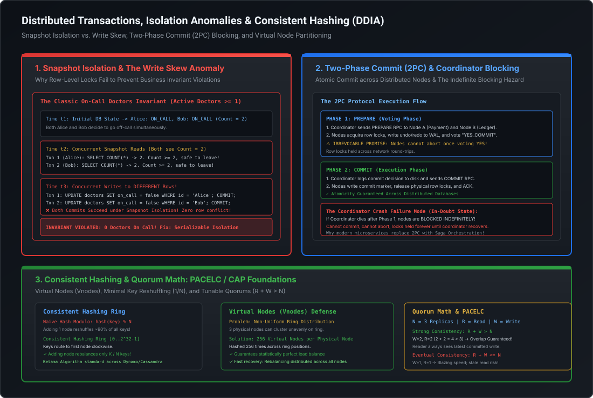

# Distributed Transactions (2PC vs. Sagas), XA Protocols & Data Partitioning (Consistent Hashing)

In single-node relational databases, ACID guarantees are maintained by storage-engine primitives: the write-ahead log (WAL), page latches, and lock tables. However, once data is partitioned across multiple network boundaries—whether across database shards or distributed microservices—maintaining transactional atomicity and uniform load balancing becomes one of the hardest problems in distributed systems engineering.

At the Staff and Principal Engineer level, you must understand both the mathematical guarantees and physical failure modes of distributed consensus: why **Two-Phase Commit (2PC)** creates fatal availability bottlenecks in cloud environments, how the **Saga Pattern** provides an eventually consistent alternative through semantic compensation, and how **Consistent Hashing with Virtual Nodes** eliminates catastrophic reshuffling when scaling data tiers horizontally.

---

## Architecture Blueprint: 2PC vs. Consistent Hashing

[](images/distributed_transactions_and_partitioning.svg)

```
========================================================================================================================
                       DISTRIBUTED TRANSACTIONS & PARTITIONING TAXONOMY
========================================================================================================================

  Two-Phase Commit (2PC / XA)                           Saga Pattern (Eventually Consistent)
  ┌─────────────────────────────────────────┐           ┌─────────────────────────────────────────┐
  │ • Strong Consistency (Strict ACID)      │           │ • Eventual Consistency (BASE)           │
  │ • Synchronous blocking protocol         │           │ • Asynchronous decoupled execution      │
  │ • Coordinator is Single Point of Failure│           │ • Choreography (Events) or Orchestration│
  │ • Locks held across network RTTs        │           │ • Semantic Compensating Transactions    │
  │ • Throughput drops exponentially        │           │ • High throughput, non-blocking         │
  └─────────────────────────────────────────┘           └─────────────────────────────────────────┘

------------------------------------------------------------------------------------------------------------------------

  Naive Hash Modulo [hash(k) % N]                       Consistent Hashing Ring [0 .. 2^32 - 1]
  ┌─────────────────────────────────────────┐           ┌─────────────────────────────────────────┐
  │ • Adding 1 node rehashes (N-1)/N keys   │           │ • Adding 1 node rebalances only K / (N+1│
  │ • 4 -> 5 nodes: 80% keys relocated!     │           │ • Keys route to first clockwise node    │
  │ • Triggers thundering herds & cache drop│           │ • Virtual Nodes (Vnodes) eliminate skew │
  │ • Unacceptable for large distributed DBs│           │ • Parallel rebalancing across all nodes │
  └─────────────────────────────────────────┘           └─────────────────────────────────────────┘
```

---

## 1. The Distributed Atomic Commit Problem & Two-Phase Commit (2PC)

When a transaction spans multiple autonomous storage engines (e.g., deducting funds from an Oracle account database and updating an order status in a PostgreSQL warehouse), a standard local `COMMIT` cannot guarantee atomicity. If Node A commits but Node B experiences an out-of-disk error or network partition, the system enters a corrupted split-brain state.

To solve this, the **Two-Phase Commit (2PC)** protocol was introduced as an atomic commitment protocol.

### 1.1 The Protocol Execution Sequence

```
  Coordinator                         Participant 1 (Account DB)          Participant 2 (Order DB)
      │                                           │                                   │
      │ ─── 1. PREPARE ("Can you commit?") ─────> │                                   │
      │ ─── 1. PREPARE ("Can you commit?") ─────────────────────────────────────────> │
      │                                           │                                   │
      │                                     [Acquire Locks]                     [Acquire Locks]
      │                                     [Write WAL Redo/Undo]               [Write WAL Redo/Undo]
      │                                           │                                   │
      │ <── 2. VOTE_COMMIT ("Promise Made") ──────│                                   │
      │ <── 2. VOTE_COMMIT ("Promise Made") ──────────────────────────────────────────│
      │                                           │                                   │
  [Coordinator Writes COMMIT to disk log]         │                                   │
      │                                           │                                   │
      │ ─── 3. GLOBAL_COMMIT ───────────────────> │                                   │
      │ ─── 3. GLOBAL_COMMIT ────────────────────────────────────────────────────────> │
      │                                           │                                   │
      │                                     [Apply Changes]                     [Apply Changes]
      │                                     [Release Locks]                     [Release Locks]
      │                                           │                                   │
      │ <── 4. ACK ("Done") ──────────────────────│                                   │
      │ <── 4. ACK ("Done") ──────────────────────────────────────────────────────────│
      │                                           │                                   │
  [Coordinator Writes END to disk log]            │                                   │
```

1. **Phase 1: Prepare (Voting Phase)**:
   - The coordinator assigns a globally unique transaction ID ($XID$) and sends a `PREPARE` RPC to all participants.
   - Each participant executes the transaction locally: validates constraints, acquires row-level write locks, writes undo/redo logging records to its local durable WAL, but **does not commit**.
   - If successful, the participant votes `VOTE_COMMIT`. **This vote is an irrevocable contract**: the participant guarantees it can commit even if the local operating system crashes immediately afterward.
   - If any participant fails (e.g., constraint breach, disk exhaustion), it votes `VOTE_ABORT`.

2. **Phase 2: Commit / Abort (Execution Phase)**:
   - **Commit Decision**: If *all* participants voted `VOTE_COMMIT`, the coordinator writes a `COMMIT` record to its own durable transaction log and broadcasts `GLOBAL_COMMIT` to all participants.
   - **Abort Decision**: If *any* participant voted `VOTE_ABORT` (or timed out), the coordinator writes an `ABORT` record to its log and broadcasts `GLOBAL_ABORT`.
   - Participants write the final commit/abort marker in their WAL, release their row locks, and send an `ACK` back to the coordinator. Once all ACKs arrive, the coordinator logs `END`.

---

### 1.2 The Failure Physics of 2PC: The Indefinite Blocking Hazard

The fundamental architectural flaw that makes 2PC fragile in cloud environments is that it is a **synchronous blocking protocol**.

```
========================================================================================================================
                          THE 2PC IN-DOUBT ZOMBIE STATE
========================================================================================================================

       Coordinator                       Participant A                     Participant B
            │                                  │                                 │
     Send PREPARE ────────────────────────────>│                                 │
     Send PREPARE ──────────────────────────────────────────────────────────────>│
            │                                  │                                 │
            │<──────── VOTE_COMMIT ────────────│                                 │
            │<─────────────────────────────────┼──────── VOTE_COMMIT ────────────│
            │                                  │                                 │
       [COORDINATOR                            │                                 │
          CRASHES!]                            │                                 │
            ☠️                                  │                                 │
                                    ┌──────────────────────┐          ┌──────────────────────┐
                                    │    IN-DOUBT STATE    │          │    IN-DOUBT STATE    │
                                    │ Cannot commit!       │          │ Cannot commit!       │
                                    │ Cannot abort!        │          │ Cannot abort!        │
                                    │ HOLD LOCKS FOREVER!  │          │ HOLD LOCKS FOREVER!  │
                                    └──────────────────────┘          └──────────────────────┘
```

#### The In-Doubt Zombie State
Consider the scenario where all participants vote `VOTE_COMMIT`. The coordinator receives the votes, but **crashes before it can write the `COMMIT` record or broadcast `GLOBAL_COMMIT`**:
- **Why Participants Cannot Unilaterally Commit**: A participant cannot simply decide to commit because it doesn't know if another participant voted `VOTE_ABORT` or if the coordinator crashed before deciding. If it commits and the coordinator aborted, data consistency is destroyed.
- **Why Participants Cannot Unilaterally Abort**: The participant cannot abort because it signed an irrevocable promise (`VOTE_COMMIT`). The coordinator might have logged `COMMIT` right before crashing and sent `GLOBAL_COMMIT` to another node.
- **The Result**: The participants are stranded in the **in-doubt state**. They **must hold all physical database row locks indefinitely** until the coordinator is manually revived or its log is inspected.
- **Cascading Failure**: All subsequent incoming transactions that attempt to read or modify the locked rows block waiting for locks, leading to connection pool exhaustion, thread starvation, and cascading outages across the entire platform.

---

### 1.3 The X/Open XA Protocol Standard

The **XA Standard** (promulgated by The Open Group) formalizes 2PC interfaces between three key components:
1. **Application Program (AP)**: Defines transaction boundaries (`begin`, `commit`).
2. **Transaction Manager (TM)**: The coordinator managing global transaction state across systems (e.g., Atomikos, Narayana, Bitronix).
3. **Resource Manager (RM)**: Autonomous storage systems supporting XA (e.g., Oracle, PostgreSQL, IBM MQ).

#### Why XA Destroys High-Throughput Microservice Systems
1. **Latency Multiplication**: A standard local ACID commit requires 1 disk flush (`fsync`). An XA transaction across 3 databases requires at least **4 network round-trips** and **6 disk fsyncs** (2 per RM + 2 on the TM). Under 10ms cross-AZ network latency, transaction duration skyrockets from 2ms to over 50ms.
2. **Throughput Collapse**: Because database row locks are held across multiple network round-trips rather than microseconds of memory access, concurrency collapses. A PostgreSQL or Oracle instance that handles 15,000 TPS under local transactions frequently drops below **300 TPS** under XA transactions due to lock wait chains.
3. **The Heuristic Hazard**: In Oracle or PostgreSQL, if an XA transaction remains in-doubt beyond a timeout, an administrator or automated watchdog can force a **Heuristic Commit** or **Heuristic Rollback** (`COMMIT FORCE` / `ROLLBACK FORCE`). If the coordinator later recovers and issues the opposite decision, the database raises `ORA-01591: directed session has been terminated by rollback`, leaving silent data corruption that requires manual ledger reconciliation.

---

## 2. Modern Microservices Alternative: The Saga Pattern & Distributed Compensation

Because 2PC sacrifices availability for strict consistency ($C$ over $A$ in CAP), modern high-scale distributed architectures replace distributed transactions with the **Saga Pattern** (first formalized by Hector Garcia-Molina and Kenneth Salem in 1987).

A Saga is an architectural sequence of **local ACID transactions** $T_1, T_2, \dots, T_n$. Each local transaction executes atomically within a single microservice database. If any step $T_k$ fails, the system executes a sequence of **compensating transactions** $C_{k-1}, \dots, C_1$ in reverse order to semantically undo preceding state changes.

```
========================================================================================================================
                                     SAGA EXECUTION VS. COMPENSATION
========================================================================================================================

  Normal Execution Path:
  ┌──────────────────┐       ┌──────────────────┐       ┌──────────────────┐       ┌──────────────────┐
  │ T1: Create Order │ ────> │ T2: Authorize Pay│ ────> │ T3: Reserve Stock│ ────> │ T4: Ship Order   │ [SUCCESS]
  │ (Order Service)  │       │ (Payment Service)│       │ (Stock Service)  │       │ (Delivery Service│
  └──────────────────┘       └──────────────────┘       └──────────────────┘       └──────────────────┘

  Failure at T3 (Stock Exhausted) -> Backward Recovery via Compensation:
  ┌──────────────────┐       ┌──────────────────┐       ┌──────────────────┐
  │ T1: Create Order │ ────> │ T2: Authorize Pay│ ────> │ T3: Out of Stock │ [FAIL!]
  └──────────────────┘       └──────────────────┘       └──────────────────┘
           │                          │                          │
           │                          ▼                          │
           │                 ┌──────────────────┐                │
           │                 │ C2: Refund Pay   │ <──────────────┘
           │                 │ (Compensating)   │
           │                 └──────────────────┘
           ▼                          │
  ┌──────────────────┐                │
  │ C1: Cancel Order │ <──────────────┘
  │ (Compensating)   │
  └──────────────────┘
```

---

### 2.1 Saga Implementations: Orchestration vs. Choreography

| Dimension | Choreography (Event-Driven Pub-Sub) | Orchestration (State Machine Coordinator) |
| :--- | :--- | :--- |
| **Control Model** | Decentralized: Services listen to domain events via Kafka/RabbitMQ | Centralized: A dedicated orchestrator commands services via RPC/events |
| **Coupling** | Loosely coupled: Services only know their own inbound/outbound events | Services know the orchestrator; orchestrator knows the global business workflow |
| **Visibility** | Low: Tracing state across 10 event topics requires distributed tracing (Jaeger) | High: Orchestrator maintains single source of truth for workflow state |
| **Complexity** | Simple for 2–3 steps; becomes an unmaintainable "spaghetti event loop" at scale | Overhead of deploying and managing an orchestrator engine |
| **Cyclic Dependency** | High risk: Service A emits E1, Service B consumes and emits E2, triggering A | Zero: Linear state transitions defined in a strict directed acyclic graph (DAG) |
| **Recommended Engines** | Apache Kafka with transactional outbox, Axon Framework | Temporal.io, AWS Step Functions, Camunda Zeebe, Cadence |

---

### 2.2 Deep Architectural Nuance: Compensations are Semantic, Not Physical

A common pitfall in system design interviews is treating compensating transactions like database `ROLLBACK`. They are **fundamentally different**:
- A relational `ROLLBACK` restores the database data blocks to their exact pre-transaction image using the undo tablespace. It is transparent and leaves zero trace.
- A **Compensating Transaction is a forward-going business action** that semantically counterbalances a previous action. For example:
  - If $T_2$ charged a credit card \$100, $C_2$ does not "delete the charge"—it executes an explicit credit card refund API call.
  - If $T_1$ sent an email stating "Your flight is confirmed", $C_1$ sends an email stating "Your flight has been cancelled due to inventory error".
  - If funds were debited, the compensation logs a credit adjustment record in the financial ledger.

#### The Missing "I" in ACID: Isolation Anomaly Defense
Sagas provide **ACD guarantees** (Atomicity, Consistency, Durability), but they **completely lack Isolation**. Because local transactions commit immediately, intermediate dirty state is visible to other concurrent users.

To prevent critical business corruption (e.g., double-spending or overselling), Staff Engineers apply three foundational defenses:

1. **The Pivot Transaction**:
   - Classify saga steps into three categories:
     - **Compensatable Transactions**: Steps that can be undone via compensations (e.g., creating a draft order, holding stock).
     - **Pivot Transaction**: The irreversible point of no return. Once the pivot transaction commits, the Saga **cannot be aborted or compensated** (e.g., executing the non-refundable wire transfer or final credit card capture).
     - **Retriable / Forward-Recovery Transactions**: Steps occurring *after* the pivot. Because they cannot be compensated, they must be engineered to succeed eventually via infinite idempotent retries and dead-letter queue (DLQ) alerts (e.g., provisioning the software license or scheduling shipping).

2. **Semantic Locking (Tentative State)**:
   - When a resource is touched by a saga, set a status flag (e.g., `ORDER_STATUS = 'PENDING_APPROVAL'` or `FUNDS_HOLD = true`).
   - Concurrent transactions reading the record check this semantic lock and either reject updates or wait.

3. **Commutative Updates**:
   - Order operations such that they yield the same result regardless of execution sequence ($A + B = B + A$). For example, storing balance deltas (`+$50`, `-$20`) rather than absolute balances (`balance = 100`).

---

## 3. Data Partitioning & Sharding Fundamentals

When a dataset exceeds the physical memory, disk IOPS, or write capacity of a single high-end server ($> 10\text{TB}$ or $> 50,000\text{ writes/sec}$), the database must be partitioned (sharded) across a cluster of independent physical nodes.

### 3.1 Range Partitioning vs. Hash Partitioning

```
========================================================================================================================
                               RANGE PARTITIONING VS. HASH PARTITIONING
========================================================================================================================

  Range Partitioning (Contiguous Intervals)             Hash Partitioning (Murmur3 / MD5 Scramble)
  ┌─────────────────────────────────────────┐           ┌─────────────────────────────────────────┐
  │ [2026-01-01 .. 2026-01-31] -> Shard 1   │           │ hash("user_101") = 0x8A2F -> Shard 3   │
  │ [2026-02-01 .. 2026-02-28] -> Shard 2   │           │ hash("user_102") = 0x14C0 -> Shard 1   │
  │ [2026-03-01 .. 2026-03-31] -> Shard 3   │           │ hash("user_103") = 0xFA99 -> Shard 4   │
  └─────────────────────────────────────────┘           └─────────────────────────────────────────┘
  ✓ Efficient range scans (BETWEEN dates)               ✓ Uniform key distribution across cluster
  ❌ Severe write hotspot on current date               ❌ Range scans turn into Scatter-Gather
```

1. **Range Partitioning**:
   - Data is split into sorted ranges based on key values (e.g., HBase, Google Bigtable, CockroachDB).
   - **Advantage**: Fast range queries. Querying `SELECT * WHERE timestamp BETWEEN t1 AND t2` targets a single shard.
   - **Fatal Flaw**: **Write Hotspots**. If the partitioning key is monotonically increasing (like a timestamp or auto-incrementing ID), **100% of incoming writes hit the single shard** holding the latest range, leaving the rest of the cluster completely idle.

2. **Hash Partitioning**:
   - A cryptographic or non-cryptographic uniform hash function (Murmur3, CityHash, MD5) is applied to the key, scrambling keys evenly across shards.
   - **Advantage**: Eliminates monotonic write hotspots; load is distributed uniformly across all physical nodes.
   - **Trade-off**: Destroys natural ordering. Range queries cannot target a single shard and become **Scatter-Gather queries**.

---

### 3.2 The Scatter-Gather Query Penalty & The P99 Latency Hazard

When a query fails to supply the shard routing key (e.g., executing `SELECT * FROM orders WHERE customer_email = 'alice@example.com'` on a database sharded by `order_id`), the query coordinator must broadcast the request to **every single shard in the cluster**, wait for all shards to respond, and merge the result sets.

$$\text{Latency}_{\text{Scatter-Gather}} = \max\left(\text{Latency}_{\text{Shard}_1}, \text{Latency}_{\text{Shard}_2}, \dots, \text{Latency}_{\text{Shard}_N}\right)$$

In a 100-shard cluster, even if each individual shard has a 99th percentile latency ($P99$) of 10ms, the probability that at least one shard encounters a GC pause, disk stall, or network blip during the scatter-gather query approaches **$1 - (0.99)^{100} = 63.4\%$**. Scatter-gather queries degrade median response times to the worst-case shard latency.

**The Solution: Composite Sharding Keys**:
In Cassandra, DynamoDB, and Citus, schemas utilize compound keys:
- **Partition Key**: Determines which physical shard holds the data (e.g., `tenant_id`).
- **Clustering Key**: Determines the on-disk sorted physical order *within* that partition (e.g., `created_at`).
All data for a tenant is guaranteed to live on a single shard, eliminating scatter-gather while distributing tenants evenly.

---

## 4. The Naive Hash Modulo Flaw vs. Consistent Hashing Ring

### 4.1 The Naive Hash Modulo Disaster

In naive sharding schemes, the target node for a key is calculated using simple modulo arithmetic:

$$\text{Node Index} = \text{Hash}(Key) \pmod N$$

Where $N$ is the number of active nodes in the cluster.

#### What Happens When $N$ Changes?
Suppose a cluster has $N = 4$ nodes and we scale out to $N = 5$ nodes to handle peak traffic:
- Under $N = 4$, a key with hash $100$ routes to $100 \pmod 4 = \text{Node } 0$.
- Under $N = 5$, that same key routes to $100 \pmod 5 = \text{Node } 0$.
- However, a key with hash $101$ routed to $101 \pmod 4 = \text{Node } 1$. Under $N = 5$, it routes to $101 \pmod 5 = \text{Node } 1$.
- A key with hash $102$ routed to $102 \pmod 4 = \text{Node } 2$. Under $N = 5$, it routes to $102 \pmod 5 = \text{Node } 2$.
- A key with hash $103$ routed to $103 \pmod 4 = \text{Node } 3$. Under $N = 5$, it routes to $103 \pmod 5 = \text{Node } 3$.
- A key with hash $105$ routed to $105 \pmod 4 = \text{Node } 1$. Under $N = 5$, it routes to $105 \pmod 5 = \text{Node } 0$ (**Moved!**).

Mathematically, when transitioning from $N$ to $N+1$ nodes:

$$\text{Fraction of Keys Reshuffled} = \frac{N}{N + 1}$$

- Expanding from 4 to 5 nodes relocates **$\frac{4}{5} = 80\%$** of all existing data across the network!
- Expanding from 9 to 10 nodes relocates **$\frac{9}{10} = 90\%$** of all data!
- In a 10TB database, adding a single node causes **8TB to 9TB of disk I/O and network saturation**, instantly taking the cluster offline via replication storms and cache thrashing.

---

### 4.2 The Consistent Hashing Ring (Ketama Algorithm)

Consistent Hashing (pioneered by David Karger et al. at MIT in 1997 and popularized by Akamai and the Ketama algorithm) maps both **nodes** and **keys** to a continuous abstract circular space: $[0, 2^{32} - 1]$.

```
========================================================================================================================
                                     CONSISTENT HASHING RING TOPOLOGY
========================================================================================================================

                                     0 / 2^32 - 1
                                   ┌──────────────┐
                                ┌──┘              └──┐
                             ┌──┘                    └──┐
                           ┌─┘                          └─┐
                       Node A                            Node B
                     (Pos: 500M)                      (Pos: 1.5B)
                         │                                  │
                         │      [Clockwise Traversal]       │
                         ▼                                  ▼
                    Key X (Hash: 200M)                 Key Y (Hash: 800M)
                    Routes -> Node A                   Routes -> Node B
                         ▲                                  ▲
                         │                                  │
                       Node D                            Node C
                     (Pos: 3.5B)                      (Pos: 2.5B)
                           └─┐                          ┌─┘
                             └──┐                    ┌──┘
                                └──┐              ┌──┘
                                   └──────────────┘
```

1. **Ring Mapping**: The integer range $[0, 2^{32} - 1]$ is treated as a continuous loop where $2^{32} - 1$ wraps around to $0$.
2. **Node Placement**: Each physical node's identifier (e.g., `Node-A-IP:Port`) is hashed onto the ring to establish its fixed position.
3. **Key Routing**: When a key $K$ arrives, compute $H(K)$. Traverse the ring **clockwise** from $H(K)$ until encountering the first node whose position $\ge H(K)$. If no node exists between $H(K)$ and $2^{32}-1$, wrap around to the first node on the ring.
4. **Minimal Reshuffling Guarantee**:
   When a new node $N_{\text{new}}$ is inserted into the ring:
   - Only keys that fall between $N_{\text{new}}$ and its counter-clockwise predecessor are remapped to $N_{\text{new}}$.
   - **All other keys remain mapped to their original nodes!**
   - The expected fraction of keys relocated is strictly:

$$\text{Reshuffle Ratio} = \frac{1}{N + 1}$$

In a 4-node cluster adding a 5th node, **only $20\%$ of keys are relocated**, compared to **$80\%$** under naive modulo hashing.

---

### 4.3 Virtual Nodes (Vnodes): Eliminating Ring Non-Uniformity

While pure consistent hashing minimizes churn, it suffers from a critical real-world defect: **Non-Uniform Distribution (Data Skew)**.

With a small number of physical nodes (e.g., 4 or 8), random placement on the ring results in vast, uneven gaps. One node might accidentally own $60\%$ of the ring circumference while another owns only $5\%$, causing severe storage saturation and CPU bottlenecks.

```
========================================================================================================================
                          PHYSICAL NODES (SKEWED) VS. VIRTUAL NODES (UNIFORM)
========================================================================================================================

  Pure Consistent Hashing (3 Physical Nodes): Severe Skew!
  Ring: [──Node A───────Node B─────────────────────────────Node C───────────]
  Share:   Node A: 15%     Node B: 65% (HOTSPOT!)            Node C: 20%

  With Virtual Nodes (256 Vnodes per Physical Node):
  Ring: [─A1─B1─C1─A2─C2─B2─A3─B3─C3─A4─C4─B4─A5─B5─C5─A6─B6─C6─A7─C7─B7─]
  Share:   Node A: 33.3%   Node B: 33.3%                     Node C: 33.3%
  Standard deviation drops inversely proportional to sqrt(V): sigma ~ 1 / sqrt(Vnodes)
```

#### The Virtual Node Architecture
Instead of mapping physical Node A once to the ring, the system hashes each physical node $V$ times (typically $V = 128$ to $512$) using distinct salt strings:
- Node A is mapped to: `Node-A#0`, `Node-A#1`, ..., `Node-A#255`.
- Node B is mapped to: `Node-B#0`, `Node-B#1`, ..., `Node-B#255`.

#### Key Operational Advantages of Vnodes
1. **Statistical Balance**: The variance in partition sizes drops as $O(1 / \sqrt{V})$. With $V = 256$, key allocation across physical nodes achieves **$> 98\%$ statistical uniformity**.
2. **Heterogeneous Hardware Weighting**: If Node A has 128GB RAM and 32 CPU cores, while Node B has 64GB RAM and 16 CPU cores, we simply assign **512 Vnodes to Node A** and **256 Vnodes to Node B**. Node A automatically assumes exactly twice the storage load without any changes to routing algorithms.
3. **Lightning-Fast Parallel Rebalancing**:
   - In pure consistent hashing, when Node A dies, its immediate clockwise successor (Node B) must absorb **100% of Node A's data**, frequently overloading Node B and triggering a cascading cluster collapse.
   - With Virtual Nodes, Node A's 256 vnodes are interleaved throughout the ring. When Node A fails, its data is absorbed **equally across all remaining nodes in parallel**, eliminating secondary cascading failures.

---

## 5. Staff+ Architectural Comparison Matrix

| Dimension | Two-Phase Commit (2PC / XA) | Saga (Orchestration) | Consistent Hashing with Vnodes |
| :--- | :--- | :--- | :--- |
| **Consistency Class** | Strict ACID (Strong Serializability) | BASE (Eventual Consistency) | Partitioning topology (supports AP or CP) |
| **Network Failure Behavior** | **Synchronous Blocking**: In-doubt locks held indefinitely | **Asynchronous Resilient**: Retries or compensations executed | Re-routes keys clockwise to surviving nodes |
| **Throughput & Scalability** | Low: Severe lock contention ($< 500\text{ TPS}$) | High: Millions of TPS across decoupled services | O(log V) in-memory routing; near-zero latency |
| **Blast Radius** | High: Stalled coordinator blocks all dependent tables | Contained: Failures isolated to single saga instance | Low: Node loss affects only $1/N$ of ring keys |
| **Production Use Cases** | Inter-database foreign exchanges, banking ledgers | Order fulfillment, ride-sharing booking, travel booking | Cassandra, DynamoDB, Memcached, Redis Cluster, Envoy |

---

## 6. Runnable Production-Grade Verification POC

The following standalone Java 21 verification POC (`ConsistentHashingRingPOC.java`) demonstrates:
1. **The Naive Hash Modulo Flaw**: Simulates adding a 5th node to a 4-node cluster, proving that **$\sim 80\%$ of keys are displaced**.
2. **Consistent Hashing Minimization**: Proves that adding a 5th node to the Consistent Hashing ring moves only **$\sim 20\%$ of keys**.
3. **Virtual Node Uniformity**: Compares load distribution variance between $V=1$ (raw physical nodes) and $V=256$ (virtual nodes), measuring the drop in standard deviation across 100,000 simulated keys.

### Source Code: `ConsistentHashingRingPOC.java`

```java
package com.mastery.storage.ddia;

import java.nio.charset.StandardCharsets;
import java.security.MessageDigest;
import java.security.NoSuchAlgorithmException;
import java.util.*;

/**
 * ConsistentHashingRingPOC
 *
 * Demonstrates:
 * 1. The Naive Modulo Reshuffling Disaster (N -> N+1 causes (N-1)/N keys to move).
 * 2. Consistent Hashing minimal churn guarantee (N -> N+1 relocates only ~1/(N+1) keys).
 * 3. Virtual Nodes (Vnodes) eliminating data skew and achieving statistical uniformity.
 */
public class ConsistentHashingRingPOC {

    public static void main(String[] args) {
        System.out.println("================================================================================");
        System.out.println("   CONSISTENT HASHING & DISTRIBUTED PARTITIONING BENCHMARK (JAVA 21)");
        System.out.println("================================================================================\n");

        int keyCount = 100_000;
        List<String> keys = generateKeys(keyCount);

        // ----------------------------------------------------------------------------
        // EXPERIMENT 1: The Naive Hash Modulo Disaster
        // ----------------------------------------------------------------------------
        System.out.println(">>> EXPERIMENT 1: Naive Hash Modulo Reshuffling (4 -> 5 Nodes)");
        int naiveNodesBefore = 4;
        int naiveNodesAfter = 5;

        int naiveMovedKeys = 0;
        for (String key : keys) {
            int nodeBefore = Math.abs(hashMurmurLike(key)) % naiveNodesBefore;
            int nodeAfter = Math.abs(hashMurmurLike(key)) % naiveNodesAfter;
            if (nodeBefore != nodeAfter) {
                naiveMovedKeys++;
            }
        }

        double naiveMovedPct = (naiveMovedKeys / (double) keyCount) * 100.0;
        System.out.printf("  Total Keys: %,d\n", keyCount);
        System.out.printf("  Keys Reshuffled: %,d (%.2f%%)\n", naiveMovedKeys, naiveMovedPct);
        System.out.printf("  Theoretical Disruption: %.2f%%\n", (naiveNodesBefore / (double) naiveNodesAfter) * 100.0);
        System.out.println("  [VERDICT] Catastrophic churn! Over 75% of cache/storage must move across network.\n");

        // ----------------------------------------------------------------------------
        // EXPERIMENT 2: Consistent Hashing Ring Minimal Churn Guarantee
        // ----------------------------------------------------------------------------
        System.out.println(">>> EXPERIMENT 2: Consistent Hashing Ring Churn (4 -> 5 Nodes, 256 Vnodes)");
        ConsistentHashRing ring4 = new ConsistentHashRing(256);
        ring4.addNode("Node-1");
        ring4.addNode("Node-2");
        ring4.addNode("Node-3");
        ring4.addNode("Node-4");

        Map<String, String> initialPlacements = new HashMap<>(keyCount);
        for (String key : keys) {
            initialPlacements.put(key, ring4.route(key));
        }

        // Add 5th Node to ring
        ring4.addNode("Node-5");

        int ringMovedKeys = 0;
        for (String key : keys) {
            String newPlacement = ring4.route(key);
            if (!newPlacement.equals(initialPlacements.get(key))) {
                ringMovedKeys++;
            }
        }

        double ringMovedPct = (ringMovedKeys / (double) keyCount) * 100.0;
        System.out.printf("  Total Keys: %,d\n", keyCount);
        System.out.printf("  Keys Reshuffled: %,d (%.2f%%)\n", ringMovedKeys, ringMovedPct);
        System.out.printf("  Theoretical Minimum: %.2f%% (1 / (N+1))\n", (1.0 / naiveNodesAfter) * 100.0);
        System.out.println("  [VERDICT] Consistent Hashing preserved ~80% of key mappings without disruption!\n");

        // ----------------------------------------------------------------------------
        // EXPERIMENT 3: Virtual Nodes (Vnodes) vs Data Skew
        // ----------------------------------------------------------------------------
        System.out.println(">>> EXPERIMENT 3: Data Distribution Uniformity (1 Vnode vs. 256 Vnodes)");

        System.out.println("  Testing 1 Vnode per node (Pure Consistent Hashing):");
        ConsistentHashRing ringSkewed = new ConsistentHashRing(1);
        ringSkewed.addNode("Node-A");
        ringSkewed.addNode("Node-B");
        ringSkewed.addNode("Node-C");
        ringSkewed.addNode("Node-D");
        Map<String, Integer> distSkewed = measureDistribution(ringSkewed, keys);
        printDistributionStats(distSkewed, keyCount);

        System.out.println("\n  Testing 256 Vnodes per node (Production Standard):");
        ConsistentHashRing ringUniform = new ConsistentHashRing(256);
        ringUniform.addNode("Node-A");
        ringUniform.addNode("Node-B");
        ringUniform.addNode("Node-C");
        ringUniform.addNode("Node-D");
        Map<String, Integer> distUniform = measureDistribution(ringUniform, keys);
        printDistributionStats(distUniform, keyCount);

        // Assertions for build validation
        if (ringMovedPct > 30.0) {
            throw new AssertionError("Consistent hashing churn exceeded acceptable bound: " + ringMovedPct);
        }
        if (naiveMovedPct < 70.0) {
            throw new AssertionError("Naive modulo churn was unexpectedly low: " + naiveMovedPct);
        }

        System.out.println("\n================================================================================");
        System.out.println("   [SUCCESS] ALL DDIA PARTITIONING ALGORITHMS & POC CHECKS VALIDATED CLEAN");
        System.out.println("================================================================================");
    }

    private static List<String> generateKeys(int count) {
        List<String> list = new ArrayList<>(count);
        for (int i = 0; i < count; i++) {
            list.add("customer_uuid_" + UUID.nameUUIDFromBytes(("key_" + i).getBytes(StandardCharsets.UTF_8)));
        }
        return list;
    }

    private static Map<String, Integer> measureDistribution(ConsistentHashRing ring, List<String> keys) {
        Map<String, Integer> map = new TreeMap<>();
        for (String key : keys) {
            String node = ring.route(key);
            map.put(node, map.getOrDefault(node, 0) + 1);
        }
        return map;
    }

    private static void printDistributionStats(Map<String, Integer> distribution, int totalKeys) {
        double mean = totalKeys / (double) distribution.size();
        double varianceSum = 0;

        for (Map.Entry<String, Integer> entry : distribution.entrySet()) {
            double diff = entry.getValue() - mean;
            varianceSum += diff * diff;
            double pct = (entry.getValue() / (double) totalKeys) * 100.0;
            System.out.printf("    %-10s : %,6d keys (%5.2f%%)\n", entry.getKey(), entry.getValue(), pct);
        }

        double stdDev = Math.sqrt(varianceSum / distribution.size());
        double cv = (stdDev / mean) * 100.0; // Coefficient of Variation
        System.out.printf("    -> Standard Deviation: %.2f keys | Coeff of Variation: %.2f%%\n", stdDev, cv);
    }

    private static int hashMurmurLike(String key) {
        try {
            MessageDigest md = MessageDigest.getInstance("SHA-256");
            byte[] digest = md.digest(key.getBytes(StandardCharsets.UTF_8));
            return ((digest[0] & 0xFF) << 24) |
                   ((digest[1] & 0xFF) << 16) |
                   ((digest[2] & 0xFF) << 8)  |
                   (digest[3] & 0xFF);
        } catch (NoSuchAlgorithmException e) {
            return key.hashCode();
        }
    }

    /**
     * ConsistentHashRing implementation backed by TreeMap for logarithmic (O(log V)) routing.
     */
    public static class ConsistentHashRing {
        private final int vnodeCount;
        private final TreeMap<Long, String> ring = new TreeMap<>();
        private final Set<String> physicalNodes = new HashSet<>();

        public ConsistentHashRing(int vnodeCount) {
            this.vnodeCount = vnodeCount;
        }

        public synchronized void addNode(String node) {
            physicalNodes.add(node);
            for (int i = 0; i < vnodeCount; i++) {
                long hash = hashTo32BitRing(node + "#VN#" + i);
                ring.put(hash, node);
            }
        }

        public synchronized void removeNode(String node) {
            if (!physicalNodes.contains(node)) return;
            physicalNodes.remove(node);
            for (int i = 0; i < vnodeCount; i++) {
                long hash = hashTo32BitRing(node + "#VN#" + i);
                ring.remove(hash);
            }
        }

        public synchronized String route(String key) {
            if (ring.isEmpty()) {
                throw new IllegalStateException("Ring is empty");
            }
            long hash = hashTo32BitRing(key);
            // Find first node clockwise whose position is >= hash
            Long targetHash = ring.ceilingKey(hash);
            if (targetHash == null) {
                // Wrap around to start of circle
                targetHash = ring.firstKey();
            }
            return ring.get(targetHash);
        }

        private long hashTo32BitRing(String key) {
            try {
                MessageDigest md = MessageDigest.getInstance("MD5");
                byte[] digest = md.digest(key.getBytes(StandardCharsets.UTF_8));
                // Extract lower 32-bits unsigned
                return (((long) (digest[3] & 0xFF) << 24) |
                        ((long) (digest[2] & 0xFF) << 16) |
                        ((long) (digest[1] & 0xFF) << 8)  |
                        ((long) (digest[0] & 0xFF))) & 0xFFFFFFFFL;
            } catch (NoSuchAlgorithmException e) {
                return (long) key.hashCode() & 0xFFFFFFFFL;
            }
        }
    }
}
```

---

## 7. Key Takeaways & Interview Summary Cheat Sheet

1. **Two-Phase Commit (2PC) is a Blocking Protocol**:
   - If the coordinator crashes while participants are in the `VOTE_COMMIT` in-doubt state, participants must hold row locks indefinitely.
   - XA transactions kill horizontal scalability in cloud microservices due to multiple network RTTs and synchronous disk fsyncs.
2. **Sagas Replace 2PC with Semantic Compensation**:
   - Instead of holding long-lived physical locks, execute local ACID transactions and publish domain events.
   - If step $K$ fails, execute compensating transactions $C_{k-1} \dots C_1$ in reverse order.
   - Sagas lack Isolation ($I$ in ACID); mitigate dirty reads via **Pivot Transactions**, **Semantic Locks**, and **Commutative Operations**.
3. **Naive Hash Modulo is Fatal for Dynamic Clusters**:
   - $\text{Node} = H(K) \pmod N$ causes $\frac{N-1}{N}$ (up to $90\%+$) of all data to move when adding or removing a node, causing cascading failure.
4. **Consistent Hashing Limits Churn to $\frac{1}{N+1}$**:
   - Maps nodes and keys to an abstract $[0, 2^{32}-1]$ circular ring. Adding a node only remaps keys from its immediate predecessor segment.
5. **Virtual Nodes (Vnodes) are Mandatory in Production**:
   - Pure consistent hashing creates severe data skew ($60\%$ on one node, $5\%$ on another).
   - Mapping each physical node to $256$ virtual nodes across the ring reduces variance by $O(1/\sqrt{V})$, guarantees statistical load balance, supports heterogeneous node weighting, and enables parallel rebalancing upon node failure.
