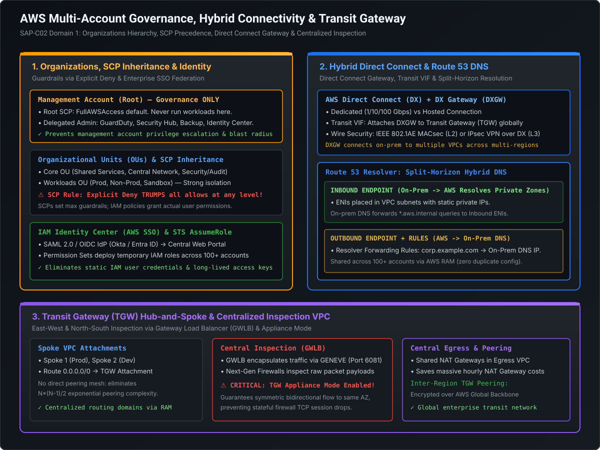

# Multi-Account Governance, SCP Evaluation & Enterprise Identity Federation

In enterprise cloud architecture, hosting all applications and environments within a single AWS account is an anti-pattern that creates catastrophic blast radiuses, security boundary leaks, and account-level service quota contention. A Staff or Principal Cloud Architect must design a **multi-account landing zone** that enforces centralized governance, automated guardrails, and seamless federated identity.

This playbook breaks down the deep architecture of **AWS Organizations**, the exact mathematical evaluation flow of **Service Control Policies (SCPs)**, automated governance via **AWS Control Tower**, enterprise identity with **AWS IAM Identity Center (formerly AWS SSO)**, and cross-account delegation via **AWS Security Token Service (STS)**.

---

## Architecture Blueprint: Organizations, SCPs & Identity Center

[](images/aws_organizations_and_hybrid_networking.svg)

```
========================================================================================================================
                               ENTERPRISE MULTI-ACCOUNT HIERARCHY
========================================================================================================================

                                     ┌───────────────────────────────┐
                                     │      MANAGEMENT ACCOUNT       │
                                     │   (Billing & Org Mgmt ONLY)   │
                                     └──────────────┬────────────────┘
                                                    │
                                                    ▼
                                     ┌───────────────────────────────┐
                                     │           ROOT OU             │
                                     └──────────────┬────────────────┘
                                                    │
                 ┌──────────────────────────────────┴──────────────────────────────────┐
                 │                                                                     │
                 ▼                                                                     ▼
  ┌───────────────────────────────┐                                     ┌───────────────────────────────┐
  │           CORE OU             │                                     │         WORKLOADS OU          │
  └──────────────┬────────────────┘                                     └──────────────┬────────────────┘
                 │                                                                     │
     ┌───────────┴───────────┐                                             ┌───────────┴───────────┐
     ▼                       ▼                                             ▼                       ▼
┌──────────────┐      ┌──────────────┐                              ┌──────────────┐      ┌──────────────┐
│  Log Archive │      │ Central Sec  │                              │   Prod OU    │      │ Non-Prod OU  │
│  Account     │      │ (GuardDuty)  │                              │ (Strict SCP) │      │  (Dev / QA)  │
└──────────────┘      └──────────────┘                              └──────────────┘      └──────────────┘
```

---

## 1. Multi-Account Strategy & AWS Organizations

### 1.1 Why Single-Account Architectures Fail at Scale
1. **Blast Radius Isolation**: A compromised credential or accidental `rm -rf` in development must have zero physical capability to impact production databases or customer-facing traffic.
2. **Hard AWS API Service Quotas**: API rate limits (e.g., EC2 `RunInstances`, CloudFormation, Route 53 API calls) are enforced per account per region. Multi-account partitioning distributes API quotas across dozens of autonomous accounts.
3. **Consolidated Billing & FinOps Allocation**: AWS Organizations automatically aggregates usage across all accounts for volume discounts (e.g., S3 tiering, EC2 Savings Plans) while providing transparent cost-allocation tags per account.
4. **Security & Compliance Separation**: PCI-DSS or HIPAA workloads can be isolated into dedicated accounts subject to strict auditable compliance boundary rules without placing compliance burdens on non-regulated services.

---

### 1.2 Management Account Best Practices & Delegated Administration

The **Management Account** (formerly Master Account) is the root of trust for the entire organization:
- **Zero Workload Rule**: Never deploy application workloads, VPCs, EC2 instances, or RDS databases in the management account.
- **Root Credentials Lockdown**: Store management account root credentials in an enterprise physical safe with hardware MFA; day-to-day operations must use federated IAM Identity Center users.
- **SCPs Do Not Apply to Management**: Service Control Policies (SCPs) **never restrict actions in the management account**, even if attached to Root!
- **Delegated Administrator**: To protect the management account, AWS allows designating specific member accounts as **Delegated Administrators** for security and management services:
  - GuardDuty, Security Hub, and Macie delegated to the **Security Tooling Account**.
  - AWS Backup policies delegated to the **Backup Operations Account**.
  - IAM Identity Center delegated to the **Identity Account**.
  - AWS CloudFormation StackSets delegated to the **DevOps/Deployment Account**.

---

## 2. Service Control Policies (SCPs): Mechanics & Evaluation Logic

A **Service Control Policy (SCP)** is a policy type in AWS Organizations used to manage permissions across the multi-account tree.

### 2.1 The Golden Rule: SCPs Define Boundaries, Not Permissions
An SCP does **not grant permissions**. It acts strictly as an **authorization filter (permission boundary)**.
- For an IAM principal to perform an action, the action must be **explicitly allowed by the account's IAM policy AND permitted through every SCP** in the path from the Root to the target account.

$$\text{Effective Permission} = \text{SCP}_{\text{Root}} \cap \text{SCP}_{\text{OU}_1} \cap \dots \cap \text{SCP}_{\text{OU}_n} \cap \text{SCP}_{\text{Account}} \cap \text{IAM Policy}$$

```
========================================================================================================================
                                 SCP AUTHORIZATION EVALUATION LOGIC
========================================================================================================================

  Is there an EXPLICIT DENY in ANY SCP along the path (Root -> OU -> Account)?
     │
     ├─── YES ────────> [ACCESS DENIED] (Explicit Deny trumps all!)
     │
     └─── NO
           │
           ▼
  Is the action permitted by an EXPLICIT ALLOW in EVERY SCP level along the path?
     │
     ├─── NO ─────────> [ACCESS DENIED] (Implicit Deny: Missing allow at one or more levels)
     │
     └─── YES
           │
           ▼
  Does the local IAM Policy grant an EXPLICIT ALLOW?
     │
     ├─── YES ────────> [ACCESS GRANTED]
     └─── NO ─────────> [ACCESS DENIED]
```

### 2.2 Default Allow Strategy vs. Explicit Deny Strategy
When AWS Organizations is enabled:
- AWS automatically attaches the `FullAWSAccess` SCP (`{"Effect": "Allow", "Action": "*"}`) to the Root, all OUs, and all accounts.
- **Strategy A (Explicit Deny Guardrails - Recommended)**: Leave `FullAWSAccess` attached at all levels and layer custom SCPs containing specific `{"Effect": "Deny"}` statements. Because an explicit `Deny` overrides any `Allow`, the guardrail is guaranteed.
- **Strategy B (Whitelist Allow Strategy - Advanced)**: Remove `FullAWSAccess` and replace it with strict explicit `Allow` statements. If a new AWS service is launched, it is automatically forbidden until explicitly whitelisted. However, this creates high operational overhead.

---

### 2.3 Production-Grade Enterprise SCPs (SAP-C02 Standards)

#### SCP 1: Restricting Approved AWS Regions
Enforces data residency compliance (e.g., GDPR) and blocks resource creation in unauthorized regions:

```json
{
  "Version": "2012-10-17",
  "Statement": [
    {
      "Sid": "EnforceApprovedRegionsOnly",
      "Effect": "Deny",
      "NotAction": [
        "iam:*",
        "organizations:*",
        "route53:*",
        "route53domains:*",
        "cloudfront:*",
        "waf:*",
        "wafv2:*",
        "shield:*",
        "sts:*",
        "support:*",
        "globalaccelerator:*"
      ],
      "Resource": "*",
      "Condition": {
        "StringNotEquals": {
          "aws:RequestedRegion": [
            "us-east-1",
            "eu-west-1",
            "ap-south-1"
          ]
        },
        "ArnNotLike": {
          "aws:PrincipalARN": [
            "arn:aws:iam::*:role/AWSControlTowerExecution"
          ]
        }
      }
    }
  ]
}
```

> [!IMPORTANT]
> Global services (IAM, Route 53, CloudFront, Shield, WAF, STS) operate out of `us-east-1` or global endpoints. If they are not included in the `NotAction` block, the region restriction will break identity and DNS across the entire company!

#### SCP 2: Preventing Member Accounts from Disabling Security Tooling
Guarantees that rogue administrators or compromised credentials cannot stop CloudTrail logging or disable GuardDuty:

```json
{
  "Version": "2012-10-17",
  "Statement": [
    {
      "Sid": "ProtectSecurityServices",
      "Effect": "Deny",
      "Action": [
        "cloudtrail:DeleteTrail",
        "cloudtrail:StopLogging",
        "cloudtrail:UpdateTrail",
        "guardduty:DeleteDetector",
        "guardduty:DisassociateFromMasterAccount",
        "guardduty:UpdateDetector",
        "config:DeleteConfigRule",
        "config:DeleteConfigurationRecorder",
        "config:StopConfigurationRecorder"
      ],
      "Resource": "*"
    },
    {
      "Sid": "PreventLeavingOrganization",
      "Effect": "Deny",
      "Action": [
        "organizations:LeaveOrganization"
      ],
      "Resource": "*"
    }
  ]
}
```

---

## 3. AWS Control Tower: Automated Landing Zone Governance

**AWS Control Tower** automates the setup of a secure, multi-account AWS environment following the AWS Well-Architected Framework.

### 3.1 Architecture & Core Components
- **Landing Zone**: A pre-configured multi-account structure containing the Management Account, Log Archive Account, and Security Audit Account.
- **Guardrails (Controls)**: Pre-packaged governance rules applied to OUs:
  - **Preventive Guardrails**: Implemented as **SCPs**. Enforced immediately at the API level (disallowed actions are rejected before execution).
  - **Detective Guardrails**: Implemented as **AWS Config Rules** and Lambda functions. Continuously monitor resources for non-compliance and flag drift in the Control Tower dashboard.
  - **Proactive Guardrails**: Implemented via **AWS CloudFormation Guard** to evaluate resources *before* provisioning via CI/CD.
- **Account Factory**: Built on **AWS Service Catalog**. Enables developers and platform teams to self-serve new, compliant member accounts with pre-vetted VPCs, security tooling, and baseline IAM roles automatically wired into the organization.

---

## 4. Enterprise Identity Federation & AWS IAM Identity Center

Modern enterprise security dictates that developers, data scientists, and engineers must **never have long-lived IAM users or static access keys** in individual member accounts.

```
========================================================================================================================
                              IAM IDENTITY CENTER (SSO) FEDERATION ARCHITECTURE
========================================================================================================================

  Corporate Employee          Corporate IdP (SAML 2.0 / OIDC)               AWS IAM Identity Center
   (Alice - DevOps)              (Okta / Entra ID / Ping)                         (SSO Portal)
          │                                   │                                         │
          │ ─── 1. Login to Corp SSO ───────> │                                         │
          │ <── 2. Returns SAML Assertion ────│                                         │
          │                                   │                                         │
          │ ─── 3. Submits SAML Assertion to AWS SSO Portal ──────────────────────────> │
          │                                                                             │
          │ <── 4. Displays Authorized AWS Accounts & Permission Sets ──────────────────│
          │                                                                             │
          │ ─── 5. Selects "Production Account" + "SeniorDevOps" Role ─────────────────>│
          │                                                                             │
          │                                                      [Calls STS AssumeRoleWithSAML]
          │                                                                             │
          │ <── 6. Returns Short-Lived (1-Hour) AWS Credentials (AccessKey, SecretKey, SessionToken)
```

### 4.1 IAM Identity Center Architecture
1. **Central Identity Source**: Synchronizes identities from an external Identity Provider (IdP) via **SCIM (System for Cross-domain Identity Management)** protocol (e.g., Azure AD / Entra ID, Okta, PingFederate).
2. **Permission Sets**: A collection of IAM managed policies and inline policies defined centrally in IAM Identity Center.
3. **Automated Role Provisioning**: When a Permission Set is assigned to a user or group for Account X, IAM Identity Center automatically deploys an IAM role prefixed with `AWSReservedSSO_*` into Account X, along with a trust policy that trusts the IAM Identity Center SAML identity provider.
4. **Temporary Session Credentials**: Users receive temporary credentials via AWS STS (default duration: 1 hour; configurable up to 12 hours) with automatic rotation.

---

## 5. Cross-Account Delegation via AWS STS & The Confused Deputy Defense

When external applications, SaaS monitoring tools (e.g., Datadog), or automated deployment pipelines in Account A need to inspect or deploy resources in Account B, they use **AWS STS `AssumeRole`**.

```
========================================================================================================================
                            STS ASSUMEROLE & EXTERNAL ID VALIDATION
========================================================================================================================

    Account A (SaaS Vendor / CI/CD)                             Account B (Your Production Account)
  ┌─────────────────────────────────┐                         ┌─────────────────────────────────┐
  │ Principal: arn:aws:iam::111:app │                         │ Role: CrossAccountDeployerRole  │
  └────────────────┬────────────────┘                         └────────────────┬────────────────┘
                   │                                                           │
                   │ ─── 1. sts:AssumeRole ──────────────────────────────────> │
                   │        (RoleArn, ExternalId: "unique-uuid-12345")         │
                   │                                                           │
                   │                                                [Evaluates Trust Policy]
                   │                                                1. Is Principal Account 111?
                   │                                                2. Does ExternalId Match?
                   │                                                           │
                   │ <── 2. Returns Temporary Credentials ─────────────────────│
                   │        (AccessKeyId, SecretAccessKey, SessionToken)       │
```

### 5.1 Trust Policy vs. Permissions Policy
Every cross-account role in Account B consists of two distinct policies:
1. **Trust Policy (Who can assume the role)**: Defines the trusted external entity.
2. **Permissions Policy (What the role can do)**: Defines the actions allowed once assumed.

```json
{
  "Version": "2012-10-17",
  "Statement": [
    {
      "Sid": "AllowExternalSaaSToAssume",
      "Effect": "Allow",
      "Principal": {
        "AWS": "arn:aws:iam::123456789012:root"
      },
      "Action": "sts:AssumeRole",
      "Condition": {
        "StringEquals": {
          "sts:ExternalId": "7b8f9a2c-4e1d-4f32-8a90-b1c2d3e4f5a6"
        }
      }
    }
  ]
}
```

### 5.2 The Confused Deputy Problem & External ID Defense
- **The Vulnerability**: Suppose SaaS Vendor X monitors AWS accounts for multiple clients (Client A and Client B). Client A discovers Vendor X's role ARN in Client B's account. Client A asks Vendor X to monitor Client B's role ARN. If Vendor X does not use an `ExternalId`, Vendor X uses its own trusted credentials to assume Client B's role on behalf of Client A—becoming a "confused deputy"!
- **The Antidote**: Client B generates a random, cryptographically secure `ExternalId` and configures it in their trust policy. When Vendor X assumes the role, it passes Client B's specific `ExternalId`. Since Client A does not know Client B's `ExternalId`, the assume-role request fails.

---

## 6. AWS Directory Service: Architectural Decision Matrix

When integrating with Microsoft Active Directory (on-premises or cloud), SAP-C02 questions test the exact nuances between the four Directory Service offerings:

| Directory Service Type | Underlying Technology | Forest Trust Support | Local Credential Storage | Recommended Production Use Cases |
| :--- | :--- | :---: | :---: | :--- |
| **AWS Managed Microsoft AD** | Actual Windows Server AD domain controllers managed by AWS (2 DCs in Multi-AZ) | **YES** (One-way or two-way forest trusts) | Yes (In AWS domain controllers) | Native Windows workloads, SharePoint, RDS for SQL Server Windows Auth, multi-region AD forest extensions |
| **AD Connector** | Active Directory proxy / redirector (No local directory storage) | **NO** | **NO** (Proxies authentication requests to on-prem AD via DX/VPN) | Seamless integration with existing on-premises AD for WorkSpaces, QuickSight, and EC2 domain join without replicating passwords to the cloud |
| **Simple AD** | Samba 4-compatible LDAP server | **NO** | Yes (in Linux Samba) | Small standalone Linux/Windows directory (< 5,000 users) needing basic LDAP; cannot join existing AD domains |
| **Cognito User Pools** | Cloud-native web/mobile user directory | N/A | Yes | Web and mobile customer-facing authentication (OAuth2 / OIDC / social logins); NOT for internal corporate AD |

---

## 7. Staff+ Architectural Summary Cheat Sheet

1. **Management Account Discipline**: The management account must be completely clean of workloads and used strictly for consolidated billing and organization tree maintenance.
2. **SCPs Enforce Maximum Permission Boundaries**: SCPs never grant permissions. An explicit `Deny` anywhere along the hierarchy from Root down to the account level irrevocably blocks the action.
3. **Region Lock Guardrail**: Restricting unapproved regions via SCPs must always exempt global services (`iam`, `route53`, `cloudfront`, `sts`, `wafv2`) operating out of `us-east-1`.
4. **IAM Identity Center for Zero Static Credentials**: Replaces IAM users with external IdP SAML/OIDC federation, automated permission set role deployment, and short-lived STS credentials.
5. **External ID in Cross-Account Trust Policies**: Mandatory defense against the Confused Deputy vulnerability whenever delegating access to third-party SaaS vendors.
6. **AD Connector vs. Managed AD**: Use **AD Connector** when credentials must strictly stay on-premises and no forest trust is needed; use **AWS Managed Microsoft AD** when two-way forest trusts, Kerberos authentication, or RDS SQL Server Windows Authentication are required.
