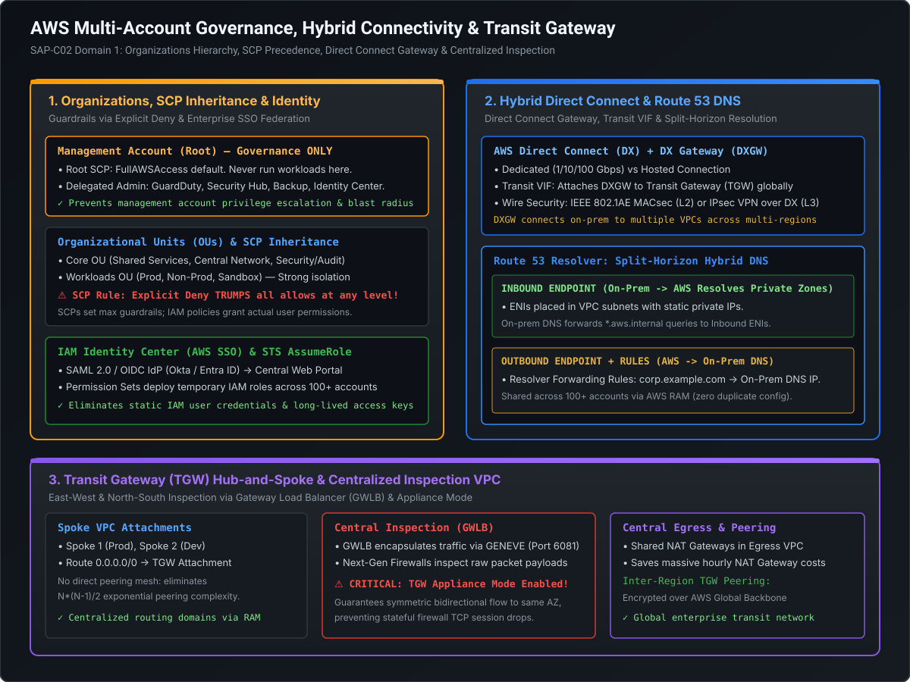

# Complex Network Topologies, Hybrid Direct Connect & Route 53 Resolver

In large enterprise AWS deployments, networking is the fundamental backbone upon which all distributed applications rely. A simple flat VPC or a mesh of VPC peering connections quickly becomes unmanageable as organizations scale past dozens of accounts and hundreds of VPCs.

At the SAP-C02 and Principal Cloud Architect level, you must master:
1. **AWS Transit Gateway (TGW)**: Multi-account hub-and-spoke routing domains, inter-region peering, and AWS RAM integration.
2. **Centralized Inspection & Egress Architecture**: Deploying **Gateway Load Balancer (GWLB)**, third-party stateful firewalls, and why **TGW Appliance Mode** is strictly required to prevent symmetric routing breaks.
3. **AWS Direct Connect (DX) & Hybrid Topologies**: Dedicated vs. Hosted connections, Private vs. Public vs. Transit VIFs, Direct Connect Gateway (DXGW), MACsec encryption, and IPsec VPN over DX failover.
4. **Route 53 Resolver (Split-Horizon DNS)**: Inbound and Outbound endpoints resolving hybrid cross-environment domain names.

---

## Architecture Blueprint: Transit Gateway & Hybrid Topology



```
========================================================================================================================
                              ENTERPRISE HUB-AND-SPOKE NETWORK TOPOLOGY
========================================================================================================================

                 ┌───────────────────────────┐         ┌───────────────────────────┐
                 │    Spoke VPC A (Prod)     │         │    Spoke VPC B (Dev)      │
                 │     CIDR: 10.100.0.0/16   │         │     CIDR: 10.101.0.0/16   │
                 └─────────────┬─────────────┘         └─────────────┬─────────────┘
                               │                                     │
                               │ [VPC Attachment]                    │ [VPC Attachment]
                               ▼                                     ▼
      ─────────────────────────────────────────────────────────────────────────────────
                                    AWS TRANSIT GATEWAY (TGW)
                           Multi-Account Routing Hub (Shared via RAM)
            [TGW Route Tables: Spoke Route Table | Inspection Route Table | Shared RT]
      ─────────────────────────────────────────────────────────────────────────────────
                 │                                                   │
                 │ [VPC Attachment - Appliance Mode ON]              │ [Transit VIF Attachment]
                 ▼                                                   ▼
  ┌─────────────────────────────────────────┐             ┌─────────────────────────────────────────┐
  │         CENTRAL INSPECTION VPC          │             │     DIRECT CONNECT GATEWAY (DXGW)       │
  │  GWLB + Next-Gen Firewalls (Palo Alto)  │             │   Multi-Region Hybrid Routing Bridge    │
  │  Payload Inspection (GENEVE Port 6081)  │             └────────────────────┬────────────────────┘
  └────────────────────┬────────────────────┘                                  │
                       │                                                       ▼
                       ▼                                          ┌─────────────────────────┐
  ┌─────────────────────────────────────────┐                     │   Corporate Data Center │
  │           CENTRAL EGRESS VPC            │                     │   (On-Premises Routers) │
  │  Shared NAT Gateways + Internet Gateway │                     └─────────────────────────┘
  └─────────────────────────────────────────┘
```

---

## 1. AWS Transit Gateway (TGW): The Scalable Hub-and-Spoke Topology

### 1.1 Why VPC Peering Fails at Scale
- **The $N(N-1)/2$ Mesh Trap**: Connecting 50 VPCs requires **1,225 peering connections**. Managing route tables and CIDR allocations across thousands of peering links creates an operational nightmare.
- **No Transitive Routing**: If VPC A is peered with VPC B, and VPC B is peered with VPC C, **traffic from VPC A cannot reach VPC C through VPC B**.
- **No Inter-Region Transit**: VPC peering cannot route on-premises Direct Connect traffic through a central VPC into other VPCs.

---

### 1.2 Transit Gateway Architecture & Route Domains

AWS Transit Gateway acts as a high-throughput, cloud-native Layer 3 router supporting up to **5,000 VPC attachments** and **50 Gbps bandwidth per attachment** (with automated burst capacity).

```
========================================================================================================================
                                 TGW ROUTE DOMAINS (NETWORK SEGREGATION)
========================================================================================================================

  VPC Attachment               Association (Determines Next Hop)          Propagation (Learns Routes)
  ┌──────────────────┐         ┌───────────────────────────────┐          ┌───────────────────────────┐
  │ Prod VPCs        │ ──────> │ TGW Route Table: "Prod-RT"    │ <─────── │ Learns Shared Services    │
  └──────────────────┘         └───────────────────────────────┘          │ Learns On-Prem DXGW       │
                                                                          └───────────────────────────┘
  ┌──────────────────┐         ┌───────────────────────────────┐          ┌───────────────────────────┐
  │ Dev VPCs         │ ──────> │ TGW Route Table: "Dev-RT"     │ <─────── │ Learns Shared Services    │
  └──────────────────┘         └───────────────────────────────┘          │ (NO Prod routes learned!) │
                                                                          └───────────────────────────┘
```

#### Key Concepts:
1. **Attachment**: A network connection between TGW and an external entity (VPC, Direct Connect Gateway, VPN, or another peered TGW).
2. **Association**: Each attachment can be **associated with exactly ONE TGW route table**. When a packet enters TGW from that attachment, TGW evaluates this route table to determine the destination.
3. **Propagation**: An attachment can **propagate its CIDR to MULTIPLE TGW route tables**, allowing other route tables to dynamically learn its routes.
4. **Resource Access Manager (RAM)**: A single TGW created in the Central Network Account is shared with hundreds of member accounts across the organization via AWS RAM. Member accounts simply attach their VPCs to the shared TGW.

---

### 1.3 Inter-Region TGW Peering
- Connects Transit Gateways across different AWS regions (e.g., `us-east-1` and `eu-west-1`).
- **Encrypted Global Backbone**: All inter-region traffic travels across AWS's private global fiber network, fully encrypted at the physical layer, with zero exposure to the public internet.
- **MTU Differences**:
  - Intra-region VPC attachments support **Jumbo Frames (8,500 MTU)**.
  - Inter-region TGW peering connections support standard **1,500 MTU** (traffic exceeding 1,500 bytes is fragmented or dropped if DF bit is set).

---

## 2. Centralized Inspection & Egress Architecture (GWLB & Network Firewall)

Enterprise compliance (PCI-DSS, SOC2) requires all outbound internet traffic and inter-VPC (East-West) traffic to undergo deep packet inspection (DPI) through stateful next-generation firewalls (e.g., Palo Alto Networks, Fortinet, Check Point, or AWS Network Firewall).

```
========================================================================================================================
                       CENTRALIZED INSPECTION VPC & TGW APPLIANCE MODE
========================================================================================================================

    Spoke VPC A (AZ-1)                                                   Central Inspection VPC
  ┌──────────────────────┐                                             ┌──────────────────────┐
  │  Client EC2 Instance │                                             │   AZ-1 Firewall EC2  │
  └──────────┬───────────┘                                             └──────────▲───────────┘
             │                                                                    │
             │ (1) Outbound Request                                               │ (3) Forwarded via
             ▼                                                                    │     GENEVE (Port 6081)
  ┌──────────────────────┐                                             ┌──────────┴───────────┐
  │ TGW Attachment (AZ-1)│ ──(2) Ingress into Inspection VPC (AZ-1)──> │  Gateway LB (GWLB)   │
  └──────────────────────┘                                             └──────────────────────┘
             ▲                                                                    │
             │                                                                    │ (4) Inspected &
             │ (6) Symmetrical Return Flow                                        ▼     Sent to Target
             │                                                         ┌──────────────────────┐
  ┌──────────┴───────────┐ <─(5) Return Path Enforced to AZ-1!─────── │     Target Spoke     │
  │ TGW Attachment (AZ-1)│       [APPLIANCE MODE ON]                   │     or Internet GW   │
  └──────────────────────┘                                             └──────────────────────┘
```

---

### 2.1 Gateway Load Balancer (GWLB) Mechanics
- Operates at **Layer 3 / Layer 4** as a transparent "bump-in-the-wire".
- **GENEVE Protocol Encapsulation (UDP Port 6081)**: GWLB encapsulates the original IP packet inside a GENEVE header, preserving the original client IP, destination IP, and TCP ports without performing Source NAT (SNAT).
- **Health Checks & Auto-Scaling**: GWLB monitors firewall appliances and automatically reroutes traffic around failed instances.

---

### 2.2 The TGW Appliance Mode Mandate (The Staff Engineer Differentiator)

In multi-AZ deployments, asymmetric routing is the \#1 cause of mysterious connection drops in inspection architectures:
- **The Asymmetric Routing Defect**: A client in Spoke VPC AZ-1 sends a TCP `SYN` packet to TGW. TGW routes the packet to the Inspection VPC in AZ-1, where Firewall-1 processes the `SYN`. When the server responds with `SYN-ACK`, TGW might route the return packet to Inspection VPC **AZ-2**, where Firewall-2 receives it. Because Firewall-2 never saw the initial `SYN`, it considers the packet invalid and **drops the connection via TCP RST**!
- **The Solution: TGW Appliance Mode**:
  Enabling **Appliance Mode** on the Inspection VPC TGW attachment forces TGW to use a deterministic hashing algorithm that ensures **both the forward (request) and reverse (response) flows are routed to the same Availability Zone (AZ)** in the inspection VPC for the entire life of the TCP flow.

```bash
# Enable Appliance Mode on the Inspection VPC Attachment via AWS CLI
aws ec2 modify-transit-gateway-vpc-attachment \
    --transit-gateway-attachment-id tgw-attach-0123456789abcdef0 \
    --options ApplianceModeSupport=enable
```

---

## 3. Hybrid Connectivity: AWS Direct Connect (DX) Deep Dive

**AWS Direct Connect** bypasses the public internet by establishing a dedicated physical fiber cross-connect between an on-premises data center router and an AWS Direct Connect location.

### 3.1 Dedicated vs. Hosted Connections

| Dimension | Dedicated Connection | Hosted Connection |
| :--- | :--- | :--- |
| **Physical Link** | Dedicated physical 1 Gbps, 10 Gbps, or 100 Gbps Ethernet port directly allocated to customer | Shared physical port on an AWS Direct Connect Partner router; partitioned via 802.1Q VLANs |
| **Bandwidth Options** | 1 Gbps, 10 Gbps, 100 Gbps | Sub-1G (50M, 100M, 200M, 500M) or 1G, 2G, 5G, 10G |
| **Virtual Interfaces (VIFs)** | Supports **up to 50 VIFs** (mix of Private, Public, or Transit) | Supports **exactly ONE VIF** per hosted connection |
| **MACsec Support** | Supported on 10 Gbps and 100 Gbps ports | **Not supported** |

---

### 3.2 Virtual Interfaces (VIFs) Taxonomy

1. **Private VIF**:
   - Connects to an on-premises network to a single VPC (via Virtual Private Gateway - VGW) or multiple VPCs (via Direct Connect Gateway - DXGW).
   - Only provides access to private IP addresses (RFC 1918) within the target VPC CIDRs.
2. **Public VIF**:
   - Provides on-premises access to **all public AWS service endpoints globally** (Amazon S3, DynamoDB, SQS, CloudWatch, EC2 public IPs).
   - BGP advertises AWS public IP prefixes (over 4,000 routes) to the on-prem router.
3. **Transit VIF**:
   - Connects Direct Connect Gateway (DXGW) directly to an **AWS Transit Gateway (TGW)**.
   - **This is the mandatory VIF type for enterprise multi-account architectures**: a single Transit VIF can route to thousands of VPCs attached to TGW across multiple accounts and regions!

---

### 3.3 Direct Connect Encryption: MACsec vs. IPsec VPN over DX

By default, **AWS Direct Connect traffic is unencrypted** at the physical layer. If regulatory compliance mandates encryption in transit:

```
========================================================================================================================
                               DIRECT CONNECT ENCRYPTION OPTIONS
========================================================================================================================

  Option 1: IEEE 802.1AE MACsec (Hardware Layer 2 Encryption)
  ┌───────────────────────┐                                          ┌───────────────────────┐
  │ On-Prem Router        │ ══════════════ [10G/100G MACsec] ══════════════ │ AWS DX Location Port  │
  │ (MACsec-capable NIC)  │          Zero throughput penalty (Line-rate)    │ (AWS Direct Connect)  │
  └───────────────────────┘                                          └───────────────────────┘

  Option 2: IPsec VPN over Direct Connect (Layer 3 Encryption)
  ┌───────────────────────┐                                          ┌───────────────────────┐
  │ On-Prem Router        │ ────────────── [Direct Connect] ───────────────> │ AWS Transit Gateway   │
  │ (IPsec Tunnel Engine) │ ══════════ [Encrypted IPsec Tunnel] ═══════════> │ (VPN Attachment / VGW)│
  └───────────────────────┘       Max 1.25 Gbps per tunnel (ECMP scaling)    └───────────────────────┘
```

1. **MACsec (Layer 2 Encryption)**:
   - Encrypts traffic at line-rate on 10 Gbps and 100 Gbps Dedicated Connections between the customer router and AWS DX port.
   - Zero CPU overhead, sub-microsecond latency, native wire-speed throughput.
2. **IPsec VPN over Direct Connect (Layer 3 Encryption)**:
   - For connections where MACsec is unavailable (e.g., 1 Gbps links or Hosted connections).
   - Establish an AWS Site-to-Site VPN over a **Public VIF** or **Transit VIF**.
   - **Throughput Limit**: Each IPsec tunnel has a hard limit of **1.25 Gbps**. To achieve 5 Gbps, you must configure **Equal-Cost Multi-Path (ECMP)** routing across 4 parallel VPN tunnels.

---

### 3.4 Direct Connect Redundancy & Active-Active BGP Tuning

For enterprise SLA (99.99% resiliency requires 2 DX locations with 2 connections each):
- **BGP Community Attributes**:
  - **Inbound to AWS (Customer to AWS)**: Use **AS Path Prepending** on the secondary connection to make its path appear longer, forcing AWS to prefer the primary link.
  - **Outbound from AWS (AWS to Customer)**: AWS honors BGP **Local Preference** community tags (`7224:7100` = Low, `7224:7200` = Medium, `7224:7300` = High). Tag the primary route with High and secondary with Low.
- **Bi-directional Forwarding Detection (BFD)**: Reduces failover detection time from standard BGP keepalive intervals (90 seconds) down to **sub-second failover (< 300ms)**.

---

## 4. Route 53 Resolver: Hybrid Split-Horizon DNS Resolution

In hybrid cloud architectures, on-premises workloads need to resolve AWS private resources (`aurora.prod.aws.internal`), and AWS microservices need to resolve on-premises corporate systems (`db.onprem.example.com`).

```
========================================================================================================================
                               ROUTE 53 RESOLVER HYBRID DNS TOPOLOGY
========================================================================================================================

    On-Premises Data Center                                            AWS Cloud (VPC)
  ┌─────────────────────────┐                                        ┌─────────────────────────┐
  │ Corporate DNS Server    │                                        │  Route 53 Resolver      │
  │ (192.168.1.10)          │                                        │  (VPC Base + 2: 10.0.0.2│
  └────────────┬────────────┘                                        └────────────▲────────────┘
               │                                                                  │
               │ (1) Query for *.corp.aws                                         │ (3) Resolves Private
               ▼                                                                  ▼     Hosted Zone
  ┌─────────────────────────┐      Direct Connect / VPN              ┌─────────────────────────┐
  │ Conditional Forwarder   │ ─────────────────────────────────────> │ INBOUND ENDPOINT (ENI)  │
  │ (*.corp.aws -> 10.0.1.5)│                                        │ IP: 10.0.1.5 (Subnet A) │
  └─────────────────────────┘                                        └─────────────────────────┘

  ┌─────────────────────────┐                                        ┌─────────────────────────┐
  │ Resolves Local Record   │                                        │ OUTBOUND ENDPOINT (ENI) │
  │ (db.onprem.example.com) │ <───────────────────────────────────── │ IP: 10.0.2.8 (Subnet B) │
  └────────────▲────────────┘      Direct Connect / VPN              └────────────▲────────────┘
               │                                                                  │
               │ (4) Forwards Query to On-Prem IP                                 │ (2) Query for
               └──────────────────────────────────────────────────────────────────┘     *.onprem.example.com
                                                                              [Resolver Rule via RAM]
```

### 4.1 Inbound Resolver Endpoints
- **Flow**: **On-Premises $\to$ AWS**.
- Creates Elastic Network Interfaces (ENIs) with static private IP addresses in at least 2 VPC subnets (Multi-AZ).
- On-premises DNS administrators configure **Conditional Forwarders**:
  `Zone "aws.example.corp" -> Forward to Inbound Endpoint IPs (10.0.1.5, 10.0.2.5)`.
- On-premises servers can now resolve Route 53 Private Hosted Zones seamlessly.

### 4.2 Outbound Resolver Endpoints & Resolver Rules
- **Flow**: **AWS $\to$ On-Premises**.
- Creates Outbound ENIs in VPC subnets.
- Configures **Route 53 Resolver Forwarding Rules**:
  - Rule Type: `Forward`.
  - Domain Name: `onprem.example.com`.
  - Target IPs: On-premises DNS server addresses (`192.168.1.10`, `192.168.2.10`).
- **AWS RAM Sharing**: The Outbound Resolver Rule is created once in the Central Network Account and shared via AWS RAM with the entire organization. All VPCs automatically associate with the rule.

---

## 5. Staff+ Architectural Summary Matrix

| Network Component | Protocol / Layer | Throughput & Scaling | Primary Use Case | Critical Architectural Hazard |
| :--- | :--- | :--- | :--- | :--- |
| **Transit Gateway (TGW)** | Layer 3 (IP) | 50 Gbps per attachment; up to 5,000 attachments | Hub-and-spoke multi-VPC routing & hybrid transit hub | Asymmetric routing drops without Appliance Mode on firewalls |
| **Gateway Load Balancer (GWLB)** | Layer 3/4 + GENEVE (Port 6081) | Scales horizontally with target group | Transparent inline security inspection without SNAT | Appliances must support GENEVE packet decapsulation/encapsulation |
| **Transit VIF** | 802.1Q VLAN over DX | Up to connection line rate | Attaches Direct Connect to AWS Transit Gateway across regions | Does not support Jumbo frames beyond 1,500 MTU to TGW |
| **MACsec** | Layer 2 (IEEE 802.1AE) | Line-rate (10G/100G) | High-speed zero-overhead hardware link encryption | Available ONLY on Dedicated DX ports (Not Hosted DX) |
| **Route 53 Resolver** | Layer 7 (DNS UDP/TCP 53) | Up to 10,000 QPS per ENI IP | Hybrid split-horizon cross-cloud DNS resolution | Circular forwarding loops if rules point to each other |
