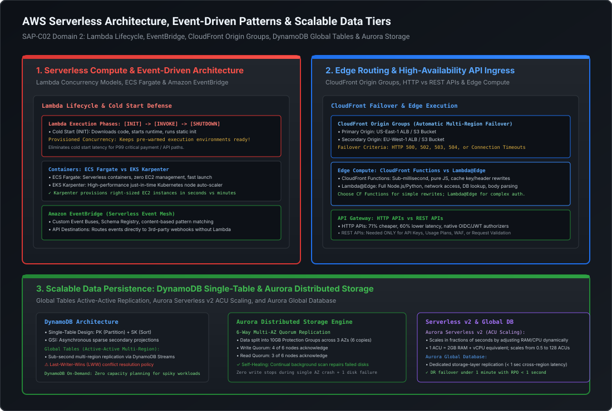

# Serverless Compute, Container Orchestration & Event-Driven Architecture

In modern cloud architecture, scalable systems are built on decoupled, event-driven foundations. Rather than maintaining monolithic fleets of long-running virtual machines, Staff and Principal Architects leverage **serverless compute, managed container orchestrators, and event buses** to build systems that scale instantly from zero to hundreds of thousands of requests per second.

This playbook breaks down the internal physics of **AWS Lambda** (execution environments, cold start anatomy, Provisioned Concurrency, and Hyperplane VPC networking), container orchestration trade-offs between **ECS Fargate and EKS Karpenter**, and the event mesh powered by **Amazon EventBridge and Amazon MSK (Kafka with KRaft)**.

---

## Architecture Blueprint: Serverless & Event-Driven Engine



```
========================================================================================================================
                                MODERN EVENT-DRIVEN COMPUTE MESH
========================================================================================================================

    Event Ingestion                  Event Mesh (Filtering & Routing)               Compute & Consumers
  ┌─────────────────┐               ┌─────────────────────────────────┐            ┌──────────────────────┐
  │ Microservice A  │ ──PutEvents─> │   Amazon EventBridge Event Bus  │ ─────────> │ AWS Lambda (Init/Inv)│
  └─────────────────┘               │   (Content-Based Pattern Filter)│            └──────────────────────┘
  ┌─────────────────┐               └────────────────┬────────────────┘            ┌──────────────────────┐
  │ SaaS Webhooks   │ ──────────────┘                │                             │ ECS Fargate / EKS    │
  │ (Stripe, GitHub)│                                ├───────── API Destination──> │ (Karpenter Scale-Out)│
  └─────────────────┘                                │                             └──────────────────────┘
  ┌─────────────────┐                                │                             ┌──────────────────────┐
  │ Financial Feeds │ ──High-Throughput Streaming──> │ Amazon MSK (Kafka + KRaft)  │ 3rd-Party Partner    │
  │ (60,000 TPS)    │                                │ Tiered Storage to S3        │ (Authenticated Webhk)│
  └─────────────────┘                                └─────────────────────────────┴──────────────────────┘
```

---

## 1. AWS Lambda Internals & High-Throughput Concurrency

AWS Lambda runs functions inside secure, lightweight microVMs powered by **Firecracker**, an open-source Rust-based virtualization technology.

### 1.1 The Execution Environment Lifecycle

A Lambda execution environment progresses through three distinct phases:

```
========================================================================================================================
                                     LAMBDA LIFECYCLE ANATOMY
========================================================================================================================

  [INIT PHASE] (Cold Start Latency Occurs Here)
  ┌────────────────────────────────────────────────────────────────────────────────────────┐
  │ 1. Extension Init: Starts internal/external extensions (telemetry, security agents)    │
  │ 2. Runtime Init: Boots language runtime (Node.js, Python, JVM, Go)                     │
  │ 3. Function Init: Runs static code / code outside handler (DB pools, AWS SDK clients)  │
  └───────────────────────────────────────────┬────────────────────────────────────────────┘
                                              │
                                              ▼
  [INVOKE PHASE] (Execution Duration Billed)
  ┌────────────────────────────────────────────────────────────────────────────────────────┐
  │ Executes the handler method: handler(event, context)                                   │
  │ Warm Starts reuse the initialized environment; skips Init phase completely!            │
  └───────────────────────────────────────────┬────────────────────────────────────────────┘
                                              │ (After period of inactivity)
                                              ▼
  [SHUTDOWN PHASE]
  ┌────────────────────────────────────────────────────────────────────────────────────────┐
  │ Sends SIGTERM to runtime & extensions; 2-second grace period for clean teardown        │
  └────────────────────────────────────────────────────────────────────────────────────────┘
```

---

### 1.2 Cold Start Mitigation: Static Caching & Provisioned Concurrency

#### Technique A: Optimal Handler Initialization (Static Context Caching)
Everything outside the `handler` function executes during the `Init` phase and **persists across warm invocations**. Always initialize database connection pools, HTTP clients, and AWS SDK clients in static memory:

```python
import os
import boto3

# EXECUTED ONCE DURING INIT (Persisted across warm invocations)
dynamodb = boto3.resource('dynamodb')
table = dynamodb.Table(os.environ['TABLE_NAME'])

def lambda_handler(event, context):
    # EXECUTED ON EVERY INVOCATION (Warm start: zero re-initialization overhead)
    item_id = event['pathParameters']['id']
    response = table.get_item(Key={'id': item_id})
    return {"statusCode": 200, "body": response.get('Item', {})}
```

#### Technique B: Provisioned Concurrency (The P99 Determinism Guarantee)
- **Standard On-Demand Concurrency**: An unexpected burst of 500 concurrent requests causes AWS to spin up 500 new Firecracker microVMs simultaneously, subjecting all 500 requests to cold-start overhead (often 200ms for Python/Node.js, up to 3–5 seconds for large JVM Spring Boot apps).
- **Provisioned Concurrency**: Allocates pre-warmed execution environments where `Extension Init`, `Runtime Init`, and `Function Init` have **already completed**.
- When an invocation arrives, it jumps directly to the `Invoke` phase, guaranteeing **sub-10ms response times**.
- Integrates with **Application Auto Scaling**: Automatically adjust Provisioned Concurrency based on schedule (e.g., peak business hours) or utilization metrics (`ProvisionedConcurrencyUtilization`).

---

### 1.3 Concurrency Models: Reserved Concurrency vs. Throttling

By default, an AWS account has a regional pool of **1,000 concurrent executions** shared across all functions.

```
========================================================================================================================
                              RESERVED CONCURRENCY VS. PROVISIONED CONCURRENCY
========================================================================================================================

  Regional Pool (1,000 Concurrency)
  ┌────────────────────────────────────────────────────────────────────────────────────────┐
  │ Unreserved Concurrency Pool (Minimum 100 reserved for functions without limits)        │
  ├──────────────────────────────────────┬─────────────────────────────────────────────────┤
  │ Function A: Reserved Concurrency = 400│ Function B: Provisioned Concurrency = 200       │
  │ • Cannot exceed 400 concurrent execs │ • 200 pre-warmed environments ready instantly   │
  │ • Guarantees 400 slots are available │ • Auto-scales up into unreserved pool on demand │
  │ • Prevents runaway billing & DB slam │ • Eliminates cold starts completely             │
  └──────────────────────────────────────┴─────────────────────────────────────────────────┘
```

- **The Poison Pill Defense (Reserved Concurrency = 0)**: To instantly kill a compromised or runaway function in production without redeploying code, set its Reserved Concurrency to `0`. All invocations immediately fail with `429 Too Many Requests`.
- **Database Connection Starvation Defense**: Relational databases (RDS PostgreSQL/MySQL) have strict connection limits (e.g., 500 max connections). If a Lambda function querying RDS scales to 2,000 concurrent instances, it will instantly crash the database. Setting Reserved Concurrency to `100` (or deploying **Amazon RDS Proxy**) protects the database tier.

---

### 1.4 Hyperplane VPC Networking (Zero Cold Start Penalty)
Prior to 2019, connecting a Lambda function to a private VPC required allocating an Elastic Network Interface (ENI) inside the VPC during `Init`, creating catastrophic cold starts of 15 to 30 seconds.

AWS solved this with **AWS Hyperplane** (the high-throughput network fabric behind Network Load Balancers and NAT Gateways):
- AWS pre-provisions shared, managed Hyperplane ENIs inside your VPC subnets when the function is created.
- Lambda execution environments connect to these shared Hyperplane ENIs via dual-stack tunnels.
- **Cold start penalty for VPC-enabled Lambda functions is now identical to non-VPC functions (< 1ms networking delay)**.

---

## 2. Container Orchestration: ECS on Fargate vs. EKS Karpenter

When workloads require long-running background workers, complex stateful services, or specialized networking that exceeds Lambda's 15-minute execution limit, container orchestration is required.

```
========================================================================================================================
                                CONTAINER DECISION MATRIX
========================================================================================================================

  Dimension                  AWS Lambda                ECS on Fargate           EKS with Karpenter
  ──────────────────────────────────────────────────────────────────────────────────────────────────────
  Max Execution Time         15 Minutes                Unlimited                Unlimited
  Startup Latency            Milliseconds (< 1s)       30–60 Seconds            Seconds (Karpenter node provision)
  Compute Model              Event-driven microVMs     Serverless containers    Managed Kubernetes
  Cluster Management         Zero                      Zero                     Kubernetes API & Control Plane
  Networking                 VPC Hyperplane            awsvpc (Dedicated ENI)   Amazon VPC CNI (Direct IP per pod)
  Scaling Triggers           Invocations / Queue depth CPU/Memory / CloudWatch  Karpenter just-in-time pod demand
  Best For                   Short-lived APIs, webhooks Microservices, batch jobs Complex microservices, multi-cloud
```

### 2.1 Amazon ECS on Fargate
- **Zero EC2 Node Management**: AWS manages the underlying operating system, patching, and hardware.
- **Task Networking (`awsvpc`)**: Every ECS Task receives its own dedicated Elastic Network Interface (ENI) and private VPC IP address, enabling native Security Group enforcement at the individual task level.
- **Capacity Providers & Fargate Spot**: Blend baseline reliability with massive cost savings:
  ```json
  {
    "capacityProviderStrategy": [
      { "capacityProvider": "FARGATE", "weight": 1, "base": 2 },
      { "capacityProvider": "FARGATE_SPOT", "weight": 4, "base": 0 }
    ]
  }
  ```
  *Strategy*: Guarantees 2 tasks on standard Fargate (base). Any additional tasks scale out with an 80/20 split in favor of **Fargate Spot (saving up to 70% cost)**.

---

### 2.2 Amazon EKS with Karpenter (The Next-Gen Node Autoscaler)
In traditional Kubernetes, the standard **Cluster Autoscaler** interacts with AWS Auto Scaling Groups (ASGs). When a pod is unschedulable, Cluster Autoscaler triggers ASG scale-out, which boots generic EC2 instances in 3 to 5 minutes.

**Karpenter** fundamentally re-engineers Kubernetes autoscaling:
1. **Direct EC2 Provisioning**: Karpenter bypasses Auto Scaling Groups completely, communicating directly with the EC2 Fleet API.
2. **Just-In-Time Node Sizing**: Analyzes pending pods' CPU, memory, and topology spread constraints (e.g., spot vs on-demand, Graviton vs x86) and launches the **exact right-sized EC2 instance in under 45 seconds**.
3. **Automated Node Consolidation (De-provisioning)**: When workloads decrease, Karpenter automatically moves pods to consolidate nodes and terminates underutilized EC2 instances, eliminating idle cloud waste.

---

## 3. Modern Event-Driven Architecture: EventBridge & Amazon MSK

### 3.1 Amazon EventBridge: The Serverless Event Backbone

EventBridge is a serverless event bus that routes events from SaaS applications, AWS services, and custom microservices using declarative JSON pattern matching.

```
========================================================================================================================
                                 EVENTBRIDGE ROUTING & API DESTINATIONS
========================================================================================================================

  Producer                           EventBridge Rule Pattern Filter                Target
  ┌───────────────┐                  ┌─────────────────────────────────┐            ┌────────────────────────┐
  │ Order Service │ ──JSON Event──>  │ {                               │ ─────────> │ SQS FIFO Payment Queue │
  └───────────────┘                  │   "source": ["ecommerce.orders"],│            └────────────────────────┘
                                     │   "detail-type": ["OrderPlaced"],│            ┌────────────────────────┐
                                     │   "detail": {                   │ ─────────> │ API Destination:       │
                                     │     "amount": [{"numeric": [">",│            │ Stripe / Shopify Hook  │
                                     │                1000]}]          │            │ (Rate Limit: 300 rps)  │
                                     │   }                             │            └────────────────────────┘
                                     │ }                               │
                                     └─────────────────────────────────┘
```

#### Content-Based Pattern Matching
Unlike SNS (which filters on message attributes), EventBridge evaluates rules against the **entire event JSON payload**:

```json
{
  "source": ["com.mastery.payments"],
  "detail-type": ["PaymentAuthorized"],
  "detail": {
    "status": ["APPROVED"],
    "amount": [ { "numeric": [ ">=", 5000 ] } ],
    "currency": ["USD", "EUR"],
    "riskScore": [ { "numeric": [ "<", 30 ] } ]
  }
}
```

#### API Destinations (Zero-Code Webhook Integration)
- Forwards events directly to external HTTP/REST endpoints (e.g., Zendesk, Salesforce, Stripe, custom partner APIs).
- **Built-in Security**: Manages OAuth2 client credentials, API keys, or basic auth secrets via AWS Secrets Manager.
- **Built-in Rate Limiting**: Throttles outbound HTTP calls (e.g., max 300 requests/sec) to protect third-party rate limits, automatically queuing bursts for retry.

#### Archive & Replay
- Automatically stores all events sent to an event bus into an immutable S3-backed archive.
- **Disaster Recovery & Debugging**: If a downstream billing service encounters a bug and drops 10,000 transactions, the engineer patches the bug and triggers **Event Replay** for that exact time window. EventBridge re-publishes the historical events with original timestamps, restoring system consistency.

---

### 3.2 Amazon MSK (Managed Streaming for Kafka) & KRaft Mode

For high-throughput streaming workloads ($> 50,000\text{ messages/sec}$ or financial transaction ledgers) where EventBridge reaches throughput and cost thresholds, **Amazon MSK** provides fully managed Apache Kafka.

1. **MSK KRaft Mode**: Replaces legacy Apache ZooKeeper with an internal Raft consensus metadata quorum. Eliminates controller cold-start stalls, enables rapid broker restarts, and scales partition counts up to millions.
2. **MSK Tiered Storage**:
   - Decouples compute (broker CPU/RAM) from storage.
   - Primary data sits on high-performance local NVMe/EBS storage for low-latency consumer reads.
   - As data ages, MSK automatically offloads immutable segments to **Amazon S3** with zero operational overhead.
   - Consumers can replay years of historical event streams from S3 without degrading real-time broker memory or disk IOPS!

---

## 4. Staff+ Architectural Summary Matrix

| Service | Compute / Event Model | Max Latency / Throughput | Scaling Mechanism | Primary Production Role |
| :--- | :--- | :--- | :--- | :--- |
| **AWS Lambda** | Ephemeral Firecracker microVM | Millisecond invoke; up to 10k+ concurrent | Provisioned Concurrency / Event-driven auto-scale | REST APIs, async webhooks, stream processors |
| **ECS Fargate** | Serverless Linux/ARM container | 30s–60s startup; sustained | CloudWatch metrics / Capacity Providers | Long-running microservices, scheduled batch jobs |
| **EKS Karpenter** | Dynamic EC2 Fleet Provisioning | < 45s node spin-up; massive scale | Just-in-time pod demand evaluation | Large-scale multi-tenant Kubernetes clusters |
| **EventBridge** | Serverless JSON Event Bus | ~30ms routing latency | Automatic serverless event ingestion | Enterprise event mesh, SaaS integrations, API destinations |
| **Amazon MSK** | Apache Kafka Distributed Log | Sub-5ms latency; millions of TPS | Partition scaling & broker additions | Real-time financial telemetry, high-speed clickstreams |
