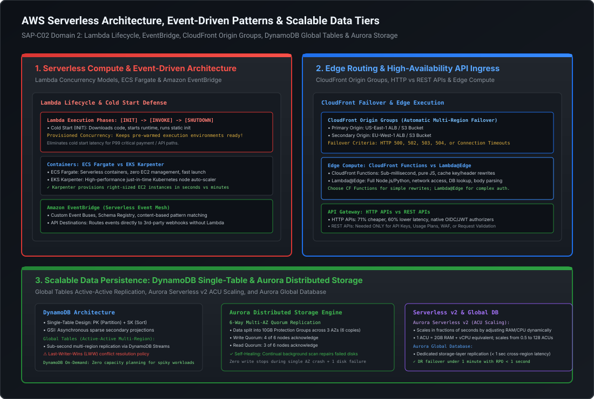

# Edge Routing, CloudFront Failover & Scalable Cloud Persistence (DynamoDB & Aurora)

Building globally resilient cloud applications requires distributing compute to the network edge while anchoring state in storage engines capable of surviving regional outages. A Staff or Principal Cloud Architect must design systems that seamlessly handle multi-region edge failover, scale NoSQL databases via single-table patterns, and exploit distributed relational engines like Amazon Aurora.

This playbook covers:
1. **API Gateway Architecture**: HTTP APIs vs. REST APIs vs. WebSocket APIs.
2. **CloudFront Edge Resilience**: Origin Shield, Origin Groups (automated multi-region failover), and CloudFront Functions vs. Lambda@Edge.
3. **Amazon DynamoDB**: Single-table design physics, GSI vs. LSI mechanics, On-Demand capacity, and Global Tables active-active replication.
4. **Amazon Aurora Storage Architecture**: 6-way multi-AZ quorum replication, Aurora Serverless v2 ACU scaling, and Aurora Global Database.
5. **Amazon ElastiCache**: Redis Cluster Mode enabled vs. disabled and Global Datastore.

---

## Architecture Blueprint: Edge Services & Distributed Data Tier



```
========================================================================================================================
                              GLOBAL EDGE ROUTING & DATA TIER BLUEPRINT
========================================================================================================================

    Global Users                                CloudFront Edge Mesh                              Origin Tier
  ┌──────────────┐                             ┌─────────────────────────────────┐            ┌──────────────────────┐
  │  US Clients  │ ──Anycast DNS──> Edge PoP ─>│ CloudFront Origin Group         │ ─────────> │ US-East-1 ALB (Prim) │
  └──────────────┘                             │ • Primary: US-East-1 ALB        │            └──────────────────────┘
  ┌──────────────┐                             │ • Failover: EU-West-1 ALB       │ (HTTP 502) ┌──────────────────────┐
  │  EU Clients  │ ──Anycast DNS──> Edge PoP ─>│ • Trigger: HTTP 500/502/503/504 │ ─────────> │ EU-West-1 ALB (Sec)  │
  └──────────────┘                             └─────────────────────────────────┘            └──────────────────────┘
                                                                │
                                                                ▼
                                      ┌──────────────────────────────────────────────────┐
                                      │              DISTRIBUTED DATA TIER               │
                                      │  DynamoDB Global Tables (Active-Active LWW)      │
                                      │  Aurora Global DB (Sub-Second Storage Redo Sync) │
                                      └──────────────────────────────────────────────────┘
```

---

## 1. Amazon API Gateway: HTTP APIs vs. REST APIs vs. WebSocket

Choosing the correct API Gateway type has massive implications for cost, latency, and feature support in enterprise architectures.

```
========================================================================================================================
                                 API GATEWAY COMPARISON MATRIX
========================================================================================================================

  Dimension                  HTTP APIs                          REST APIs                      WebSocket APIs
  ─────────────────────────────────────────────────────────────────────────────────────────────────────────────
  Pricing (per million)      $1.00 / million                    $3.50 / million                $1.00 / million + conn time
  Latency Overhead           Ultra-Low (60% faster than REST)   Standard                       Ultra-Low (Persistent TCP)
  Protocol                   HTTP/2, HTTP/1.1                   HTTP/1.1                       WSS (RFC 6455)
  Native JWT/OIDC Auth       Built-in (Zero Lambda cost)        Requires Custom Authorizer     Supported via $connect
  AWS WAF Integration        Supported (Added 2023)             Supported                      Supported
  API Keys & Usage Plans     NOT Supported                      Supported                      NOT Supported
  Request/Response Transform NOT Supported                      Supported (Velocity VTL)       NOT Supported
  Mutual TLS (mTLS)          Supported                          Supported                      NOT Supported
  Edge-Optimized Endpoints   Regional ONLY                      Edge-Optimized or Regional     Regional
```

### 1.1 The Staff+ Architectural Decision Rule
- **Default Choice**: Use **HTTP APIs** for 90% of microservice workloads. They are **71% cheaper**, deliver **60% lower latency**, and natively parse OIDC/JWT tokens (from Okta, Cognito, Auth0) without paying for or waiting on a Lambda authorizer.
- **Choose REST APIs ONLY IF**: You strictly require **API Keys and Usage Plans** (for external developer monetization), **SOAP-to-JSON XML translation via Velocity Template Language (VTL)**, or **built-in request parameter validation schemas**.
- **Choose WebSocket APIs**: For real-time bi-directional streaming applications (e.g., chat, live sports scores, real-time trading tickers), utilizing `@connections` API to push updates from the backend.

---

## 2. CloudFront Edge Resilience & Edge Compute

Amazon CloudFront routes global traffic through over 450 Edge Points of Presence (PoPs) connected directly to the AWS private fiber backbone.

### 2.1 CloudFront Origin Groups (Automated Cross-Region Failover)

To achieve multi-region disaster recovery for web and API traffic without complex client-side routing, configure **CloudFront Origin Groups**:

```
========================================================================================================================
                               CLOUDFRONT ORIGIN GROUP FAILOVER LOGIC
========================================================================================================================

  Incoming Client Request -> CloudFront Edge PoP
                                  │
                                  ▼
                     [Query Primary Origin: US-East-1 ALB]
                                  │
                  ┌───────────────┴───────────────┐
                  │                               │
             Success (200 OK)             Failure (HTTP 500, 502, 503, 504, Timeout)
                  │                               │
                  ▼                               ▼
       [Return to Client]            [AUTOMATIC ZERO-DOWNTIME RETRY]
                                     [Query Secondary Origin: EU-West-1 ALB]
                                                  │
                                                  ▼
                                         [Return to Client]
```

- **Failover Criteria**: Trigger failover automatically based on configurable HTTP status codes (`500 Internal Server Error`, `502 Bad Gateway`, `503 Service Unavailable`, `504 Gateway Timeout`) or connection timeouts.
- **Transparent to Clients**: The client never sees the 502 error; CloudFront retries against the secondary origin within milliseconds.

---

### 2.2 CloudFront Functions vs. Lambda@Edge (The Architecture Decision)

| Dimension | CloudFront Functions | Lambda@Edge |
| :--- | :--- | :--- |
| **Execution Location** | 450+ Edge PoPs (Closest to user) | 13 Regional Edge Caches |
| **Execution Duration** | **Sub-millisecond (< 1ms)** | Up to 5s (Viewer events) / 30s (Origin events) |
| **Runtime Support** | Pure JavaScript (ECMAScript 5.1 compliant) | Node.js, Python |
| **Network & Disk Access**| **Zero** (No external network calls, no file system) | Full network/internet access, file system access |
| **Request Body Access** | **No** (Headers, cookies, query string only) | **Yes** (Can inspect, parse, and modify request body) |
| **Cost** | 1/6th the cost of Lambda@Edge ($0.10 per million) | Standard Lambda pricing ($0.60 per million) |
| **Ideal Production Uses** | Cache key normalization, URL redirects, header rewrites | Edge authentication (JWT validation against DB), A/B testing, dynamic bot blocking |

---

## 3. Amazon DynamoDB: Scalable Cloud NoSQL & Single-Table Design

Amazon DynamoDB is a fully managed, serverless, key-value and document database that delivers single-digit millisecond performance at any scale.

### 3.1 Single-Table Design Architecture
In relational databases, entities are split across normalized tables (`Users`, `Orders`, `OrderItems`) and stitched together via `JOIN` operations. In DynamoDB, **joins do not exist**. Executing multiple queries to assemble a page kills performance.

**Single-Table Design** (pioneered by Rick Houlihan) models all application entities inside a single DynamoDB table using overloaded, generic partition keys (`PK`) and sort keys (`SK`):

```
========================================================================================================================
                                 DYNAMODB SINGLE-TABLE SCHEMA EXAMPLE
========================================================================================================================

  PK (Partition Key)       SK (Sort Key)            Data / Attributes
  ───────────────────────────────────────────────────────────────────────────────────────────────────────────
  USER#1001                METADATA                 name: "Alice", email: "alice@example.com", tier: "GOLD"
  USER#1001                ORDER#2026-001           order_date: "2026-03-01", total: $150.00, status: "SHIPPED"
  USER#1001                ORDER#2026-002           order_date: "2026-03-10", total: $45.00,  status: "PENDING"
  USER#1002                METADATA                 name: "Bob", email: "bob@example.com", tier: "SILVER"
  ORDER#2026-001           ITEM#SKU-99              item_name: "Mechanical Keyboard", qty: 1, price: $150.00
```

- **Querying User + All Orders in 1 Network Call**:
  Execute `Query(PK = 'USER#1001')`. DynamoDB retrieves the user's profile metadata and all their orders in a **single contiguous B-Tree read**, returning in 4 milliseconds!

---

### 3.2 Global Secondary Indexes (GSI) vs. Local Secondary Indexes (LSI)

```
========================================================================================================================
                                      GSI VS. LSI TECHNICAL COMPARISON
========================================================================================================================

  Dimension                  Local Secondary Index (LSI)              Global Secondary Index (GSI)
  ─────────────────────────────────────────────────────────────────────────────────────────────────────────────
  Partition Key              MUST be identical to base table PK       Can be ANY attribute (Different from PK)
  Sort Key                   Can be a different attribute             Can be a different attribute
  Creation Time              Table creation ONLY (Cannot add later!)  ANYTIME (Can create or delete dynamically)
  Size Limitation            Max 10GB per partition key collection    UNLIMITED (Scales across partitions)
  Consistency Guarantee      Supports Strong Consistency              Eventual Consistency ONLY
  Capacity Units (RCU/WCU)   Consumes base table RCU/WCU              Independent provisioned/on-demand RCU/WCU
```

> [!WARNING]
> **The LSI 10GB Poison Pill**: If you create an LSI, all items sharing the same Partition Key (e.g., all orders for `USER#1001`) are permanently restricted to a maximum total size of **10GB**. If exceeded, DynamoDB throws `ItemCollectionSizeLimitExceededException` and rejects all further writes for that user! For this reason, modern architectures almost exclusively use **GSIs**.

---

### 3.3 DynamoDB Global Tables (Active-Active Multi-Region)

DynamoDB Global Tables replicates table data across multiple AWS regions for local read/write latency and multi-region disaster recovery.
- **Replication Engine**: Fully managed multi-master replication powered by **DynamoDB Streams**. Replication lag is typically under **1 second**.
- **Conflict Resolution (Last-Writer-Wins - LWW)**: If two concurrent writes modify the same item in US-East-1 and EU-West-1 simultaneously, DynamoDB uses a **Last-Writer-Wins (LWW)** strategy based on AWS internal physical clock timestamps. The latest timestamp overwrites preceding writes.

---

## 4. Amazon Aurora: Distributed Cloud Relational Storage

Amazon Aurora re-architects relational database engines (MySQL and PostgreSQL) for the cloud by completely separating the **stateless database compute layer** from the **distributed shared storage layer**.

```
========================================================================================================================
                                AURORA 6-WAY MULTI-AZ DISTRIBUTED STORAGE
========================================================================================================================

                                    ┌───────────────────────────────┐
                                    │    Aurora Primary Instance    │
                                    │   (Compute Engine in AZ-1)    │
                                    └──────────────┬────────────────┘
                                                   │
                                     [Streams Binary Redo Log Vectors]
                                                   │
         ┌─────────────────────────────────────────┼─────────────────────────────────────────┐
         │                                         │                                         │
         ▼                                         ▼                                         ▼
  ┌──────────────┐                          ┌──────────────┐                          ┌──────────────┐
  │  Storage AZ1 │                          │  Storage AZ2 │                          │  Storage AZ3 │
  │ ┌────┐ ┌────┐│                          │ ┌────┐ ┌────┐│                          │ ┌────┐ ┌────┐│
  │ │Disk│ │Disk││                          │ │Disk│ │Disk││                          │ │Disk│ │Disk││
  │ │ 1  │ │ 2  ││                          │ │ 3  │ │ 4  ││                          │ │ 5  │ │ 6  ││
  │ └────┘ └────┘│                          │ └────┘ └────┘│                          │ └────┘ └────┘│
  └──────────────┘                          └──────────────┘                          └──────────────┘
         Write Quorum: 4 of 6 Acks Required   │   Read Quorum: 3 of 6 Acks Required
         Survives complete loss of 1 AZ + 1 additional disk without write interruption!
```

### 4.1 Aurora Storage Engine Quorum Mechanics
- **10GB Protection Groups**: The database volume is partitioned into thousands of 10GB segments. Each segment is replicated **6 ways across 3 Availability Zones** (2 copies per AZ).
- **The Write Quorum ($4/6$)**: A write transaction is acknowledged as committed as soon as **4 out of the 6 storage nodes** confirm receipt of the redo log records.
- **The Read Quorum ($3/6$)**: If a disk is suspected corrupt, a read checks 3 nodes to reconstruct state.
- **Peer-to-Peer Self-Healing**: Storage nodes continuously gossip. If Node 4 loses a data block due to a hardware failure, it detects the missing log record from its peers and repairs itself in the background with zero impact on database performance.
- **Fault Tolerance Guarantee**:
  - Survives the loss of **an entire AZ (2 copies) PLUS 1 additional disk failure (3 copies dead)** without losing read availability!
  - Survives the loss of an entire AZ (2 copies dead) without losing **write availability** ($4$ copies remain active)!

---

### 4.2 Aurora Serverless v2: Instant In-Place ACU Scaling
Unlike Aurora Serverless v1 (which scaled in discrete steps that caused connection drops), **Aurora Serverless v2** scales compute resources continuously and dynamically:
- **Aurora Capacity Units (ACUs)**: 1 ACU = approximately 2GB RAM, vCPU, and associated network bandwidth.
- **Granular Scaling**: Scales in fine increments of **0.5 ACU** (e.g., from 0.5 to 128 ACUs) in **fractions of a second**.
- **In-Place Resource Adjustment**: Adjusts memory allocation and CPU scheduling within the running process without migrating instances or tearing down database connections.

---

### 4.3 Aurora Global Database
- Spans multiple AWS regions (1 primary region + up to 5 read-only secondary regions).
- **Dedicated Storage Replication**: The primary DB compute engine streams raw redo log records directly to the secondary regions' storage nodes using dedicated AWS infrastructure.
- **Performance Advantage**: Replication has **zero performance impact on the primary DB**, with typical cross-region replication lag under **1 second**.
- **Disaster Recovery**: Secondary regions can be promoted to a standalone primary database in **under 1 minute with RPO < 1 second**.

---

## 5. Staff+ Architectural Summary Matrix

| Persistence Tier | Storage Model | Replication & HA | Latency | Primary Production Use Cases |
| :--- | :--- | :--- | :--- | :--- |
| **DynamoDB On-Demand** | Key-Value / Document | 3-AZ Paxos synchronous | Sub-10ms | High-velocity microservices, user sessions, shopping carts |
| **DynamoDB Global Tables**| Multi-Master NoSQL | Multi-region active-active via Streams (LWW) | Sub-10ms local; ~1s cross-region | Global apps, active-active multi-region resiliency |
| **Aurora Serverless v2** | Relational (MySQL / PG) | 6 copies across 3 AZs (4/6 Quorum) | Sub-millisecond | Spiky transactional workloads, SaaS multi-tenancy |
| **Aurora Global Database**| Relational Shared Storage | Dedicated storage replication | < 1s cross-region | Tier-0 financial ledgers, sub-minute multi-region DR |
| **ElastiCache Redis Cluster**| In-Memory Hash Slots | Master-Replica across 16,384 slots | Sub-millisecond (RAM) | Session caching, leaderboards, rate limit counters |
