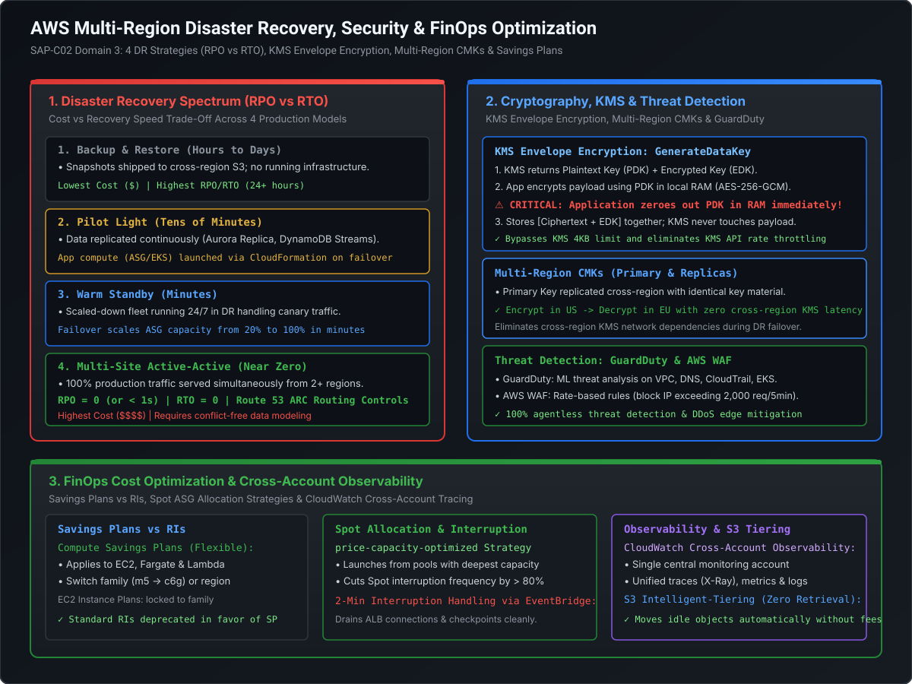

# Disaster Recovery Architecture, Multi-Region Resilience & Route 53 ARC

In enterprise distributed systems, catastrophic outages do not announce themselves. Fiber cuts, regional cloud control-plane failures, and ransomware attacks require pre-engineered, mathematically tested **Disaster Recovery (DR)** strategies. For Staff and Principal Cloud Architects, achieving business continuity is not about "hoping backups work"—it is about architecting systems with deterministic **Recovery Point Objectives (RPO)** and **Recovery Time Objectives (RTO)**.

This playbook breaks down the complete spectrum of the **4 AWS Disaster Recovery Strategies**, the mechanics of **Route 53 Application Recovery Controller (ARC)**, cross-region data replication, and WORM-compliant immutability via **AWS Backup Vault Lock**.

---

## Architecture Blueprint: Disaster Recovery & Resiliency Spectrum

[](images/aws_disaster_recovery_security_and_finops.svg)

```
========================================================================================================================
                               THE 4 DISASTER RECOVERY ARCHITECTURAL MODELS
========================================================================================================================

  Model                          RPO (Data Loss)       RTO (Downtime)        Relative Cost ($)     Complexity
  ─────────────────────────────────────────────────────────────────────────────────────────────────────────────
  1. Backup & Restore            Hours to Days         Hours to Days         $ (Lowest)            Low
  2. Pilot Light                 Minutes               10 to 30 Minutes      $$                    Moderate
  3. Warm Standby                Seconds to Minutes    Minutes (< 10m)       $$$                   High
  4. Multi-Site Active-Active    Near Zero (< 1s)      Zero (Instantaneous)  $$$$ (Highest)        Extreme
```

---

## 1. The 4 Disaster Recovery Strategies (Deep Dive)

### 1.1 Strategy 1: Backup & Restore
- **Architecture**: Application data, databases, and file systems are periodically backed up (via AWS Backup or native snapshots) and copied to an Amazon S3 bucket in a secondary AWS region. No compute infrastructure (EC2, ECS, ALBs) runs in the DR region during normal operations.
- **Failover Sequence**:
  1. Primary region fails.
  2. Restore database snapshots from S3 to newly launched RDS/Aurora instances in DR region (takes 1–4 hours depending on database size).
  3. Deploy application infrastructure via AWS CloudFormation or Terraform StackSets.
  4. Repoint Route 53 DNS records to the new ALB.
- **When to Use**: Non-critical internal tooling, dev/test environments, and batch processing systems where 24 hours of data loss and 24 hours of downtime are acceptable.

---

### 1.2 Strategy 2: Pilot Light
- **Architecture**: The **data tier is kept warm and continuously synchronized** in the DR region (e.g., cross-region Aurora Read Replica, DynamoDB Global Tables, or continuous DMS replication). However, the **application compute tier (EC2 / ASG / EKS) is kept dark** (zero instances running).
- **The Core Analogy**: A gas heater pilot light is always burning (data tier synchronized), but the furnace (compute fleet) only ignites when heat is requested.

```
========================================================================================================================
                                         PILOT LIGHT ARCHITECTURE
========================================================================================================================

    PRIMARY REGION (US-East-1)                                             DR REGION (EU-West-1)
  ┌─────────────────────────────┐                                        ┌─────────────────────────────┐
  │ Compute Fleet (100 Instances│                                        │ Compute Fleet: 0 Instances  │
  │ Running Active Traffic)     │                                        │ (AMI / IaC Templates Ready) │
  └──────────────┬──────────────┘                                        └──────────────▲──────────────┘
                 │                                                                      │
                 ▼                                                                      │ (Failover: Launch ASG
  ┌─────────────────────────────┐   Dedicated Redo Replication (< 1s)    ┌──────────────┴──────────────┐  via CloudFormation)
  │ Primary Aurora Writer DB    │ ─────────────────────────────────────> │ Aurora Cross-Region Replica │
  └─────────────────────────────┘                                        └─────────────────────────────┘
                                                                           (Promoted to Writer on DR!)
```

- **Failover Sequence**:
  1. Promote the Aurora Cross-Region Read Replica to a standalone primary database (takes 1 to 2 minutes).
  2. Trigger CloudFormation / Terraform to scale the Auto Scaling Group `DesiredCapacity` from `0` to `100` instances using pre-baked Golden AMIs.
  3. Route 53 health check flips DNS to the DR region ALB.
- **Metrics**: **RPO = Seconds** (continuous DB replication lag); **RTO = 10 to 30 minutes** (time required to boot compute fleet and pass health checks).

---

### 1.3 Strategy 3: Warm Standby
- **Architecture**: A **scaled-down, fully functional replica** of the entire application stack runs 24/7 in the DR region. For example, if the primary region runs 100 EC2 instances across 3 AZs, the DR region runs **10 to 20 instances** (just enough to handle synthetic canary traffic and keep internal caches warm).
- **Failover Sequence**:
  1. Primary region outage detected.
  2. Promote Aurora Read Replica to Writer.
  3. Issue an Auto Scaling command to scale the DR ASG from 20 to 100 instances.
  4. Because instances and load balancers are already running and passing health checks, initial traffic begins routing to the DR region **immediately**.
- **Metrics**: **RPO = Seconds**; **RTO = Under 5 minutes**.

---

### 1.4 Strategy 4: Multi-Site Active-Active
- **Architecture**: Full production capacity is deployed simultaneously across two or more AWS regions (e.g., `us-east-1` and `eu-west-1`). Both regions serve live production customer traffic simultaneously.
- **Data Tier Requirements**: Requires multi-region active-active databases (e.g., **DynamoDB Global Tables** with Last-Writer-Wins, or sharded Aurora instances where user traffic is deterministically routed by geographic region).
- **Traffic Routing**: Managed via **Route 53 Geolocation / Geoproximity** or **AWS Global Accelerator**.
- **Metrics**: **RPO = Zero (or < 1 second)**; **RTO = Zero (Instantaneous failover)**.
- **The Staff Engineer Reality**: Active-Active comes with extreme engineering complexity: cross-region data conflict resolution, dual-write races, distributed transaction isolation loss, and double the cloud infrastructure bill.

---

## 2. Route 53 Application Recovery Controller (ARC)

In large-scale enterprise outages, standard Route 53 DNS health checks frequently create **cascading failover disasters**:
- Standard Route 53 health checks poll HTTP endpoints across the internet. During a partial outage (e.g., database CPU spike), health checks flap rapidly between healthy and unhealthy, causing DNS thrashing.
- DNS TTL caching by ISPs (who frequently ignore low TTLs) delays failover by 10 to 15 minutes.

To eliminate these failure modes, AWS introduced **Route 53 Application Recovery Controller (ARC)**.

```
========================================================================================================================
                              ROUTE 53 APPLICATION RECOVERY CONTROLLER (ARC)
========================================================================================================================

                                  Route 53 ARC Control Plane (5 Regional Cells)
                                ┌───────────────────────────────────────────────┐
                                │ • Highly reliable, resilient to AWS outages   │
                                │ • Cell-based architecture (Survives 2 regions)│
                                └───────────────────────┬───────────────────────┘
                                                        │
                      ┌─────────────────────────────────┴─────────────────────────────────┐
                      │                                                                   │
                      ▼                                                                   ▼
       ┌─────────────────────────────┐                                     ┌─────────────────────────────┐
       │   ROUTING CONTROL SWITCH    │                                     │       READINESS CHECKS      │
       │ Manual / Automated On-Off   │                                     │ Continuously audits DR:     │
       │ (1 = Traffic ON, 0 = OFF)   │                                     │ • Are Auto Scaling limits ok│
       └──────────────┬──────────────┘                                     │ • Are Aurora replicas sync? │
                      │                                                    │ • Are Service Quotas ready? │
                      ▼                                                    └─────────────────────────────┘
       ┌─────────────────────────────┐
       │  Route 53 DNS Routing Rule  │
       │ (Switches traffic in < 10s) │
       └─────────────────────────────┘
```

### 2.1 Core Architectural Primitives of Route 53 ARC
1. **Routing Controls (Failover Switches)**:
   - Simple, ultra-reliable **binary switches (ON / OFF)** hosted on a dedicated cell-based control plane spanning 5 regional endpoints.
   - You can toggle a Routing Control via the AWS CLI or automated script even if the main AWS Management Console or IAM in the affected region is completely down.
   - **Safety Rules (Assertion Rules)**: Prevent human error during crises. For example, configure an assertion rule: *"At least one region's routing control MUST be ON at all times"*—preventing an engineer from accidentally turning off all traffic!
2. **Readiness Checks**:
   - Continuously audits your DR infrastructure in the background (e.g., checks if the EC2 Auto Scaling target capacity in EU-West-1 matches the US-East-1 fleet; checks if Aurora replication lag is within SLA; checks if AWS Service Quotas in the secondary region have enough headroom).
   - If an engineer accidentally changes a security group or reduces capacity in the DR region, the Readiness Check triggers an alert **before an outage occurs**.

---

## 3. Immutable Data Protection: AWS Backup with Vault Lock

In modern enterprise security, disaster recovery must protect against **Ransomware and Malicious Insiders** who gain administrative credentials and delete database snapshots before demanding ransom.

```
========================================================================================================================
                                  AWS BACKUP VAULT LOCK (WORM COMPLIANCE)
========================================================================================================================

  Compromised Administrator Credential (or Ransomware)
          │
          │ ─── 1. Calls DeleteRecoveryPoint / DeleteBackupVault ───> ┌──────────────────────────────────────┐
          │                                                           │          AWS BACKUP VAULT            │
          │                                                           │   (Vault Lock: COMPLIANCE MODE)      │
          │                                                           │                                      │
          │ <── 2. [ACCESS DENIED: LOCKED BY VAULT LOCK] ─────────────│ • Cannot delete recovery points!     │
          │                                                           │ • Cannot shorten retention days!     │
          │                                                           │ • Even AWS Root & AWS Support CANNOT │
          │                                                           │   delete until retention period ends!│
          │                                                           └──────────────────────────────────────┘
```

### 3.1 Vault Lock Modes: Governance vs. Compliance Mode
- **Governance Mode**: Enforces retention periods, but privileged users with specific IAM permissions (`backup:DeleteRecoveryPoint`) can override or delete backups. Useful for testing.
- **Compliance Mode (The SEC Rule 17a-4 / WORM Standard)**:
  - Enforces **Write Once, Read Many (WORM)** immutability.
  - Features a **cooling-off period (grace period)** of 3 to 30 days during which the lock can be cancelled.
  - **Once the cooling-off period expires, the lock is IRREVOCABLE**:
    - **NO ONE**—not the account administrator, not the AWS Organizations Root user, and **not even AWS Support engineers**—can delete the vault or delete any recovery point before its retention date expires!
    - Guarantees 100% data recoverability following a total administrative credential compromise.

---

## 4. Staff+ Architectural Summary Matrix

| Disaster Recovery Tier | RPO | RTO | Annual Cost Factor | Core AWS Services |
| :--- | :--- | :--- | :--- | :--- |
| **Backup & Restore** | 12–24 Hours | 12–24 Hours | $1\times$ (Baseline) | AWS Backup, S3 Cross-Region Replication, CloudFormation |
| **Pilot Light** | Seconds | 10–30 Minutes | $1.5\times$ | Aurora Read Replica, DynamoDB Global Tables, CloudFormation |
| **Warm Standby** | Seconds | < 5 Minutes | $2.5\times$ | Scaled-down ASG (20%), Aurora Replica, Route 53 Health Checks |
| **Multi-Site Active-Active**| Near Zero (< 1s)| Zero | $4.0\times$ | Route 53 ARC, Global Tables, Aurora Global DB, Global Accelerator |
| **Vault Lock Immutability** | N/A | Immediate Restore | + Storage cost | AWS Backup Vault Lock (Compliance Mode WORM protection) |
