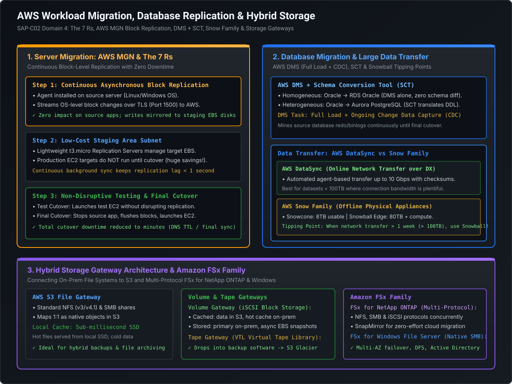

# Cloud Migration Strategies (7 Rs), AWS MGN, DMS & Hybrid Storage Architecture

Migrating enterprise workloads from on-premises data centers to AWS is one of the most critical responsibilities of a Staff or Principal Solutions Architect. Enterprise migrations are not simply about moving bits over a wire; they require evaluating technical debt, choosing between block-level server replication and database change data capture (CDC), calculating offline appliance tipping points, and architecting hybrid file gateways.

This playbook covers:
1. **The 7 Rs Migration Framework**: Architectural decision trees for portfolio rationalization.
2. **AWS Application Migration Service (MGN)**: Agent-based block-level continuous replication and zero-downtime cutover.
3. **Database Migration at Scale**: AWS Database Migration Service (DMS) full load + CDC ongoing replication with AWS Schema Conversion Tool (SCT).
4. **Large-Scale Data Ingestion**: AWS DataSync vs. AWS Snow Family (Snowcone, Snowball Edge, Snowmobile) tipping point mathematics.
5. **Hybrid Storage Solutions**: AWS Storage Gateway (S3 File, FSx File, Volume Cached/Stored, Tape VTL) and the Amazon FSx Family (NetApp ONTAP & Windows File Server).

---

## Architecture Blueprint: Migration & Hybrid Storage Engine



```
========================================================================================================================
                              ENTERPRISE CLOUD MIGRATION ARSENAL
========================================================================================================================

    Workload Type                    Migration Service / Pattern                    Target Architecture
  ┌─────────────────────────┐       ┌─────────────────────────────────┐            ┌───────────────────────────────┐
  │ Physical / Virtual Host │ ────> │ AWS Application Migration (MGN) │ ─────────> │ Amazon EC2 Target Instance    │
  │ (Linux / Windows)       │       │ (Continuous Block Replication)  │            │ (Right-Sized via Test Cutover)│
  └─────────────────────────┘       └─────────────────────────────────┘            └───────────────────────────────┘
  ┌─────────────────────────┐       ┌─────────────────────────────────┐            ┌───────────────────────────────┐
  │ On-Premises Relational  │ ────> │ AWS DMS (Full Load + CDC)       │ ─────────> │ Amazon Aurora / RDS Multi-AZ  │
  │ (Oracle, SQL Server)    │       │ + Schema Conversion Tool (SCT)  │            │ (Zero-Downtime Cutover)       │
  └─────────────────────────┘       └─────────────────────────────────┘            └───────────────────────────────┘
  ┌─────────────────────────┐       ┌─────────────────────────────────┐            ┌───────────────────────────────┐
  │ Massive Data (100TB+)   │ ────> │ AWS Snowball Edge / DataSync    │ ─────────> │ Amazon S3 / FSx ONTAP         │
  │ File Systems / Backups  │       │ (Bandwidth vs Shipping Tipping) │            │ Intelligent-Tiering / Glacier │
  └─────────────────────────┘       └─────────────────────────────────┘            └───────────────────────────────┘
```

---

## 1. The 7 Rs Cloud Migration Framework

When evaluating an enterprise application portfolio of hundreds or thousands of servers, architects categorize workloads using the **7 Rs Framework**:

```
========================================================================================================================
                                     THE 7 Rs DECISION MATRIX
========================================================================================================================

  Strategy         Description                                          Primary AWS Tools              Effort / ROI
  ─────────────────────────────────────────────────────────────────────────────────────────────────────────────
  1. Rehost        "Lift and Shift": Move servers to EC2 with zero code AWS MGN                        Low / Immediate
  2. Replatform    "Lift, Tinker and Shift": Move to managed RDS or ECS DMS, ECS, Elastic Beanstalk   Moderate / Medium
  3. Refactor      Re-architect into cloud-native serverless / Lambda   Lambda, DynamoDB, EventBridge  High / Highest
  4. Repurchase    "Drop and Shop": Replace custom software with SaaS   AWS Marketplace, Salesforce    Varies / High
  5. Relocate      Hypervisor-level migration without OS disruption     VMware Cloud on AWS (VMC)      Lowest / Low
  6. Retain        Keep on-premises (regulatory, legacy, depreciation)  AWS Outposts, Direct Connect   Zero
  7. Retire        Decommission redundant or unused legacy servers      Application Discovery Service  Zero / Cost Save
```

---

## 2. Server Migration: AWS Application Migration Service (MGN)

**AWS MGN** (which supersedes CloudEndure Migration and AWS Server Migration Service) is the primary AWS tool for lift-and-shift migrations of physical, virtual, and cloud-hosted servers.

```
========================================================================================================================
                                      AWS MGN REPLICATION FLOW
========================================================================================================================

    On-Premises Data Center                                            AWS Staging Area (Target VPC)
  ┌─────────────────────────┐                                        ┌─────────────────────────────────┐
  │ Source Server (VM/Bare) │                                        │ Staging Area Subnet             │
  │ ┌─────────────────────┐ │                                        │ ┌─────────────────────────────┐ │
  │ │ AWS MGN Agent       │ │ ──TLS Port 1500 Block Stream (TCP)───> │ │ Replication Server (t3.micro)│ │
  │ └─────────────────────┘ │                                        │ └──────────────┬──────────────┘ │
  │ App running live!       │                                        │                │ Mirrors blocks │
  │ Zero I/O disruption     │                                        │                ▼                │
  └─────────────────────────┘                                        │ ┌─────────────────────────────┐ │
                                                                     │ │ Staging EBS Volumes (gp3)   │ │
                                                                     │ └─────────────────────────────┘ │
                                                                     └─────────────────────────────────┘
                                                                                      │
                                     [TEST CUTOVER / FINAL CUTOVER]                   │ Snapshot & Boot
                                                                                      ▼
                                                                     ┌─────────────────────────────────┐
                                                                     │ Production Target Subnet        │
                                                                     │ ┌─────────────────────────────┐ │
                                                                     │ │ Live Target EC2 Instance    │ │
                                                                     │ │ (m6i.xlarge, production SG) │ │
                                                                     │ └─────────────────────────────┘ │
                                                                     └─────────────────────────────────┘
```

### 2.1 Technical Replication Mechanics
1. **Agent Installation**: The AWS Replication Agent is installed on the source operating system (Linux or Windows). It operates at the kernel level, capturing block-level disk changes in real-time.
2. **The Low-Cost Staging Area**:
   - The agent streams encrypted block changes over **TCP port 1500** directly to lightweight `t3.micro` replication servers running in a private staging subnet.
   - The replication servers attach to staging Amazon EBS volumes that mirror the size of the source disks.
   - **Financial Benefit**: Production target EC2 instances are **not launched during replication**, saving thousands of dollars during multi-month migration windows.
3. **Continuous Background Sync**: After the initial full disk synchronization, the agent continuously mirrors delta changes with sub-second replication lag.

### 2.2 Test Cutover vs. Final Cutover
- **Non-Disruptive Test Cutover**: AWS MGN takes a point-in-time EBS snapshot from the staging volume, injects target OS drivers (AWS PV/ENA network drivers), and launches a live test EC2 instance in a target subnet. The source application remains live and replication continues uninterrupted. Engineers validate networking, performance, and functionality.
- **Final Cutover (The Zero-Downtime Switch)**:
  1. Schedule a brief maintenance window (typically 10–30 minutes).
  2. Stop the application services on the on-premises source host to ensure zero in-flight writes.
  3. Wait a few moments for the MGN agent to flush the final remaining blocks to AWS (replication lag drops to `0 seconds`).
  4. Launch the live target production EC2 instance.
  5. Update Route 53 DNS records to point to the new AWS instance or load balancer.

---

## 3. Database Migration at Scale: AWS DMS & AWS SCT

When migrating databases, simply copying disk blocks via server migration is often inadequate because storage engines require transactional consistency and organizations often modernize from commercial engines (Oracle, SQL Server) to open-source cloud engines (Amazon Aurora PostgreSQL / MySQL).

```
========================================================================================================================
                                     AWS DMS & SCT MIGRATION PIPELINE
========================================================================================================================

    On-Premises Source Database                                                Target AWS Database
  ┌─────────────────────────────┐                                            ┌─────────────────────────────┐
  │ On-Premises Oracle DB       │                                            │ Amazon Aurora PostgreSQL    │
  └──────────────┬──────────────┘                                            └──────────────▲──────────────┘
                 │                                                                          │
                 │ ── 1. Schema Translated via AWS SCT ─────────────────────────────────────┤
                 │    (DDL, Tables, Indexes, Views, PL/SQL converted to PL/pgSQL)           │
                 │                                                                          │
                 ▼                                                                          │
  ┌─────────────────────────────┐                                                           │
  │ DMS Replication Instance    │ ── 2. Full Initial Load (Bulk Select) ────────────────────┤
  │ (Dedicated EC2 in VPC)      │ ── 3. Ongoing CDC (Tails Oracle Redo Logs via LogMiner) ──┘
  └─────────────────────────────┘
```

### 3.1 Homogeneous vs. Heterogeneous Database Migrations
1. **Homogeneous Migration (Same Engine)**:
   - Example: On-Premises Oracle $\to$ Amazon RDS for Oracle, or MySQL $\to$ Aurora MySQL.
   - Schema and data types are identical.
   - Handled directly by **AWS DMS** alone, or using native database tools (Oracle Data Pump, PostgreSQL `pg_dump`/`pg_restore`, MySQL Percona XtraBackup).
2. **Heterogeneous Migration (Different Engine)**:
   - Example: On-Premises Oracle $\to$ Amazon Aurora PostgreSQL.
   - **AWS DMS does NOT convert stored procedures, PL/SQL packages, or complex triggers!**
   - **AWS Schema Conversion Tool (SCT)** is strictly required upfront:
     - SCT analyzes source schema, foreign keys, and stored procedures, generating an **Assessment Report** highlighting automated conversions vs. manual code rewrites.
     - Automatically converts 80–95% of database code to target engine syntax (e.g., converting Oracle PL/SQL to PostgreSQL PL/pgSQL).

### 3.2 DMS Replication Tasks: Full Load + Ongoing CDC
- **Full Load**: Extracts all existing rows from source tables and bulk-inserts them into the target database.
- **Change Data Capture (CDC)**: While the full load runs, DMS reads the source database's transaction log stream (e.g., Oracle Redo Logs, SQL Server Transaction Logs, MySQL Binlogs) without placing query load on tables.
- **Ongoing Sync**: DMS captures all concurrent `INSERT`, `UPDATE`, and `DELETE` transactions that occurred during the full load and applies them to the target. It keeps the target database synchronized indefinitely until the application cutover.

---

## 4. Large-Scale Data Transfer: AWS DataSync vs. AWS Snow Family

When migrating tens to hundreds of terabytes of unstructured data (backups, media archives, file shares), architects must decide between **online network transfer** and **offline physical appliance shipment**.

```
========================================================================================================================
                                 BANDWIDTH VS. SHIPPING TIPPING POINT
========================================================================================================================

  Dataset Size               100 Mbps Uplink            1 Gbps Uplink              10 Gbps Uplink (Direct Connect)
  ─────────────────────────────────────────────────────────────────────────────────────────────────────────────
  10 TB                      9.2 Days                   22 Hours                   2.2 Hours
  50 TB                      46 Days                    4.6 Days                   11 Hours
  100 TB                     92 Days (Use Snowball!)    9.2 Days                   22 Hours
  500 TB                     460 Days (Use Snowball!)   46 Days (Use Snowball!)    4.6 Days
  1 PB                       2.5 Years (Use Snowball!)  92 Days (Use Snowball!)    9.2 Days
```

$$\text{Transfer Duration (Days)} = \frac{\text{Dataset Size in Bits}}{\text{Network Bandwidth in bps} \times 86,400 \times \text{Network Utilization Factor (0.8)}}$$

### 4.1 AWS DataSync (Online Transfer Engine)
- **Architecture**: A software agent deployed as a virtual machine (VMware ESXi, Hyper-V, KVM) inside the customer data center.
- **Protocol Acceleration**: Uses a custom, proprietary AWS protocol that parallelizes multi-threaded transfers over TLS, achieving **up to 10 Gbps network saturation**.
- **Metadata Preservation**: Automatically preserves POSIX permissions, ownership, timestamps, and extended file attributes when copying to S3, EFS, or FSx.
- **Built-in Verification**: Performs MD5/SHA256 checksum verification in transit and at rest to guarantee data integrity.

---

### 4.2 The AWS Snow Family (Offline Physical Transfer)

| Device | Usable Storage Capacity | On-Board Compute | Physical Weight | Recommended Use Cases |
| :--- | :--- | :--- | :--- | :--- |
| **AWS Snowcone** | 8 TB HDD (or 14 TB SSD) | 2 vCPUs, 4 GB RAM | 4.5 lbs (Ultra-portable) | Edge data collection, drones, vehicles, military field ops |
| **AWS Snowball Edge Storage Optimized** | **80 TB HDD** (+ 28 TB NVMe SSD) | 40 vCPUs, 80 GB RAM | ~49 lbs (Ruggedized case) | Large-scale data center migration (100TB to 5PB) |
| **AWS Snowball Edge Compute Optimized** | 42 TB HDD (or 28 TB NVMe) | **104 vCPUs**, 416 GB RAM (Optional GPU) | ~49 lbs | Edge machine learning, local video analytics, disconnected sites |
| **AWS Snowmobile** | **Up to 100 PB** per truck | Ruggedized shipping container | 45-foot truck trailer | Exabyte-scale data center closures (> 10PB) |

> [!IMPORTANT]
> **The 1-Week Snowball Rule**: If the mathematical calculation shows that online network transfer will take **longer than 7 to 10 days**, ordering an **AWS Snowball Edge** is both faster and more cost-effective. Shipping takes 2–3 days, local transfer takes 1–2 days, return shipping takes 2–3 days, and ingestion to S3 takes 1–2 days (Total: ~8 days for 80TB).

---

## 5. Hybrid Storage Gateway Architecture & Amazon FSx

### 5.1 AWS Storage Gateway (Connecting On-Premises to Cloud)

```
========================================================================================================================
                                 STORAGE GATEWAY TAXONOMY & PROTOCOLS
========================================================================================================================

  Gateway Type               Client Protocol            Primary Storage Location   Target AWS Storage
  ─────────────────────────────────────────────────────────────────────────────────────────────────────────────
  1. S3 File Gateway         NFS (v3/v4.1) & SMB        Amazon S3 (1:1 Object Map) S3 Standard / IA / Glacier
  2. FSx File Gateway        SMB                        Amazon FSx for Windows     Amazon FSx File System
  3. Volume Gateway (Cached) iSCSI Block Volume         Amazon S3 (Local Cache)    S3 + Point-in-time EBS Snapshots
  4. Volume Gateway (Stored) iSCSI Block Volume         On-Premises Local Disk     Local Disk + Async EBS Snapshots
  5. Tape Gateway (VTL)      iSCSI Virtual Tape         Virtual Tape Library       S3 Glacier & Deep Archive
```

- **S3 File Gateway**: The most common gateway pattern. Exposes standard NFS and SMB shares to on-premises servers. Files written to the share are asynchronously uploaded to Amazon S3 as **native S3 objects**. Includes a local SSD cache for sub-millisecond on-premise read access.
- **Volume Gateway (Cached Mode)**: Presents virtual iSCSI hard drives to on-premises servers. Primary data is stored durably in Amazon S3, while frequently accessed data is retained in local on-premises SSD cache, providing cost-effective cloud-backed storage expansion.
- **Tape Gateway (VTL)**: Completely replaces physical tape drives and off-site Iron Mountain tape archival. Legacy backup software (Veeam, Commvault, Veritas) writes to virtual iSCSI tapes; the gateway automatically ships tape images to Amazon S3 Glacier and Glacier Deep Archive for pennies per terabyte.

---

### 5.2 The Amazon FSx Enterprise File System Family

1. **Amazon FSx for NetApp ONTAP**:
   - Multi-protocol concurrent access: Supports **NFS, SMB, and iSCSI simultaneously** against the same underlying storage volume.
   - Built-in NetApp enterprise features: Thin provisioning, inline data deduplication, compression, and snapshot cloning.
   - **Migration Enabler**: Natively integrates with on-premises NetApp storage arrays using **NetApp SnapMirror**, allowing seamless block-level asynchronous cloud migration with sub-minute cutover.
2. **Amazon FSx for Windows File Server**:
   - Built natively on Microsoft Windows Server.
   - Full native support for Windows SMB v2/v3, Active Directory integration, Access Control Lists (ACLs), DFS Namespaces, and Shadow Copies.
   - Multi-AZ deployment provides automatic synchronous block-level replication with sub-minute failover.

---

## 6. Staff+ Architectural Summary Matrix

| Migration Challenge | Recommended AWS Solution | Key Architectural Justification | Cutover Downtime |
| :--- | :--- | :--- | :--- |
| **Bare-metal / VM Lift & Shift** | AWS Application Migration (MGN) | Block-level continuous replication; staging subnet avoids target EC2 costs | Minutes (final delta sync) |
| **Heterogeneous DB (Oracle $\to$ PG)** | AWS SCT + AWS DMS | SCT translates stored procedures/DDL; DMS handles full load + ongoing CDC | < 5 Minutes |
| **Bulk Data Transfer (200TB, 100M link)**| AWS Snowball Edge (Offline) | Network transfer would take 185 days; Snowball completes migration in 8 days | Zero impact on bandwidth |
| **Continuous Hybrid File Sync** | AWS DataSync | Up to 10 Gbps protocol acceleration with automated checksum verification | Continuous |
| **On-Premises File Share to S3** | S3 File Gateway | Standard NFS/SMB shares with local SSD read cache; 1:1 S3 object mapping | Zero (continuous cache) |
| **NetApp On-Premises Migration** | FSx for NetApp ONTAP | Native SnapMirror replication with zero change to client storage protocols | Sub-minute switchover |
