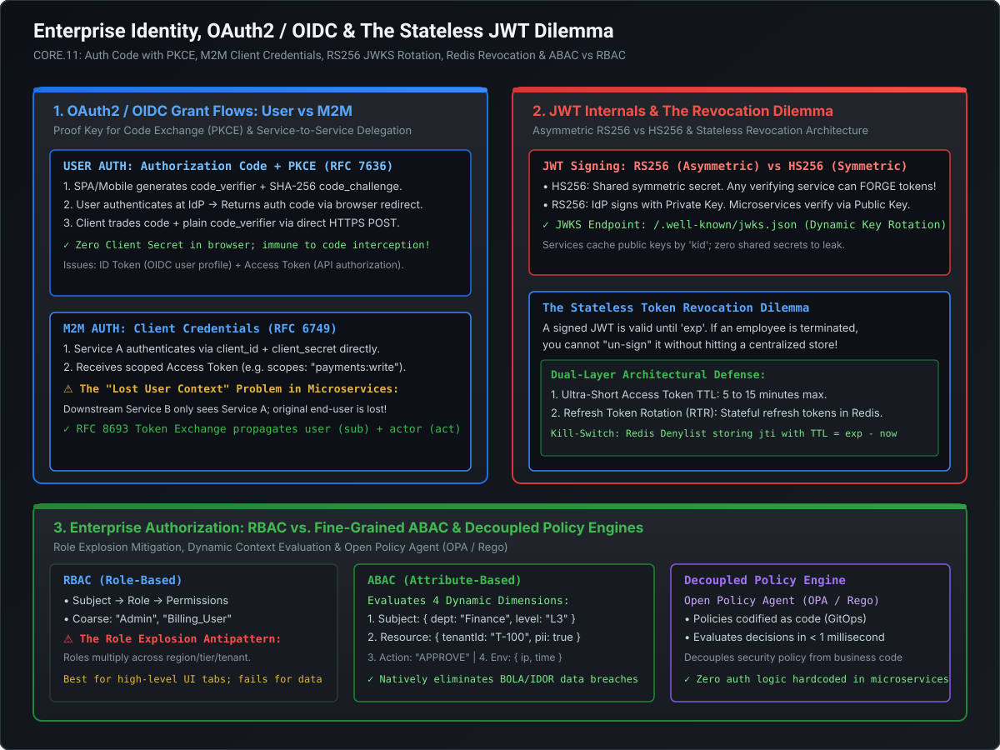

# OAuth 2.0, OpenID Connect (OIDC) & Machine-to-Machine (M2M) Token Architecture

In enterprise microservice architectures, security failures rarely stem from broken encryption algorithms; they stem from **architectural flaws in token delegation, missing cryptographic handshakes, and identity context loss across distributed boundaries**. A Staff or Principal Systems Architect must design identity pipelines that securely authenticate human users across mobile and web clients, govern autonomous service-to-service communication, and maintain strict audit trails across dozens of network hops.

This playbook breaks down the deep architecture of **OAuth 2.0 and OpenID Connect (OIDC)**, the mechanics of **Authorization Code with PKCE**, **M2M Client Credentials**, downstream context propagation via **RFC 8693 Token Exchange**, and zero-downtime **Client Secret rotation**.

---

## Architecture Blueprint: OAuth2 / OIDC & M2M Token Flow



```
========================================================================================================================
                                     AUTHN VS. AUTHZ & TOKEN TAXONOMY
========================================================================================================================

  Protocol                           Core Purpose                       Token Produced                 Intended Audience
  ──────────────────────────────────────────────────────────────────────────────────────────────────────────────────────
  OpenID Connect (OIDC)              Authentication (AuthN)             ID Token (JWT)                 The Client (App / SPA)
  OAuth 2.0 (RFC 6749)               Authorization (AuthZ)              Access Token (JWT / Opaque)    The Resource Server (API)
  OAuth 2.0 (RFC 6749)               Session Maintenance                Refresh Token (High Entropy)   The Authorization Server
```

---

## 1. Authentication vs. Authorization: OIDC vs. OAuth 2.0

A foundational interview failure is confusing authentication with authorization:
- **OAuth 2.0 is strictly an Authorization Delegation Framework (RFC 6749)**: It allows a third-party application to obtain limited access to an HTTP service on behalf of a resource owner. **OAuth 2.0 does NOT authenticate users**; an Access Token merely asserts that "the bearer possesses these scopes." It contains no standardized user profile identity claims.
- **OpenID Connect (OIDC) is an Identity Layer Built on Top of OAuth 2.0**: OIDC standardizes authentication. When a user logs in, the Identity Provider (IdP) issues an **ID Token** in addition to the Access Token.

### 1.1 The ID Token vs. Access Token Anti-Pattern (Audience Confusion)
- **The ID Token**: Formatted as a JSON Web Token (JWT). Its audience (`aud`) is the **Client Application**. It is consumed by the client UI to display the user's name, profile image, and email (`sub`, `email`, `name`).
- **The Access Token**: Its audience (`aud`) is the **Resource Server (API Gateway / Microservice)**. It is passed in the `Authorization: Bearer <token>` header to authorize API operations.
- **The Security Anti-Pattern**: Passing the ID Token to backend APIs. The backend API must reject ID Tokens because they lack authorization scopes and are intended solely for client-side consumption!

---

## 2. User Authentication: Authorization Code Flow with PKCE (RFC 7636)

In modern web applications (Single Page Apps like React/Vue) and native mobile apps (iOS/Android), storing a `client_secret` inside the client bundle is a critical security vulnerability: any user can inspect JavaScript source code or decompile an APK to extract the secret.

For this reason, the legacy Implicit Flow and standard Authorization Code Flow are deprecated in favor of **Authorization Code with Proof Key for Code Exchange (PKCE)**.

```
========================================================================================================================
                              AUTHORIZATION CODE WITH PKCE EXECUTION SEQUENCE
========================================================================================================================

  Browser / Client (SPA)                     Identity Provider (Okta / Keycloak)             Resource Server (API)
          │                                                  │                                         │
  [1. Generates code_verifier]                               │                                         │
  [2. Computes code_challenge =                              │                                         │
      BASE64URL(SHA256(verifier))]                           │                                         │
          │                                                  │                                         │
          │ ─── 3. GET /authorize?response_type=code ────────> │                                         │
          │        &client_id=my-spa                         │                                         │
          │        &code_challenge=E9Melhoa2Owv...           │                                         │
          │        &code_challenge_method=S256               │                                         │
          │                                                  │                                         │
          │ <─── 4. User Authenticates (MFA / SSO) ──────────│                                         │
          │ <─── 5. Redirects to /callback?code=AUTH_CODE ───│                                         │
          │                                                  │                                         │
  [6. Exchanges Code via Direct POST]                        │                                         │
          │ ─── 7. POST /oauth/token ──────────────────────> │                                         │
          │        grant_type=authorization_code             │                                         │
          │        &code=AUTH_CODE                           │                                         │
          │        &code_verifier=dBjftJeZ4CVP-mB92K27uhb... │                                         │
          │                                                  │                                         │
          │                                    [IdP Cryptographic Check:                               │
          │                                     SHA256(verifier) == challenge?]                        │
          │                                                  │                                         │
          │ <─── 8. Returns Access Token + ID Token ─────────│                                         │
          │                                                                                            │
          │ ─── 9. GET /api/v1/orders (Authorization: Bearer <Access_Token>) ───────────────────────> │
```

### 2.1 The Cryptographic Proof Mechanics
1. **`code_verifier`**: The client generates a high-entropy, cryptographically random string (between 43 and 128 characters) using characters `[A-Z]`, `[a-z]`, `[0-9]`, `-`, `_`, `.`, `~`.
2. **`code_challenge`**: The client computes the SHA-256 hash of the `code_verifier` and URL-safe Base64 encodes it:

$$\text{code\_challenge} = \text{Base64URL}\Big(\text{SHA-256}(\text{code\_verifier})\Big)$$

3. **Immunity to Code Interception**: If an attacker intercepts the authorization code on a mobile OS redirect URI, they cannot exchange it for an access token because they do not know the unhashed `code_verifier` stored in client memory!

---

## 3. Machine-to-Machine (M2M) Authentication: Client Credentials

When backend microservices communicate without human interaction (e.g., a scheduled payment batch processor or an ingestion worker), they authenticate via the **OAuth 2.0 Client Credentials Grant (RFC 6749 Section 4.4)**.

```
========================================================================================================================
                                CLIENT CREDENTIALS SERVICE-TO-SERVICE FLOW
========================================================================================================================

    Order Service (Client)                     Identity Provider (Keycloak / Auth0)          Payment Service
              │                                                  │                                   │
              │ ─── 1. POST /oauth/token ──────────────────────> │                                   │
              │        grant_type=client_credentials             │                                   │
              │        &client_id=order-service                  │                                   │
              │        &client_secret=sec_abc123...              │                                   │
              │        &scope=payments:charge                    │                                   │
              │                                                  │                                   │
              │ <── 2. Returns Access Token (Valid for 15m) ─────│                                   │
              │        { "sub": "order-service",                 │                                   │
              │          "scope": "payments:charge" }            │                                   │
              │                                                  │                                   │
              │ ─── 3. POST /v1/charges ───────────────────────────────────────────────────────────> │
              │        Authorization: Bearer <Access_Token>                                          │
              │                                                                                      │
              │                                                                      [Validates Signature via JWKS]
              │                                                                      [Enforces Scope: payments:charge]
```

---

### 3.1 The "Lost User Context" Dilemma & RFC 8693 Token Exchange

A critical architectural pitfall occurs when Service A calls Service B during a user-initiated transaction:

```
========================================================================================================================
                                 THE USER CONTEXT LOSS VULNERABILITY
========================================================================================================================

  Alice (Customer) ──> Order Service (User JWT: sub="Alice") ──M2M Token──> Payment Service (Token sub="OrderService")
                                                                            ❌ Payment Service does not know ALICE!
                                                                            Cannot verify if Alice owns the bank card!
```

- **Flaw 1 (Passing M2M Token)**: If Order Service uses its own Client Credentials to call Payment Service, Payment Service only sees `sub="OrderService"`. Alice's identity is erased, destroying audit trails and preventing object-level authorization (BOLA/IDOR).
- **Flaw 2 (Forwarding Alice's Token Directly)**: If Order Service blindly forwards Alice's token to Payment Service, it violates the **Principle of Least Privilege**. Alice's token might have an audience (`aud`) restricted to Order Service; Payment Service should not trust an unexpected audience.

#### The Staff+ Enterprise Solution: RFC 8693 OAuth 2.0 Token Exchange
Order Service calls the IdP's token endpoint to exchange Alice's token for a new token tailored for Payment Service:

```http
POST /oauth/token HTTP/1.1
Host: idp.example.com
Content-Type: application/x-www-form-urlencoded

grant_type=urn:ietf:params:oauth:grant-type:token-exchange
&subject_token=ALICE_USER_ACCESS_TOKEN
&subject_token_type=urn:ietf:params:oauth:token-type:access_token
&actor_token=ORDER_SERVICE_M2M_TOKEN
&actor_token_type=urn:ietf:params:oauth:token-type:access_token
&audience=https://payment-service.corp.internal
&scope=payments:charge
```

The resulting token delivered to Payment Service contains both the **Subject** and the **Actor (Delegation Chain)**:

```json
{
  "sub": "user_alice_9812",
  "aud": "https://payment-service.corp.internal",
  "scope": "payments:charge",
  "act": {
    "sub": "order-service-client"
  },
  "exp": 1773245600
}
```

Now Payment Service knows: *"Order Service is executing a charge on behalf of Alice."* Both identities are cryptographically verified!

---

### 3.2 Automated Client Secret Lifecycle & Zero-Downtime Rotation

Hardcoded client secrets in application configurations are an operational disaster. An expired or compromised secret causes cascading outages.

```
========================================================================================================================
                                  DUAL-SECRET ROTATION ARCHITECTURE
========================================================================================================================

  Identity Provider (Active Secrets for Order Service)
  ┌────────────────────────────────────────────────────────┐
  │ Primary Secret:   sec_v1_active  (Expires: 2026-03-31) │
  │ Secondary Secret: sec_v2_pending (Expires: 2026-04-30) │
  └──────────────────────────┬─────────────────────────────┘
                             │
            [Vault / AWS Secrets Manager Sync]
                             │
                             ▼
  ┌────────────────────────────────────────────────────────┐
  │ Step 1: Vault generates new Secret v2 in IdP           │
  │ Step 2: Vault updates Microservice Secret Store        │
  │ Step 3: Microservice gracefully adopts Secret v2       │
  │ Step 4: Vault deletes Secret v1 after 48-hour window   │
  └────────────────────────────────────────────────────────┘
```

1. **Dual Secret Support**: Modern IdPs (Okta, Keycloak, Azure AD) support **two concurrent client secrets** per registered application.
2. **Automated Secret Orchestration**:
   - An automated rotation engine (HashiCorp Vault or AWS Secrets Manager) generates Secret $V_2$ and registers it with the IdP as the secondary secret.
   - The orchestrator updates the microservice secret store.
   - Microservices dynamically reload Secret $V_2$ without JVM/container restart.
   - Once all instances are verified using Secret $V_2$, the orchestrator deprecates and deletes Secret $V_1$ after a 48-hour safety window.

---

## 4. Enterprise SSO: SAML 2.0 vs. OpenID Connect (OIDC)

In enterprise IT, identity federation connects external Identity Providers (Okta, Ping Identity, Microsoft Entra ID) to internal applications.

| Dimension | SAML 2.0 (Security Assertion Markup Language) | OpenID Connect (OIDC) |
| :--- | :--- | :--- |
| **Data Format** | Heavyweight XML documents with XML-DSig | Lightweight JSON Web Tokens (JWT) |
| **Transport** | Base64-encoded HTTP POST parameter / redirect | Standard HTTP headers (`Authorization: Bearer`) |
| **Client Support** | Browser-based web applications ONLY | SPAs, Mobile apps, APIs, IoT, and Web apps |
| **Mobile Friendliness** | Extremely poor (XML parsing, redirects) | Native JSON parsing supported on all platforms |
| **Cryptographic Standard**| XML Digital Signature (complex, high CVE risk) | JSON Web Signature (JWS / RFC 7515) |
| **Modern Recommendation** | Legacy enterprise corporate intranets | **Default choice for all modern applications** |

---

## 5. Staff+ Architectural Summary Matrix

| Grant Flow / Standard | RFC Standard | Security Mechanism | Best-Practice Production Use Case |
| :--- | :--- | :--- | :--- |
| **Auth Code with PKCE** | RFC 7636 | `code_verifier` + `code_challenge` (S256) | SPAs (React/Vue) and Mobile Apps (iOS/Android) |
| **Client Credentials** | RFC 6749 | Direct mTLS / Client Secret authentication | Daemon background jobs, cron tasks, headless ETL |
| **Token Exchange** | RFC 8693 | Transfers user context (`sub`) with actor (`act`) | Multi-hop microservice calls preserving user identity |
| **OIDC Discovery** | OIDC Core | `/.well-known/openid-configuration` | Dynamic endpoint and issuer configuration |
| **Dual Secret Rotation** | Enterprise Pattern | Overlapping primary/secondary secret validity | Zero-downtime automated M2M credential updates |
