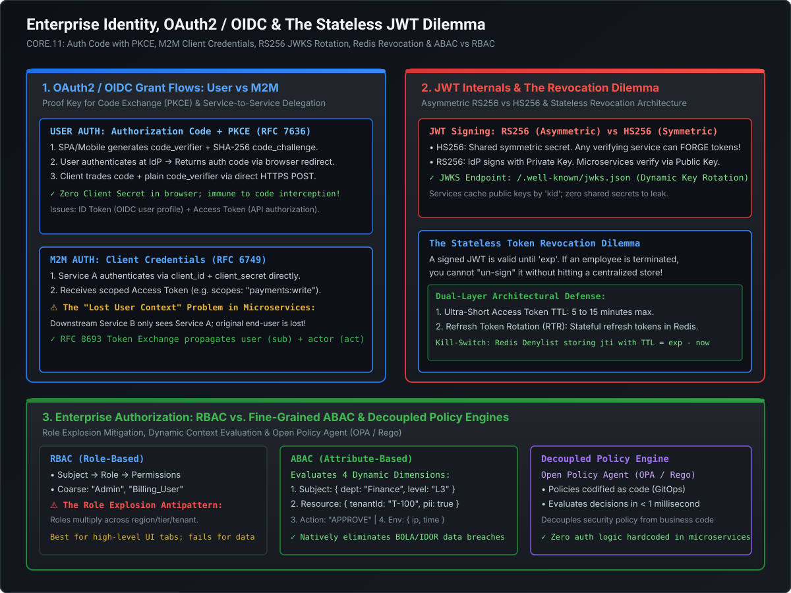

# JWT Internals, The Stateless Revocation Dilemma & Enterprise Authorization (RBAC vs. ABAC)

In distributed architectures, JSON Web Tokens (JWTs) are the universal standard for identity and access propagation. However, treating JWTs as "magic cookies" without understanding their cryptographic guarantees and operational limits creates critical vulnerabilities: shared-secret forgery, infinite session lifespans, and the **stateless revocation paradox**.

This playbook covers:
1. **JWT Architecture & Cryptographic Mechanics**: Header, payload, signature, and why **RS256 with JWKS** is mandatory over symmetric HS256.
2. **The Stateless Token Revocation Dilemma**: Why you cannot "un-sign" a JWT, and the two battle-tested production solutions (**Short-lived access tokens with Refresh Token Rotation**, and **Distributed Redis denylists keyed by `jti`**).
3. **Enterprise Authorization Models**: The mathematical failure of **RBAC (Role Explosion)** and how fine-grained **ABAC (Attribute-Based Access Control)** with **Open Policy Agent (OPA / Rego)** solves object-level authorization (BOLA/IDOR).

---

## Architecture Blueprint: JWT Lifecycle & Policy Engines



```
========================================================================================================================
                                     JWT ANATOMY & CRYPTOGRAPHIC VERIFICATION
========================================================================================================================

    Encoded Token:  eyJhbGciOiJSUzI1NiIsImtpZCI6IjIwMjYtazEifQ.eyJzdWIiOiJhbGljZSIsImV4cCI6MTc3MzI0... .TJVA95OrM7E2...
                    └──────────────────┬──────────────────┘ └──────────────────┬──────────────────┘ └──────────┬──────────┘
                                       │                                       │                               │
                                       ▼                                       ▼                               ▼
  ┌────────────────────────────────────────────────────────┐ ┌───────────────────────────────────┐ ┌──────────────────────┐
  │ 1. Header (JOSE)                                       │ │ 2. Claims Payload                 │ │ 3. RS256 Signature   │
  │ {                                                      │ │ {                                 │ │ RSA-SHA256(          │
  │   "alg": "RS256",                                      │ │   "iss": "https://auth.corp.com", │ │   Base64URL(Header)  │
  │   "typ": "JWT",                                        │ │   "sub": "user_alice_9812",       │ │   + "." +            │
  │   "kid": "2026-key-rsa-01"                             │ │   "aud": "https://api.corp.com",  │ │   Base64URL(Payload),│
  │ }                                                      │ │   "exp": 1773245600,              │ │   IdP_PrivateKey     │
  └────────────────────────────────────────────────────────┘ │   "jti": "urn:uuid:7b8f9a2c-..."  │ │ )                    │
                                                             │ }                                 │ └──────────────────────┘
                                                             └───────────────────────────────────┘
```

---

## 1. JWT Cryptography: RS256 vs. HS256 & JWKS Dynamic Rotation

### 1.1 Why Symmetric HS256 is Fatal for Microservices
- **HS256 (HMAC-SHA256)** uses a single shared secret key for both **signing** and **verifying** the token.
- **The Forgery Trap**: If you have 50 microservices that need to verify incoming client tokens, **all 50 microservices must possess the secret key**. If a vulnerability (like an RCE or log leak) compromises a single minor microservice, the attacker obtains the shared secret and can **mint forged JWTs for any user, role, or administrative clearance across the entire enterprise**!

### 1.2 The RS256 / ES256 Asymmetric Standard
- **RS256 (RSA Signature with SHA-256)** uses an asymmetric key pair:
  - **Private Key**: Held strictly by the central Identity Provider (IdP). Never leaves the IdP's Hardware Security Module (HSM) or secure vault.
  - **Public Key**: Distributed freely across all microservices and API gateways.
- Microservices verify token signatures using the public key with **zero ability to forge tokens**.

---

### 1.3 JSON Web Key Set (JWKS) Dynamic Rotation

To rotate signing keys without restarting hundreds of microservices, IdPs expose an HTTP endpoint conforming to RFC 7517: `/.well-known/jwks.json`.

```json
{
  "keys": [
    {
      "kty": "RSA",
      "use": "sig",
      "kid": "2026-key-rsa-01",
      "alg": "RS256",
      "n": "u1WDE659P355e1uQW6i-7e6L8_r4wXyZ...",
      "e": "AQAB"
    },
    {
      "kty": "RSA",
      "use": "sig",
      "kid": "2026-key-rsa-02",
      "alg": "RS256",
      "n": "v89XmKL12P099e4tY7z-1a2B3_c4dEfG...",
      "e": "AQAB"
    }
  ]
}
```

#### Verification & Caching Protocol:
1. Microservices fetch and cache the JWKS public keys in memory with a Time-To-Live (e.g., 24 hours).
2. When a request arrives, the service inspects the token header's Key ID (`kid`).
3. If the `kid` matches a cached public key, it verifies the signature locally in microseconds.
4. **Cache Miss on Unknown `kid`**: If an unknown `kid` arrives (indicating the IdP just rotated its key), the service performs an on-demand refresh of the JWKS endpoint, fetches the new public key, and verifies the token without application downtime.

---

## 2. The Stateless Token Revocation Dilemma

A signed JWT is self-contained. The resource server verifies the signature mathematically and checks if `now < exp`. The database is never queried.

**The Dilemma**: What happens if:
- An employee is terminated immediately?
- A user clicks "Log out of all devices"?
- A mobile device with an active token is stolen?
- A user's permissions are downgraded from `ADMIN` to `USER`?

Because the token is mathematically valid, **every microservice in the cluster will continue honoring the stolen token until its expiration timestamp (`exp`) passes!**

```
========================================================================================================================
                                 THE STATELESS TOKEN REVOCATION PARADOX
========================================================================================================================

  Stateless Pure JWT                                  Stateful Centralized Session (Redis)
  ┌─────────────────────────────────────────┐         ┌─────────────────────────────────────────┐
  │ • Zero DB lookups on API calls          │         │ • Central DB queried on EVERY request   │
  │ • Near-zero verification latency (< 1ms)│         │ • Instant revocation (delete key)       │
  │ ❌ CANNOT REVOKE IMMEDIATELY!           │         │ ❌ DB becomes Single Point of Failure   │
  │ ❌ Stolen tokens valid until "exp"      │         │ ❌ Cross-AZ / Network latency bottleneck │
  └─────────────────────────────────────────┘         └─────────────────────────────────────────┘
```

---

### 2.1 Solution 1: Ultra-Short Access Tokens + Refresh Token Rotation (RTR)

This is the standard architecture recommended by OAuth 2.0 Security Best Current Practice (BCP):

```
========================================================================================================================
                            REFRESH TOKEN ROTATION & REUSE DETECTION
========================================================================================================================

  Normal Rotation Cycle:
  Client ──(Presents Access Token)───────────────────────────────────────> API Gateway [Valid for 10 Mins]
  Client ──(After 10m: POST /token with Refresh Token R1)────────────────> Authorization Server
                                                                           1. Invalidates R1 in DB
                                                                           2. Issues new Access Token + Refresh Token R2

  Stolen Token Attack Scenario (Reuse Detection Triggered):
  Attacker ──(Uses stolen R1 after Legitimate Client used it)────────────> Authorization Server
                                                                           🚨 ALARM: R1 was ALREADY used!
                                                                           BREACH DETECTED!
                                                                           ACTION: Revokes entire Token Family (R1, R2)!
                                                                           Forces re-authentication immediately.
```

1. **Access Tokens Live for 5–15 Minutes**: Limits the vulnerability window of a stolen token to minutes.
2. **Refresh Tokens are Stateful & Rotated**:
   - Refresh tokens are high-entropy opaque random strings stored in a central database or Redis.
   - **Refresh Token Rotation (RTR)**: Every time a refresh token is used to obtain a new access token, the IdP **burns the old refresh token and issues a new one**.
3. **Automated Compromise Detection**:
   - If an attacker intercepts a refresh token and attempts to use it *after* the legitimate client has already rotated it, the IdP detects that an already-consumed token was presented.
   - The IdP instantly marks the entire **token family as compromised** and revokes all active sessions for that user.

---

### 2.2 Solution 2: Distributed Redis Denylist (The Emergency Kill-Switch)

When an enterprise strictly mandates **instantaneous revocation (< 1 second)** for high-risk operations (e.g., immediate employee offboarding):

```
========================================================================================================================
                              REDIS DENYLIST WITH ZERO MEMORY LEAK
========================================================================================================================

  Admin clicks "Revoke User Session"
          │
          ▼
  Identity Provider extracts JWT ID: jti = "urn:uuid:7b8f9a2c-4e1d-4f32-8a90-b1c2d3e4f5a6"
          │
          ▼
  Writes to Redis Cluster:
  SETEX "blacklist:jwt:7b8f9a2c-..."  TTL  "REVOKED"
  Where: TTL = exp - current_timestamp
          │
          ▼
  Incoming API Request to Microservice / API Gateway:
  1. Verifies RS256 signature (In memory).
  2. Checks Redis: EXISTS "blacklist:jwt:7b8f9a2c-..."
     ├── If EXISTS -> Return HTTP 401 Unauthorized!
     └── If NOT -> Allow request.
```

#### Why This Eliminates Memory Leaks:
In naive denylists, the list of revoked tokens grows infinitely until the server runs out of memory. 

By setting the Redis key's Time-To-Live strictly to the remaining lifetime of the token ($\text{TTL} = \text{exp} - \text{now}$), **Redis automatically deletes the revocation record the exact second the token expires naturally**. The denylist only stores tokens that are currently unexpired!

---

## 3. Enterprise Authorization: RBAC vs. Fine-Grained ABAC

Once a request has verified the client's identity (AuthN), the system must determine if the caller is authorized to execute the action on the target entity (AuthZ).

### 3.1 Role-Based Access Control (RBAC) & The "Role Explosion" Antipattern

In RBAC, permissions are assigned to static roles, and users are assigned to roles:

$$\text{User} \longrightarrow \text{Role} \longrightarrow \text{Permissions}$$

- **Where RBAC Works**: Coarse-grained functional capabilities (e.g., `ROLE_BILLING_ADMIN`, `ROLE_CUSTOMER_SUPPORT`).
- **Where RBAC Fails (Role Explosion)**: When authorization logic depends on data ownership, geography, or financial amounts:
  - *"Can John approve an expense report?"*
  - In RBAC, you must create: `ROLE_EXPENSE_APPROVER_US_ENGINEERING_UNDER_50K`.
  - Adding dimensions causes the number of static roles to multiply exponentially into thousands of unmaintainable entries.

---

### 3.2 Attribute-Based Access Control (ABAC) & The 4 Dimensions

ABAC evaluates permissions dynamically at runtime by evaluating attributes across four distinct dimensions:

```
========================================================================================================================
                                     THE 4 DIMENSIONS OF ABAC
========================================================================================================================

  1. Subject Attributes      Who is making the request? (User ID, Department, Clearance, Org Unit)
  2. Resource Attributes     What is being accessed? (Owner ID, Classification: "PII", Tenant ID, Amount)
  3. Action Attributes       What is the operation? (READ, WRITE, REFUND, EXPORT)
  4. Environment Attributes  Under what conditions? (Time of day, Client IP subnet, Device compliance status)
```

#### Rule Example:
$$\text{ALLOW if } (\text{Subject.Department} == \text{"CardOperations"}) \land (\text{Resource.Amount} < \$10,000) \land (\text{Environment.MFAVerified} == \text{true})$$

---

### 3.3 Decoupled Policy Engines: Open Policy Agent (OPA) with Rego

Hardcoding authorization logic inside application controllers (`if user.role == 'admin' or user.id == order.ownerId`) creates massive maintenance bottlenecks and prevents centralized compliance auditing.

The modern Staff+ standard decouples authorization using **Open Policy Agent (OPA)** or **AWS Verified Permissions (Cedar)**:

```
========================================================================================================================
                              DECOUPLED POLICY ENFORCEMENT ARCHITECTURE
========================================================================================================================

  Client HTTP Request ──> API Gateway / Microservice (PEP)
                                    │
                                    │ 1. Sends Authz Query: { subject, resource, action, env }
                                    ▼
                         Open Policy Agent (PDP)
                         (Evaluates Rego Policy Code in Memory in < 1ms)
                                    │
                                    │ 2. Returns Decision: { "allow": true }
                                    ▼
  API Gateway ──────────> Executes Business Logic
```

1. **Policy Enforcement Point (PEP)**: The API Gateway or microservice interceptor. Traps incoming requests and constructs a JSON payload of attributes.
2. **Policy Decision Point (PDP)**: The central OPA daemon. Evaluates compiled declarative **Rego policies** in memory with sub-millisecond latency.

#### Declarative Rego Policy Example:
```rego
package api.banking.transfers

default allow = false

# Allow if user is an Auditor reading during business hours
allow {
    input.action == "READ"
    input.subject.role == "COMPLIANCE_AUDITOR"
    input.env.hour >= 9
    input.env.hour <= 17
}

# Allow if user is the direct owner of the account
allow {
    input.action == "TRANSFER"
    input.subject.id == input.resource.account_owner_id
    input.resource.amount <= 5000
    input.env.mfa_authenticated == true
}
```

---

## 4. Staff+ Architectural Summary Matrix

| Security Mechanism | Architectural Standard | Performance Overhead | Primary Production Defense |
| :--- | :--- | :--- | :--- |
| **RS256 Signing** | Asymmetric RSA-SHA256 | ~0.5ms signature verification | Prevents shared-secret token forgery across microservices |
| **JWKS Endpoint** | RFC 7517 `/.well-known/jwks.json` | Cached; refreshed on unknown `kid` | Zero-downtime cryptographic key rotation |
| **Short-Lived Access Tokens**| OAuth 2.0 Security BCP | 5–15 minutes TTL | Minimizes stolen token exposure window |
| **Refresh Token Rotation** | OAuth 2.0 BCP (RTR) | Database/Redis lookup on refresh | Automatically detects stolen refresh token reuse |
| **Redis Denylist (`jti`)** | Keyed by `jti` with `TTL = exp` | Sub-millisecond Redis `EXISTS` | Instantaneous emergency token revocation with zero memory leaks |
| **ABAC Policy Engine** | Open Policy Agent (OPA / Rego) | < 1ms in-memory evaluation | Prevents BOLA/IDOR; decouples auth logic from code |
