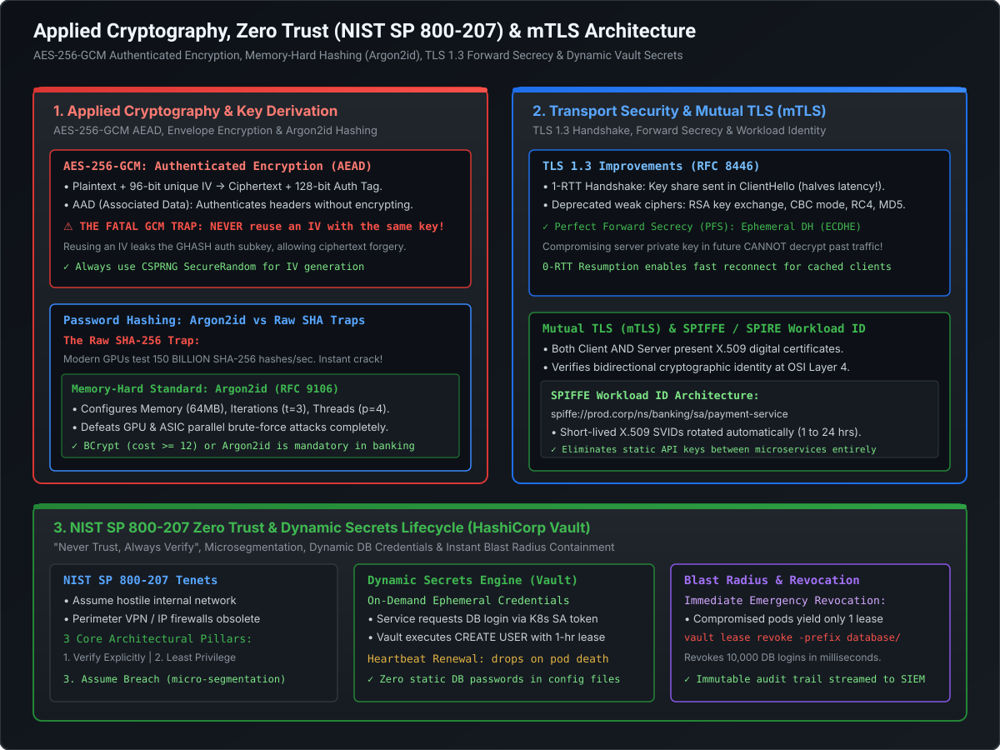

# Applied Cryptography, AES-256-GCM & Memory-Hard Key Derivation (Argon2id)

In enterprise software engineering, cryptography is the foundation of data protection. Yet, cryptographic vulnerabilities rarely originate from mathematical flaws in algorithms like AES or RSA; they originate from **misused cipher modes, unauthenticated ciphertexts, catastrophic Initialization Vector (IV) collisions, and using fast cryptographic hash functions for password storage**.

At the Staff and Principal Engineer level, you are expected to understand the hardware physics of symmetric encryption (AES-NI), the mechanics of **Authenticated Encryption with Associated Data (AEAD)**, the lifecycle of **Envelope Encryption**, and why **memory-hard key derivation functions (Argon2id / BCrypt)** are strictly required to defeat modern GPU cluster brute-force attacks.

---

## Architecture Blueprint: Applied Cryptography & Key Derivation



```
========================================================================================================================
                                     APPLIED CRYPTOGRAPHY TAXONOMY
========================================================================================================================

  Domain                             Algorithm / Standard               Key Feature                    Critical Production Hazard
  ──────────────────────────────────────────────────────────────────────────────────────────────────────────────────────
  Data Encryption at Rest            AES-256-GCM (AEAD)                 Confidentiality + Authenticity NEVER reuse IV with same key!
  Envelope Encryption                KMS CMK (KEK) + Data Key (DEK)     Encrypts local payloads        Zero out Plaintext DEK in RAM
  Password Storage                   Argon2id (IETF RFC 9106) / BCrypt  Memory-hard + Slow             Raw SHA-256/MD5 is easily cracked
  Key Exchange (In Transit)          ECDH (X25519 / P-256)              Forward Secrecy                Static RSA key exchange deprecated
```

---

## 1. Symmetric vs. Asymmetric Cryptography

| Dimension | Symmetric Encryption (AES-256-GCM, ChaCha20) | Asymmetric Encryption (RSA, ECC / Curve25519) |
| :--- | :--- | :--- |
| **Key Architecture** | Single shared secret key for encryption and decryption | Public key (encrypt/verify) + Private key (decrypt/sign) |
| **Hardware Performance** | **Ultra-Fast (Gigabytes/sec)** via CPU AES-NI instructions | **Slow (Kilobytes/sec)**; intensive modular math / curves |
| **Payload Size Limit** | Virtually unlimited (terabytes under GCM limits) | Small payloads only (e.g., RSA 2048 cannot encrypt > 214 bytes) |
| **Primary Production Role**| Bulk data encryption at rest and in transit | Key exchange (TLS handshake) and digital signatures (JWT) |

---

## 2. AES-256-GCM: Authenticated Encryption with Associated Data (AEAD)

Legacy cipher modes such as **AES-CBC (Cipher Block Chaining)** and **AES-ECB (Electronic Codebook)** provide *confidentiality*, but **zero authenticity**:
- **The Padding Oracle Vulnerability**: An attacker intercepting CBC ciphertext can alter individual bytes. If the server reveals whether PKCS#7 padding was valid (via error codes or timing differences), the attacker can decrypt the entire message without ever knowing the key!
- **Bit-Flipping Attacks**: In CBC mode, flipping bit $k$ in ciphertext block $C_1$ deterministically flips bit $k$ in plaintext block $P_2$. In financial systems, an attacker can modify a transaction amount from \$100 to \$900 without triggering a decryption error.

### 2.1 The Galois/Counter Mode (GCM) Architecture
AES-GCM combines counter mode encryption with a universal hash function over a binary Galois field $\text{GF}(2^{128})$ to provide **simultaneous confidentiality and cryptographic integrity**.

```
========================================================================================================================
                                        AES-256-GCM AEAD ENCRYPTION FLOW
========================================================================================================================

  Plaintext Payload (Data to Hide) ──────────┐
                                             ├────> [AES-CTR Encryption Engine] ────> Ciphertext
  Secret Key (256-bit AES) ──────────────────┤
                                             │
  Unique Initialization Vector (96-bit IV) ──┘
                                             │
                                             ▼
  Additional Authenticated Data (AAD) ───────┼────> [GHASH Galois Field Multiplier] ─> 128-bit Authentication Tag
  (Unencrypted Metadata: Tenant ID, Time) ───┘
```

#### The Cryptographic Primitives:
1. **Plaintext**: The private payload (e.g., credit card number, medical diagnosis).
2. **Secret Key**: 256-bit cryptographically random key.
3. **Initialization Vector (IV / Nonce)**: Standard 96-bit (12-byte) unique value.
4. **Ciphertext**: The encrypted data, identical in byte length to the plaintext.
5. **Additional Authenticated Data (AAD)**: Plaintext metadata (e.g., `tenant_id`, `record_uuid`, `timestamp`). It is **not encrypted** (remains readable in the clear), but is fed into the GHASH calculation.
6. **128-bit Authentication Tag (MAC)**: If an attacker modifies even a single bit of the ciphertext **OR** the unencrypted AAD metadata, the decryption algorithm throws `AEADBadTagException` and **immediately aborts without outputting any data**.

---

### 2.2 The Fatal GCM Catastrophe: Nonce / IV Reuse

> [!CAUTION]
> **The Golden Law of AES-GCM**: You must **NEVER, UNDER ANY CIRCUMSTANCES**, encrypt two different plaintexts using the same key and the same Initialization Vector (IV)!

#### The Mathematical Consequences of IV Reuse:
1. **Plaintext XOR Leakage**: Counter mode acts like a stream cipher: $C_1 = P_1 \oplus \text{AES}_K(\text{IV} \parallel 1)$ and $C_2 = P_2 \oplus \text{AES}_K(\text{IV} \parallel 1)$. If the IV is identical:
   $$C_1 \oplus C_2 = P_1 \oplus P_2$$
   XORing the two ciphertexts cancels out the keystream, exposing the raw XOR of the plaintexts.
2. **Total Authentication Key Extraction**: In Galois field arithmetic, evaluating two ciphertexts with identical nonces reveals the internal GHASH authentication subkey ($H$). Once $H$ is recovered, **the attacker can forge valid authentication tags for arbitrary forged messages**, completely destroying the integrity of the database!

#### The Engineering Mitigation:
- Use a cryptographically secure random number generator (`SecureRandom`) to generate a fresh 96-bit IV for every encryption call.
- Alternatively, use a deterministic 64-bit sequence counter combined with a 32-bit node ID to guarantee global uniqueness.

---

## 3. Envelope Encryption: Hierarchical Key Management (DEKs vs. KEKs)

In enterprise data stores, encrypting millions of database rows or terabytes of S3 objects directly with a central Master Key creates fatal operational bottlenecks:
- Sending every 1KB database row over the network to AWS KMS or HashiCorp Vault introduces millisecond network latency and exhausts KMS API rate quotas ($10,000\text{ req/sec}$).
- Encrypting millions of records with a single static key increases the cryptographic blast radius if the key is compromised.

```
========================================================================================================================
                                     ENVELOPE ENCRYPTION ARCHITECTURE
========================================================================================================================

    Storage Tier (S3 / DB Row)                                          Central Key Manager (KMS / Vault)
  ┌─────────────────────────────────────────────────────────┐         ┌───────────────────────────────────┐
  │ Encrypted Record:                                       │         │ Key Encrypting Key (KEK / CMK)    │
  │ ┌─────────────────────────────────────────────────────┐ │         │ • Stored in FIPS 140-2 Level 3 HSM│
  │ │ Ciphertext: AES-GCM(Data, Plaintext_DEK)           │ │         │ • Never leaves the HSM hardware!  │
  │ ├─────────────────────────────────────────────────────┤ │         └─────────────────┬─────────────────┘
  │ │ Encrypted Data Key (EDK): AES-KW(DEK, KEK)          │ │                           │
  │ ├─────────────────────────────────────────────────────┤ │                           │ kms:Decrypt(EDK)
  │ │ Unique IV (12 Bytes) + Auth Tag (16 Bytes)          │ │ <─────────────────────────┘
  │ └─────────────────────────────────────────────────────┘ │
  └─────────────────────────────────────────────────────────┘
  ✓ 1 Network Call per Key Rotation (or cached in memory); Bulk Data encrypted locally at wire-speed!
```

1. **Key Encrypting Key (KEK / Master Key)**: Lives permanently inside an HSM. Never leaves secure hardware.
2. **Data Encryption Key (DEK)**: A short-lived, symmetric 256-bit AES key generated dynamically to encrypt a single file, database row, or session.
3. **Decryption Flow**:
   - The application fetches the record containing `[Ciphertext + EDK]`.
   - Sends the small 256-byte `EDK` to KMS: `kms:Decrypt(EDK)`.
   - KMS unwraps and returns the `Plaintext_DEK`.
   - The application decrypts the ciphertext locally using AES-NI CPU instructions in microseconds.
   - **Mandatory Security Hygiene**: The application **immediately wipes the `Plaintext_DEK` byte array in memory** (`Arrays.fill(keyBytes, (byte) 0)`) to prevent heap dumps from exposing keys.

---

## 4. Password Hashing: Why Raw Cryptographic Hashes are Fatal

A catastrophic design flaw in legacy systems is storing passwords using standard cryptographic hash functions like **MD5, SHA-1, SHA-256, or SHA-512** (even with a salt).

```
========================================================================================================================
                                     THE GPU BRUTE-FORCE REALITY
========================================================================================================================

  Algorithm Class             Throughput on 8x NVIDIA RTX 4090 Rig   Time to Crack 8-Character Password
  ──────────────────────────────────────────────────────────────────────────────────────────────────────────────
  MD5                         Over 500 BILLION Hashes / Second       < 1 Second (Instantaneous)
  SHA-256                     Over 150 BILLION Hashes / Second       < 2 Seconds
  BCrypt (Cost Factor = 12)   ~15,000 Hashes / Second                Years
  Argon2id (m=64MB, t=3, p=4) ~400 Hashes / Second                   Decades (GPU memory starved!)
```

### 4.1 The Fundamental Flaw of Fast Hashes
Cryptographic hash functions like SHA-256 were explicitly engineered to be **as fast as possible** to calculate checksums of gigabyte files and sign TLS packets. 
- A modern GPU or specialized ASIC chip can parallelize billions of SHA-256 computations simultaneously across thousands of tiny cores.
- Adding a simple salt prevents pre-computed **Rainbow Table** attacks, but **it does nothing to slow down brute-force attacks**. If a database of salted SHA-256 hashes is leaked, an attacker running `hashcat` on a cloud GPU cluster can crack millions of passwords per day.

---

### 4.2 The Solution: Memory-Hard Functions (Argon2id & BCrypt)

Modern password hashing functions are intentionally engineered to be **computationally expensive and memory-intensive**.

#### 1. Argon2id (The IETF RFC 9106 Standard):
Argon2 was the official winner of the Password Hashing Competition. It is released in three variants:
- `Argon2d`: Optimized to resist GPU attacks (data-dependent memory access; susceptible to side-channel cache attacks).
- `Argon2i`: Optimized to resist side-channel timing attacks (data-independent memory access).
- **`Argon2id` (Recommended Standard)**: A hybrid approach. It begins as `Argon2i` to protect against side-channels, then transitions to `Argon2d` for maximum resistance against GPU/ASIC brute-forcing.

```
========================================================================================================================
                                  ARGON2id CONFIGURATION PARAMETERS
========================================================================================================================

  Parameter                  Recommended Production Value       Architectural Purpose
  ─────────────────────────────────────────────────────────────────────────────────────────────────────────────
  Memory Cost (m)            64 MB (65,536 KiB) per hash        Forces hashing to consume RAM; starves GPU cores!
  Time Cost (t)              3 Iterations                       Number of passes over memory array
  Parallelism (p)            4 Threads                          Number of concurrent execution lanes
  Salt Length                16 Bytes (128-bit random)          Guarantees uniqueness against identical passwords
```

*Why Memory-Hardness Defeats GPUs*: While a modern GPU has thousands of computing cores, it has very limited cache memory per core (kilobytes). If calculating a single password hash requires **64 megabytes of dedicated RAM**, an 8GB GPU can only run a tiny handful of hashes in parallel, completely neutralizing its brute-force advantage!

#### 2. BCrypt (The Battle-Tested Alternative):
- Based on the Blowfish block cipher's key expansion algorithm (`Eksblowfish`).
- Uses a **Work Factor (Cost Parameter)** where iterations grow exponentially: $\text{Iterations} = 2^{\text{cost}}$.
- Recommended enterprise cost factor: **$\text{Cost} \ge 12$** (computes in $\approx 250\text{ms}$ on modern server hardware).
- **The 72-Byte Truncation Limit**: BCrypt silently truncates passwords longer than 72 bytes. To hash arbitrarily long passphrases with BCrypt, pre-hash the input with SHA-256 before feeding into BCrypt, or adopt **Argon2id**.

---

## 5. Staff+ Architectural Summary Matrix

| Cryptographic Task | Modern Standard | Legacy Anti-Pattern | Attack Defeated |
| :--- | :--- | :--- | :--- |
| **Data Encryption at Rest** | AES-256-GCM (AEAD) | AES-CBC or AES-ECB | Padding Oracle & Bit-flipping attacks |
| **Payload Integrity** | 128-bit Auth Tag + AAD | Separate HMAC-SHA256 | Chosen-ciphertext & metadata tampering |
| **Key Management** | Envelope Encryption (KMS) | Static hardcoded encryption keys | Key compromise & KMS API rate limits |
| **Password Storage** | Argon2id ($m=64\text{MB}, t=3$) | Salted SHA-256 or MD5 | GPU / ASIC massive parallel brute-force |
| **Key Derivation (PBKDF)** | Argon2id or Scrypt | PBKDF2 with low iterations | Specialized ASIC hardware acceleration |
