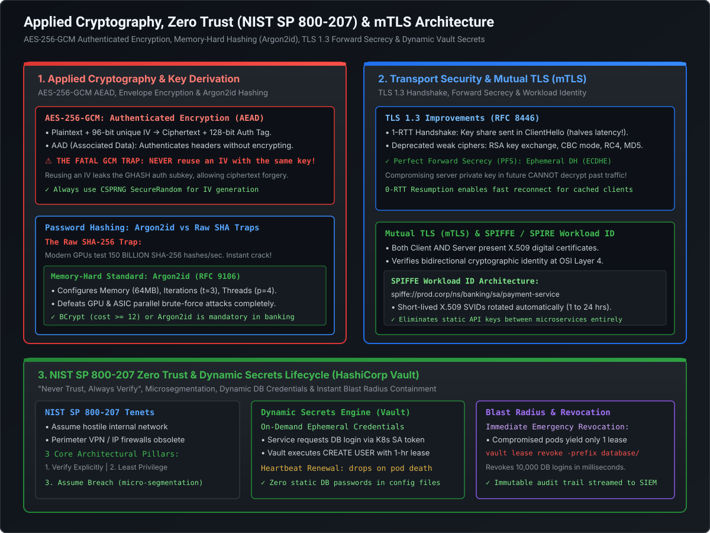

# Zero Trust Architecture (NIST SP 800-207), mTLS & Dynamic Secrets Lifecycle

For decades, enterprise security relied on the **"Hard Castle, Soft Interior" perimeter defense model**: build a deep moat around the data center using IP firewalls and VPNs, and assume that all traffic inside the corporate network is inherently trustworthy. In modern distributed cloud architectures, this model is an invitation to catastrophic breach. Once an attacker breaches the perimeter—via compromised developer credentials, an SSRF bug, or a rogue dependency—they can freely move laterally across unauthenticated internal microservices.

At the Staff and Principal Engineer level, you are expected to design security from the ground up following **NIST SP 800-207 Zero Trust Architecture (ZTA)**, enforce cryptographically verified workload identity via **Mutual TLS (mTLS)** and **SPIFFE/SPIRE**, and eliminate static credentials using **dynamic, lease-based secrets engines (HashiCorp Vault & AWS Secrets Manager)**.

---

## Architecture Blueprint: Zero Trust Mesh & Dynamic Secrets



```
========================================================================================================================
                                    PERIMETER SECURITY VS. ZERO TRUST
========================================================================================================================

  Legacy Perimeter Defense ("Castle and Moat")       NIST SP 800-207 Zero Trust Architecture ("Assume Hostile Network")
  ┌─────────────────────────────────────────┐       ┌─────────────────────────────────────────────────────────────────┐
  │ • Trust is determined by IP location    │       │ • Every network packet is untrusted (even on localhost/VPC)    │
  │ • Once inside VPN, user has free access │       │ • Every request requires explicit AuthN + AuthZ                 │
  │ • Cleartext HTTP between microservices  │       │ • End-to-end wire encryption via mTLS (TLS 1.3)                 │
  │ ❌ Lateral movement is trivial          │       │ • Ephemeral dynamic credentials with short-lived leases         │
  └─────────────────────────────────────────┘       └─────────────────────────────────────────────────────────────────┘
```

---

## 1. NIST SP 800-207: Core Tenets of Zero Trust Architecture (ZTA)

NIST Special Publication 800-207 formalizes the enterprise standard for Zero Trust. It establishes seven foundational tenets:

1. **All Data Sources and Computing Services are Resources**: Microservices, databases, queues, and storage buckets are all autonomous protected entities.
2. **All Communication is Secured Regardless of Network Location**: Being located inside a private AWS VPC, private subnet, or on-premises corporate LAN confers **zero implicit trust**. Internal microservice calls must be authenticated and encrypted just like public internet traffic.
3. **Access is Granted on a Per-Session Basis**: Authentication in a previous request does not guarantee access to subsequent requests; credentials are evaluated dynamically on each transaction.
4. **Access is Governed by Dynamic Policy**: Policy evaluation factors in user identity, client device security posture (e.g., disk encryption, EDR agent status), time of day, geolocation, and behavioral anomaly scores.
5. **Continuous Asset Monitoring and Measurement**: The enterprise monitors the integrity and health of all connected assets (servers, containers, endpoints).
6. **Dynamic Authentication and Authorization**: Strict enforcement using standard identity tokens (OIDC, mTLS, SPIFFE) prior to granting access.
7. **Continuous Data Collection and Telemetry**: Comprehensive audit logging and behavioral telemetry are fed into Security Information and Event Management (SIEM) systems (Splunk, Elastic, Sentinel).

---

## 2. Transport Security: TLS 1.3 Handshake & Mutual TLS (mTLS)

### 2.1 TLS 1.3 (RFC 8446): Performance & Cryptographic Hardening
TLS 1.3 completely overhauled transport security, eliminating legacy cryptographic vulnerabilities while cutting handshake latency in half.

```
========================================================================================================================
                                 TLS 1.2 VS. TLS 1.3 HANDSHAKE TIMELINES
========================================================================================================================

  TLS 1.2 Handshake (2 Full Round-Trips - 2-RTT):
  Client                                                          Server
    │ ─── 1. ClientHello (Supported ciphers) ───────────────────────> │
    │ <── 2. ServerHello + Certificate + ServerKeyExchange ─────────│
    │ ─── 3. ClientKeyExchange + ChangeCipherSpec + Finished ───────> │
    │ <── 4. ChangeCipherSpec + Finished ───────────────────────────│
    │ ─── 5. First Encrypted Application Data (HTTP Request) ───────> │ (Takes 2 network RTTs before data!)

  TLS 1.3 Handshake (1 Full Round-Trip - 1-RTT):
  Client                                                          Server
    │ ─── 1. ClientHello + Ephemeral Key Share (ECDH) ─────────────> │
    │ <── 2. ServerHello + Certificate + Finished + Server Key ─────│ (Both sides compute master secret!)
    │ ─── 3. First Encrypted Application Data (HTTP Request) ───────> │ (Latency cut by 50%!)
```

#### Key Innovations in TLS 1.3:
1. **1-RTT Handshake**: The client anticipates the server's key exchange algorithm and sends its public ephemeral Diffie-Hellman key share directly in the initial `ClientHello`.
2. **Perfect Forward Secrecy (PFS) Mandate**:
   - TLS 1.3 **completely eliminates static RSA key exchange**. Only ephemeral Diffie-Hellman key exchanges (**ECDHE** using Curve25519/X25519 or NIST P-256) are permitted.
   - **Forward Secrecy Guarantee**: The session key is ephemeral and discarded from memory immediately after the connection terminates. If an adversary records encrypted network traffic today and steals the server's private key 5 years from now, **they still cannot decrypt the recorded past traffic!**
3. **Deprecation of Insecure Algorithms**: Stripped out CBC mode, RC4, MD5, SHA-1, and arbitrary Diffie-Hellman groups, permanently eliminating padding oracle and downgrade attacks.

---

### 2.2 Mutual TLS (mTLS): Service-to-Service Cryptographic Identity

Standard TLS authenticates only the server to the client (e.g., your browser verifying Amazon.com). In **Mutual TLS (mTLS)**, both the client and the server possess an X.509 certificate and verify each other's identity:

```
========================================================================================================================
                                   MUTUAL TLS (mTLS) HANDSHAKE SEQUENCE
========================================================================================================================

    Order Service (Client)                                             Payment Service (Server)
              │                                                                  │
              │ ─── 1. ClientHello (TLS 1.3 + Key Share) ──────────────────────> │
              │ <── 2. ServerHello + Server Certificate (X.509) ─────────────────│
              │ <── 3. CertificateRequest ("Present your Client Cert!") ─────────│
              │                                                                  │
  [Verifies Server Cert against Internal CA]                                     │
              │                                                                  │
              │ ─── 4. Client Certificate (X.509) + CertificateVerify ─────────> │
              │ ─── 5. Finished ───────────────────────────────────────────────> │
              │                                                                  │
              │                                                   [Verifies Client Cert against Internal CA]
              │                                                   [Extracts Client Identity: "order-service"]
              │                                                                  │
              │ <═══ 6. Established Encrypted Bidirectional Pipe (TLS 1.3) ══════│
```

#### Why mTLS is the Backbone of Zero Trust Microservices:
- **Zero Static Credentials**: Services do not pass API keys or basic auth passwords over the wire; identity is established at the Layer 4 transport layer.
- **Wire-Level Encryption**: All intra-cluster East-West traffic is encrypted with AES-256-GCM.
- **Spoofing Immunity**: Even if an unauthorized container joins the Kubernetes network, it cannot establish a TCP connection to downstream services because it lacks a valid client certificate signed by the internal Certificate Authority.

---

### 2.3 Workload Identity Standard: SPIFFE & SPIRE

Managing X.509 certificates manually across thousands of ephemeral containers and Kubernetes pods is impossible. **SPIFFE (Secure Production Identity Framework for Everyone)** and **SPIRE (SPIFFE Runtime Environment)** automate workload identity:

```
========================================================================================================================
                                   SPIFFE / SPIRE WORKLOAD ATTESTATION
========================================================================================================================

  SPIRE Agent (DaemonSet on Kubernetes Node)
  ┌────────────────────────────────────────────────────────────────────────────────────────┐
  │ 1. Attests Pod: Inspects Linux cgroups, Kubelet namespace, service account            │
  │ 2. Issues SPIFFE ID: spiffe://prod.corp/ns/banking/sa/payment-service                  │
  │ 3. Injects X.509 SVID (Short-Lived Cert valid for 1 hour) into container memory socket │
  │ 4. Automatically rotates certificate every 30 minutes in background with zero restart  │
  └────────────────────────────────────────────────────────────────────────────────────────┘
```

1. **SPIFFE ID**: A standardized URI representing workload identity:
   `spiffe://prod.corp.internal/ns/finance/sa/ledger-service`
2. **X.509 SVID (SPIFFE Verifiable Identity Document)**: A short-lived X.509 certificate encoding the SPIFFE ID in the Subject Alternative Name (SAN) extension.
3. **Ultra-Short Validity (1–24 Hours)**: Because certificates are continuously rotated by the local SPIRE agent daemon, **Certificate Revocation Lists (CRLs) and OCSP are obsolete**. If a container is compromised, its certificate expires within minutes.

---

## 3. Dynamic Secrets Lifecycle: HashiCorp Vault vs. AWS Secrets Manager

Hardcoded database credentials in configuration files (`application.yml`) are a premier target for attackers. Once compromised, static credentials grant unlimited access until manually rotated.

```
========================================================================================================================
                             DYNAMIC DATABASE CREDENTIALS (HASHICORP VAULT)
========================================================================================================================

    Microservice (Spring Boot)                  HashiCorp Vault Cluster                     PostgreSQL Production DB
              │                                            │                                            │
              │ ── 1. Authenticates via K8s SA Token ────> │                                            │
              │                                            │                                            │
              │ ── 2. Requests DB Credentials: ──────────> │                                            │
              │       GET /v1/database/creds/readonly      │                                            │
              │                                            │ ── 3. Executes SQL: ─────────────────────> │
              │                                            │       CREATE USER "v-app-8a2f"             │
              │                                            │       WITH PASSWORD 'random_pwd_xyz'       │
              │                                            │       VALID UNTIL '2026-03-11 21:00:00';   │
              │                                            │       GRANT SELECT ON ALL TABLES...;       │
              │                                            │                                            │
              │ <── 4. Returns Temporary Credentials ──────│                                            │
              │        { username: "v-app-8a2f",           │                                            │
              │          password: "random_pwd_xyz",       │                                            │
              │          lease_duration: 3600 }            │                                            │
              │                                            │                                            │
              │ ── 5. Connects directly to DB ────────────────────────────────────────────────────────> │
```

### 3.1 The Dynamic Secret Revolution
1. **On-Demand Generation**: Vault does not store existing passwords. When a microservice boots, it requests credentials from Vault. Vault **generates a brand new database user and random password on the fly**.
2. **Lease Renewal & Heartbeats**: The credential is tied to a **Lease Duration (e.g., 1 hour)**. The microservice must periodically send a heartbeat to renew the lease.
3. **Automated Teardown**: If the microservice terminates, crashes, or is decommissioned, the lease expires. Vault immediately connects to the database and issues `DROP USER "v-app-8a2f"`.
4. **Blast Radius Elimination**:
   - Every individual container instance has its own unique database username.
   - If a container is breached, the attacker possesses credentials that are valid for only that single container and will self-destruct within the hour.
   - To contain a breach instantly, the security team executes:
     ```bash
     vault lease revoke -prefix database/creds/readonly
     ```
     Vault connects to all databases across all data centers and **terminates every compromised dynamic session simultaneously in milliseconds**.

---

### 3.2 Architectural Comparison: HashiCorp Vault vs. AWS Secrets Manager

| Dimension | HashiCorp Vault | AWS Secrets Manager |
| :--- | :--- | :--- |
| **Deployment Model** | Self-hosted cluster or HCP managed SaaS | Fully managed, serverless AWS native service |
| **Multi-Cloud Support**| **Native**: Runs on AWS, GCP, Azure, bare-metal, on-prem | AWS-centric (supports external access via IAM/STS) |
| **Dynamic Secrets** | **Built-in**: MySQL, Postgres, MongoDB, RabbitMQ, SSH, PKI | Native for RDS/Aurora; requires custom Lambda scripts for other engines |
| **Built-in CA / PKI** | **Yes**: Can act as an intermediate CA issuing mTLS certificates | No (requires integration with AWS Private Certificate Authority) |
| **Encryption Engine** | Transit Secrets Engine (Encryption-as-a-service) | Backed by AWS KMS |
| **Operational Overhead**| High (requires cluster management, unsealing, high availability) | **Near Zero** (Fully managed by AWS) |

---

## 4. Staff+ Architectural Summary Matrix

| Security Pillar | Technology / Protocol | Core Mechanism | Zero Trust Guarantee |
| :--- | :--- | :--- | :--- |
| **Transport Security** | TLS 1.3 (RFC 8446) | 1-RTT handshake + ECDHE Ephemeral Keys | Perfect Forward Secrecy; immune to past traffic decryption |
| **Workload Identity** | Mutual TLS (mTLS) | Bidirectional X.509 verification | Cryptographic proof of caller identity at transport layer |
| **Automated PKI** | SPIFFE / SPIRE | Short-lived SVID certificates (< 24h) | Eliminates long-lived certs and revocation lists (CRLs) |
| **Dynamic Credentials** | HashiCorp Vault | Leased, on-demand ephemeral users | Zero static database passwords in source code or configs |
| **Automated Rotation** | AWS Secrets Manager | 4-step Lambda dual-user rotation | Zero downtime credential updates for cloud-native databases |
