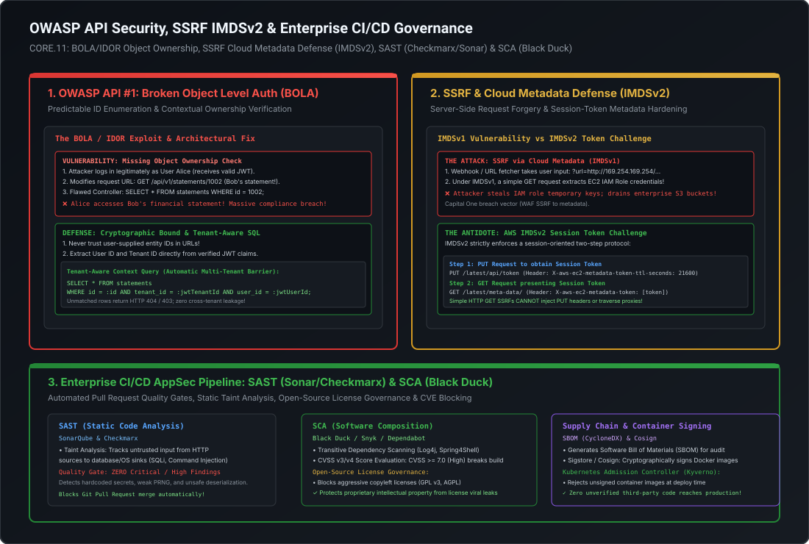

# OWASP API Security Top 10: BOLA/IDOR, SSRF (IMDSv2) & Injection Defenses

In distributed API architectures, the attack surface has shifted fundamentally from traditional web servers to **RESTful endpoints, GraphQL resolvers, and JSON microservices**. The Open Worldwide Application Security Project (OWASP) maintains the **OWASP API Security Top 10**, identifying the vulnerabilities that lead to 90%+ of modern enterprise data breaches.

At the Staff and Principal Engineer level, you are expected to understand the exact exploitation mechanics of **API1: BOLA (Broken Object Level Authorization)**, the cloud infrastructure physics of **SSRF (Server-Side Request Forgery)** and the **AWS IMDSv2 defense**, and the architectural differences between **CORS preflight semantics** and **CSRF in stateless Bearer token APIs**.

---

## Architecture Blueprint: OWASP API Defenses & Metadata Hardening



```
========================================================================================================================
                                     OWASP API TOP 10 HIGHEST-YIELD THREATS
========================================================================================================================

  OWASP API Rank                     Vulnerability                      Core Architectural Defense
  ──────────────────────────────────────────────────────────────────────────────────────────────────────────────────────
  API1:2023                          BOLA / IDOR                        Tenant-Aware Context Binding in SQL/Data Tier
  API2:2023                          Broken Authentication              OAuth2 with PKCE + RS256 JWKS + Refresh Rotation
  API3:2023                          Broken Object Property (Mass Assign) Strict DTOs; never bind HTTP request directly to Entities
  API7:2023                          SSRF (Server-Side Request Forgery) AWS IMDSv2 Token Challenge + Egress Network Allowlist
  API8:2023                          Security Misconfiguration          Disable default credentials; strict CORS origin checks
```

---

## 1. OWASP API #1: Broken Object Level Authorization (BOLA / IDOR)

**BOLA (Broken Object Level Authorization)**, formerly known as Insecure Direct Object References (IDOR), is consistently ranked by OWASP as the **most pervasive, severe, and catastrophic vulnerability in modern APIs**.

### 1.1 The Exploitation Mechanics
BOLA occurs when an API endpoint accepts an identifier from the client request (e.g., path parameter, query parameter, or JSON field) and uses that identifier to access a database object **without verifying that the authenticated user possesses legitimate ownership of that specific object**.

```
========================================================================================================================
                                       THE BOLA / IDOR EXPLOIT ANATOMY
========================================================================================================================

  1. Alice logs in legitimately -> Receives valid JWT with sub = "alice_uuid_101".
  2. Alice inspects her mobile app network traffic:
     GET /api/v1/bank-accounts/9812/transactions
  3. Alice changes the URL ID to Bob's account ID (9813):
     GET /api/v1/bank-accounts/9813/transactions
  4. The Flawed Spring Boot Controller:
     @GetMapping("/bank-accounts/{accountId}/transactions")
     public List<Txn> getTransactions(@PathVariable Long accountId) {
         // ❌ FLAW: Authenticates that caller has a valid token, BUT NEVER CHECKS IF ALICE OWNS ACCOUNT 9813!
         return txnRepository.findByAccountId(accountId);
     }
  5. 🚨 BREACH: Alice views Bob's private financial transactions!
```

---

### 1.2 The Predictable ID Enumeration Trap
Using auto-incrementing sequential integers (e.g., `id = 1001, 1002, 1003`) as primary keys in public API endpoints turns BOLA into an automated catastrophe:
- An attacker writes a 10-line Python script that loops from `1` to `1,000,000`, systematically harvesting the entire company's database in minutes.
- Auto-incrementing IDs also leak sensitive business intelligence: competitors can register an account today and another tomorrow to calculate your exact daily transaction volume!

#### Remediation: Non-Enumerable Identifiers
- Use **UUIDv4** (`randomUUID()`), **ULID (Universally Unique Lexicographically Sortable Identifier)**, or cryptographically signed opaque tokens (e.g., `acc_01h8x4k9z...`) for all external public API surfaces.
- *Caveat*: Non-enumerable IDs prevent automated sequential scraping, but **they do NOT fix BOLA**. If an attacker obtains Bob's UUID via an email or shared link, a missing ownership check still allows unauthorized access!

---

### 1.3 The Staff+ Architectural Defenses against BOLA

#### Defense A: Tenant-Aware Contextual Query Binding (The Database Defense)
Never write queries that filter solely by the entity ID. Always bind the `user_id` and `tenant_id` directly from the cryptographically verified JWT security context:

```java
@Repository
public interface FinancialStatementRepository extends JpaRepository<FinancialStatement, UUID> {

    // ❌ VULNERABLE TO BOLA:
    // Optional<FinancialStatement> findById(UUID id);

    // ✓ IMMUNE TO BOLA: Automatically enforces tenant & user isolation at the SQL query level!
    @Query("""
        SELECT s FROM FinancialStatement s 
        WHERE s.id = :id 
          AND s.tenantId = :jwtTenantId 
          AND s.ownerId = :jwtUserId
    """)
    Optional<FinancialStatement> findSecurely(
        @Param("id") UUID id,
        @Param("jwtTenantId") UUID jwtTenantId,
        @Param("jwtUserId") UUID jwtUserId
    );
}
```

If Alice attempts to query Bob's statement ID `9813`, the SQL query evaluates `s.ownerId = 'alice_id'`. The database returns **0 rows**, and the API returns `HTTP 404 Not Found`.

#### Defense B: Declarative Aspect-Oriented Ownership Verification (AOP)
For complex domain models where queries cannot easily join tenant tables, enforce object ownership using a Spring Security `@PreAuthorize` expression calling a dedicated authorization service:

```java
@GetMapping("/contracts/{contractId}")
@PreAuthorize("@securityEvaluator.canAccessContract(authentication, #contractId)")
public ResponseEntity<ContractDTO> getContract(@PathVariable UUID contractId) {
    return ResponseEntity.ok(contractService.getContract(contractId));
}
```

---

## 2. Server-Side Request Forgery (SSRF) & Cloud Metadata (IMDSv2)

### 2.1 The SSRF Attack Vector
**Server-Side Request Forgery (SSRF)** occurs when an application receives a URL from a user and makes a backend HTTP request to that URL without strict validation (e.g., fetching a user's remote profile avatar, validating a webhook endpoint, or converting a web page to PDF).

```
========================================================================================================================
                                     THE SSRF ATTACK ON CLOUD METADATA
========================================================================================================================

  Attacker                           Vulnerable Cloud Application                       AWS Metadata Service
     │                                           │                                               │
     │ ── 1. POST /api/v1/render-avatar ────────>│                                               │
     │       { "url": "http://169.254.169.254/   │                                               │
     │                 latest/meta-data/iam/     │                                               │
     │                 security-credentials/" }  │                                               │
     │                                           │ ── 2. Executes HTTP GET ────────────────────> │
     │                                           │       http://169.254.169.254/...              │
     │                                           │                                               │
     │                                           │ <── 3. Returns IAM Role Credentials! ─────────│
     │                                           │        { "AccessKeyId": "ASIA...",            │
     │                                           │          "SecretAccessKey": "xyz..." }        │
     │                                           │                                               │
     │ <── 4. Returns Credentials in Response! ──│                                               │
  (Attacker uses stolen IAM keys to drain S3 buckets!)
```

The IP address `169.254.169.254` is the **AWS Instance Metadata Service (IMDS)** link-local address accessible from within every EC2 instance and container. Under legacy **IMDSv1**, a simple HTTP `GET` request returns the instance's IAM role temporary credentials! This was the exact attack vector behind the 2019 Capital One data breach.

---

### 2.2 The Antidote: AWS IMDSv2 Token Challenge

To neutralize SSRF attacks against cloud metadata, AWS introduced **IMDSv2**, which replaces single-hop HTTP `GET` requests with a **session-oriented token challenge**:

```
========================================================================================================================
                                  IMDSv2 SESSION TOKEN PROTOCOL
========================================================================================================================

  Legitimate Application                                              AWS Metadata Service (169.254.169.254)
            │                                                                            │
            │ ── 1. HTTP PUT Request (Requests Session Token) ─────────────────────────> │
            │       PUT /latest/api/token                                                │
            │       Header: X-aws-ec2-metadata-token-ttl-seconds: 21600                  │
            │                                                                            │
            │ <── 2. Returns Session Token: "AQAEAF...secret_session_token" ─────────────│
            │                                                                            │
            │ ── 3. HTTP GET Request (Presents Session Token) ──────────────────────────> │
            │       GET /latest/meta-data/iam/security-credentials/                      │
            │       Header: X-aws-ec2-metadata-token: AQAEAF...                          │
            │                                                                            │
            │ <── 4. Returns Credentials                                                 │
```

#### Why IMDSv2 Defeats SSRF:
1. **Requires an HTTP `PUT` Method**: The vast majority of SSRF vulnerabilities can only trigger HTTP `GET` or `POST` requests. Attackers cannot force an internal library (like an image renderer) to send a `PUT` request.
2. **Requires Custom Headers (`X-aws-ec2-metadata-token`)**: Browsers, proxies, and naive SSRF injection vectors strip or refuse to inject custom arbitrary HTTP headers.
3. **Hop Limit Defense (TTL = 1)**: By setting the IMDSv2 network packet hop limit to `1`, the IP packet cannot traverse any intermediate Layer 3 proxy, container bridge, or router before reaching the metadata hypervisor!

#### Enforcing IMDSv2 via AWS CLI:
```bash
aws ec2 modify-instance-metadata-options \
    --instance-id i-0123456789abcdef0 \
    --http-tokens required \
    --http-put-response-hop-limit 1 \
    --http-endpoint enabled
```

---

## 3. CORS Semantics vs. CSRF in Stateless Bearer Token APIs

### 3.1 CORS (Cross-Origin Resource Sharing) Demystified
CORS is **NOT a security defense that protects your server**; it is a **browser mechanism that protects users** by loosening the strict Same-Origin Policy (SOP).
- **The Preflight Request (`OPTIONS`)**: When a browser client on `https://app.example.com` makes a cross-origin request with custom headers (like `Authorization: Bearer ...`) or non-simple HTTP methods (`PUT`, `DELETE`) to `https://api.corp.com`, the browser automatically sends an **`OPTIONS` preflight request** before executing the real request.

```http
OPTIONS /api/v1/payments HTTP/1.1
Host: api.corp.com
Origin: https://app.example.com
Access-Control-Request-Method: POST
Access-Control-Request-Headers: Authorization, Content-Type
```

- **The Server Response**:
```http
HTTP/1.1 204 No Content
Access-Control-Allow-Origin: https://app.example.com
Access-Control-Allow-Methods: GET, POST, PUT, DELETE, OPTIONS
Access-Control-Allow-Headers: Authorization, Content-Type
Access-Control-Max-Age: 86400
```

> [!WARNING]
> **The Wildcard Origin with Credentials Trap**: Never configure `Access-Control-Allow-Origin: *` in conjunction with `Access-Control-Allow-Credentials: true`. Modern browsers will reject this response as an invalid security violation. Always reflect the exact whitelisted requesting origin.

---

### 3.2 Why CSRF is Irrelevant for Stateless Bearer Token APIs

A frequent interview trap is asking how to implement Cross-Site Request Forgery (CSRF) protection on a microservice REST API.

**The Staff Engineer Answer**: If the API uses **stateless `Authorization: Bearer <JWT>` tokens, CSRF protection is completely unnecessary!**

#### The Fundamental Physics of CSRF:
- CSRF relies on **Ambient Credentials**: When a victim visits a malicious site (`attacker.com`), and that site submits a hidden form targeting `bank.com/transfer`, the browser **automatically attaches all stored cookies and HTTP Basic Auth credentials** belonging to `bank.com`.
- **Why Bearer Tokens are Immune**:
  - A Bearer token is stored in client memory or `sessionStorage`.
  - The browser **NEVER automatically attaches the `Authorization: Bearer` header** to a cross-origin request!
  - For a cross-origin request to include an `Authorization` header, JavaScript on the page must explicitly set it via `fetch()` or `XMLHttpRequest`.
  - But the browser's Same-Origin Policy strictly blocks `attacker.com` from executing custom JavaScript headers against `bank.com` unless explicitly permitted by CORS!
  - Therefore, stateless Bearer token APIs are **natively immune to CSRF**.

---

## 4. Staff+ Architectural Summary Matrix

| Vulnerability | Attack Vector | Architectural Remediation | Operational Validation |
| :--- | :--- | :--- | :--- |
| **BOLA / IDOR** | Manipulating URL IDs to access other users' records | Tenant-Aware contextual SQL filtering (`tenant_id = :jwtTenantId`) | Automated unit tests simulating cross-tenant requests |
| **SSRF** | Injecting `169.254.169.254` into URL fetching endpoints | Enforce **AWS IMDSv2** (`HttpTokens=required`, Hop Limit = 1) | AWS Config Rule: `ec2-imdsv2-check` |
| **SQL Injection** | Concatenating untrusted strings into queries | Strict Parameterized Queries (`PreparedStatement`) | SAST Taint Analysis (SonarQube / Checkmarx) |
| **CORS Misconfig** | Wildcard `*` allowing malicious origins to read responses | Strict origin allowlists reflecting trusted domain | Automated API Gateway CORS policy inspection |
| **CSRF** | Ambient cookie replay across origins | Use stateless `Authorization: Bearer` tokens; eliminate cookies | Disable Spring Security CSRF for stateless REST endpoints |
