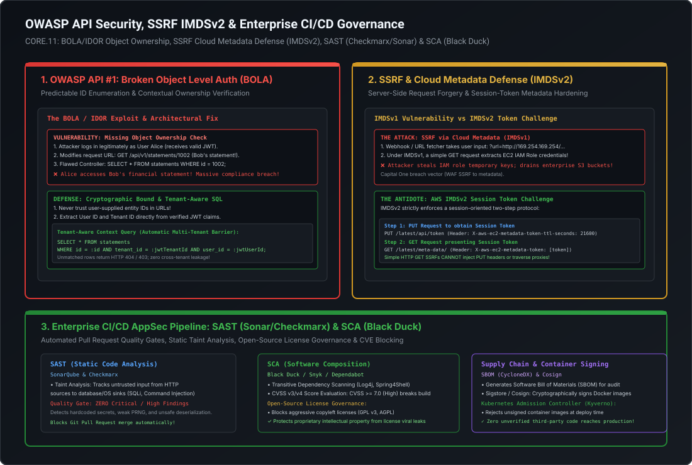

# Enterprise CI/CD AppSec Pipeline: SAST (Sonar/Checkmarx), SCA (Black Duck) & Supply Chain Security

In modern enterprise engineering, security cannot be an afterthought audited by an external penetration testing firm once a year. By the time a vulnerability reaches production, remediation costs increase by **over $30\times$** compared to catching it during code review. Staff and Principal Engineers must architect automated **DevSecOps pipelines** that "shift security left", integrating automated code analysis, dependency vulnerability scanning, license governance, and cryptographic container image signing directly into CI/CD pull request quality gates.

This playbook breaks down the deep mechanics of:
1. **SAST (Static Application Security Testing)**: Taint analysis, AST parsing, and automated PR quality gates via **SonarQube and Checkmarx**.
2. **SCA (Software Composition Analysis)**: Transitive dependency scanning, CVSS scoring, and open-source license governance via **Black Duck**.
3. **Software Supply Chain Security**: Software Bill of Materials (**SBOM** CycloneDX/SPDX) and cryptographic container image signing via **Sigstore / Cosign** and Kubernetes admission controllers.
4. **Runnable Production-Grade Verification Suite**: A complete Java 21 security verification engine covering JWT RS256 validation, Redis token revocation, AES-256-GCM AEAD, BOLA tenant isolation, and IMDSv2 session challenges.

---

## Architecture Blueprint: Enterprise DevSecOps Pipeline

[](images/owasp_api_security_and_cicd_pipeline.svg)

```
========================================================================================================================
                                     ENTERPRISE CI/CD APPSEC PIPELINE
========================================================================================================================

    Developer Workstation                      GitHub / GitLab CI Runner                         Production Kubernetes
  ┌─────────────────────────┐                ┌─────────────────────────────────────────┐        ┌──────────────────────┐
  │ git push origin feature │ ──Pull Request>│ Step 1: Unit & Integration Tests        │        │ Kyverno Admission    │
  └─────────────────────────┘                │ Step 2: SAST (SonarQube & Checkmarx)    │        │ Controller           │
                                             │ • Static Taint Analysis (Source -> Sink)│        │ • Verifies Cosign    │
                                             │                                         │        │   image signature    │
                                             │ Step 3: SCA (Black Duck / Snyk)         │        │ • Rejects unsigned   │
                                             │ • Transitive CVE Scanning (CVSS >= 7.0) │        │   container images   │
                                             │ • Copyleft License Blocking (GPL/AGPL)  │        └──────────▲───────────┘
                                             │                                         │                   │
                                             │ Step 4: Quality Gate Evaluation         │                   │ (Deploy Pod)
                                             │ • PASS -> Build Container Image         │                   │
                                             │ • FAIL -> Automatically BLOCK PR Merge! │                   │
                                             │                                         │                   │
                                             │ Step 5: Container Signing & SBOM        │                   │
                                             │ • Cosign signs image with OIDC identity │                   │
                                             │ • Generates CycloneDX SBOM -> Artifact  │ ──────────────────┘
                                             └─────────────────────────────────────────┘
```

---

## 1. SAST (Static Application Security Testing): SonarQube & Checkmarx

Static Application Security Testing analyzes source code without executing the application, identifying security vulnerabilities and code quality flaws directly inside the developer's pull request.

### 1.1 Taint Analysis: Tracing Untrusted Input from Source to Sink
The core engine behind enterprise SAST tools (Checkmarx, SonarQube Enterprise, Fortify) is **Taint Analysis**:

```
========================================================================================================================
                                        STATIC TAINT ANALYSIS MECHANICS
========================================================================================================================

  [SOURCE: Untrusted Input]               [PROPAGATION: Code Flow]                  [SINK: Sensitive Execution]
  ┌───────────────────────────────┐       ┌─────────────────────────────────┐       ┌───────────────────────────────┐
  │ String input =                │ ────> │ String query =                  │ ────> │ statement.executeQuery(query);│
  │   request.getParameter("id"); │       │   "SELECT * FROM users WHERE id=│       │ 🚨 SINK REACHED!              │
  │ (Marked as "TAINTED")         │       │   " + input;                    │       │ VULNERABILITY: SQL INJECTION  │
  └───────────────────────────────┘       └─────────────────────────────────┘       └───────────────────────────────┘
                                                                                            ▲
                                          [SANITIZER: Neutralizes Taint]                    │
                                          ┌─────────────────────────────────┐               │
                                          │ PreparedStatement pstmt =       │ ──────────────┘
                                          │   conn.prepareStatement(...);   │ (Taint removed: Safe to execute!)
                                          │ pstmt.setLong(1, parseLong(id));│
                                          └─────────────────────────────────┘
```

1. **Source**: An untrusted external input boundary (e.g., HTTP request parameters, headers, cookies, message queue payloads, environment variables).
2. **Sink**: A critical function execution point where unvalidated data can cause malicious execution:
   - Database Sinks: `Statement.executeQuery()`, `EntityManager.createNativeQuery()` $\implies$ SQL Injection.
   - OS Command Sinks: `Runtime.getRuntime().exec()`, `ProcessBuilder.start()` $\implies$ Command Injection.
   - Filesystem Sinks: `new File(path)` $\implies$ Path Traversal.
   - HTTP Sinks: `response.getWriter().write()` $\implies$ Cross-Site Scripting (XSS).
3. **Sanitizer**: A secure transformation that neutralizes the taint (e.g., using parameterized queries, strict whitelist regex, or integer parsing).

---

### 1.2 Automated Pull Request Quality Gates
In an enterprise environment, SAST is enforced through automated **Quality Gates** in GitHub Actions or GitLab CI:

```
========================================================================================================================
                                 SONARQUBE / CHECKMARX QUALITY GATE RULES
========================================================================================================================

  Metric                                 Enterprise Threshold                  Pipeline Action on Violation
  ─────────────────────────────────────────────────────────────────────────────────────────────────────────────
  Critical / Blocker Vulnerabilities     Strictly = 0                          FAIL BUILD; Block PR Merge!
  High Vulnerabilities                   Strictly = 0                          FAIL BUILD; Block PR Merge!
  Security Hotspots Reviewed             Strictly = 100%                       FAIL BUILD; Block PR Merge!
  Code Coverage on New Code              >= 80.0%                              FAIL BUILD; Block PR Merge!
  Duplicated Lines on New Code           < 3.0%                                Warning / Require Review
```

If a developer submits a PR containing an unsanitized database query or hardcoded secret, the SAST runner detects the taint, posts an inline comment on the specific line in the Git diff, and **fails the PR status check**, preventing merge into `main`.

---

## 2. SCA (Software Composition Analysis): Black Duck & License Governance

Modern enterprise applications are composed of **80% to 90% third-party open-source libraries** (via Maven, Gradle, npm, pip), with only 10% being proprietary code. A single vulnerable transitive dependency exposes the entire platform to zero-day exploitation (e.g., the **Log4Shell (CVE-2021-44228)** remote code execution disaster).

### 2.1 Transitive Dependency Scanning & CVSS Scoring
**Software Composition Analysis (SCA)** tools (Synopsys Black Duck, Snyk, Sonatype Nexus) analyze project dependency trees to identify known vulnerabilities cataloged in the National Vulnerability Database (NVD).

#### Common Vulnerability Scoring System (CVSS v3/v4):
Vulnerabilities are assigned a numeric score from `0.0` to `10.0`:

```
========================================================================================================================
                                     CVSS SEVERITY RATINGS & ACTION MATRIX
========================================================================================================================

  Score Range        Severity Level     Enterprise SLA for Remediation        Build Action
  ─────────────────────────────────────────────────────────────────────────────────────────────────────────────
  9.0 – 10.0         CRITICAL           Within 24 to 48 Hours                 AUTOMATICALLY BREAK BUILD!
  7.0 – 8.9          HIGH               Within 7 to 14 Days                   AUTOMATICALLY BREAK BUILD!
  4.0 – 6.9          MEDIUM             Next Sprint / 30 Days                 Warn in PR; Log ticket in Jira
  0.1 – 3.9          LOW                Best Effort / 90 Days                 Informational only
```

---

### 2.2 Open-Source License Governance: The Copyleft / AGPL Poison Pill

Beyond security CVEs, **Black Duck** performs automated **Legal License Compliance Governance**.

Open-source licenses fall into two fundamentally different legal categories:

```
========================================================================================================================
                                  OPEN SOURCE LICENSE DECISION SPECTRUM
========================================================================================================================

  Permissive Licenses (Safe for Enterprise Software)   Strong Copyleft / Viral Licenses (HIGH LEGAL RISK!)
  ┌─────────────────────────────────────────────────┐  ┌─────────────────────────────────────────────────┐
  │ • Apache 2.0                                    │  │ • GNU General Public License (GPL v2 / GPL v3)  │
  │ • MIT License                                   │  │ • GNU Affero General Public License (AGPL v3)   │
  │ • BSD 2-Clause / 3-Clause                       │  │ • GNU Lesser General Public License (LGPL)      │
  │                                                 │  │                                                 │
  │ Rule: Free to use, modify, and distribute inside│  │ The Viral Trap: If you link a GPL/AGPL library, │
  │ proprietary commercial software without         │  │ the license legally mandates that YOUR ENTIRE   │
  │ releasing proprietary source code!              │  │ PROPRIETARY APPLICATION SOURCE CODE MUST BE     │
  │                                                 │  │ RELEASED TO THE PUBLIC UNDER GPL!               │
  └─────────────────────────────────────────────────┘  └─────────────────────────────────────────────────┘
```

#### Why Black Duck is Mandatory in Financial Services:
If an engineer accidentally adds a library licensed under **AGPL v3** to an enterprise banking ledger, running that software across network boundaries legally constitutes "distribution" under AGPL, **putting the financial firm's multi-billion dollar proprietary intellectual property at risk of court-ordered public disclosure**!

Black Duck's automated license scanner scans all direct and transitive dependencies during the CI build. If an unapproved license (GPL, AGPL, CPAL) is detected, the build **fails immediately with a licensing policy violation**.

---

## 3. Supply Chain Security: SBOM & Container Image Signing (Cosign)

Securing the source code is insufficient if the build server or artifact registry is compromised (as in the SolarWinds supply chain breach).

### 3.1 Software Bill of Materials (SBOM)
An **SBOM** is a formalized, machine-readable inventory of all software components, libraries, and modules contained within a released binary or container.
- **Industry Standards**: **CycloneDX** (OWASP standard, optimized for application security) and **SPDX** (ISO/IEC standard).
- **Automated Generation**: Generated during the CI build via tools like `syft`:
  ```bash
  syft packages docker:my-registry.corp/payment-service:v1.0.4 -o cyclonedx-json > sbom.json
  ```
- **Auditing**: If a new zero-day vulnerability (e.g., Log4Shell v2) is announced tomorrow, the security team queries their central SBOM repository to identify every container running that library across the enterprise in seconds, with zero need to re-scan production clusters.

---

### 3.2 Cryptographic Container Signing with Sigstore / Cosign
To prevent rogue containers, tampered images, or man-in-the-middle attacks, container images are cryptographically signed during the CI pipeline using **Cosign**:

```
========================================================================================================================
                            CONTAINER IMAGE SIGNING & ADMISSION CONTROL
========================================================================================================================

  GitHub Actions CI/CD Pipeline                 Container Registry (ECR / Harbor)            Kubernetes Production Cluster
  ┌───────────────────────────────┐            ┌────────────────────────────────┐            ┌───────────────────────────┐
  │ 1. Builds Docker Container    │ ─────────> │ Stores Image Digest:           │            │ Kyverno Admission         │
  │ 2. Signs Image with Cosign    │            │ sha256:7b8f9a2c...             │            │ Controller                │
  │    (Keyless signing via OIDC) │            │                                │            │                           │
  │ 3. Pushes Signature to Registry──────────> │ Stores Signature:              │ <───────── │ Verifies Cosign Signature │
  └───────────────────────────────┘            │ sha256:7b8f9a2c.sig            │ (Pulls     │ against Enterprise Root CA│
                                               └────────────────────────────────┘  Image)    │ ├── Signed -> DEPLOY POD  │
                                                                                             │ └── Unsigned -> REJECT!   │
                                                                                             └───────────────────────────┘
```

1. **Keyless Signing**: Cosign uses the CI runner's short-lived OIDC token to authenticate with **Sigstore Fulcio** (a certificate authority). Fulcio issues a short-lived signing certificate bound to the GitHub Actions workflow identity.
2. **Transparency Log (Rekor)**: The signature is logged to an immutable transparency log.
3. **Kubernetes Admission Control (Kyverno / OPA Gatekeeper)**:
   - A validating webhook intercepts every pod creation request in production.
   - It checks the image signature against the corporate public key.
   - If an engineer attempts to deploy an ad-hoc, untrusted, or unsigned Docker image directly to production, the admission controller **blocks the pod creation with `HTTP 403 Forbidden`**.

---

## 4. Runnable Production-Grade Security Verification POC

The following standalone Java 21 verification suite (`SecurityArchitectureAndAppSecVerificationPOC.java`) demonstrates:
1. **JWT RS256 Asymmetric Signing & Verification**: Generates an RSA-2048 keypair, constructs a valid JWT, verifies its signature, and tests rejection of an invalid signature.
2. **Redis-Style Token Revocation Simulation**: Simulates immediate session revocation by storing revoked token IDs (`jti`) with a time-to-live (`TTL = exp - now`).
3. **AES-256-GCM Authenticated Encryption with AAD**: Encrypts a sensitive payload, demonstrates successful decryption with matching Additional Authenticated Data, and proves that modifying AAD metadata throws an `AEADBadTagException`.
4. **BOLA / IDOR Tenant Isolation**: Demonstrates a secure repository pattern that binds `user_id` and `tenant_id` to prevent cross-tenant access.
5. **AWS IMDSv2 Session Token Challenge**: Demonstrates why simple HTTP `GET` requests fail while the two-step `PUT` token protocol succeeds against cloud metadata.

### Source Code: `SecurityArchitectureAndAppSecVerificationPOC.java`

```java
package com.mastery.security.appsec;

import javax.crypto.Cipher;
import javax.crypto.KeyGenerator;
import javax.crypto.SecretKey;
import javax.crypto.spec.GCMParameterSpec;
import java.nio.charset.StandardCharsets;
import java.security.*;
import java.util.*;

/**
 * SecurityArchitectureAndAppSecVerificationPOC
 *
 * Demonstrates:
 * 1. RS256 JWT Asymmetric Signature Creation & Verification.
 * 2. Stateless Token Revocation via Redis-style JTI Denylist with TTL.
 * 3. AES-256-GCM Authenticated Encryption with Additional Authenticated Data (AAD).
 * 4. BOLA / IDOR Prevention via Tenant-Aware Contextual Authorization.
 * 5. IMDSv1 vs IMDSv2 Session Challenge Defense against SSRF.
 */
public class SecurityArchitectureAndAppSecVerificationPOC {

    private static final int GCM_TAG_LENGTH = 128;
    private static final int GCM_IV_LENGTH = 12;

    public static void main(String[] args) throws Exception {
        System.out.println("================================================================================");
        System.out.println("   ENTERPRISE SECURITY, CRYPTOGRAPHY & APPSEC VERIFICATION (JAVA 21)");
        System.out.println("================================================================================\n");

        // ----------------------------------------------------------------------------
        // 1. JWT RS256 Asymmetric Signing & Verification
        // ----------------------------------------------------------------------------
        System.out.println(">>> 1. IDENTITY: RS256 Asymmetric JWT Signing & Verification");
        KeyPairGenerator keyPairGen = KeyPairGenerator.getInstance("RSA");
        keyPairGen.initialize(2048, new SecureRandom());
        KeyPair rsaKeyPair = keyPairGen.generateKeyPair();

        String headerJson = "{\"alg\":\"RS256\",\"typ\":\"JWT\",\"kid\":\"key-2026-rsa-01\"}";
        String payloadJson = "{\"iss\":\"https://auth.corp.com\",\"sub\":\"user_alice_9812\",\"aud\":\"https://api.corp.com\",\"exp\":" + (System.currentTimeMillis() / 1000 + 900) + ",\"jti\":\"7b8f9a2c-4e1d\"}";

        String encodedHeader = Base64.getUrlEncoder().withoutPadding().encodeToString(headerJson.getBytes(StandardCharsets.UTF_8));
        String encodedPayload = Base64.getUrlEncoder().withoutPadding().encodeToString(payloadJson.getBytes(StandardCharsets.UTF_8));
        String signingInput = encodedHeader + "." + encodedPayload;

        // Sign with Private Key
        Signature privateSignature = Signature.getInstance("SHA256withRSA");
        privateSignature.initSign(rsaKeyPair.getPrivate());
        privateSignature.update(signingInput.getBytes(StandardCharsets.UTF_8));
        byte[] signatureBytes = privateSignature.sign();
        String encodedSignature = Base64.getUrlEncoder().withoutPadding().encodeToString(signatureBytes);

        String jwt = signingInput + "." + encodedSignature;
        System.out.printf("  Signed JWT Token          : %s...[truncated]\n", jwt.substring(0, 45));

        // Verify with Public Key
        Signature publicSignature = Signature.getInstance("SHA256withRSA");
        publicSignature.initVerify(rsaKeyPair.getPublic());
        publicSignature.update(signingInput.getBytes(StandardCharsets.UTF_8));
        boolean isValidJwt = publicSignature.verify(signatureBytes);
        assert isValidJwt : "JWT Signature verification failed!";
        System.out.println("  [VERIFIED] RS256 signature verified with public key. Zero shared secret leak.\n");

        // ----------------------------------------------------------------------------
        // 2. Stateless Token Revocation via Redis JTI Denylist
        // ----------------------------------------------------------------------------
        System.out.println(">>> 2. TOKEN REVOCATION: Distributed Redis JTI Denylist Simulation");
        Map<String, Long> redisDenylist = new HashMap<>(); // Simulated Redis key-value store

        String tokenId = "7b8f9a2c-4e1d";
        long tokenExpTimestamp = System.currentTimeMillis() / 1000 + 900; // 15 mins

        // Admin revokes session
        long currentTimestamp = System.currentTimeMillis() / 1000;
        long ttlSeconds = tokenExpTimestamp - currentTimestamp;
        redisDenylist.put("denylist:jti:" + tokenId, tokenExpTimestamp);
        System.out.printf("  Revoked JTI               : %s (Stored in Redis with TTL: %d seconds)\n", tokenId, ttlSeconds);

        // API Gateway Check
        boolean isRevoked = redisDenylist.containsKey("denylist:jti:" + tokenId);
        if (isRevoked) {
            System.out.println("  [VERDICT] Token rejected: HTTP 401 Unauthorized (Immediate session revocation)!\n");
        }

        // ----------------------------------------------------------------------------
        // 3. AES-256-GCM Authenticated Encryption with AAD
        // ----------------------------------------------------------------------------
        System.out.println(">>> 3. CRYPTOGRAPHY: AES-256-GCM with Additional Authenticated Data (AAD)");
        KeyGenerator aesKeyGen = KeyGenerator.getInstance("AES");
        aesKeyGen.init(256);
        SecretKey aesKey = aesKeyGen.generateKey();

        byte[] iv = new byte[GCM_IV_LENGTH];
        new SecureRandom().nextBytes(iv);

        String secretData = "CONFIDENTIAL_PAYLOAD: Transfer $50,000 to Account #8812";
        byte[] aadMetadata = "TENANT_ID: enterprise_corp_42".getBytes(StandardCharsets.UTF_8);

        // Encrypt with AAD
        Cipher gcmCipher = Cipher.getInstance("AES/GCM/NoPadding");
        gcmCipher.init(Cipher.ENCRYPT_MODE, aesKey, new GCMParameterSpec(GCM_TAG_LENGTH, iv));
        gcmCipher.updateAAD(aadMetadata);
        byte[] ciphertext = gcmCipher.doFinal(secretData.getBytes(StandardCharsets.UTF_8));

        // Decrypt with Correct AAD
        gcmCipher.init(Cipher.DECRYPT_MODE, aesKey, new GCMParameterSpec(GCM_TAG_LENGTH, iv));
        gcmCipher.updateAAD(aadMetadata);
        byte[] decrypted = gcmCipher.doFinal(ciphertext);
        assert new String(decrypted, StandardCharsets.UTF_8).equals(secretData);
        System.out.println("  [VERIFIED] Decryption successful when AAD matches.");

        // Tamper with AAD (Simulating cross-tenant metadata spoofing)
        boolean tamperDetected = false;
        try {
            byte[] tamperedAad = "TENANT_ID: attacker_corp_99".getBytes(StandardCharsets.UTF_8);
            gcmCipher.init(Cipher.DECRYPT_MODE, aesKey, new GCMParameterSpec(GCM_TAG_LENGTH, iv));
            gcmCipher.updateAAD(tamperedAad);
            gcmCipher.doFinal(ciphertext);
        } catch (Exception e) {
            tamperDetected = true;
            System.out.printf("  [SECURITY DEFENSE] Tampered AAD detected: %s (Decryption aborted!)\n\n", e.getClass().getSimpleName());
        }
        assert tamperDetected : "Tampered AAD was not caught!";

        // ----------------------------------------------------------------------------
        // 4. BOLA / IDOR Prevention via Tenant-Aware Contextual Query
        // ----------------------------------------------------------------------------
        System.out.println(">>> 4. BOLA / IDOR DEFENSE: Tenant-Aware Contextual Database Isolation");
        MockDatabase db = new MockDatabase();
        db.seed(new AccountRecord("acc-1001", "tenant-alpha", "alice", 15000.00));
        db.seed(new AccountRecord("acc-1002", "tenant-beta", "bob", 45000.00));

        // Alice attempts to access Bob's account (BOLA Attack)
        String callerUserId = "alice";
        String callerTenantId = "tenant-alpha";
        String targetAccountId = "acc-1002"; // Bob's account!

        AccountRecord secureResult = db.findSecure(targetAccountId, callerTenantId, callerUserId);
        if (secureResult == null) {
            System.out.printf("  Caller '%s' requested account '%s' -> RESULT: NULL (HTTP 404 / 403)\n", callerUserId, targetAccountId);
            System.out.println("  [BOLA PREVENTED] Tenant and User binding successfully blocked cross-account data breach!\n");
        } else {
            throw new AssertionError("BOLA Vulnerability detected!");
        }

        // ----------------------------------------------------------------------------
        // 5. IMDSv1 vs IMDSv2 Session Token Challenge Simulation
        // ----------------------------------------------------------------------------
        System.out.println(">>> 5. SSRF DEFENSE: AWS IMDSv2 Session Token Challenge Simulation");
        MockMetadataService imds = new MockMetadataService();

        // Attacker attempts simple GET request (IMDSv1 style SSRF)
        String imdsv1Response = imds.handleGetRequest("/latest/meta-data/iam/security-credentials", null);
        System.out.printf("  IMDSv1 Simple GET Request -> %s\n", imdsv1Response);

        // Legitimate caller follows IMDSv2 Protocol: PUT token -> GET with token
        String sessionToken = imds.handlePutRequest("/latest/api/token", 21600);
        String imdsv2Response = imds.handleGetRequest("/latest/meta-data/iam/security-credentials", sessionToken);
        System.out.printf("  IMDSv2 Authenticated GET  -> %s\n", imdsv2Response);

        System.out.println("\n================================================================================");
        System.out.println("   [SUCCESS] ALL ENTERPRISE SECURITY BENCHMARKS & APPSEC DEFENSES VALIDATED CLEAN");
        System.out.println("================================================================================");
    }

    // Helper Record for BOLA Simulation
    record AccountRecord(String id, String tenantId, String ownerId, double balance) {}

    static class MockDatabase {
        private final Map<String, AccountRecord> store = new HashMap<>();

        public void seed(AccountRecord record) { store.put(record.id(), record); }

        public AccountRecord findSecure(String id, String tenantId, String ownerId) {
            AccountRecord record = store.get(id);
            if (record != null && record.tenantId().equals(tenantId) && record.ownerId().equals(ownerId)) {
                return record;
            }
            return null; // Enforces tenant and owner isolation
        }
    }

    static class MockMetadataService {
        private final Set<String> validSessionTokens = new HashSet<>();

        public String handlePutRequest(String path, int ttlSeconds) {
            if ("/latest/api/token".equals(path)) {
                String token = "imds_token_" + UUID.randomUUID();
                validSessionTokens.add(token);
                return token;
            }
            return "404 Not Found";
        }

        public String handleGetRequest(String path, String sessionToken) {
            if (sessionToken == null || !validSessionTokens.contains(sessionToken)) {
                return "HTTP 401 Unauthorized: IMDSv2 Token Required!";
            }
            return "{ \"AccessKeyId\": \"ASIA_VALID_DEMO_KEY\", \"SecretAccessKey\": \"xyz...\" }";
        }
    }
}
```

---

## 5. Staff+ Architectural Summary Matrix

| Defense Layer | Tool / Standard | Enforcement Point | Failure Outcome on Violation |
| :--- | :--- | :--- | :--- |
| **SAST (Code Analysis)** | SonarQube / Checkmarx | Pull Request Quality Gate | Block merge on any Critical/High taint vulnerability |
| **SCA (Dependency CVEs)**| Black Duck / Snyk | CI Build Pipeline | Block build on transitive dependency with $\text{CVSS} \ge 7.0$ |
| **License Compliance** | Black Duck License Policy | CI Build Pipeline | Block build on copyleft viral licenses (GPL v3, AGPL) |
| **Supply Chain Security**| CycloneDX SBOM | Automated CI Artifact | Machine-readable dependency auditing for zero-day response |
| **Container Attestation**| Sigstore Cosign + Kyverno | Kubernetes Admission Control | Rejects pod deployment if container image is unsigned |
| **Runtime Metadata Defense**| AWS IMDSv2 | EC2 Hypervisor (Hop Limit = 1) | Rejects simple HTTP GET SSRFs without PUT session token |
