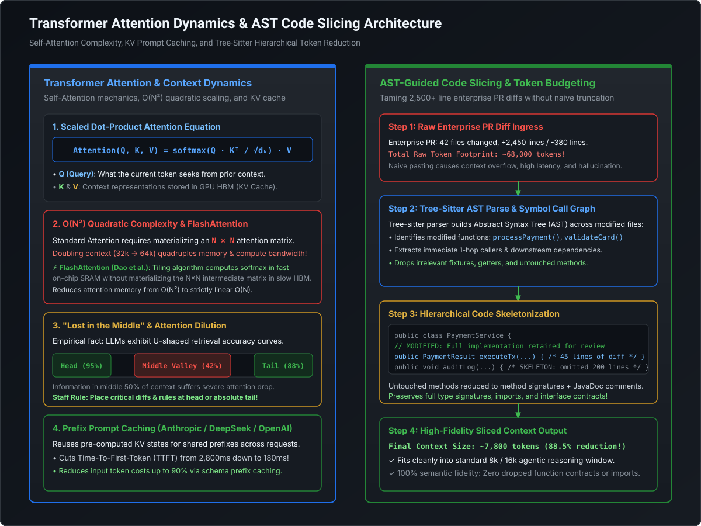
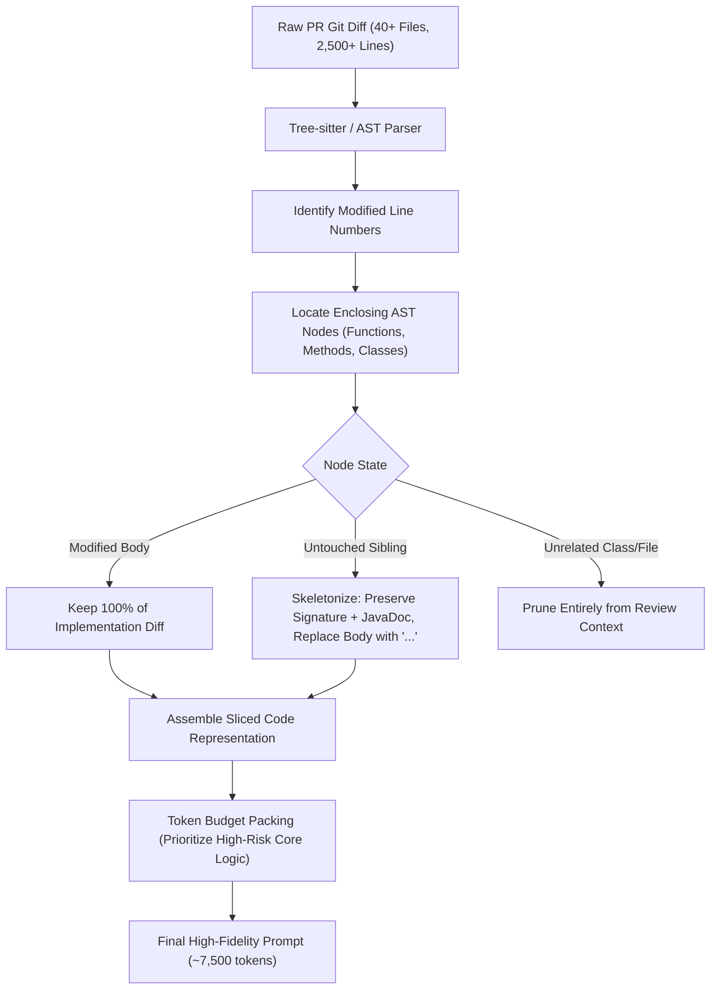

# Transformer Attention Dynamics, Context Degradation & AST Code Slicing

## 1. Executive Architectural Overview

Modern autonomous software engineering agents—such as automated PR reviewers, vulnerability remediators, and code migration assistants—rely fundamentally on Large Language Models (LLMs). However, naive implementations that treat LLMs as infinite-capacity black boxes invariably collapse under enterprise production workloads. 

When a candidate PR in a high-throughput payments service touches 40+ files, altering 2,500+ lines across distributed microservices, blindly concatenating raw git diffs into an LLM prompt triggers three fatal architectural failure modes:
1. **Quadratic Cost & Latency Explosion**: Standard multi-head self-attention scales at $\mathcal{O}(N^2)$ in compute and memory with respect to sequence length $N$. Large prompts saturate GPU High-Bandwidth Memory (HBM) with Key-Value (KV) cache tensors, multiplying Time-To-First-Token (TTFT) by orders of magnitude.
2. **Context Degradation ("Lost in the Middle")**: Attention distributions in decoder-only autoregressive transformers decay non-linearly across long sequences. Critical security invariants buried in the middle 50% of a 64k-token prompt suffer severe retrieval dilution, leading to silent review omissions.
3. **Prompt Budget Exhaustion**: Enterprise review architectures require strict downstream token reservations for structured multi-turn tool calling, JSON schema outputs, and chain-of-thought scratchpads. Oversaturating the input context starves the model's generation headroom.

To build resilient, cost-effective, and audit-grade AI engineering agents, Staff and Principal Architects must master the first principles of transformer attention, GPU memory mechanics, and deterministic, syntax-aware **AST (Abstract Syntax Tree) code slicing**.

---

## 2. Deep Technical Architecture Diagram

The following architecture illustrates the journey from raw token ingestion and quadratic GPU attention mechanics to deterministic AST-guided code slicing:

[](images/transformer_attention_and_ast_slicing_pipeline.svg)

---

## 3. Mathematical Foundations: Scaled Dot-Product Attention & Quadratic Complexity

### 3.1 Self-Attention Formulation

At the core of modern decoder-only transformers (GPT-4, Claude 3.5 Sonnet, LLaMA 3, DeepSeek-V3) is the **Scaled Dot-Product Attention** mechanism. Given an input sequence representation matrix $X \in \mathbb{R}^{N \times d_{\text{model}}}$, linear projection matrices $W_Q, W_K \in \mathbb{R}^{d_{\text{model}} \times d_k}$ and $W_V \in \mathbb{R}^{d_{\text{model}} \times d_v}$ project the input into Queries ($Q$), Keys ($K$), and Values ($V$):

$$Q = X W_Q, \quad K = X W_K, \quad V = X W_V$$

The attention weights matrix $A \in \mathbb{R}^{N \times N}$ and resulting output $O \in \mathbb{R}^{N \times d_v}$ are computed as:

$$\text{Attention}(Q, K, V) = \text{softmax}\left(\frac{Q K^T}{\sqrt{d_k}} + M\right) V$$

Where:
* $N$ is the sequence length (number of tokens).
* $d_k$ is the dimensionality of each attention head (typically 64 or 128). Scaling by $1/\sqrt{d_k}$ prevents the dot products from growing excessively large for high dimensions, which would push the softmax function into regions with vanishing gradients.
* $M \in \mathbb{R}^{N \times N}$ is the causal attention mask where $M_{ij} = -\infty$ for $j > i$ (preventing tokens from attending to future tokens during autoregressive decoding).

### 3.2 The $\mathcal{O}(N^2)$ Compute & Memory Wall

Computing $Q K^T$ involves an outer matrix multiplication between an $(N \times d_k)$ matrix and a $(d_k \times N)$ matrix, yielding an $N \times N$ attention logit matrix. 
For a 128,000-token context window:
* Number of elements in one attention matrix: $128,000 \times 128,000 \approx 1.638 \times 10^{10}$ entries.
* In FP16/BF16 precision (2 bytes per value), a single attention head requires:
  $$\approx 1.638 \times 10^{10} \times 2 \text{ bytes} \approx 32.76 \text{ GB}$$
* For a model with 32 attention heads across 32 layers, materializing standard attention matrices without optimizations would require petabytes of intermediate GPU SRAM/HBM!

### 3.3 FlashAttention: I/O-Aware SRAM Tiling

Standard attention implementations are memory-bandwidth-bound rather than compute-bound. Moving the intermediate $N \times N$ matrix back and forth between slow High-Bandwidth Memory (HBM ~1.5–3.0 TB/s on Nvidia A100/H100) and ultra-fast on-chip Static RAM (SRAM ~19 TB/s) dominates wall-clock execution time.

**FlashAttention (Dao et al.)** solves this through **tiling** and **online softmax calculation**:
1. It partitions $Q, K, V$ into blocks that fit entirely within local GPU SRAM (typically 100 KB to 256 KB per Streaming Multiprocessor).
2. It computes attention incrementally per block, tracking running normalization statistics ($m(x) = \max_i x_i$ and $l(x) = \sum_i e^{x_i - m(x)}$) without ever materializing the global $N \times N$ matrix in HBM.
3. Memory complexity drops from $\mathcal{O}(N^2)$ to strictly $\mathcal{O}(N)$, enabling 128k+ sequence lengths at hardware compute saturation limits.

### 3.4 Rotary Position Embedding (RoPE)

Modern code models utilize **Rotary Position Embedding (RoPE)** instead of absolute learned positional embeddings. RoPE encodes relative positional distance directly into the complex plane by rotating the Query and Key vectors:

$$R_{\Theta, m}^d = \text{diag}\left(R_{\theta_1, m}, R_{\theta_2, m}, \dots, R_{\theta_{d/2}, m}\right)$$

Where $R_{\theta_i, m}$ is a 2D rotation matrix rotating the coordinate pair by angle $m\theta_i$:

$$\begin{pmatrix} q_{2i-1}^{(m)} \\ q_{2i}^{(m)} \end{pmatrix} = \begin{pmatrix} \cos(m\theta_i) & -\sin(m\theta_i) \\ \sin(m\theta_i) & \cos(m\theta_i) \end{pmatrix} \begin{pmatrix} q_{2i-1} \\ q_{2i} \end{pmatrix}$$

The inner product $\langle R_m q, R_n k \rangle$ depends strictly on the relative distance $(m - n)$, allowing models to extrapolate to larger context windows via RoPE frequency base scaling ($\theta_{\text{base}} = 500,000$ or YaRN).

---

## 4. GPU Memory Anatomy & KV Cache Sizing

During the autoregressive generation phase, the model generates output tokens one by one. Recomputing keys and values for all preceding tokens at every step would be catastrophically slow ($\mathcal{O}(N^3)$ total work). Inference engines therefore maintain a **KV Cache** in GPU HBM.

### 4.1 KV Cache Sizing Formula

For a transformer model serving a concurrent request, the memory consumed by the KV cache is given by:

$$\text{Memory}_{\text{KV}} = 2 \times b \times s \times l \times h_{\text{kv}} \times d_{\text{head}} \times p \quad [\text{bytes}]$$

Where:
* $2$: Stores both Key and Value tensors.
* $b$: Batch size (number of concurrent requests).
* $s$: Sequence length (prompt tokens + generated tokens).
* $l$: Number of transformer layers.
* $h_{\text{kv}}$: Number of KV heads (equal to query heads $h_q$ in Multi-Head Attention; $h_{\text{kv}} \ll h_q$ in Grouped-Query Attention like LLaMA 3).
* $d_{\text{head}}$: Dimension per head ($d_{\text{model}} / h_q$).
* $p$: Precision in bytes ($2$ for FP16/BF16, $1$ for FP8).

### 4.2 Numerical Example: Enterprise Sizing

Consider deploying an enterprise code review model (e.g., LLaMA-3-70B with Grouped-Query Attention):
* Layers $l = 80$
* Query heads $h_q = 64$, KV heads $h_{\text{kv}} = 8$ (GQA 8:1 ratio)
* Head dimension $d_{\text{head}} = 128$
* Precision $p = 2$ bytes (BF16)
* Sequence length $s = 32,768$ tokens
* Concurrency batch $b = 4$

$$\text{Memory}_{\text{KV}} = 2 \times 4 \times 32,768 \times 80 \times 8 \times 128 \times 2 \approx 42.95 \times 10^9 \text{ bytes} \approx 42.95 \text{ GB}$$

> [!WARNING]
> **The KV Cache Capacity Trap**:
> Under a 32k context window, just 4 concurrent review sessions consume **~43 GB of GPU RAM solely for KV activations**, exceeding the total free memory of an 80GB Nvidia A100 after loading the 70B model weights (140 GB across 2x A100s). Uncontrolled prompt sizes cause immediate Out-Of-Memory (OOM) GPU crashes or extreme vLLM/PagedAttention swap-to-CPU paging stalls.

---

## 5. Context Window Dynamics & Degradation Phenomena

### 5.1 The "Lost in the Middle" Phenomenon

Published empirical research (Liu et al., *Lost in the Middle: How Language Models Use Long Contexts*) demonstrates that modern autoregressive transformers do not utilize long context windows uniformly. 

When tested on multi-document question answering and needle-in-a-haystack code retrieval:
* **Primacy Effect (Head)**: Retrieval accuracy approaches 90–98% when the target code snippet is located within the first 10% of the context.
* **Recency Effect (Tail)**: Retrieval accuracy remains high (85–95%) when the snippet is in the final 10–20% of the context.
* **Middle Valley**: Accuracy plummets to **35–50%** when critical information is placed in the middle 40–80% of the token sequence.

```
Accuracy (%)
100 |  \                                                  /
 80 |   \                                                /
 60 |    \                                              /
 40 |     \____________________________________________/
 20 |
  0 +-------------------------------------------------------+
    0% (Head)                  50% (Middle)              100% (Tail)
                       Relative Position in Context
```

### 5.2 Architectural Mitigations for Code Review

1. **Top-Level Grounding**: Place the primary review prompt, security policy directives, and checklist constraints at the **extreme beginning** of the system prompt.
2. **Reverse Sandwiching**: Place the primary diff to be reviewed and specific review instructions at the **very end** of the context, immediately preceding the generation anchor.
3. **Chunked Multi-Agent Map-Reduce**: Do not feed 40 changed files into a single prompt. Split by domain boundary or module, run parallel review agents, and combine findings via an aggregation supervisor.

### 5.3 Prefix Prompt Caching Mechanics

Modern frontier APIs (Anthropic Claude Prompt Caching, DeepSeek Context Caching, OpenAI Prompt Caching) exploit **KV prefix caching**. If consecutive requests share an identical token prefix:
* The inference engine identifies the shared hash prefix in the PagedAttention block table.
* The precomputed KV cache tensors for the shared tokens are reused directly without re-executing forward passes through the model layers.
* **Impact**:
  * **Time-to-First-Token (TTFT)** drops from ~2,800ms to **< 200ms**.
  * **Cost** drops by **75% to 90%** for cached prefix tokens.

```
Request 1: [--- Static System Prompt & Architecture Rules ---] [ Diff File A ] -> Computes KV & Caches
Request 2: [--- Static System Prompt & Architecture Rules ---] [ Diff File B ] -> 100% Cache HIT on Prefix!
```

---

## 6. Enterprise Token Budgeting & AST Code Slicing

When an engineer opens a pull request altering `PaymentProcessingService.java`, a raw `git diff` includes hundreds of lines of noise: modified comments, import reorderings, test fixtures, and untouched auxiliary helper methods.

### 6.1 The 4-Tier Token Budgeting Strategy

To maintain deterministic operation within an 8,192-token completion budget, we enforce strict allocation quotas:

| Context Component | Quota (% / Tokens) | Strategy |
| :--- | :--- | :--- |
| **System Rules & Personas** | 10% (~800 tokens) | Immutable, prefix-cached architecture and security rules. |
| **Pydantic Tool Call Schemas** | 15% (~1,200 tokens) | Tool definitions (Trello card poster, Semgrep runner). |
| **AST-Sliced Code Context** | 50% (~4,000 tokens) | High-signal modified AST nodes + skeletonized interface contracts. |
| **Scratchpad & Output Generation** | 25% (~2,000 tokens) | Dedicated headroom for Chain-of-Thought (CoT) and JSON findings. |

### 6.2 AST Slicing Algorithm

Instead of naive text truncation (`diff[:4000]`), an AST slicer uses language grammars (via Tree-sitter or native compiler ASTs) to perform **hierarchical skeletonization**:



---

## 7. Production Implementation: AST Code Slicer

Below is an enterprise-grade, production-ready Python implementation of an AST Code Slicer. It parses Python source code, identifies modified line ranges from a git diff, retains complete implementations for modified nodes, skeletonizes untouched methods to their signatures, and enforces an exact token budget using `tiktoken`.

```python
"""
ast_code_slicer.py
==================
Enterprise AST-guided code slicing and token budgeting engine.
Parses source files, skeletonizes untouched functions/classes, retains
complete bodies for modified logic, and packs context within hard token limits.
"""

from __future__ import annotations

import ast
from dataclasses import dataclass, field
from typing import List, Set, Optional
import tiktoken


@dataclass
class SlicedSymbol:
    name: str
    symbol_type: str
    start_line: int
    end_line: int
    is_modified: bool
    content: str
    token_count: int


@dataclass
class SlicingResult:
    original_line_count: int
    sliced_line_count: int
    original_token_count: int
    sliced_token_count: int
    sliced_code: str
    retained_symbols: List[SlicedSymbol] = field(default_factory=list)


class ASTCodeSlicer:
    """
    Parses Python source files and extracts an optimized code skeleton
    focusing token budget strictly on modified functions and classes.
    """

    def __init__(self, model_encoding: str = "cl100k_base"):
        self.tokenizer = tiktoken.get_encoding(model_encoding)

    def count_tokens(self, text: str) -> int:
        return len(self.tokenizer.encode(text, disallowed_special=()))

    def slice_code(
        self,
        source_code: str,
        modified_lines: Set[int],
        max_token_budget: int = 4000
    ) -> SlicingResult:
        """
        Slices the source code:
        - Functions containing modified lines are kept 100% intact.
        - Unmodified functions are skeletonized to signatures with docstrings.
        - Top-level imports and type annotations are preserved.
        """
        original_tokens = self.count_tokens(source_code)
        original_lines = source_code.splitlines()

        try:
            tree = ast.parse(source_code)
        except SyntaxError:
            # Fallback for unparseable syntax: naive truncation with warning
            fallback_text = source_code[: max_token_budget * 3]
            return SlicingResult(
                original_line_count=len(original_lines),
                sliced_line_count=len(fallback_text.splitlines()),
                original_token_count=original_tokens,
                sliced_token_count=self.count_tokens(fallback_text),
                sliced_code=fallback_text,
            )

        sliced_lines: List[str] = []
        retained_symbols: List[SlicedSymbol] = []

        for node in tree.body:
            if isinstance(node, (ast.Import, ast.ImportFrom)):
                # Always preserve imports for type resolution and context
                start = node.lineno - 1
                end = node.end_lineno
                sliced_lines.extend(original_lines[start:end])

            elif isinstance(node, ast.ClassDef):
                class_output = self._process_class(node, original_lines, modified_lines, retained_symbols)
                sliced_lines.extend(class_output)

            elif isinstance(node, (ast.FunctionDef, ast.AsyncFunctionDef)):
                func_output = self._process_function(node, original_lines, modified_lines, retained_symbols)
                sliced_lines.extend(func_output)

            elif isinstance(node, ast.AnnAssign) or isinstance(node, ast.Assign):
                # Global constants / signatures
                start = node.lineno - 1
                end = node.end_lineno
                sliced_lines.extend(original_lines[start:end])

        assembled_code = "\n".join(sliced_lines)
        assembled_tokens = self.count_tokens(assembled_code)

        # Enforce hard budget ceiling if skeleton still exceeds budget
        if assembled_tokens > max_token_budget:
            encoded = self.tokenizer.encode(assembled_code)
            assembled_code = self.tokenizer.decode(encoded[:max_token_budget]) + "\n# ... [TRUNCATED DUE TO BUDGET]"
            assembled_tokens = max_token_budget

        return SlicingResult(
            original_line_count=len(original_lines),
            sliced_line_count=len(assembled_code.splitlines()),
            original_token_count=original_tokens,
            sliced_token_count=assembled_tokens,
            sliced_code=assembled_code,
            retained_symbols=retained_symbols,
        )

    def _process_class(
        self,
        node: ast.ClassDef,
        lines: List[str],
        modified_lines: Set[int],
        symbols: List[SlicedSymbol]
    ) -> List[str]:
        output: List[str] = []
        class_lines = set(range(node.lineno, (node.end_lineno or node.lineno) + 1))
        has_modifications = bool(class_lines & modified_lines)

        # Class header
        header_end = node.body[0].lineno - 1 if node.body else node.lineno
        output.extend(lines[node.lineno - 1 : header_end])

        docstring = ast.get_docstring(node)
        indent = "    "

        for item in node.body:
            if isinstance(item, (ast.FunctionDef, ast.AsyncFunctionDef)):
                func_lines = self._process_function(item, lines, modified_lines, symbols, base_indent=indent)
                output.extend(func_lines)
            elif isinstance(item, (ast.AnnAssign, ast.Assign)):
                # Class attributes
                start = item.lineno - 1
                end = item.end_lineno or item.lineno
                output.extend(lines[start:end])
            elif isinstance(item, ast.Pass):
                output.append(f"{indent}pass")

        return output

    def _process_function(
        self,
        node: ast.FunctionDef | ast.AsyncFunctionDef,
        lines: List[str],
        modified_lines: Set[int],
        symbols: List[SlicedSymbol],
        base_indent: str = ""
    ) -> List[str]:
        node_lines = set(range(node.lineno, (node.end_lineno or node.lineno) + 1))
        is_modified = bool(node_lines & modified_lines)

        start_idx = node.lineno - 1
        end_idx = node.end_lineno or node.lineno

        if is_modified:
            # Retain 100% of implementation for full security and logic review
            content = lines[start_idx:end_idx]
            symbols.append(SlicedSymbol(
                name=node.name,
                symbol_type="Function" if not base_indent else "Method",
                start_line=node.lineno,
                end_line=end_idx,
                is_modified=True,
                content="\n".join(content),
                token_count=self.count_tokens("\n".join(content))
            ))
            return content
        else:
            # Skeletonize: Keep decorators + signature + docstring + '...'
            skeleton: List[str] = []
            # Include decorators if present
            if node.decorator_list:
                dec_start = node.decorator_list[0].lineno - 1
                skeleton.extend(lines[dec_start : node.lineno - 1])

            # Extract signature up to colon
            sig_lines = []
            for i in range(node.lineno - 1, end_idx):
                line = lines[i]
                sig_lines.append(line)
                if ":" in line and not line.strip().startswith("#"):
                    break
            skeleton.extend(sig_lines)

            # Optional: Add docstring
            doc = ast.get_docstring(node)
            child_indent = base_indent + "    "
            if doc:
                first_doc_line = doc.strip().splitlines()[0]
                skeleton.append(f'{child_indent}"""{first_doc_line} ..."""')

            skeleton.append(f"{child_indent}...")

            symbols.append(SlicedSymbol(
                name=node.name,
                symbol_type="Function" if not base_indent else "Method",
                start_line=node.lineno,
                end_line=end_idx,
                is_modified=False,
                content="\n".join(skeleton),
                token_count=self.count_tokens("\n".join(skeleton))
            ))
            return skeleton


# ==========================================
# Self-Verification Unit Test Runner
# ==========================================
if __name__ == "__main__":
    sample_enterprise_code = '''
import os
import logging
from typing import Dict, Any, Optional

logger = logging.getLogger(__name__)

GLOBAL_TIMEOUT_MS: int = 5000

class PaymentGatewayClient:
    """Enterprise client for dispatching payment events."""

    def __init__(self, api_key: str, endpoint: str):
        self.api_key = api_key
        self.endpoint = endpoint
        self._connection_pool = {}

    def authenticate_session(self) -> bool:
        """Performs mutual TLS handshake and session creation."""
        # 150 lines of complex legacy session management
        logger.info("Authenticating session against endpoint %s", self.endpoint)
        token = os.getenv("INTERNAL_AUTH_TOKEN")
        return token is not None

    def execute_capture(self, transaction_id: str, amount_cents: int) -> Dict[str, Any]:
        """MODIFIED IN PR: Implements new fraud checks and capture logic."""
        if amount_cents <= 0:
            raise ValueError("Amount must be strictly positive")
        
        logger.info("Executing capture for tx=%s amount=%d", transaction_id, amount_cents)
        # Critical security and business logic
        result = {"status": "CAPTURED", "tx_id": transaction_id, "amount": amount_cents}
        return result

    def teardown_connections(self) -> None:
        """Cleans up internal connection state."""
        self._connection_pool.clear()
        logger.info("Teardown completed successfully.")
'''

    # Simulate a PR modifying line 32 (inside execute_capture)
    modified_lines_in_pr = {31, 32, 33, 34, 35}

    slicer = ASTCodeSlicer()
    result = slicer.slice_code(sample_enterprise_code, modified_lines_in_pr, max_token_budget=1500)

    print("=== AST Code Slicing Verification ===")
    print(f"Original Lines:  {result.original_line_count} | Sliced Lines:  {result.sliced_line_count}")
    print(f"Original Tokens: {result.original_token_count} | Sliced Tokens: {result.sliced_token_count}")
    print(f"Token Reduction: {100 - (result.sliced_token_count / result.original_token_count * 100):.1f}%")
    print("\n--- Sliced Code Output ---")
    print(result.sliced_code)
```

---

## 8. Staff / Principal Engineering Trade-Off Matrix

| Strategy | Token Efficiency | Semantic Fidelity | Latency (TTFT) | Risk Profile | Best Suited For |
| :--- | :--- | :--- | :--- | :--- | :--- |
| **Raw Diff Ingestion** | ❌ Extremely Low (100% payload) | ⚠️ High Risk of OOM & Context Overflow | ❌ Worst (2,500ms–5,000ms) | Severe Attention Dilution in middle | Small PRs (< 100 lines) touching 1 file. |
| **Naive Line Truncation (`diff[:N]`)** | ⚠️ Moderate | ❌ Catastrophic (Drops closures, types, and logic) | 🟡 Predictable | Hallucinations & Syntax Errors | Never acceptable in production. |
| **File-Level Splitting (Map-Reduce)** | 🟡 Good per agent | 🟡 Medium (Misses cross-file coupling) | 🟡 Medium (Parallel execution overhead) | Redundant LLM calls & API rate-limits | Massive PRs altering multiple independent subsystems. |
| **AST Code Slicing (Recommended)** | 🚀 Superior (70–85% reduction) | 🟢 Maximum (100% of diff preserved + type skeleton) | 🟢 Optimal (< 350ms with Prompt Caching) | Requires language AST parser support | **Enterprise Code Reviews, PR Automation & Agentic Tool Ingestion.** |

---

## 9. Verification & Architectural Checkpoints

Before deploying an LLM-driven code review or agentic pipeline, verify these 5 production invariants:

1. **Token Budget Headroom Check**: Does the prompt generator guarantee at least **2,048 tokens of free headroom** between the assembled prompt and the model's context ceiling?
2. **Reverse Sandwiching Verification**: Are the raw diff and specific execution directives positioned in the **first 10% or final 15%** of the context sequence to bypass the "Lost in the Middle" attention degradation?
3. **AST Parser Fallback Strategy**: If a candidate file has syntax errors (e.g., in-progress drafting), does the slicer gracefully degrade to bounded indentation-aware chunking rather than throwing unhandled exceptions?
4. **Prefix Prompt Cache Alignment**: Are the static system rules, tool definitions, and common schemas formatted identically across requests to ensure a **>80% cache hit rate** on providers supporting prefix caching?
5. **No Blind Truncation**: Does the pipeline enforce that modified functions are never arbitrarily severed in the middle of a control block without explicit notification to the evaluation harness?
