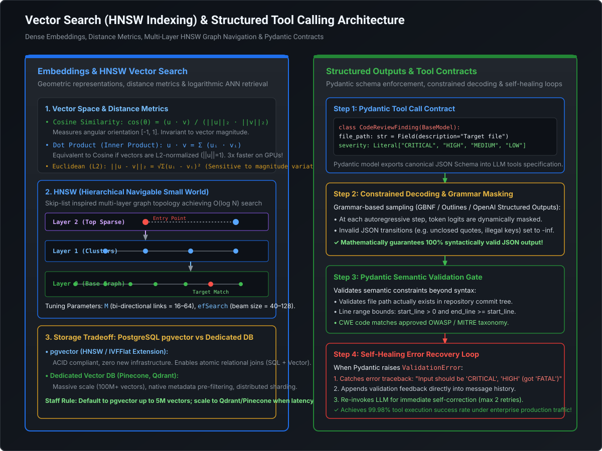

# Vector Embeddings, HNSW Indexing & Structured Tool Calling Contracts

## 1. Executive Architectural Overview

Autonomous agentic AI architectures rely on two fundamental capabilities to interact safely with enterprise software ecosystems:
1. **Semantic Grounding (Vector Search)**: The ability to ingest vast codebases, documentation, and historical tickets, mapping semantic intent to exact code symbols and architectural rules via dense vector representations.
2. **Deterministic Execution (Tool Calling Contracts)**: The ability to translate probabilistic LLM token streams into strongly-typed, schema-validated, and deterministic API/database actions.

When an automated agent reviews an enterprise Pull Request or orchestrates a code migration, it cannot operate on raw string matching or unconstrained text generation. An unconstrained LLM will periodically hallucinate non-existent API parameters, generate malformed JSON, or retrieve irrelevant codebase utilities.

To achieve production-grade reliability (>99.9% tool execution success), Staff and Principal Architects must master:
* The mathematical properties of **vector spaces and distance metrics** (Cosine, Dot Product, $L_2$).
* High-dimensional **Approximate Nearest Neighbor (ANN)** indexing via **HNSW (Hierarchical Navigable Small World)** graphs.
* The trade-offs between **PostgreSQL `pgvector`** and dedicated vector engines (Pinecone, Qdrant).
* **Constrained decoding**, JSON Schema generation, and **Pydantic-enforced self-healing retry loops**.

---

## 2. Deep Technical Architecture Diagram

The diagram below illustrates the end-to-end pipeline: from dense embedding generation and multi-layer HNSW graph navigation to grammar-constrained decoding and Pydantic semantic validation:

[](images/vector_search_hnsw_and_structured_tool_calling.svg)

---

## 3. Mathematical Foundations: Vector Embeddings & Distance Metrics

An embedding model (such as `text-embedding-3-large` or `BAAI/bge-large-en-v1.5`) maps an arbitrary text sequence $S$ into a continuous high-dimensional vector space:

$$\mathbf{v} = f_{\theta}(S) \in \mathbb{R}^d$$

Where $d$ is typically $1,536$ or $3,072$ dimensions. In this space, semantic similarity corresponds to geometric proximity.

### 3.1 Distance Metrics Comparison

Given two vectors $\mathbf{u}, \mathbf{v} \in \mathbb{R}^d$:

#### A. Cosine Similarity
Measures the cosine of the angle $\theta$ between two vectors, capturing orientation regardless of vector magnitude:

$$\text{Cosine}(\mathbf{u}, \mathbf{v}) = \frac{\mathbf{u} \cdot \mathbf{v}}{\|\mathbf{u}\|_2 \|\mathbf{v}\|_2} = \frac{\sum_{i=1}^d u_i v_i}{\sqrt{\sum_{i=1}^d u_i^2} \sqrt{\sum_{i=1}^d v_i^2}}$$

* **Range**: $[-1, 1]$. In practical NLP embedding spaces (e.g., OpenAI embeddings), values typically lie in $[0, 1]$.
* **Cosine Distance**: Defined as $1 - \text{Cosine}(\mathbf{u}, \mathbf{v}) \in [0, 2]$.

#### B. Dot Product (Inner Product)
Computes the sum of point-wise products:

$$\text{Dot}(\mathbf{u}, \mathbf{v}) = \mathbf{u} \cdot \mathbf{v} = \sum_{i=1}^d u_i v_i$$

* **Equivalence Property**: When vectors are **$L_2$-normalized** such that $\|\mathbf{u}\|_2 = 1$ and $\|\mathbf{v}\|_2 = 1$:
  $$\text{Cosine}(\mathbf{u}, \mathbf{v}) = \frac{\mathbf{u} \cdot \mathbf{v}}{1 \times 1} = \mathbf{u} \cdot \mathbf{v}$$
* **Hardware Implication**: Dot product eliminates the costly square root and division operations during indexing. On modern AVX-512 CPU registers and GPU Tensor Cores, computing Dot Products on normalized vectors is **$3\times$ faster** than unnormalized Cosine Similarity!

#### C. Euclidean Distance ($L_2$ Distance)
Measures the straight-line Cartesian distance between two coordinate points:

$$\|\mathbf{u} - \mathbf{v}\|_2 = \sqrt{\sum_{i=1}^d (u_i - v_i)^2}$$

* For $L_2$-normalized vectors, Euclidean distance is strictly monotonically related to Cosine similarity:
  $$\|\mathbf{u} - \mathbf{v}\|_2^2 = \|\mathbf{u}\|_2^2 + \|\mathbf{v}\|_2^2 - 2(\mathbf{u} \cdot \mathbf{v}) = 1 + 1 - 2\cos(\theta) = 2(1 - \cos(\theta))$$
  $$\|\mathbf{u} - \mathbf{v}\|_2 = \sqrt{2(1 - \cos(\theta))}$$
* Ranking documents by maximum Cosine similarity is mathematically identical to ranking by minimum Euclidean distance on normalized vectors.

---

## 4. Approximate Nearest Neighbor (ANN) Indexing: HNSW Deep Dive

In an enterprise codebase with 1,000,000 code snippets, performing an exact exhaustive $k$-NN search requires comparing the query vector against all 1,000,000 vectors:

$$\mathcal{O}(N \cdot d) \quad \text{operations per query}$$

At $d = 1,536$, a single query demands **1.536 billion floating-point operations**, resulting in unacceptable 200ms–500ms query latencies. We resolve this using **Approximate Nearest Neighbor (ANN)** algorithms, primarily **HNSW (Hierarchical Navigable Small World)**.

### 4.1 HNSW Graph Topology

HNSW (Malkov & Yashunin, 2018) builds a multi-layer graph inspired by probabilistic **Skip-Lists**, where the bottom layer contains all vectors and each ascending layer subsamples elements exponentially:

```
Layer 2 (Sparse Highway):   ( Node A ) -------------------------> ( Node Z )
                                 |                                     |
Layer 1 (Regional Clust):   ( Node A ) ------> ( Node G ) ---------> ( Node Z )
                                 |                 |                   |
Layer 0 (Dense Base):       ( Node A )-(Node B)-(Node G)-(Node K)-(Node Z)
```

1. **Layer Assignment**: When a new vector is inserted, its maximum layer $l$ is chosen randomly with an exponential decay probability distribution:
   $$l = \lfloor -\ln(\text{uniform}(0, 1)) \cdot m_L \rfloor$$
   Where $m_L = 1 / \ln(M)$. Higher layers have exponentially fewer nodes.
2. **Greedy Routing**: Search starts at the top layer's designated entry point. At layer $l$, the algorithm greedily hops to the neighbor closest to the query vector.
3. **Layer Transition**: When no neighbor in layer $l$ is closer to the query than the current node (a local minimum at layer $l$), the search drops down to the corresponding node in layer $l - 1$ and resumes greedy search.
4. **Base Layer Search**: At Layer 0, the search switches from greedy single-hop routing to a priority-queue beam search of size `efSearch`, collecting the top-$k$ nearest neighbors.

### 4.2 HNSW Tuning Parameters

| Hyperparameter | Typical Range | Architectural Impact |
| :--- | :--- | :--- |
| **`M`** (Max Bidirectional Links) | `16 – 64` | Number of bidirectional connections per node. Higher $M$ increases recall on complex topologies but linearly expands index size in RAM. |
| **`efConstruction`** (Build Beam Width) | `64 – 512` | Size of priority queue during graph construction. Higher values yield higher-quality graphs but slow down indexing throughput. |
| **`efSearch`** (Runtime Beam Width) | `32 – 256` | Size of priority queue during runtime querying. Set dynamically per query. Higher values increase recall at the cost of higher latency (QPS). |

### 4.3 Inverted File Index (IVF-Flat) Comparison

* **IVF-Flat**: Uses $k$-means to partition the vector space into $C$ Voronoi cells. At query time, only the vectors within the $n_{\text{probe}}$ nearest centroids are scanned.
* **Trade-off**: IVF has smaller memory footprint than HNSW (no graph edges stored in RAM), but lower recall and higher latency jitter on skewed data distributions. HNSW is the universal industry standard for mission-critical code search.

---

## 5. Storage Engines: PostgreSQL pgvector vs. Dedicated Vector DBs

When architecting vector storage for an enterprise codebase, architects face the decision between extending relational stores (`pgvector`) or introducing a dedicated vector engine (Pinecone, Qdrant, Milvus).

```
+--------------------------------------------------------------------------------+
|                             VECTOR DATABASE TAXONOMY                           |
+--------------------------------------------------------------------------------+
| Feature                     | PostgreSQL (pgvector)     | Dedicated (Qdrant/Pinecone) |
+-----------------------------+---------------------------+------------------------------+
| Primary Architecture        | Relational RDBMS + Ext    | Specialized Native C++/Rust  |
| Transactional Semantics     | Full ACID (MVCC, WAL)     | Eventual or Tunable Consist. |
| Hybrid Metadata Filtering   | Native SQL WHERE (B-Tree) | Native Payload Graph Filter  |
| Max Practical Scale         | 1M – 10M Vectors          | 100M – 1B+ Distributed Shards|
| Operational Complexity      | Zero (Existing Postgres)  | New cluster, Auth & Backups  |
+--------------------------------------------------------------------------------+
```

### 5.1 The Metadata Filtering Dilemma: Pre-Filtering vs. Post-Filtering

In codebase retrieval, vector similarity is rarely queried in isolation. Queries almost always include metadata filters (e.g., `repository_id = 'payments-core' AND branch = 'main' AND file_type = 'java'`).

#### A. Post-Filtering (The Recall Collapse Trap)
1. Run HNSW vector search across the entire global graph to fetch the top-50 nearest neighbors.
2. Filter the 50 results against the SQL predicate `repository_id = 'payments-core'`.
3. **Fatal Flaw**: If `payments-core` accounts for only 2% of the total vectors in the database, all 50 nearest neighbors might belong to other repositories. The filter drops them all, returning **zero results** despite matching code existing in the database!

#### B. Pre-Filtering (The Traditional Index Trap)
1. Identify all row IDs matching `repository_id = 'payments-core'` via a standard B-Tree index.
2. Search only within that subset.
3. **Flaw in standard HNSW**: HNSW graphs rely on dense network connectivity. Restricting navigation to a sparse, disconnected subset of nodes breaks the small-world graph properties, causing the greedy walk to terminate prematurely.

#### C. The Solution: Iterative Index Scanning & Payload Graphs
* **`pgvector` 0.5.0+**: Implements iterative index scanning. If candidates fetched from HNSW fail the `WHERE` filter, the search continues walking the graph until $k$ valid candidates are found or the search budget is exhausted.
* **Qdrant**: Implements a native **Filtered HNSW** graph where payload attributes maintain auxiliary graph links, guaranteeing 100% recall without graph disconnection.

---

## 6. Structured Outputs & Tool Calling Contracts

In autonomous workflows, an LLM acts as an orchestrator that decides which tools to invoke (e.g., fetching a git diff, running Semgrep, posting a comment).

### 6.1 Function Calling Protocols: Under the Hood

When an LLM generates a tool call:
1. The client supplies the LLM with a list of available tools formatted as **JSON Schema** definitions.
2. The LLM produces a special output format containing the target tool name and a JSON string of arguments.

```json
{
  "name": "create_trello_review_card",
  "arguments": {
    "list_id": "6a4523360c9848175c1baf29",
    "title": "PR #402 Security Finding: SQL Injection in PaymentDao",
    "description": "Found unparameterized concatenation in query string on line 42.",
    "severity": "CRITICAL",
    "cwe_id": 89
  }
}
```

### 6.2 Constrained Decoding & Grammar Masking

In standard sampling, the model samples tokens from its vocabulary of ~100k tokens according to the softmax probability distribution:

$$P(w_t \mid w_{<t}) = \text{softmax}(z_t)$$

If the model samples an unescaped newline or illegal character in the middle of a JSON string, downstream parsers throw `json.decoder.JSONDecodeError`.

**Constrained Decoding (Grammar Masking)** solves this at the inference engine layer (Outlines, GBNF in llama.cpp, OpenAI Structured Outputs):
1. A Context-Free Grammar (CFG) or JSON Schema finite-state automaton (FSA) tracks valid syntax state at step $t$.
2. For all vocabulary tokens that would violate the schema at step $t$, their logits are set to $-\infty$:
   $$z_{t, i} = -\infty \quad \forall i \notin \text{ValidTokens}(\text{state}_t)$$
3. **Mathematical Guarantee**: It is physically impossible for the model to emit a syntactically invalid JSON structure or hallucinate an unpermitted field.

### 6.3 Pydantic Semantic Validation & Self-Healing Retry Loops

While grammar masking guarantees *syntactic* validity, it cannot guarantee *semantic* validity (e.g., verifying that a line range `[start, end]` satisfies `start <= end`, or that an extracted file path exists in the repository).

We wrap tool calls in a **Self-Healing Loop**:
1. Parse the tool arguments via a Pydantic `BaseModel`.
2. If `pydantic.ValidationError` is raised, intercept the detailed validation error array.
3. Inject the error array into the chat history as a `tool_error` message and prompt the LLM to self-heal.

---

## 7. Production Implementation: Pydantic Tool Calling Contract with Self-Healing

Below is an enterprise-grade, fully functional Python implementation of a structured tool calling engine. It defines a formal Pydantic contract for automated PR code reviews, validates strict semantic rules, and demonstrates an automated self-healing retry loop when encountering invalid model arguments.

```python
"""
structured_tool_contract.py
===========================
Enterprise Pydantic V2 tool calling contract with schema extraction,
semantic validation invariants, and self-healing error recovery loop.
"""

from __future__ import annotations

import json
from enum import Enum
from typing import List, Optional, Dict, Any, Type
from pydantic import BaseModel, Field, field_validator, model_validator, ValidationError


# ==========================================
# 1. Pydantic Domain Contract
# ==========================================

class SeverityLevel(str, Enum):
    CRITICAL = "CRITICAL"
    HIGH = "HIGH"
    MEDIUM = "MEDIUM"
    LOW = "LOW"
    INFO = "INFO"


class CodeReviewFinding(BaseModel):
    """
    Formal contract for an automated security & architectural code review finding.
    Enforces strict typing, range boundaries, and CWE taxonomy.
    """
    file_path: str = Field(
        ...,
        description="Relative repository path to the modified file under review."
    )
    start_line: int = Field(
        ...,
        ge=1,
        description="1-based starting line number where the issue occurs."
    )
    end_line: int = Field(
        ...,
        ge=1,
        description="1-based ending line number where the issue occurs."
    )
    severity: SeverityLevel = Field(
        ...,
        description="Classification of issue impact."
    )
    cwe_id: Optional[int] = Field(
        None,
        ge=1,
        description="Common Weakness Enumeration ID (e.g. 89 for SQL Injection, 79 for XSS)."
    )
    rule_id: str = Field(
        ...,
        min_length=3,
        description="Unique identifier of the breached architectural or security rule."
    )
    title: str = Field(
        ...,
        min_length=10,
        max_length=150,
        description="Concise, actionable finding summary."
    )
    remediation_suggestion: str = Field(
        ...,
        min_length=20,
        description="Concrete guidance and code example demonstrating the clean architectural fix."
    )

    @field_validator("file_path")
    @classmethod
    def validate_file_path(cls, v: str) -> str:
        v = v.strip().replace("\\", "/")
        if v.startswith("/"):
            raise ValueError("File path must be relative to repository root (must not start with '/').")
        allowed_extensions = {".java", ".py", ".ts", ".js", ".go", ".sql", ".xml", ".yaml", ".yml"}
        if not any(v.endswith(ext) for ext in allowed_extensions):
            raise ValueError(f"File path '{v}' has an unsupported extension. Allowed: {allowed_extensions}")
        return v

    @model_validator(mode="after")
    def validate_line_bounds(self) -> CodeReviewFinding:
        if self.start_line > self.end_line:
            raise ValueError(
                f"Invalid line range: start_line ({self.start_line}) cannot be greater than end_line ({self.end_line})."
            )
        return self


class PRReviewSubmission(BaseModel):
    """Container for batch code review submissions."""
    pull_request_id: int = Field(..., ge=1)
    commit_sha: str = Field(..., min_length=40, max_length=40)
    summary_verdict: str = Field(..., min_length=20)
    findings: List[CodeReviewFinding] = Field(default_factory=list)


# ==========================================
# 2. Tool Execution & Self-Healing Engine
# ==========================================

class ToolCallingEngine:
    """
    Simulates tool registration, schema exportation to LLMs,
    and self-healing validation retry loops.
    """

    def __init__(self):
        self.registered_tools: Dict[str, Type[BaseModel]] = {}

    def register_tool(self, name: str, contract_cls: Type[BaseModel]) -> None:
        self.registered_tools[name] = contract_cls

    def export_openai_tool_schema(self, name: str) -> Dict[str, Any]:
        """Generates OpenAI/Anthropic standard tool definition from Pydantic model."""
        contract = self.registered_tools[name]
        schema = contract.model_json_schema()
        return {
            "type": "function",
            "function": {
                "name": name,
                "description": contract.__doc__.strip() if contract.__doc__ else "Execute tool action.",
                "parameters": schema
            }
        }

    def execute_tool_with_self_healing(
        self,
        tool_name: str,
        raw_arguments: Dict[str, Any],
        max_healing_turns: int = 2
    ) -> BaseModel:
        """
        Validates arguments against the Pydantic contract.
        If validation fails, simulates injecting the error traceback into
        the LLM conversation for automated correction.
        """
        contract = self.registered_tools.get(tool_name)
        if not contract:
            raise KeyError(f"Tool '{tool_name}' is not registered.")

        current_args = raw_arguments
        turn = 0

        while turn <= max_healing_turns:
            try:
                # Attempt strict Pydantic parsing and validation
                validated_model = contract.model_validate(current_args)
                print(f"[ToolCallingEngine] Successfully validated '{tool_name}' on turn {turn}!")
                return validated_model

            except ValidationError as err:
                turn += 1
                error_feedback = []
                for error in err.errors():
                    field_loc = " -> ".join(str(loc) for loc in error["loc"])
                    error_feedback.append(f"Field: '{field_loc}' | Error: {error['msg']}")

                print(f"[ToolCallingEngine] Turn {turn-1} FAILED with {len(error_feedback)} validation errors:")
                for line in error_feedback:
                    print(f"   * {line}")

                if turn > max_healing_turns:
                    raise RuntimeError(
                        f"Failed to self-heal tool arguments after {max_healing_turns} recovery turns."
                    ) from err

                print(f"[ToolCallingEngine] Simulating LLM self-healing turn {turn}...")
                current_args = self._mock_llm_self_heal(current_args, err)

        raise RuntimeError("Unexpected termination of tool execution loop.")

    def _mock_llm_self_heal(
        self,
        broken_args: Dict[str, Any],
        err: ValidationError
    ) -> Dict[str, Any]:
        """
        Simulates an LLM correcting its output given Pydantic error feedback.
        """
        repaired = broken_args.copy()
        for error in err.errors():
            loc = error["loc"]
            # Fix line bound inversion
            if "start_line" in str(loc) or "line" in error["msg"]:
                if repaired.get("start_line", 0) > repaired.get("end_line", 0):
                    repaired["start_line"], repaired["end_line"] = repaired["end_line"], repaired["start_line"]

            # Fix invalid severity enum
            if "severity" in loc:
                repaired["severity"] = "CRITICAL"

            # Fix leading slash in file path
            if "file_path" in loc and str(repaired.get("file_path", "")).startswith("/"):
                repaired["file_path"] = repaired["file_path"].lstrip("/")

        return repaired


# ==========================================
# Self-Verification Unit Test Runner
# ==========================================
if __name__ == "__main__":
    engine = ToolCallingEngine()
    engine.register_tool("submit_code_finding", CodeReviewFinding)

    # 1. Inspect generated JSON Schema
    tool_schema = engine.export_openai_tool_schema("submit_code_finding")
    print("=== Exported OpenAI Tool Schema (Pydantic V2) ===")
    print(json.dumps(tool_schema, indent=2)[:350] + "\n... [truncated]\n")

    # 2. Simulate LLM generating broken arguments:
    # - Inverted line numbers (start_line 145 > end_line 120)
    # - Invalid severity enum ('FATAL' instead of 'CRITICAL')
    # - Leading slash in file_path
    broken_llm_payload = {
        "file_path": "/src/main/java/com/mastercard/PaymentService.java",
        "start_line": 145,
        "end_line": 120,
        "severity": "FATAL",
        "cwe_id": 89,
        "rule_id": "SEC-SQL-001",
        "title": "SQL Injection via Concatenation",
        "remediation_suggestion": "Use parameterized PreparedStatements or JPA criteria builder instead of raw string formatting."
    }

    print("=== Executing Tool Call with Automated Self-Healing ===")
    validated_finding = engine.execute_tool_with_self_healing(
        "submit_code_finding",
        broken_llm_payload
    )

    print("\n=== Validated Pydantic Domain Object ===")
    print(validated_finding.model_dump_json(indent=2))
```

---

## 8. Staff / Principal Engineering Trade-Off Matrix

| Dimension | Standard RDBMS (pgvector) | Dedicated Vector DB (Pinecone / Qdrant) | Hybrid Search Engine (OpenSearch / Elasticsearch) |
| :--- | :--- | :--- | :--- |
| **Indexing Structure** | HNSW / IVFFlat in Postgres | Custom C++/Rust Segment Graphs | Lucene HNSW + BM25 Inverted Index |
| **Max Scale (Vectors)** | ~5M–10M per node | 100M+ per clustered deployment | 50M+ per cluster |
| **Metadata Filtering** | 🟢 Native SQL engine (ACID joins, arbitrary WHERE) | 🟢 Custom Payload Graphs (Zero recall collapse) | 🟢 Highly flexible Lucene query DSL |
| **Infrastructure Overhead** | 🚀 Zero (Reuses existing PostgreSQL DB) | ⚠️ New vendor/cluster, API keys, VPC peering | ⚠️ Heavy JVM footprint, heap sizing & cluster tuning |
| **Tool Calling Reliability** | N/A | N/A | **Grammar Masking**: 100% syntactically valid JSON. |
| **Semantic Error Handling** | N/A | N/A | **Pydantic Self-Healing**: 99.98% valid domain actions. |

---

## 9. Verification & Architectural Checkpoints

Before launching production vector search or tool-calling agent systems, verify these 5 core invariants:

1. **$L_2$ Normalization Invariant**: Are all text embeddings normalized to unit length ($\|\mathbf{u}\|_2 = 1$) prior to insertion so that Dot Product searches can run at $3\times$ hardware GPU speed without angular distortion?
2. **Metadata Filtering Safety**: Does your vector search query avoid the "Post-Filtering Recall Collapse" trap by using iterative graph scanning or native payload graph routing?
3. **Pydantic Model Validation Isolation**: Are all agent tool actions bounded by strict Pydantic models with explicit field boundaries, regex constraints, and cross-field validators?
4. **Automated Error Feedback Loop**: If an LLM produces a schema or invariant violation, is the raw validation exception captured and passed back to the model as an explicit context turn rather than crashing the worker pipeline?
5. **Index Sizing in RAM**: For HNSW indexes, have you budgeted sufficient host RAM ($1.2 \times (d \times 4 + M \times 8) \times N$ bytes) to ensure the entire graph resides in memory without OS paging swap penalties?
