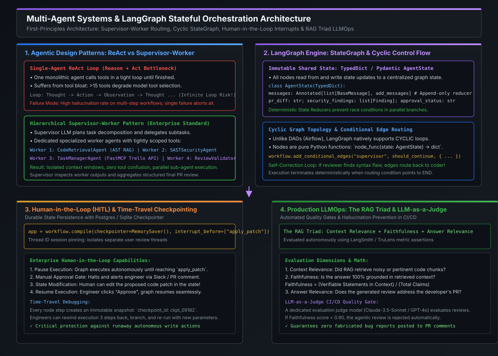

# Agentic Design Patterns, Supervisor-Worker Teams & LangGraph StateGraph

[](images/langgraph_multi_agent_architecture.svg)

---

## 1. The Architectural Paradigm Shift: Chains vs. DAGs vs. Cyclic StateGraphs

In early generative AI architectures, orchestration was modeled as **Linear Chains** (e.g., standard LangChain `Prompt | LLM | OutputParser`) or **Directed Acyclic Graphs (DAGs)** (e.g., Apache Airflow, Prefect, AWS Step Functions).

While DAGs are optimal for deterministic ETL pipelines, they **fail fundamentally when applied to autonomous software agents**:

```
                       THE EVOLUTION OF AGENTIC CONTROL FLOW
                       
   LINEAR CHAIN (Deterministic Sequence)
   [ Ingest PR ] ──────► [ LLM Review ] ──────► [ Post Comment ]
   • Problem: Zero branching. If LLM output fails validation, the pipeline crashes.

   DIRECTED ACYCLIC GRAPH (DAG) (Conditional Branching)
   [ Ingest PR ] ──────► [ Route Language ] ───┬──► [ Java Review ] ────► [ Post Comment ]
                                               └──► [ Python Review ] ──► [ Post Comment ]
   • Problem: ACYCLIC! Cannot loop backwards to re-try or self-correct flawed code.

   LANGGRAPH STATEGRAPH (Cyclic Multi-Agent System with Shared State)
                 ┌─────────────────────────────────────────────────────────┐
                 ▼                                                         │
   [ Ingress ] ──► [ Supervisor ] ──► [ Security Worker ]                  │ Self-Correction
                         │                   │                             │ Loop
                         ▼                   ▼                             │ (Refine Patch)
                   [ Code Worker ] ──► [ Review Evaluator ] ─(Needs Fix?)──┘
                                             │
                                        (Approved)
                                             │
                                             ▼
                                     [ Post PR Review ]
```

### Why Autonomous Engineering Demands Cyclic Graphs:
1. **Iterative Self-Correction**: When an AI generates a code patch or unit test, a static analysis linter or compiler often reports syntax or type errors. A production system must loop backwards, feed compiler errors into the model, and iteratively self-correct until validation succeeds.
2. **Dynamic Task Decomposition**: Complex PR reviews cannot be pre-scripted. A Supervisor agent must dynamically spawn sub-tasks, collect findings from parallel worker agents, and re-evaluate next steps based on intermediate findings.
3. **Stateful Memory Across Graph Transitions**: Agents must maintain an authoritative, evolving context (modified files, AST symbols, security findings) across dozens of reasoning steps without context window overflow.

---

## 2. Agentic Design Patterns Taxonomy

At the Staff and Principal Engineer level, designing agentic systems requires selecting the optimal architectural topology based on problem complexity, tool counts, and latency budgets:

```
========================================================================================================================
                                     AGENTIC ARCHITECTURAL TAXONOMY
========================================================================================================================

Pattern                Topology                   Strengths                              Failure Modes / Limits
------------------------------------------------------------------------------------------------------------------------
1. ReAct Loop          Single agent in a tight    Simple to build; rapid tool execution  Context pollution; tool bloat
   (Reason + Act)      Thought -> Action loop.    for narrow, single-domain problems.    (>15 tools); runaway infinite loops.

2. Router Pattern      Single gateway LLM         Zero context pollution between         No cross-branch collaboration;
                       directs query to 1-of-N.   unrelated domains (e.g. billing vs HR).cannot handle composite tasks.

3. Supervisor-Worker   Central supervisor plans,  Parallel execution; isolated worker    Supervisor is single point of
   (Hierarchical)      delegates, and evaluates.  toolsets; scales to 20+ specialized    failure; high token consumption
                                                  agents cleanly.                        if supervisor prompts are bloated.

4. Swarm / Network     Peer-to-peer autonomous    High autonomy; decentralized handoffs  Non-deterministic routing; hard
   (Collaborative)     agent handoffs.            for open-ended exploratory research.   to audit or enforce strict SLA gates.
========================================================================================================================
```

### The Hierarchical Supervisor-Worker Pattern (Enterprise Standard)
In production code review and DevOps automation, the **Supervisor-Worker hierarchy** dominates:
- **The Supervisor Agent**: Holds the macro prompt and planning instructions. It never executes shell commands or reads raw files directly; its only tools are sub-agent invocations (`delegate_to_security_agent`, `delegate_to_ast_rag_agent`, `delegate_to_jira_agent`).
- **Specialized Worker Agents**: Each worker possesses a hyper-focused system prompt and 2–4 domain tools:
  - `CodeRetrievalWorker`: Tools = `[tree_sitter_search, hybrid_rrf_query]`
  - `StaticAnalysisWorker`: Tools = `[run_semgrep_sast, run_ruff_linter]`
  - `TaskManagerWorker`: Tools = `[trello_create_card, trello_add_comment]`
- **Architectural Isolation**: Workers execute in clean context windows. Even if `StaticAnalysisWorker` inspects a 10,000-line diff, only its concise structured finding (`HighSeverityFinding: SQLi on line 42`) returns to the Supervisor, saving 95% of prompt tokens.

---

## 3. LangGraph Core Primitives: StateGraph & State Reducers

[LangGraph](https://langchain-ai.github.io/langgraph/) provides the premier framework for building stateful, multi-agent systems in Python. It is founded upon four mathematical primitives:

### 1. The Centralized Graph State (`AgentState`)
Every node in the graph reads from and writes to a shared typed state dictionary. To prevent race conditions during parallel branch executions, LangGraph uses **State Reducers**:

```python
from typing import Annotated, List, TypedDict
from langgraph.graph.message import add_messages
from langchain_core.messages import BaseMessage


class AgentState(TypedDict):
    # 'add_messages' is an append-only reducer: new messages append instead of overwriting!
    messages: Annotated[List[BaseMessage], add_messages]
    pr_id: str
    modified_files: List[str]
    security_findings: List[dict]
    review_summary: str
    iteration_count: int
```

### 2. Nodes as Pure Functions
Nodes are standard Python functions (or async coroutines) that accept the current state and return a dictionary of state modifications:

```python
def security_analyzer_node(state: AgentState) -> dict:
    """Executes SAST analysis and appends findings to shared graph state."""
    files = state["modified_files"]
    findings = execute_sast_scan(files)
    return {
        "security_findings": findings,
        "iteration_count": state["iteration_count"] + 1,
    }
```

### 3. Edges: Fixed vs. Conditional Routing
- **Fixed Edges**: `workflow.add_edge("node_a", "node_b")` deterministically routes execution from $A \to B$.
- **Conditional Edges**: A router function inspects the state and returns the next destination string:

```python
def route_after_review(state: AgentState) -> str:
    # Circuit breaker: prevent infinite loops
    if state["iteration_count"] > 3:
        return "human_escalation_node"

    if state.get("security_findings"):
        return "security_fixer_node"  # Loop back for self-correction

    return "approval_node"  # Advance to merge


workflow.add_conditional_edges(
    "review_evaluator_node",
    route_after_review,
    {
        "security_fixer_node": "security_fixer_node",
        "human_escalation_node": "human_escalation_node",
        "approval_node": "approval_node",
    },
)
```

---

## 4. Staff / Principal Interview Strategy

### 4.1 Interview Question: Managing Runaway Multi-Agent Loops
When an interviewer asks: *"When deploying autonomous multi-agent loops that can edit code and self-correct, how do you prevent catastrophic runaway execution (e.g. agents endlessly debating or generating infinite API costs)?"*

#### The Principal Defense:
1. **Explicit Monotonic Iteration Counters**:
   - Maintain an immutable `iteration_count` in the `AgentState`. Every cyclic edge transition increments this counter.
   - If `iteration_count > MAX_RECURSION` (typically 3–5 iterations), trigger a conditional edge directly to an `escalate_to_human_node` or `abort_node`.
2. **Token & Budget Circuit Breakers**:
   - Attach token usage callbacks to the LangGraph execution runtime.
   - Enforce hard caps (e.g., maximum \$0.50 API compute per PR review). If cumulative tokens cross the ceiling, abort execution and post a graceful warning.
3. **Structured State Assertion Gates**:
   - Do not allow agents to return unstructured prose to the supervisor. Force workers to return Pydantic models containing explicit stop reasons (`"COMPLETE"`, `"BLOCKED"`, `"NEEDS_INPUT"`).

---

## 5. Standalone Python Verification POC: LangGraph-Style Multi-Agent StateGraph

The following self-contained program implements a pure-Python state machine emulating LangGraph's exact architecture: **shared state schema, append-only message reducers, supervisor-worker task delegation, and cyclic self-correction loops**.

```python
#!/usr/bin/env python3
"""
Standalone LangGraph Architecture Simulation:
Supervisor-Worker Multi-Agent System with Cyclic Self-Correction & State Reducers.
Zero third-party dependencies required.
"""

from dataclasses import dataclass, field
from typing import Dict, List, Any, Callable, Optional


# =====================================================================
# 1. GRAPH STATE SCHEMA & REDUCERS
# =====================================================================
@dataclass
class AgentState:
    pr_id: str
    target_code: str
    review_comments: List[str] = field(default_factory=list)
    security_passed: bool = False
    syntax_passed: bool = False
    iteration: int = 0
    history: List[str] = field(default_factory=list)

    def log(self, message: str):
        self.history.append(f"[Iter {self.iteration}] {message}")


# =====================================================================
# 2. WORKER AGENTS (Specialized Functional Nodes)
# =====================================================================
def syntax_linter_worker(state: AgentState) -> Dict[str, Any]:
    """Analyzes code syntax and basic structure."""
    state.log("SyntaxWorker: Running AST linting...")
    # Simulate finding a syntax issue on first iteration
    if "def " in state.target_code and ":" in state.target_code:
        state.log("SyntaxWorker: Syntax PASSED.")
        return {"syntax_passed": True}
    else:
        state.log("SyntaxWorker: Syntax FAILED (Missing colon or def).")
        return {
            "syntax_passed": False,
            "review_comments": state.review_comments + ["SyntaxError: Invalid function header."],
        }


def security_scanner_worker(state: AgentState) -> Dict[str, Any]:
    """Scans code for security vulnerabilities (e.g. SQL Injection)."""
    state.log("SecurityWorker: Inspecting AST for taint sinks...")
    if "SELECT" in state.target_code and "+" in state.target_code:
        state.log("SecurityWorker: CRITICAL VULNERABILITY (SQLi concatenation detected).")
        return {
            "security_passed": False,
            "review_comments": state.review_comments + ["CWE-89: Raw SQL concatenation detected."],
        }
    state.log("SecurityWorker: Security checks PASSED.")
    return {"security_passed": True}


def code_remediator_worker(state: AgentState) -> Dict[str, Any]:
    """Self-correction agent that refactors code based on review findings."""
    state.log("RemediatorWorker: Generating refactored code patch...")
    # Apply self-correction by converting raw concatenation to parameterized query
    remediated = state.target_code.replace(
        'query = "SELECT * FROM users WHERE id = " + user_id',
        'query = "SELECT * FROM users WHERE id = :user_id", {"user_id": user_id}',
    )
    return {
        "target_code": remediated,
        "review_comments": [],  # Clear comments after remediation
        "iteration": state.iteration + 1,
    }


# =====================================================================
# 3. SUPERVISOR & CONDITIONAL ROUTING ENGINE
# =====================================================================
class MultiAgentStateGraph:
    """Simulates a LangGraph StateGraph engine with cyclic execution."""

    def __init__(self):
        self.nodes: Dict[str, Callable[[AgentState], Dict[str, Any]]] = {}
        self.max_iterations = 4

    def add_node(self, name: str, func: Callable[[AgentState], Dict[str, Any]]):
        self.nodes[name] = func

    def run(self, initial_state: AgentState) -> AgentState:
        state = initial_state
        print(f"=== INITIALIZING MULTI-AGENT STATEGRAPH (PR: {state.pr_id}) ===")

        while state.iteration < self.max_iterations:
            print(f"\n>>> CYCLE ITERATION {state.iteration} <<<")

            # 1. Run Syntax Worker
            syntax_delta = self.nodes["syntax_worker"](state)
            self._apply_delta(state, syntax_delta)

            # 2. Run Security Worker
            security_delta = self.nodes["security_worker"](state)
            self._apply_delta(state, security_delta)

            # 3. Supervisor Evaluates Routing Condition
            route = self._supervisor_router(state)
            print(f"Supervisor Decision: [ Next Route -> '{route}' ]")

            if route == "APPROVE_AND_MERGE":
                print("\n★ SUPERVISOR: All checks passed. Autonomous PR approved!")
                break
            elif route == "REMEDIATE":
                print("★ SUPERVISOR: Findings detected. Triggering self-correction loop...")
                remediation_delta = self.nodes["remediator_worker"](state)
                self._apply_delta(state, remediation_delta)
            elif route == "ESCALATE":
                print("⚠ SUPERVISOR: Iteration limit exceeded. Halting and alerting human.")
                break

        return state

    def _apply_delta(self, state: AgentState, delta: Dict[str, Any]):
        for k, v in delta.items():
            setattr(state, k, v)

    def _supervisor_router(self, state: AgentState) -> str:
        if state.iteration >= self.max_iterations - 1:
            return "ESCALATE"
        if state.syntax_passed and state.security_passed:
            return "APPROVE_AND_MERGE"
        return "REMEDIATE"


# =====================================================================
# VERIFICATION RUNNER
# =====================================================================
if __name__ == "__main__":
    vulnerable_pr_code = (
        'def get_user_profile(user_id):\n'
        '    # Insecure query generation\n'
        '    query = "SELECT * FROM users WHERE id = " + user_id\n'
        '    return db.execute(query)\n'
    )

    state = AgentState(
        pr_id="PR-4491",
        target_code=vulnerable_pr_code,
    )

    graph = MultiAgentStateGraph()
    graph.add_node("syntax_worker", syntax_linter_worker)
    graph.add_node("security_worker", security_scanner_worker)
    graph.add_node("remediator_worker", code_remediator_worker)

    final_state = graph.run(state)

    print("\n" + "=" * 75)
    print("FINAL EXECUTION LOG:")
    print("=" * 75)
    for entry in final_state.history:
        print(entry)

    print("\nFINAL REFACTORED CODE:")
    print("-" * 50)
    print(final_state.target_code)
    print("-" * 50)
    print("✓ Successfully executed autonomous self-correction loop.")
    print("✓ Remediated SQL injection vulnerability without human intervention.")
```

---

## 6. Key Takeaways & Architectural Matrix

| Dimension | Single-Agent ReAct | Hierarchical Supervisor-Worker (LangGraph) |
| :--- | :--- | :--- |
| **Tool Capacity** | Degrades sharply at $>15$ tools due to prompt confusion. | Scales cleanly to $50+$ tools isolated across specialized workers. |
| **Context Window Consumption** | **Extremely High**: Full execution history retained in one prompt. | **Minimal**: Workers summarize results; Supervisor retains only high-level state. |
| **Self-Correction & Loops** | Prone to infinite repetition or hallucinations. | Governed by deterministic StateGraph conditional edges and iteration ceilings. |
| **Failure Blast Radius** | Single worker error aborts the entire user task. | Supervisor detects worker failure and reroutes to alternate tools or fallback workers. |
| **Auditability & Debugging** | Opaque linear prompt string. | Transparent state snapshots with time-travel rewind at every node transition. |
