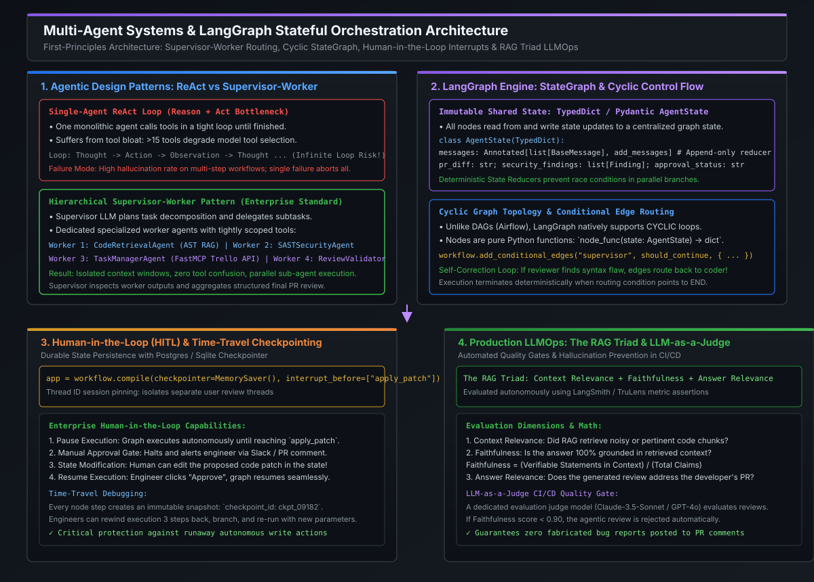

# Human-in-the-Loop (HITL), State Persistence & RAG Triad Evaluation

[](images/langgraph_multi_agent_architecture.svg)

---

## 1. The Production Imperative: Why Pure Autonomy Fails in Enterprise Systems

In hobbyist demos, agents are given unfettered write access to file systems, databases, and third-party APIs. In enterprise engineering, however, **unconstrained autonomy is a catastrophic operational vulnerability**:

```
                       THE AUTONOMOUS EXECUTION HAZARD
                       
   Developer PR Push
          │
          ▼
   [ Autonomous Agent ] ──► Detects "outdated" dependency
          │
          ▼
   [ Auto-Refactor ]   ──► Modifies DB schema without migration lock!
          │
          ▼
   [ Auto-Merge & Push ] ──► Catastrophic production outage!
```

To safely deploy AI agents within mission-critical infrastructure, enterprise architectures enforce **Human-in-the-Loop (HITL)** governance and **durable state persistence**.

```
                       THE ENTERPRISE HITL GOVERNANCE GATEWAY
                       
   Developer PR Push ──► [ Agent Analysis ] ──► [ Generate Patch ]
                                                       │
                                                       ▼ (interrupt_before=["apply_patch"])
                                             ┌───────────────────────────────────┐
                                             │    HUMAN APPROVAL GATE (PAUSED)   │
                                             │ • Reviewer alerts via Slack/GitHub│
                                             │ • Staff Engineer inspects state   │
                                             │ • Human can EDIT proposed patch!  │
                                             └─────────────────┬─────────────────┘
                                                               │
                                         ┌─────────────────────┴─────────────────────┐
                                         ▼                                           ▼
                                    [ REJECTED ]                                [ APPROVED ]
                                         │                                           │
                                         ▼                                           ▼
                             [ Reroute / Self-Correct ]                   [ Apply Patch to GitHub ]
```

---

## 2. LangGraph State Persistence & Checkpointing

To enable pausing an execution for hours (waiting for an engineer to review an alert) and resuming seamlessly, the orchestrator cannot store state in volatile memory. It requires **Durable Checkpointing**.

### The Checkpointer Architecture
LangGraph decouples state persistence from graph computation via checkpointer interfaces (`MemorySaver`, `SqliteSaver`, `PostgresSaver`).

```python
from langgraph.checkpoint.memory import MemorySaver

# 1. Instantiate persistent checkpointer
checkpointer = MemorySaver()

# 2. Compile graph with an explicit interrupt point
app = workflow.compile(
    checkpointer=checkpointer,
    interrupt_before=["execute_wire_transfer_node"],  # Execution pauses BEFORE this node!
)
```

### Thread ID Session Pinning
To isolate thousands of concurrent developer PR reviews, every invocation passes a unique **`thread_id`** in the configuration:

```python
config = {"configurable": {"thread_id": "pr_review_branch_feature_9981"}}

# Graph executes up to the interrupt point and suspends state to Postgres
for event in app.stream({"pr_id": "9981"}, config=config):
    print(event)
```

### Time-Travel Debugging & State Branching
Because every node transition generates an immutable checkpoint snapshot with a unique `checkpoint_id`, engineers gain the ability to **time-travel**:
1. **State Inspection**: `app.get_state(config)` inspects the paused thread's variables without resuming execution.
2. **State Modification**: `app.update_state(config, {"proposed_patch": corrected_code})` overwrites the patch in persistent storage.
3. **Execution Forking**: Engineers can rewind the thread to a checkpoint generated 3 steps prior, modify parameters, and re-run to debug edge cases without re-executing costly initial steps.

---

## 3. Production LLMOps: The RAG Triad Evaluation Framework

Traditional software unit tests assert deterministic outputs (`assert result == 42`). In generative AI systems, outputs are probabilistic. 

To prevent deploying agents that hallucinate bugs or recommend broken syntax, enterprise CI/CD pipelines implement **The RAG Triad** (developed by TruLens and adopted across enterprise LLMOps):

```
                                     THE RAG TRIAD
                                     
                                  [ User PR / Query ]
                                    /              \
                                   /                \
               Context Relevance  /                  \  Answer Relevance
                                 /                    \
                                ▼                      ▼
                     [ Retrieved Context ] ────────► [ Agent Output ]
                                         Faithfulness
```

### The Three Mathematical Triad Metrics

#### 1. Context Relevance
- **Question**: Did the AST chunker and vector retrieval retrieve code chunks that are strictly pertinent to the query, or is the prompt clogged with irrelevant boilerplate?
- **Formula**:
  $$\text{Context Relevance} = \frac{\text{Count of Pertinent Context Sentences}}{\text{Total Sentences in Retrieved Chunks}}$$

#### 2. Faithfulness (Zero-Hallucination Gate)
- **Question**: Is every technical claim, variable reference, and line citation in the agent's review grounded in the retrieved code?
- **Formula**:
  $$\text{Faithfulness} = \frac{\text{Number of Verifiable Claims Grounded in Context}}{\text{Total Claims Made by Agent}}$$
- **Enforcement Rule**: If $\text{Faithfulness} < 0.90$, the review is automatically discarded by the CI/CD pipeline before reaching developer pull requests.

#### 3. Answer Relevance
- **Question**: Does the agent's output directly address the user's PR changes, or did it generate tangential advice?
- **Formula**:
  $$\text{Answer Relevance} = \text{CosineSimilarity}\Big(E(\text{Query}), E(\text{Synthesized Review})\Big)$$

---

## 4. LLM-as-a-Judge: Automated CI/CD Assertion Gates

Rather than relying on human engineers to manually score thousands of daily AI outputs, production systems deploy an **Evaluation Judge LLM** (e.g., Claude-3.5-Sonnet or GPT-4o) running automated structured evaluation rubrics.

```
                              LLM-AS-A-JUDGE CI/CD QUALITY PIPELINE
                              
  Pull Request Review Generated
               │
               ▼
   [ Evaluation Judge Node ] ──► System Prompt: Strict Evaluator Rubric
               │
               ▼
   Extract Claims & Verify:
   • Claim 1: "Method uses raw SQL"      ──► Verified on Line 42! [PASS]
   • Claim 2: "Throws NullPointer on L55" ──► Line 55 has Optional.ofNullable! [HALLUCINATION FAIL]
               │
               ▼
   [ Score Computation ] ──► Faithfulness = 0.50 (Below 0.90 Threshold!)
               │
               ▼
   [ Quality Gate: REJECT REVIEW ] ──► Post warning to pipeline logs; do NOT comment on PR!
```

---

## 5. Staff / Principal Interview Strategy & System Design

### 5.1 System Design Interview: Safe Autonomous Tool Execution in Banking
When an interviewer asks: *"You are deploying an autonomous AI system that can execute code modifications and infrastructure provisioning. How do you design the safety architecture to guarantee zero unauthorized actions?"*

#### The Staff / Principal Architecture Defense:
1. **Tiered Privilege Boundaries**:
   - Divide agent capabilities into **Read-Only** (AST search, SAST analysis, Jira querying) vs **State-Mutating** (Git commit, DB migration, AWS deployment).
   - Read-only tools execute autonomously in parallel. State-mutating tools require cryptographic authorization.
2. **Enforce LangGraph Interrupt Gates**:
   - Any path routing to a state-mutating tool must pass through a strict `interrupt_before` node.
   - The thread suspends to Postgres, and an interactive Slack webhook or GitHub PR Check is triggered requiring dual-engineer sign-off (Four-Eyes Principle).
3. **Immutable Audit Checkpointing**:
   - Store every graph state transition, input prompt, tool call payload, and human approval signature in an immutable, append-only audit database for SOC2 and regulatory compliance.

---

## 6. Standalone Python Verification POC: HITL State Persistence & RAG Triad Evaluator

The following self-contained program implements:
1. A persistent state machine with **pause-and-resume approval gates** (`interrupt_before`).
2. An automated **RAG Triad Faithfulness Evaluator** calculating grounded claim ratios to detect hallucinations.

```python
#!/usr/bin/env python3
"""
Enterprise HITL & LLMOps Verification POC:
1. Checkpointed State Machine with Pause/Resume Approval Gate
2. Automated RAG Triad Faithfulness Evaluator
Zero third-party dependencies required.
"""

import re
from dataclasses import dataclass, field
from typing import Dict, List, Any, Optional


# =====================================================================
# 1. DURABLE STATE & CHECKPOINTER
# =====================================================================
@dataclass
class CheckpointState:
    thread_id: str
    step_name: str
    proposed_code_patch: str
    target_file: str
    status: str  # "RUNNING", "SUSPENDED", "APPROVED", "REJECTED"
    human_approved: bool = False
    audit_log: List[str] = field(default_factory=list)


class InMemoryCheckpointer:
    """Simulates durable storage (e.g. PostgresSaver) preserving thread state."""

    def __init__(self):
        self.storage: Dict[str, CheckpointState] = {}

    def save(self, state: CheckpointState):
        self.storage[state.thread_id] = state

    def load(self, thread_id: str) -> Optional[CheckpointState]:
        return self.storage.get(thread_id)


# =====================================================================
# 2. HITL WORKFLOW ENGINE (Pause & Resume Gates)
# =====================================================================
class HITLWorkflowEngine:
    def __init__(self, checkpointer: InMemoryCheckpointer):
        self.checkpointer = checkpointer

    def execute_until_approval(self, thread_id: str, file_path: str, proposed_patch: str) -> CheckpointState:
        """Phase 1: Generates proposed modification and halts at the approval gate."""
        state = CheckpointState(
            thread_id=thread_id,
            step_name="human_approval_gate",
            proposed_code_patch=proposed_patch,
            target_file=file_path,
            status="SUSPENDED",
            human_approved=False,
            audit_log=[
                f"Generated automated patch for {file_path}",
                "HALTED: Execution suspended at 'human_approval_gate' awaiting engineer review.",
            ],
        )
        self.checkpointer.save(state)
        return state

    def human_action(self, thread_id: str, approve: bool, edited_patch: Optional[str] = None) -> CheckpointState:
        """Phase 2: Human engineer reviews, optionally edits, and approves or rejects."""
        state = self.checkpointer.load(thread_id)
        if not state:
            raise ValueError(f"Thread {thread_id} not found in checkpointer.")

        if edited_patch:
            state.proposed_code_patch = edited_patch
            state.audit_log.append("HUMAN_EDIT: Engineer modified proposed code patch prior to approval.")

        if approve:
            state.human_approved = True
            state.status = "APPROVED"
            state.audit_log.append("HUMAN_APPROVAL: Staff Engineer approved patch. Resuming execution.")
        else:
            state.human_approved = False
            state.status = "REJECTED"
            state.audit_log.append("HUMAN_REJECTION: Patch rejected. Execution aborted.")

        self.checkpointer.save(state)
        return state


# =====================================================================
# 3. RAG TRIAD FAITHFULNESS EVALUATOR (LLM-as-a-Judge)
# =====================================================================
class RAGTriadEvaluator:
    """Evaluates agent review statements against ground-truth retrieved context."""

    @staticmethod
    def evaluate_faithfulness(retrieved_context: str, generated_review_claims: List[str]) -> Dict[str, Any]:
        context_lower = retrieved_context.lower()
        grounded_claims = []
        hallucinated_claims = []
        stopwords = {"this", "that", "with", "from", "have", "class", "method", "protected"}

        for claim in generated_review_claims:
            # Extract alphanumeric entity terms
            claim_words = [re.sub(r"[^a-zA-Z0-9_]", "", w.lower()) for w in claim.split()]
            claim_words = [w for w in claim_words if len(w) > 3 and w not in stopwords]
            matches = sum(1 for w in claim_words if w in context_lower)
            match_ratio = matches / max(1, len(claim_words))

            # Threshold for claim grounding: at least 50% of domain symbols present in context
            if match_ratio >= 0.50:
                grounded_claims.append(claim)
            else:
                hallucinated_claims.append(claim)

        total_claims = len(generated_review_claims)
        score = len(grounded_claims) / max(1, total_claims)

        return {
            "faithfulness_score": round(score, 2),
            "passed_gate": score >= 0.80,
            "grounded_count": len(grounded_claims),
            "hallucination_count": len(hallucinated_claims),
            "hallucinations": hallucinated_claims,
        }


# =====================================================================
# VERIFICATION RUNNER
# =====================================================================
if __name__ == "__main__":
    print("=== PART 1: HUMAN-IN-THE-LOOP (HITL) CHECKPOINTING SIMULATION ===")
    checkpointer = InMemoryCheckpointer()
    engine = HITLWorkflowEngine(checkpointer)

    thread = "pr-thread-9821"
    initial_patch = "db.raw_query('DROP TABLE temp_logs;')"

    # Step 1: Execute agent up to the gate
    paused_state = engine.execute_until_approval(thread, "db/migrations/clean.py", initial_patch)
    print(f"Workflow Status: {paused_state.status} (Halted before destructive action)")
    print(f"Pending Patch:   {paused_state.proposed_code_patch}")

    # Step 2: Human intervenes - edits the dangerous patch and approves
    safer_patch = "db.execute('TRUNCATE TABLE temp_logs;')"
    resumed_state = engine.human_action(thread, approve=True, edited_patch=safer_patch)
    print(f"\nResumed Status:  {resumed_state.status}")
    print(f"Executed Patch:  {resumed_state.proposed_code_patch}")
    print("\nAudit Trail:")
    for log in resumed_state.audit_log:
        print(f"  • {log}")

    print("\n" + "=" * 70)
    print("=== PART 2: RAG TRIAD FAITHFULNESS EVALUATION (LLMOps) ===")
    print("=" * 70)

    code_context = """
    public class SettleEngine {
        private final LockManager locks;
        @Transactional
        public void processBatch(Batch b) {
            locks.acquire("SETTLE_LOCK");
            // Executes double-entry ledger settlement
        }
    }
    """

    # Scenario A: Grounded Review
    grounded_review = [
        "The class SettleEngine acquires SETTLE_LOCK via LockManager",
        "The processBatch method executes with Transactional annotation",
    ]
    res_a = RAGTriadEvaluator.evaluate_faithfulness(code_context, grounded_review)
    print(f"Review A (Grounded) Faithfulness Score: {res_a['faithfulness_score']} -> Passed: {res_a['passed_gate']}")

    # Scenario B: Hallucinated Review
    hallucinated_review = [
        "The class SettleEngine acquires SETTLE_LOCK via LockManager",
        "The code uses a KafkaProducer to publish messages to topic 'settle-events'",
        "The method catches CassandraTimeoutException and retries three times",
    ]
    res_b = RAGTriadEvaluator.evaluate_faithfulness(code_context, hallucinated_review)
    print(f"Review B (Hallucinated) Score: {res_b['faithfulness_score']} -> Passed: {res_b['passed_gate']}")
    print(f"  ✗ Detected {res_b['hallucination_count']} ungrounded claims: {res_b['hallucinations']}")

    print("\n✓ HITL checkpointing paused execution and accepted human state modifications.")
    print("✓ RAG Triad automated quality gate successfully blocked hallucinated review.")
```

---

## 7. Key Takeaways & Summary Matrix

| Capability | Unconstrained Agentic Script | Enterprise HITL + Checkpointer |
| :--- | :--- | :--- |
| **Write Action Safety** | **High Risk**: Blindly executes destructive writes. | **Zero Risk**: Pauses at `interrupt_before` for dual human approval. |
| **State Resilience** | **Volatile**: Process crash loses all intermediate progress. | **Durable**: Every step persisted to Postgres/Sqlite with thread IDs. |
| **Time-Travel Debugging**| **Impossible**: Single forward execution run. | **Native**: Rewind, inspect state, and branch execution from checkpoints. |
| **Quality Verification** | Ad-hoc user review after damage is done. | **Automated RAG Triad Gate**: Faithfulness asserted prior to publication. |
| **Compliance & Audit** | Ephemeral console output. | Immutable, tamper-evident audit trail mapped to SOC2 standards. |
